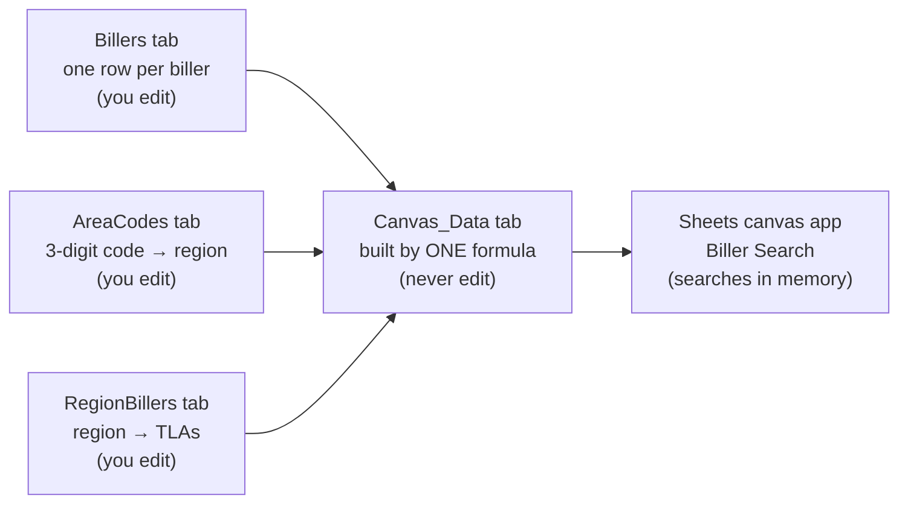

# Biller Search for Google Sheets: Gemini build guide

A fast biller lookup built entirely inside Google Sheets. You maintain three data tabs, one formula merges them into a single tab, and a Gemini **Sheets canvas** app searches that tab in memory as you type.

This guide is written to be followed literally. Every prompt is meant to be copied whole, every step ends with a check, and every formula and piece of code in it has been tested.

---

## Contents

1. [What you are building](#1-what-you-are-building)
2. [Before you start](#2-before-you-start)
3. [Rules for working with Gemini](#3-rules-for-working-with-gemini)
4. [Part A: Build the spreadsheet](#part-a-build-the-spreadsheet) (steps A1–A8)
5. [Part B: Build the canvas app](#part-b-build-the-canvas-app) (steps B1–B8)
6. [Part C: Keep it up to date](#part-c-keep-it-up-to-date)
7. [Troubleshooting](#troubleshooting)
8. [Column reference](#column-reference)
9. [What was tested and what was not](#what-was-tested-and-what-was-not)
10. [Repository layout](#repository-layout)

---

## 1. What you are building



### What the search box does

| You type | Mode | What you get |
| --- | --- | --- |
| `KUB`, `hanover ins`, `hydro` | Text | Billers ranked by where the words match: **TLA › Name › Alias › Payment type** |
| `416` (exactly 3 digits) | Area code | A card with region, country and time zone, a clickable chip for each TLA in that region, and every biller whose own Area Codes list includes 416 |
| `1187` (exactly 4 digits) | Last 4 | Every biller with a contact number ending in 1187 (SearchOnly numbers rank last) |
| `865-558-2999`, `(800) 456-6004` (5+ digits) | Phone | Billers with that number. Spaces, dashes, brackets and a leading 1 are ignored |

Results are always split into two lists: **Top billers** (the ~200 that take about 99% of calls, marked `Top` in the Priority column) first, then **Other billers**. Clicking a result, or a TLA chip, opens the full biller record. Ties are broken by live billers first, then name A–Z.

### How fast

The search code in step B3 was benchmarked on 5,200 synthetic billers (200 Top) plus 800 area codes:

| Search | Time per search |
| --- | --- |
| Area code (`416`) | about 0.5 ms |
| Last 4 / phone | 1–1.7 ms |
| Text, worst case (`p`, `water`) | 1.3–4 ms |

Anything under about 50 ms feels instant, so results update on every keystroke with no delay. Real biller names share far fewer words than the synthetic test, so real searches will mostly sit at the low end.

### Why it is built this way

- **A canvas reads exactly one tab, and that tab must stay under 1 million cells** ([Google Help: Create a Sheets canvas](https://support.google.com/docs/answer/17035851)). Billers, area codes and region lists are three tables, so a formula merges them into one tab, `Canvas_Data`. You never edit that tab; it rebuilds itself whenever the source tabs change. Your data will be about 6,000 rows × 58 columns, roughly 350,000 cells.
- **The canvas is read-write by default** (edits in the app change the sheet). This app is instructed to be read-only, and it reads a formula-built tab, so it cannot damage your data.
- **Gemini is given the exact search code** instead of a description. That keeps the ranking precise and identical to the tested version.
- **Biller fields will keep changing.** Columns T to AZ of the Billers tab are reserved for new fields. Add a header and values there and the field appears automatically in the app's details panel under "More details", with no prompt changes.

---

## 2. Before you start

**Requirements**

- [ ] Desktop Chrome (canvas does not work in the Sheets mobile app).
- [ ] A Google Workspace plan with Gemini in Sheets (Business or Enterprise Standard/Plus, or a Google AI plan). Your account language must be English.
- [ ] In any spreadsheet, **Insert › Create a canvas** exists. If it doesn't, canvas has not reached your account yet. It rolled out from August 2026 ([Workspace Updates](https://workspaceupdates.googleblog.com/2026/08/use-google-sheets-canvas-to-visualize-data.html)).
- [ ] Download, copy and print are not disabled for the spreadsheet. Canvas refuses to run if they are.

**Have ready**

- [ ] Your biller data (the JavaScript objects with `id`, `tla`, `name`, `contacts`, …).
- [ ] Your area code map (`window.AREA_CODES = { '936': { name: 'Texas', country: 'US', timezone: 'America/Chicago' }, … }`).
- [ ] Your region map (`window.LOCATION_BILLERS = { 'Texas, US': ['CEB', 'DUQL', …], … }`).
- [ ] The list of Top TLAs (the ~200 high-call billers).
- [ ] This repository's `tools/data-converter.html` and `sample-data/` folder, downloaded to your computer.

**Time:** about 45 minutes for the first build.

---

## 3. Rules for working with Gemini

1. **One step at a time.** Copy the whole prompt block, paste it into Gemini, send it, then run that step's **Check**. Do not start the next step until the check passes.
2. **Formulas and code are pasted by you, not retyped by Gemini.** Wherever a formula appears, pasting it into the cell yourself is the reliable route. Gemini often "tidies" long formulas and breaks them.
3. **Build with the sample data first.** Steps A3–A5 import the files in `sample-data/` (7 billers). Get the whole app passing the acceptance test (step B8) on that data, then load your real data in Part C. Problems are much easier to see with 7 billers than with 5,200.
4. **When a canvas prompt breaks something that worked**, use the fix prompt in step B8. If the canvas gets messy after several fixes, delete it (top toolbar › Delete canvas) and run B1–B7 again; it takes about 10 minutes.
5. **Never type into the `Canvas_Data` tab.** It is rebuilt by its formula.

---

## Part A: Build the spreadsheet

Use the **Gemini side panel** inside Google Sheets (the Gemini icon at the top right). Some steps are faster by hand; those have an **Or by hand** line.

### A1. Create the spreadsheet and its four tabs

Create a new spreadsheet (type `sheets.new` in the address bar) and name it **Biller Search**.

**Prompt (Gemini in Sheets)**

```text
Rename the tab "Sheet1" to "Billers". Then add three new empty tabs to the right of it, in this order, with these exact names: "AreaCodes", "RegionBillers", "Canvas_Data". Do not add any data.
```

**Or by hand:** double-click the tab name to rename it; use the **+** button at the bottom left to add tabs.

**Check:** the bottom bar shows exactly four tabs, `Billers | AreaCodes | RegionBillers | Canvas_Data`. Names are case-sensitive.

### A2. Prepare the three data files

For the first build, skip this step and use the files already in `sample-data/` (`Billers.csv`, `AreaCodes.csv`, `RegionBillers.csv`).

For your real data (Part C), open `tools/data-converter.html` in Chrome by double-clicking it. It runs entirely on your computer and uploads nothing.

1. Paste your biller objects into box 1. Copy them straight from the source file so line breaks are kept.
2. Paste your Top TLAs into box 2, separated by commas, spaces or new lines.
3. Paste the `AREA_CODES` map into box 3.
4. Paste the `LOCATION_BILLERS` map into box 4.
5. Press **Convert**, read the report and fix anything marked in red or orange.
6. Press each of the three **Download** buttons.

**Check:** the report shows the number of billers, how many are Top, how many area codes and how many region rows you expect. Lines in orange explain anything skipped. For example, region TLAs that are not in your biller data still appear as grey chips in the app.

The converter writes each biller in the format of the Billers tab. Lists inside a cell are separated by `;`, each contact becomes `Type | Label | Number | Group`, and any field it doesn't recognise becomes its own new column.

### A3. Import Billers

These are menu clicks; Gemini cannot import files.

1. Click the **Billers** tab.
2. **File › Import › Upload** and choose `Billers.csv`.
3. Set **Import location** to **Replace current sheet** and **Separator type** to **Comma**.
4. **Untick "Convert text to numbers, dates, and formulas"**. This keeps phone numbers, area codes and TRUE/FALSE exactly as written.
5. Press **Import data**.

**Check:** `A1` = `TLA`, `B1` = `Name`, `C1` = `Priority`, `S1` = `ID`. With the sample data there are 7 billers in rows 2–8, and `C2` = `Top`.

### A4. Import AreaCodes

Repeat A3 on the **AreaCodes** tab with `AreaCodes.csv` (Replace current sheet, Comma, conversion **unticked**).

**Check:** `A1:D1` = `Code | Region | Country | Timezone`. With the sample data, `A2` = `936`, `B2` = `Texas`, `C2` = `US`, and there are 29 codes.

### A5. Import RegionBillers

Repeat A3 on the **RegionBillers** tab with `RegionBillers.csv`.

**Check:** `A1:B1` = `Region Key | TLAs`. The first row reads `Alabama, US`, and `Texas, US` has `CEB, DUQL, TGXH, GALV, DCN3, AETX`. With the sample data there are 63 regions.

The Region Key must be exactly `Region, Country` as written in the AreaCodes tab (for example `Ontario, CA`, `Toll - Free, US`). That exact text is how an area code finds its region's billers.

### A6. Format the Billers tab

**Prompt (Gemini in Sheets)**

```text
Work only in the "Billers" tab and do not change any existing cell values.
1. Make sure the tab has columns all the way to column AZ (52 columns). If it ends earlier, add empty columns at the right until the last column is AZ.
2. Make row 1 bold and freeze row 1.
3. Add a dropdown to C2:C5001 with exactly two options: Top, Other.
4. Add a dropdown to D2:D5001 with exactly two options: TRUE, FALSE.
5. Add a dropdown to M2:M5001 with exactly two options: TRUE, FALSE.
6. Set the number format of columns A to AZ to "Plain text".
```

**Or by hand:** to add columns, right-click the last column header › **Insert 1 column right**, or select 10 headers first to insert 10 at once. Dropdowns are under **Insert › Dropdown**. Plain text is under **Format › Number › Plain text**.

**Check:** type `AZ1` in the Name box (left of the formula bar) and press Enter; the cursor jumps to column AZ. `C2` shows a dropdown with Top/Other, and the 7 sample values are unchanged.

### A7. Format AreaCodes and RegionBillers

**Prompt (Gemini in Sheets)**

```text
Do not change any existing cell values.
1. In the "AreaCodes" tab: make row 1 bold, freeze row 1, and set the number format of column A to "Plain text".
2. In the "RegionBillers" tab: make row 1 bold and freeze row 1.
```

**Check:** both tabs have a bold, frozen header row, and the area codes still read `936`, `937`, ….

### A8. Build the Canvas_Data tab (the one formula)

**A8a. Make room.** The formula's output is about (billers + area codes + 1) rows by 58 columns. Sheets will not grow the tab by itself.

**Prompt (Gemini in Sheets)**

```text
In the "Canvas_Data" tab only: add empty columns until the tab has at least 60 columns (the last column is BH or later), and add empty rows until the tab has at least 8000 rows. Do not type anything into any cell.
```

**Or by hand:** select columns A–Z, right-click › **Insert 26 columns right**, and do it twice more. For rows, scroll to the bottom and use **Add 1000 more rows at bottom** (type `7000` into the box to add 7,000 at once).

If you will have more than 7,800 billers plus area codes, add more rows than this.

**A8b. Paste the formula.** Click cell **A1** of **Canvas_Data**, paste the formula below into the formula bar, and press Enter. If you would rather Gemini do it, use the prompt underneath, but check the result.

```text
=LET( h, Billers!A1:AZ1, bok, ARRAYFORMULA(LEN(Billers!A2:A5001&Billers!B2:B5001)>0), bd, FILTER(Billers!A2:AZ5001, bok), nb, ROWS(bd), nc, COLUMNS(h), head, VSTACK(HSTACK("Record", h, "AreaCode", "Region", "Country", "AreaTimezone", "RegionTLAs"), HSTACK(MAKEARRAY(nb, 1, LAMBDA(r, c, "BILLER")), bd, MAKEARRAY(nb, 5, LAMBDA(r, c, "")))), ad, FILTER(AreaCodes!A2:D2001, ARRAYFORMULA(LEN(AreaCodes!A2:A2001)>0)), IF(ISERROR(ROWS(ad)), head, LET( na, ROWS(ad), tl, ARRAYFORMULA(IFERROR(VLOOKUP(CHOOSECOLS(ad, 2)&", "&CHOOSECOLS(ad, 3), RegionBillers!A2:B501, 2, FALSE), "")), VSTACK(head, HSTACK(MAKEARRAY(na, 1, LAMBDA(r, c, "AREA")), MAKEARRAY(na, nc, LAMBDA(r, c, "")), ARRAYFORMULA(TO_TEXT(CHOOSECOLS(ad, 1))), CHOOSECOLS(ad, 2, 3, 4), tl)))))
```

**Prompt (Gemini in Sheets, optional)**

```text
In the "Canvas_Data" tab, select cell A1 and enter the formula I paste below exactly as written, character for character. Do not change, shorten, reformat or explain it. It fills the rest of the tab by itself, so leave every other cell empty.
[paste the formula here]
```

**A8c. Protect it.** **Data › Protect sheets and ranges › Add a sheet or range › Sheet › Canvas_Data › Set permissions › Show a warning when editing this range › Done.**

**Check** (with the sample data):

- `A1` = `Record`, `B1` = `TLA`, `T1` = `ID`.
- Columns `U` to `BA` have blank headers. These are the reserved new-field columns.
- `BB1:BF1` = `AreaCode | Region | Country | AreaTimezone | RegionTLAs`.
- Rows 2–8 have `BILLER` in column A, and rows 9–37 have `AREA`.
- The row for area code `936` shows `Texas | US | America/Chicago | CEB, DUQL, TGXH, GALV, DCN3, AETX` in `BB:BF`.

---

## Part B: Build the canvas app

Every prompt below goes to the **canvas**, not the side panel chat. After the canvas exists, edit it with the Gemini button at its top right.

### B1. Create the canvas (layout and data loading)

1. Click the **Canvas_Data** tab so it is the active tab.
2. Open **Insert › Create a canvas** (or **Tools › Create canvas**). If it asks which data to use, choose the **Canvas_Data** tab.
3. Paste this prompt:

```text
Build a read-only "Biller Search" app for call-centre agents using the data in this tab (Canvas_Data). Follow every rule below exactly.

DATA RULES
- Row 1 holds the column headers. Every other row is one record. Load ALL rows; there can be more than 6,000. Never sample, page or limit the rows you load.
- The column "Record" says what each row is: BILLER (one biller) or AREA (one telephone area code). Ignore rows with any other value. Ignore columns whose header is blank.
- BILLER rows use these columns: TLA, Name, Priority, Live, Aliases, Payment Types, Contacts, Area Codes, Timezone, Office Hours, Prod DC, UAT DC, IPN Prefix, KB Link, AD Link, Biller File, Notes, Custom Fields, ID. Any other non-blank header between "ID" and "AreaCode" is an extra biller field that may be added later.
- AREA rows use these columns: AreaCode, Region, Country, AreaTimezone, RegionTLAs.
- Lists inside one cell: Aliases and Payment Types are separated by ";". Contacts are separated by ";" and each contact is "Type | Label | Number | Group". Custom Fields are separated by ";" and each is "Label | Value". Area Codes and RegionTLAs are separated by ",".
- Priority is "Top" or "Other". Live and IPN Prefix are TRUE or FALSE.
- Treat every value as text. Never change, add or delete any data. Do not show any edit, add, delete, drag or form controls anywhere in the app.

LAYOUT (desktop, full width)
1. Top bar, always visible: the title "Biller Search"; one large search box with the placeholder "TLA, name, alias or payment type · 3 digits = area code · 4 digits = last 4 of a number"; to its right a small grey status line.
2. Below the top bar, two columns: the left 40% shows results, the right 60% shows biller details. Each column scrolls on its own.
3. Results column: a section titled "Top billers" followed by a section titled "Other billers". Each result row shows the TLA in bold monospace, the biller name, a small badge "Live" (green) or "Not live" (grey), and one small grey line explaining why it matched.
4. Details column: when no biller is selected, show the text "Select a biller to see its details".
5. The search box has keyboard focus when the app opens.

Do not build any search logic yet. For now, under each section show the first 10 billers of that priority sorted by Name, so I can check that the data loaded. In the status line show: "<number of BILLER rows> billers · <number of Top billers> Top · <number of AREA rows> area codes".
```

**Check:** the status line reads `7 billers · 4 Top · 29 area codes` with the sample data. "Top billers" lists HYDO, KNOX, PSG, HOIG; "Other billers" lists PLMC, NYCH, PPL (sorted by Name). There are no edit buttons anywhere.

### B2. Rename the canvas

Click the canvas name in its toolbar, type `Biller Search`, and press Enter.

### B3. Add the search engine (exact code)

**Prompt (canvas)**

````text
Add the search engine. Keep the layout and data loading exactly as they are.

Use the JavaScript at the end of this message exactly as written. Do not rewrite, simplify, reorder or "improve" it, and do not rename its functions.

How to connect it:
1. Turn the Canvas_Data rows into an array of plain objects, one per row (not the header row). Each key is the header text exactly as written in row 1, and each value is the cell's displayed text. Call buildIndex(rows) ONCE when the app loads and store the result in one variable named searchIndex. Call buildIndex again only when the sheet data changes. Never rebuild the index while typing.
2. On every change of the search box (every keystroke, with no delay and no debounce), call search(searchIndex, <the search box text>) and show its result:
   - result.top goes in the "Top billers" section and result.other in the "Other billers" section, in the order given. Do not re-sort.
   - For each hit h: the TLA is h.b.tla, the name is h.b.name, the Live badge comes from h.b.live, and the grey reason line is h.why.
   - Section titles show counts: "Top billers (result.topTotal)" and "Other billers (result.otherTotal)". If a total is bigger than the number of rows shown, put a small grey "+ N more, keep typing to narrow down" under that section.
   - Status line: "<mode label> · <result.ms with 2 decimals> ms". Mode labels: TEXT → "Text search", AREA → "Area code", LAST4 → "Last 4 digits", PHONE → "Phone number".
   - If the box is not empty and both sections are empty, show: No billers match "<the text>".
   - If the box is empty (result.mode is EMPTY), show the start view from before (first 10 Top and first 10 Other by Name) and the data counts in the status line.
3. Never search the sheet directly and never call any AI or external service while searching. Only use searchIndex.

```javascript
// Biller Search - reference search core.
// This exact code is pasted into the Sheets canvas prompt C2 of the guide.
// Input rows = one object per row of the Canvas_Data tab, keyed by header text.

// ---------- helpers ----------
function norm(s) {
  return String(s ?? '').toLowerCase().normalize('NFKD').replace(/[\u0300-\u036f]/g, '')
    .replace(/[^a-z0-9]+/g, ' ').trim();
}
function splitList(s, sep) {
  return String(s ?? '').split(sep).map(x => x.trim()).filter(Boolean);
}
function phoneDigits(s) {
  let d = String(s ?? '').replace(/\D/g, '');
  if (d.length === 11 && d[0] === '1') d = d.slice(1); // drop US/CA country code
  return d;
}
function isTrue(v) {
  return v === true || String(v ?? '').trim().toUpperCase() === 'TRUE';
}
function field(v) {
  const s = norm(v);
  return { s, p: ' ' + s };   // p = leading space, so ' ' + word finds a word start
}

// ---------- index (built once, rebuilt only when the data changes) ----------
function buildIndex(rows) {
  const billers = [];
  const byTla = new Map();
  const areas = new Map();
  for (const r of rows) {
    const rec = String(r['Record'] ?? '').trim().toUpperCase();
    if (rec === 'AREA') {
      const code = String(r['AreaCode'] ?? '').replace(/\D/g, '');
      if (code.length === 3) {
        areas.set(code, {
          code,
          region: String(r['Region'] ?? '').trim(),
          country: String(r['Country'] ?? '').trim(),
          timezone: String(r['AreaTimezone'] ?? '').trim(),
          tlas: splitList(r['RegionTLAs'], ',').map(t => t.toUpperCase()),
        });
      }
      continue;
    }
    if (rec !== 'BILLER') continue;
    const tla = String(r['TLA'] ?? '').trim();
    const name = String(r['Name'] ?? '').trim();
    if (!tla && !name) continue;
    const b = {
      row: r,
      tla,
      name,
      top: String(r['Priority'] ?? '').trim().toLowerCase() === 'top',
      live: isTrue(r['Live']),
      kT: norm(tla),
      kN: field(name),
      kA: splitList(r['Aliases'], ';').map(field),
      kP: splitList(r['Payment Types'], ';').map(field),
      phones: splitList(r['Contacts'], ';').map(c => {
        const p = c.split('|').map(x => x.trim());
        return { type: p[0] || '', label: p[1] || '', number: p[2] || '', group: p[3] || '', d: phoneDigits(p[2]) };
      }).filter(p => p.d.length >= 4),
      areaCodes: splitList(r['Area Codes'], ',').map(a => a.replace(/\D/g, '')).filter(a => a.length === 3),
    };
    // blob = every searchable text field in one string, for a one-check pre-filter
    b.blob = ' ' + [b.kT, b.kN.s, ...b.kA.map(f => f.s), ...b.kP.map(f => f.s)].join(' | ');
    billers.push(b);
    if (tla) byTla.set(tla.toUpperCase(), b);
  }
  // tie-break order: live billers first, then name A-Z
  billers.sort((a, b) => (b.live - a.live) || a.name.localeCompare(b.name));
  billers.forEach((b, i) => { b.order = i; });
  return { billers, byTla, areas, topCount: billers.filter(b => b.top).length };
}

// ---------- text scoring: TLA > Name > Alias > Payment type ----------
function fieldScore(f, q, qw, exact, contains) {
  if (!f.s) return 0;
  if (f.s === q) return exact;                                          // exact
  if (f.s.startsWith(q)) return exact - 40;                             // starts with
  if (qw.every(t => f.p.includes(' ' + t))) return exact - 80;         // every typed word starts a word
  if (q.length >= 3 && f.s.includes(q)) return contains;                // mid-word (partial)
  return 0;
}
function textScore(b, q, qw) {
  let best = 0, on = '';
  const take = (s, label) => { if (s > best) { best = s; on = label; } };
  if (b.kT && b.kT === q) take(1000, 'TLA');
  else if (b.kT && b.kT.startsWith(q)) take(900, 'TLA');
  take(fieldScore(b.kN, q, qw, 800, 300), 'Name');
  for (const a of b.kA) take(fieldScore(a, q, qw, 700, 250), 'Alias');
  for (const p of b.kP) take(fieldScore(p, q, qw, 600, 200), 'Payment type');
  return { score: best, on: best && best < 500 ? on + ' (partial)' : on };
}

// ---------- query type ----------
function classify(raw) {
  const q = String(raw ?? '').trim();
  if (!q) return { mode: 'EMPTY' };
  if (/^[\d\s().+\-]+$/.test(q)) {
    const d = q.replace(/\D/g, '');
    if (d.length === 3) return { mode: 'AREA', d };
    if (d.length === 4) return { mode: 'LAST4', d };
    if (d.length >= 5) return { mode: 'PHONE', d: phoneDigits(d) };
  }
  return { mode: 'TEXT', q: norm(q) };
}

// ---------- search ----------
function search(ix, raw, limit = 25) {
  const t0 = (typeof performance !== 'undefined' ? performance : Date).now();
  const c = classify(raw);
  const hits = [];
  let area = null;
  let missing = [];

  if (c.mode === 'TEXT' && c.q) {
    const qw = c.q.split(' ');
    for (const b of ix.billers) {
      if (!qw.every(t => b.blob.includes(t))) continue; // cannot match: skip cheaply
      const r = textScore(b, c.q, qw);
      if (r.score) hits.push({ b, score: r.score, why: r.on });
    }
  } else if (c.mode === 'AREA') {
    area = ix.areas.get(c.d) || null;
    const seen = new Set();
    if (area) {
      area.tlas.forEach((t, i) => {
        const b = ix.byTla.get(t);
        if (!b) { missing.push(t); return; }
        if (!seen.has(b)) { seen.add(b); hits.push({ b, score: 2000 - i, why: 'Region list: ' + area.region }); }
      });
    }
    for (const b of ix.billers) {
      if (!seen.has(b) && b.areaCodes.includes(c.d)) { seen.add(b); hits.push({ b, score: 1000, why: 'Lists area code ' + c.d }); }
    }
  } else if (c.mode === 'LAST4' || c.mode === 'PHONE') {
    for (const b of ix.billers) {
      let best = 0, num = '';
      for (const p of b.phones) {
        let s = 0;
        if (c.mode === 'LAST4') { if (p.d.endsWith(c.d)) s = p.type.toLowerCase() === 'searchonly' ? 1 : 2; }
        else if (p.d === c.d) s = 3;
        else if (p.d.includes(c.d)) s = 1;
        if (s > best) { best = s; num = (p.label || p.type) + ': ' + p.number; }
      }
      if (best) hits.push({ b, score: best, why: num });
    }
  }

  hits.sort((x, y) => (y.score - x.score) || (x.b.order - y.b.order));
  const top = hits.filter(h => h.b.top);
  const other = hits.filter(h => !h.b.top);
  const now = (typeof performance !== 'undefined' ? performance : Date).now();
  return {
    mode: c.mode, area, missing,
    top: top.slice(0, limit), other: other.slice(0, limit),
    topTotal: top.length, otherTotal: other.length,
    ms: now - t0,
  };
}

if (typeof module !== 'undefined') module.exports = { norm, phoneDigits, buildIndex, classify, search };
```
````

**Check** (sample data):

| Type | Expected |
| --- | --- |
| `kub` | Top: **KNOX**, reason `Alias` |
| `electric` | Top: **HYDO** (Name), **PSG** (Name), **KNOX** (Payment type). Other: **PPL** (Name) |
| `p` | Top: **PSG** (TLA). Other: **PLMC**, **PPL** (TLA) |
| `1187` | Status `Last 4 digits`; Top: **HOIG**, reason `Main IVR: 800-573-1187` |

### B4. Add the area-code card

**Prompt (canvas)**

```text
Keep everything that already works exactly as it is. Add an area-code card:

When result.mode is "AREA", show a card above the result sections:
- Line 1, large text: the 3 typed digits, then " · " + result.area.region + ", " + result.area.country. If result.area is null, show "<the 3 digits> · not in the AreaCodes list" instead and skip lines 2 and 3.
- Line 2, grey: "Time zone: " + result.area.timezone. Hide this line if the time zone is empty.
- Line 3: the label "Billers for this region:" followed by one chip per TLA in result.area.tlas, in that exact order. If a TLA is in result.missing, its chip is grey, not clickable, with the tooltip "Not in the biller list". Every other chip is clickable and opens that biller's details, exactly like clicking its result row.
When result.mode is not "AREA", do not show the card.
The Top billers and Other billers sections stay below the card, unchanged.
```

**Check** (sample data):

| Type | Expected |
| --- | --- |
| `973` | Card: `973 · New Jersey, US`, `Time zone: America/New_York`, chips `PHI` (grey) `AWK` (grey) `PSG` (clickable). Top: **PSG**, reason `Region list: New Jersey` |
| `937` | Card: `937 · Ohio, US`, four grey chips. Both sections empty |
| `212` | Card: `212 · not in the AreaCodes list`. Other: **NYCH**, reason `Lists area code 212` |

### B5. Build the details panel

**Prompt (canvas)**

```text
Keep everything that already works exactly as it is. Build the biller details panel.

When a result row or a clickable TLA chip is clicked, show that biller in the details column, using its row (h.b.row, or the row of the biller whose TLA matches the chip). Show, in this order:
1. Header: the TLA (large, bold, monospace), the Name, a "Top" badge if Priority is Top, and the Live / Not live badge.
2. Buttons, each shown only when its value is not empty: "Open KB" (KB Link), "Open AD" (AD Link), "Open biller file" (Biller File). Each opens its link in a new browser tab. Also always show a "Copy TLA" button that copies the TLA and shows "Copied" for one second.
3. Section "Contacts": split Contacts by ";" and each part by "|" into Type, Label, Number, Group (trim spaces). Skip any contact whose Type is "SearchOnly". Group the rest under their Group name (use the Type when Group is empty). Show each as "Label: Number" with a small copy button next to the number.
4. Section "Details": a two-column table (label | value) with these rows in this order, skipping any row whose value is empty: Aliases, Payment Types, Office Hours, Timezone, Area Codes, Prod DC, UAT DC, IPN Prefix, Notes, ID. Show Aliases and Payment Types with ";" replaced by ", ". Show IPN Prefix as "Yes" for TRUE and "No" for FALSE.
5. Section "Custom fields": split Custom Fields by ";" and each part by "|" into Label and Value. Show each as "Label: Value". Hide the section when empty.
6. Section "More details": every other column of this row whose header is not blank, is not "Record", is not one of the columns already shown above (TLA, Name, Priority, Live, Aliases, Payment Types, Contacts, Area Codes, Timezone, Office Hours, Prod DC, UAT DC, IPN Prefix, KB Link, AD Link, Biller File, Notes, Custom Fields, ID), is not AreaCode, Region, Country, AreaTimezone or RegionTLAs, and whose value is not empty. Use the header as the label. This must work automatically for columns added to the sheet later. Hide the section when empty.
7. Anywhere in the panel, a value that starts with http:// or https:// is a clickable link that opens in a new browser tab.
Clicking another result replaces the panel. The panel never edits anything.
```

**Check:** search `hoig` and click it. The header shows `HOIG`, The Hanover Insurance Group, `Top` and `Live`, with Open KB and Open AD buttons.

- **Contacts:** "IVR Numbers › Main IVR: 800-573-1187" and "Customer Service › Main CSR: 800-922-8427". There are **no** SearchOnly numbers.
- **Details:** Aliases "Citizens Insurance Company of America, Hanover Insurance", Office Hours 8am-6pm, IPN Prefix No.
- **Custom fields:** "Biller Website: https://www.hanover.com/" as a link.

### B6. Keyboard control

**Prompt (canvas)**

```text
Keep everything that already works exactly as it is. Add keyboard control:
- Pressing "/" anywhere (when the cursor is not already in the search box) puts the cursor in the search box and selects its text.
- After every search, the first result row is highlighted automatically.
- Down and Up arrows move the highlight through the visible result rows: all Top rows first, then all Other rows.
- Enter opens the highlighted biller in the details panel.
- Esc clears the search box and the details panel.
- Clicking a result row also highlights it.
The arrow keys, Enter and Esc work while the cursor is in the search box.
```

**Check:** type `ele`, press Down twice, then Enter. The third result opens. Esc clears everything.

### B7. Final look

**Prompt (canvas)**

```text
Keep all behaviour exactly as it is. Only adjust the look:
- Clean, dense, professional style on a light background, system font, 14px base size.
- Result rows at most 48px tall, with the highlighted row clearly visible (light blue background).
- "Top billers" section title with a small gold star; "Other billers" title in grey.
- Details panel sections separated by thin lines; section titles small, uppercase, grey.
- No animations, transitions or loading delays. Typing must stay instant.
```

### B8. Acceptance test

Run every row with the sample data loaded. **All rows must match** before you load real data (Part C).

| Type in the search box | Status | Top billers | Other billers |
| --- | --- | --- | --- |
| `hydo` | Text search | HYDO (TLA) | none |
| `hydro` | Text search | HYDO (Name) | none |
| `kub` | Text search | KNOX (Alias) | none |
| `electric` | Text search | HYDO (Name), PSG (Name), KNOX (Payment type) | PPL (Name) |
| `insurance hanover` | Text search | HOIG (Name) | none |
| `rent` | Text search | none | NYCH (Payment type) |
| `ville` | Text search | KNOX (Name (partial)) | none |
| `p` | Text search | PSG (TLA) | PLMC (TLA), PPL (TLA) |
| `zzqx` | Text search | No billers match "zzqx" | |
| `973` | Area code | PSG (Region list: New Jersey) | none, plus the New Jersey card |
| `941` | Area code | none | PLMC (Region list: Florida), plus the Florida card |
| `937` | Area code | none | none, plus the Ohio card with 4 grey chips |
| `212` | Area code | none | NYCH (Lists area code 212), plus "not in the AreaCodes list" |
| `1187` | Last 4 digits | HOIG (Main IVR: 800-573-1187) | none |
| `6004` | Last 4 digits | HOIG (SearchOnly: 800-456-6004) | none |
| `2360` | Last 4 digits | none | PLMC (Main IVR: 386-986-2360) |
| `(800) 456-6004` | Phone number | HOIG (SearchOnly: 800-456-6004) | none |
| `1-800-436-7734` | Phone number | PSG (Main CSR: 1-800-436-7734) | none |
| `865-524` | Phone number | KNOX (Main CSR: 865-524-2911) | none |

The same table is produced by `node reference/acceptance.test.js`.

**Fix prompt (canvas), for any row that does not match**

```text
Keep everything else exactly as it is. Problem: when I type "<what you typed>" I see "<what you see>", but I expected "<the expected result from the table>". The buildIndex() and search() functions I gave you earlier must stay exactly as written. Fix only how the app reads the rows from the tab or how it displays the result.
```

If the app ignores the code, re-send step B3 word for word. That usually fixes it.

---

## Part C: Keep it up to date

### Load your real data (first time)

1. Run the converter (step A2) on your real data and download the three CSVs.
2. Import each into its tab exactly as in A3–A5 (**Replace current sheet**, conversion **unticked**).
3. Run step A6 again (the import resets the extra columns and dropdowns).
4. Check that `Canvas_Data` has no error in `A1`, and that the app's status line shows your real counts.

### Everyday changes (no prompts needed)

| Change | Where | Notes |
| --- | --- | --- |
| Add or edit a biller | Billers tab, one row per biller | The app updates automatically. Keep the in-cell formats: `;` between list items, `Type \| Label \| Number \| Group` per contact |
| Promote a biller to Top | Billers › Priority | `Top` or `Other` |
| Add a new kind of biller information | Billers, the first empty column from T onwards | Type the field name in row 1 and fill values. It appears under "More details" in the app. There is room for 33 new fields (T–AZ) |
| Link a biller's file | Billers › Biller File | Paste the file's URL; the app shows "Open biller file" |
| Add or change an area code | AreaCodes | Code must be 3 digits; Region and Country must match a Region Key |
| Change which TLAs belong to a region | RegionBillers › TLAs | Comma-separated, in the order you want the chips |

### Limits you may hit later

| Limit | Fix |
| --- | --- |
| More than 5,000 billers | In the `Canvas_Data` formula, change every `5001` to a larger number (there are 3), and add rows to `Canvas_Data` |
| More than 33 new fields | In the formula, change both `AZ` to a later column (for example `BZ`); add columns to Billers and to `Canvas_Data` |
| More than 2,000 area codes or 500 regions | Change `2001` (2 places) or `501` (1 place) in the formula |

---

## Troubleshooting

| You see | Cause | Fix |
| --- | --- | --- |
| `#ERROR!` in `Canvas_Data!A1` | The formula was changed while pasting (often curly quotes) | Paste the formula from this guide again yourself |
| `#NAME?` | A function name was changed. For example, `TAKE` does not exist in Sheets | Paste the formula again |
| `#REF!` "Result was not automatically expanded, please insert more rows (or columns)" | The tab is too small for the output | Add the rows or columns it asks for (step A8a) |
| Phone numbers show as `8.66E+09` or lose dashes; area codes lose leading digits | Import converted text to numbers | Re-import with "Convert text to numbers, dates, and formulas" **unticked** |
| Area code search shows the card but no chips | Region Key in RegionBillers doesn't match `Region, Country` in AreaCodes | Make them identical, including spaces |
| A chip is grey | That TLA is listed for the region but isn't in the Billers tab | Add the biller, or remove the TLA from the region |
| The app shows fewer billers than the sheet | Gemini loaded only part of the data | Re-send step B1's first rule as a fix prompt: "Load ALL rows; never sample or limit" |
| A new column doesn't appear in the app | The column is past AZ, or its header is blank | Use a column between T and AZ with a header in row 1 |
| "Create a canvas" is missing | Not rolled out to you, account not in English, or download/copy/print disabled | See the requirements in section 2 |

---

## Column reference

**Billers tab** (row 1 headers must be exactly these, in this order):

| Col | Header | Format | Example |
| --- | --- | --- | --- |
| A | TLA | Text, unique | `KNOX` |
| B | Name | Text | `Knoxville Utility Board` |
| C | Priority | `Top` or `Other` | `Top` |
| D | Live | `TRUE` or `FALSE` | `TRUE` |
| E | Aliases | Separated by `;` | `KUB; Knoxville Utilities` |
| F | Payment Types | Separated by `;` | `Utility Bill; Electricity` |
| G | Contacts | `Type \| Label \| Number \| Group`, separated by `;` | `IVR \| Standard IVR \| 866-819-0066 \| IVR Numbers; SearchOnly \| \| 865-558-2999 \|` |
| H | Area Codes | 3-digit codes separated by `,` | `865, 423` |
| I | Timezone | IANA name | `America/New_York` |
| J | Office Hours | Text | `8am-6pm` |
| K | Prod DC | Separated by `,` | `1` |
| L | UAT DC | Separated by `,` | `1, 2` |
| M | IPN Prefix | `TRUE` or `FALSE` | `FALSE` |
| N | KB Link | URL | `https://kb.paymentus.io/…` |
| O | AD Link | URL | `https://adg-ipn1.paymentus.net/knox?v2=true&lang=en` |
| P | Biller File | URL of the biller's file | `https://docs.google.com/…` |
| Q | Notes | Text | `Provides utility services to Knoxville, Tennessee.` |
| R | Custom Fields | `Label \| Value`, separated by `;` | `Biller Website \| https://www.kub.org/` |
| S | ID | Number | `33` |
| T–AZ | *(your new fields)* | Any | |

`SearchOnly` contacts are searchable (last 4 and phone modes) but hidden in the details panel.

**AreaCodes tab:** `Code` (3 digits, plain text) | `Region` | `Country` | `Timezone`.

**RegionBillers tab:** `Region Key` (exactly `Region, Country`) | `TLAs` (comma-separated, in display order).

**Canvas_Data tab (formula output):** `Record` (`BILLER` or `AREA`) | the 52 Billers columns A–AZ | `AreaCode` | `Region` | `Country` | `AreaTimezone` | `RegionTLAs`.

---

## What was tested and what was not

| Part | How it was verified |
| --- | --- |
| `Canvas_Data` formula | Run in a real Google Sheet on the sample data. The output matched the expected rows, columns and region lookups |
| Search engine (step B3 code) | 28 automated cases (`reference/search-core.test.js`) plus the acceptance table (`reference/acceptance.test.js`), and a speed benchmark on 5,200 billers |
| Data converter | Run in headless Chrome on the real pasted biller, area-code and region data, including new unknown fields |
| The canvas app itself | **Not tested.** Building a canvas needs your Workspace account. The prompts constrain Gemini as tightly as possible, and step B8 tells you immediately if something is off |

Known limits of Sheets canvas: desktop web only, English accounts only, one tab per canvas, under 1 million cells per tab, and per-user limits on how often canvases can be created and edited.

---

## Repository layout

```text
.
├── README.md                        ← this guide
├── tools/
│   └── data-converter.html          ← JS data → Billers / AreaCodes / RegionBillers CSVs (runs offline)
├── reference/
│   ├── search-core.js               ← the exact search code used in step B3
│   ├── search-core.test.js          ← 28 behaviour cases + speed benchmark
│   └── acceptance.test.js           ← prints the step B8 table from sample-data/
└── sample-data/
    ├── Billers.csv                  ← 7 sample billers (4 Top)
    ├── AreaCodes.csv                ← 29 sample area codes
    └── RegionBillers.csv            ← 63 regions
```

Run the tests with Node.js 18 or later:

```bash
node reference/search-core.test.js
node reference/acceptance.test.js
```
