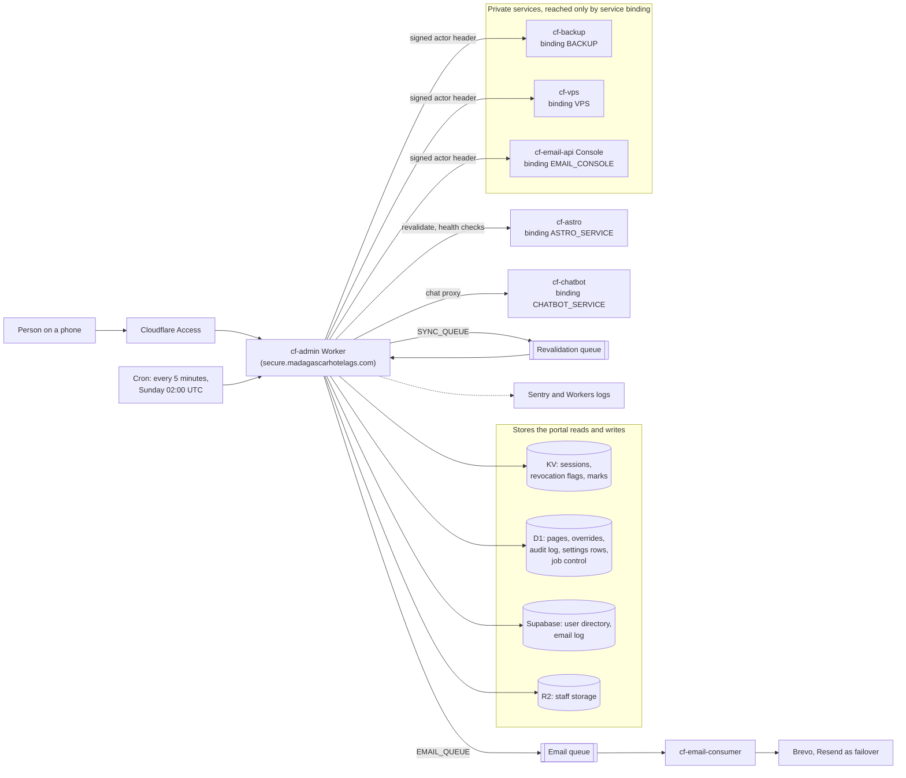
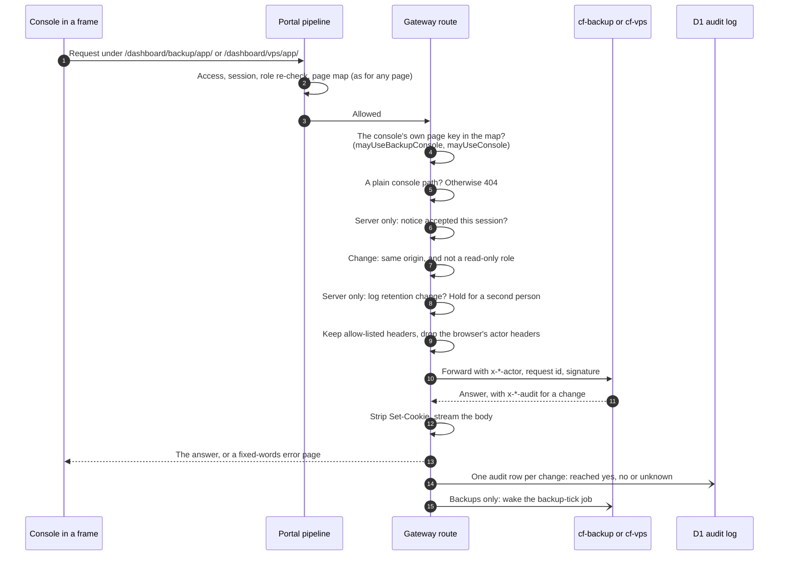
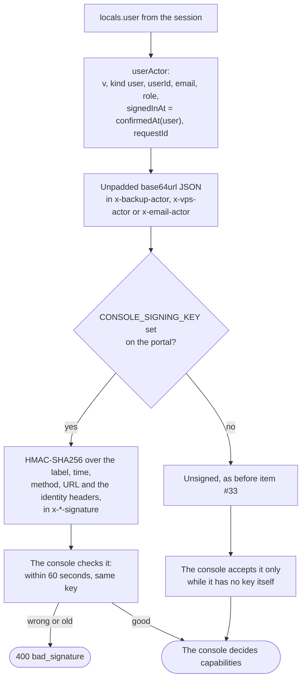
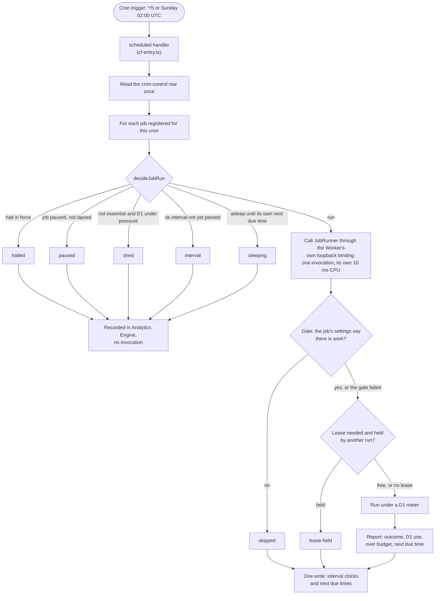
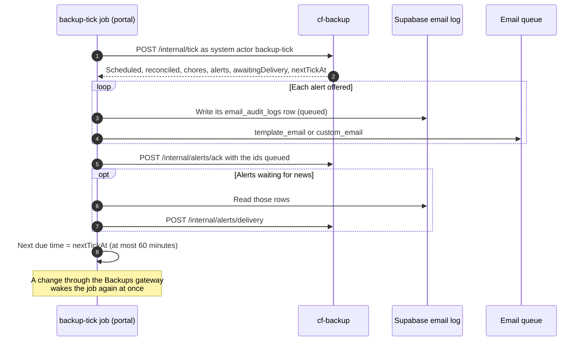
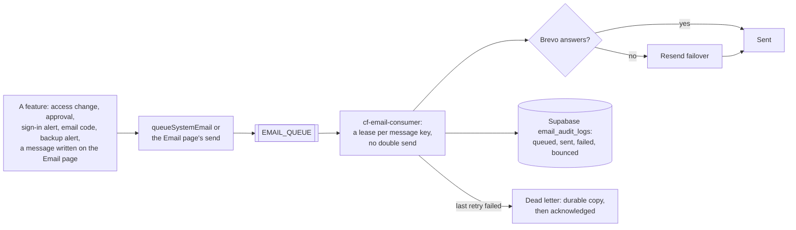
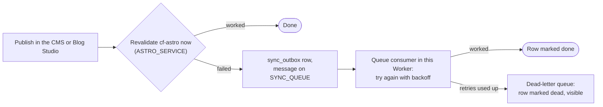

# Flows: the consoles, scheduled jobs, email and every switch

> **TL;DR (for everyone):** the admin portal is the front door for several services. It
> forwards the Backups, Server and Email API screens to their own private services, runs every
> scheduled job on one five-minute timer, and hands every email to a queue that the email
> service sends. These pictures show each path, what is checked on the way, and where each
> on/off switch lives. How a person is signed in and checked first is in
> [FLOWS-SIGN-IN-AND-CHECKS](FLOWS-SIGN-IN-AND-CHECKS.md).

Binding names and the Worker's resources are listed in
[OPERATIONS](../operations/OPERATIONS.md) §1; this page names them only to show the paths.

## 1. The portal and its neighbours

The three private services have no public address of any kind, so the service binding is the
only way in. That is why they may trust the actor header the portal attaches: nothing else can
send one. Since permissions item #33 the portal also signs that header once
`CONSOLE_SIGNING_KEY` is set on both sides (section 3).

## 2. A console screen: the Backups and Server gateways

The gateways (`src/pages/dashboard/backup/app/[...path].ts`, `src/pages/dashboard/vps/app/[...path].ts`)
know a path prefix, a header list and the audit call, nothing about backups or servers. The
console key must itself be in the person's map: it is never inherited from `/dashboard`, a
staff-level row, so a missing registry row can never open a root shell. What each person may do
inside the console is decided by the console itself
([cf-backup plan of record 13](../program/cf-backup/13-access-control.md),
`cf-vps/documentation/security/PERMISSIONS.md`).

The Server gateway adds two things: the browser terminal's WebSocket upgrade, allowed only under
`/dashboard/vps/app/api/terminal/`, with an exact Origin check and audited once as
`terminal.open`; and a long timeout for server actions (65 s to the headers, against 10 s for
Backups).

## 3. The signed actor header

`signedInAt` is the later of the real sign-in and an emailed code, so a console's 10-minute rule
follows the portal's with no change of its own
([FLOWS-SIGN-IN-AND-CHECKS](FLOWS-SIGN-IN-AND-CHECKS.md) §9). The backup-tick job sends a
`system` actor instead (`kind: system`, `job: backup-tick`), which cf-backup accepts only on its
`/internal/*` endpoints. The Email API console's actor also carries the person's Email API
capabilities (`emailApiCaps`), worked out in the portal.

## 4. Scheduled work: one timer, many jobs

The account has five cron slots, so the portal uses two and multiplexes every job inside them
(`src/lib/jobs/`). Each due job runs in its own invocation since the 2026-09-26 CPU incident, so
one slow job fails alone. Every step after the decision fails open: a gate or lease that errors
still runs the job, because missed work is worse than one extra run. Essential jobs (the
Cloudflare Access sync, booking retries, the backup tick, health checks and others) are never
shed automatically; a person can still pause any job from Cron Control, which is audited
([ARCHITECTURE](ARCHITECTURE.md) §7, [CRON-CONTROL](../features/CRON-CONTROL.md)).

## 5. The backup tick: the portal's timer lent to cf-backup

cf-backup has no cron trigger of its own: the portal calls it. It answers when it next has work,
so a quiet day costs a call an hour, not 288. An alert that was not acknowledged is offered
again on the next tick; the email service's idempotency key makes a repeat harmless
(`src/workers/scheduled-backup-tick.ts`).

## 6. Email from the portal

The portal never calls an email provider directly: it puts a message on the queue and the email
service sends it, retries it, and records it. The Email Log page reads `email_audit_logs`.
How a message is sent, retried and failed over is owned by cf-email-consumer
(`cf-email-consumer/docs/features/CONSUMER.md`).

## 7. Website content: the revalidation queue

`src/workers/sync-revalidate-consumer.ts` never throws out of the handler, so one bad message
cannot retry the whole batch.

## 8. Every switch and flag, and where it lives

| Switch | Where it lives | Who changes it | What it does |
|---|---|---|---|
| `API_DENY_MODE` | `wrangler.toml` variable | a deploy | `enforce` refuses an API call the page map does not allow; `shadow` only records it. Production is `enforce` |
| `SESSION_REFRESH_INTERVAL_MS`, `SESSION_MAX_LIFETIME_MS` | `wrangler.toml` variables | a deploy | How often a session re-checks the directory (30 minutes) and its hard end (24 hours) |
| `CONSOLE_SIGNING_KEY` | Worker secret, same value on the consoles | the owner | Present: every console request is signed and checked. Absent: unsigned, as before |
| Page registry and overrides | D1 `admin_pages`, `admin_page_overrides` | Page Registry, Users, access requests | Who may open each page and action key; an override can end on a date |
| `revoked:<userId>`, `revoked-session:<id>` | KV, 24 hours | force-kick, deactivate, delete, lock out | Ends sessions at once and refuses sign-in while set |
| `authz-changed:<userId>` | KV | any permission change | The next request re-reads role and map; nobody is signed out |
| Session fields: `codeConfirmedAt`, `testingPassUntil`, `vpsNoticeVersion` | KV session record | the person (email code, testing pass, server notice) | A recent-sign-in proof; Vendor support's testing pass; the server notice accepted |
| `cron-control` | D1 `admin_portal_settings` row | Cron Control page | Halt everything (with an end), pause one job, throttle intervals, wake a job |
| A job's gate keys | D1 `admin_portal_settings` rows | each feature's page | Lets a job skip a tick with no work (read once per run) |
| `approvals:pending` | D1 `admin_portal_settings` row | the two-person rule | Changes waiting for a second person, 3 days each |
| Configuration catalog (`custom_email_max_recipients`, `blog-suggestions-enabled`, `blog-suggestions-max-pending`) | D1 `admin_portal_settings` rows, named in `src/lib/configuration.ts` | Configuration page | Portal-wide limits and toggles; every other setting lives on its feature's page |
| `backup:*` rows | D1 `admin_portal_settings` | the Backups console | cf-backup's config, status, access policy and key registry (cf-backup reads and writes them) |
| `vps:access` | D1 `admin_portal_settings` | the Server console's Access page | cf-vps role defaults and per-person grants |

Settings live in D1, never in new environment variables (RULE #0.8). The three variables above
predate that rule and are deploy-time on purpose.

## Verification log

| Date | Who | What was checked | Result |
|---|---|---|---|
| 2026-10-25 | claude | Every diagram against the code named in it: `wrangler.toml` bindings, queues and crons; `backup-proxy.ts`, `vps-proxy.ts`, `email-console.ts`, `console-signature.ts`; both gateway routes' rule lists; `jobs/dispatch.ts`, `jobs/control.ts` `decideJobRun`, `jobs/runJob.ts`; `scheduled-backup-tick.ts`; `sync-revalidate-consumer.ts`; `configuration.ts`, `approvals/store.ts`, `CronControlRepository.ts`; the email path against cf-email-consumer's `main.md`. Every mermaid block parsed with mermaid 11.4.1. Not checked: GitHub's own renderer, the live settings rows | pass |
