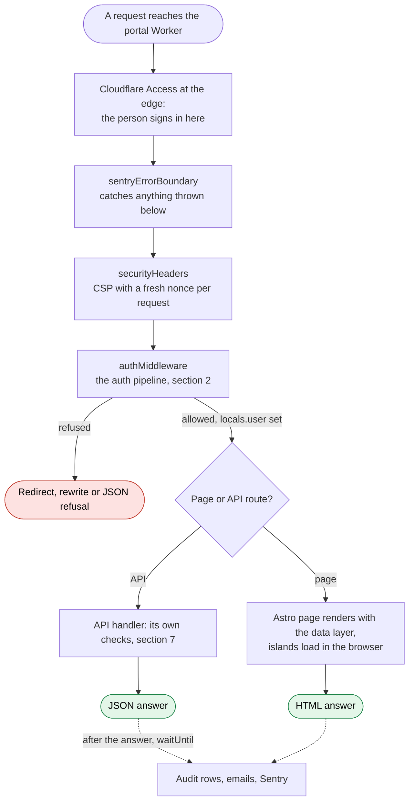
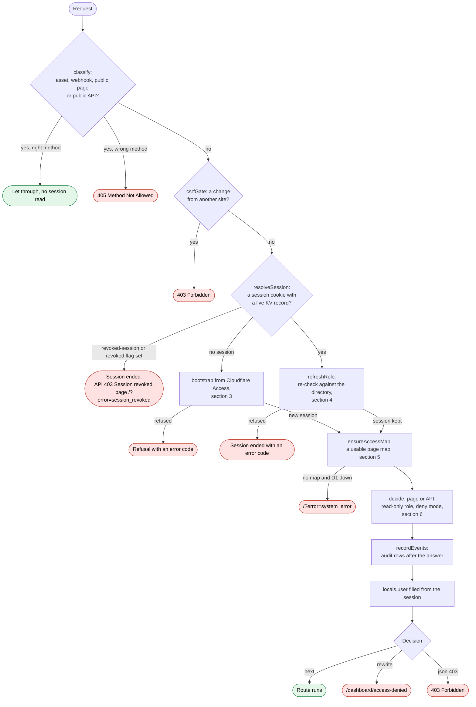
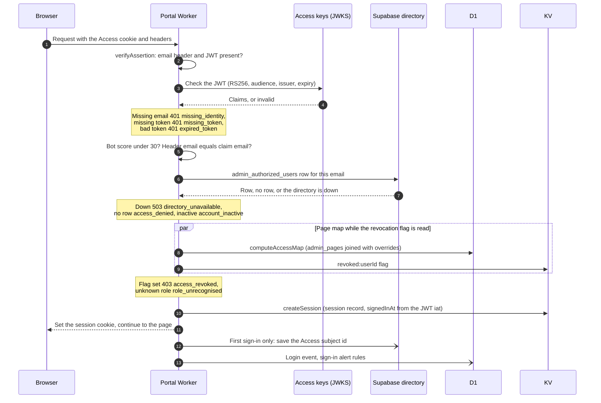
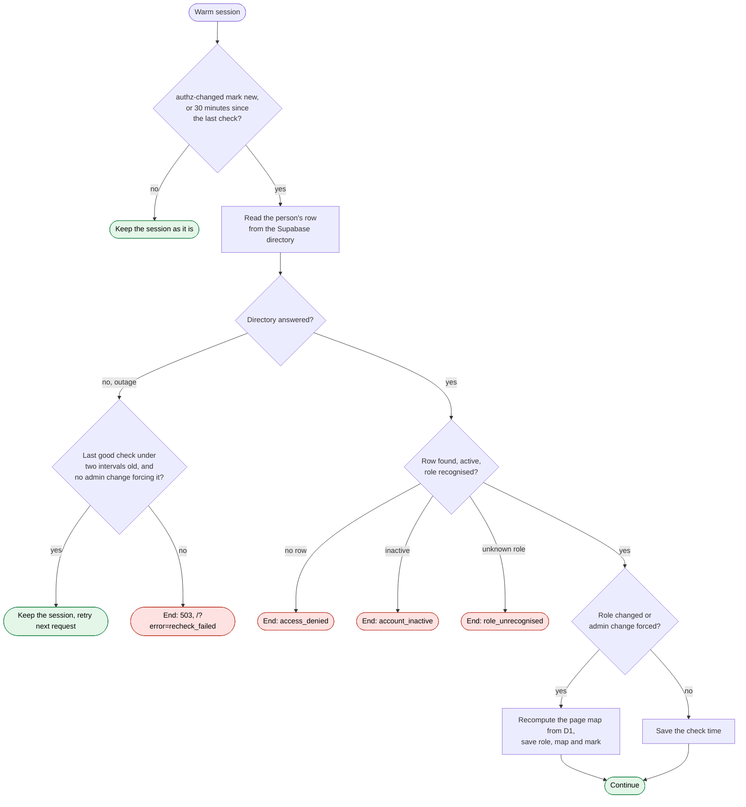
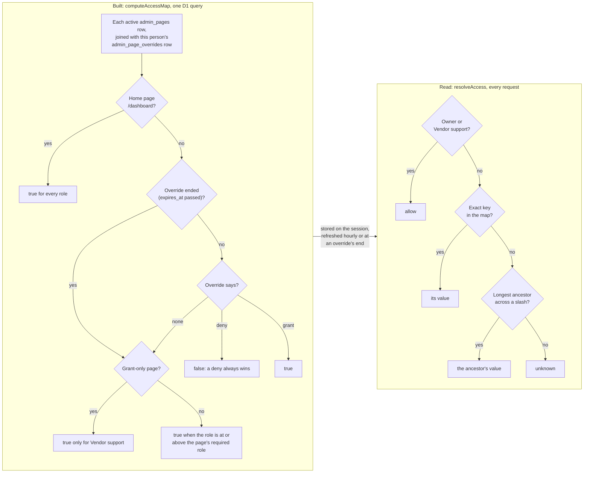
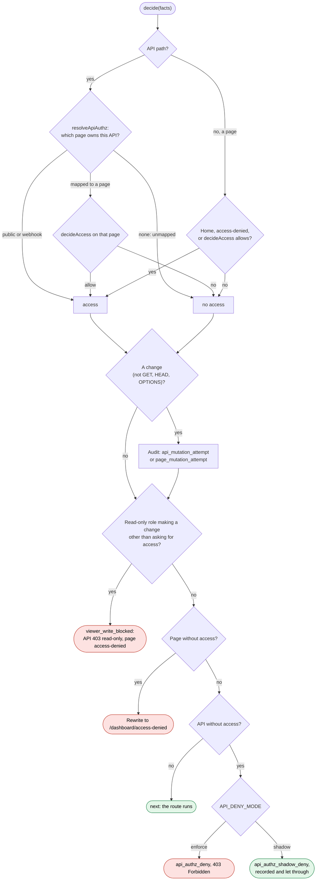
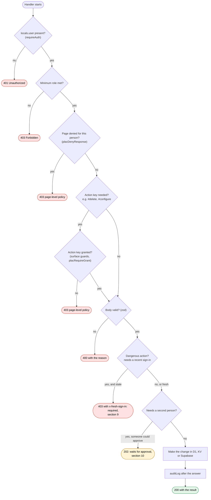
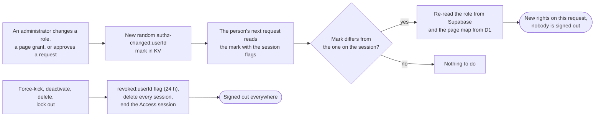
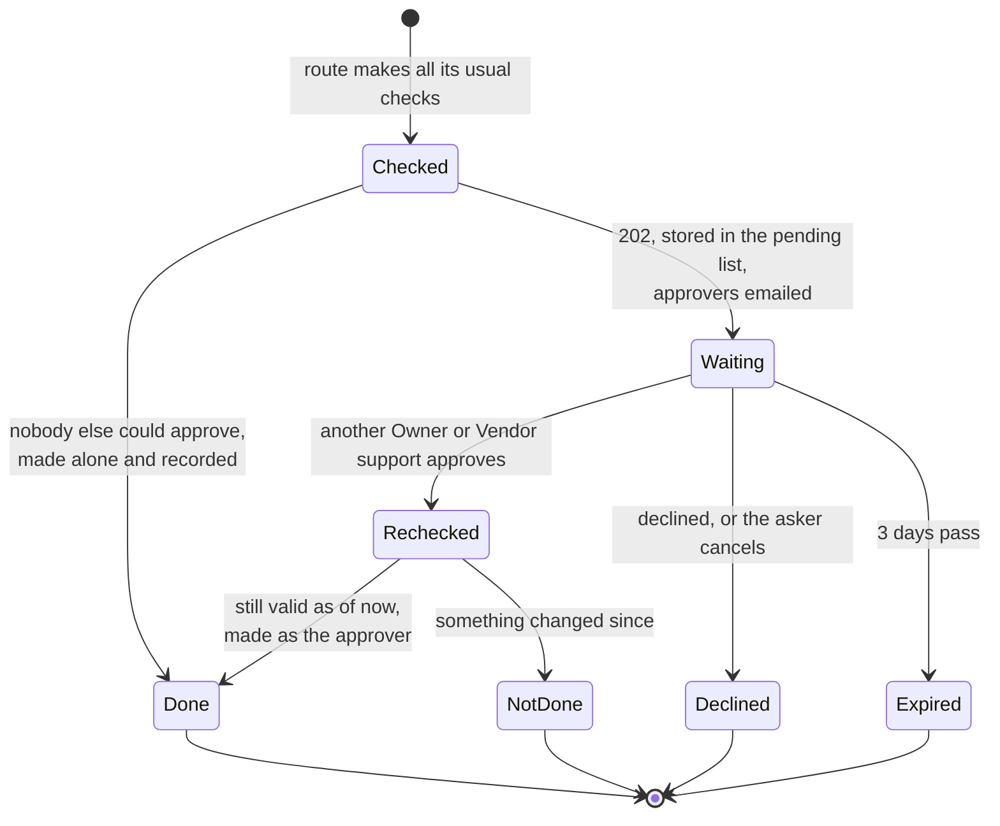

# Flows: how a request is signed in and checked

> **TL;DR (for everyone):** these are pictures of the path every request takes through the
> admin portal: who you are (Cloudflare Access, then the portal's own directory), what you may
> open (your role plus any personal grants or denies), and the extra checks a dangerous button
> adds (a recent sign-in or an emailed code, and sometimes a second person). Each picture is
> followed by a few plain sentences. The rules and their numbers are owned by
> [PERMISSIONS-SYSTEM](PERMISSIONS-SYSTEM.md); this page shows how they connect. Its companion,
> [FLOWS-SERVICES-AND-JOBS](FLOWS-SERVICES-AND-JOBS.md), shows the consoles, the scheduled jobs,
> email and every switch.

How to read the diagrams: a rectangle is a step, a diamond is a question, a rounded box is
where the request ends. Red ends refuse, green ends let the request through. Every name in
`code` is a real file, function, key or code you can search for.

## 1. The whole request, end to end

`src/middleware.ts` chains three handlers in this order. Anything a route throws becomes a
JSON 500 for `/api/*` and is reported to Sentry; pages re-throw to Astro. Audit rows and emails
are written after the answer is sent, so they never slow a page.

## 2. The auth pipeline, stage by stage

`src/lib/auth/pipeline.ts` is a short list of stages in `src/lib/auth/stages/`. Each stage
either hands facts to the next one or returns a decision. Only `decision.ts` turns a decision
into a response, and only `record.ts` writes audit rows, which is why every branch above has
its own test (`test/pipeline-*.test.ts`).

The session lookup reads the session record plus three flags in one KV call: the session's
own revocation, the person's revocation, and the person's `authz-changed:` mark (section 8).
A session older than its maximum lifetime (`SESSION_MAX_LIFETIME_MS`, 24 hours) is gone, so the
request starts again from Cloudflare Access. An open tab watches the same limit
(`SessionWatchdog`, counting down from the server's figure) and then goes back through the
landing to the page it was on, which starts that new session; the landing shows no card for it.

## 3. The first request after signing in (cold sign-in)

The sign-in time the session keeps is the Access token's own issue time, never later than now.
A token without one records 0, which no recent-sign-in rule accepts. The login event and the
sign-in alert decision run after the answer
([login-forensics](../security/login-forensics.md)).

## 4. A signed-in request: the role re-check

The interval is `SESSION_REFRESH_INTERVAL_MS` (30 minutes). An administrator's change sets the
person's `authz-changed:` mark, so the next request re-checks at once instead of waiting. No
outcome here writes a sign-in block: the directory row is the authority
(`src/lib/auth/stages/refresh-role.ts`).

## 5. The page map (PLAC): how it is built and read

The map is computed at sign-in, on a role change, when an administrator's change forces it,
when it is older than an hour, and when a personal grant or deny it used reaches its end date
(`refreshAt`). If D1 is down and the session already has a map, the old one is kept; with no
map at all the session ends (`src/lib/auth/stages/access-map.ts`).

Reading has two questions with different defaults. The middleware gate and the sidebar ask
`decideAccess`: only an allow opens, so unknown means no. A page key the registry never defined
answers unknown. Handlers ask `isExplicitlyDenied`: only a deny closes. A hash key such as
`/dashboard/users#delete` never inherits from its page, because the ancestor rule needs a slash
([PERMISSIONS-SYSTEM](PERMISSIONS-SYSTEM.md) §6).

## 6. The decision: pages, APIs and read-only roles

`src/lib/auth/stages/decide.ts` is pure: the same facts always give the same answer. Every API
route has to be listed in `API_PAGE_MAPPING` (`src/lib/auth/routes.ts`) or the public
allow-list, or it is refused: the API surface fails closed. `API_DENY_MODE` is `enforce` in
production; `shadow` exists only to stage a rollout over old routes. The read-only refusal does
not depend on it.

## 7. Inside an API handler: the checks a button adds

Not every route needs every box: each route uses the guards its feature defines
(`src/lib/auth/guard.ts`, `src/lib/auth/surface-guards.ts`). The order matters for hash keys:
the page is checked first, then the action, because a deny on the page must stop the action and
a deny on the action alone must stop it too. Owner and Vendor support pass every page and
action check by design (ADR-0002); the recent sign-in and second person still apply to them.

## 8. How a permission change reaches someone already signed in

Changing what someone may do never signs them out; only the force-kick family does
([PERMISSIONS-SYSTEM](PERMISSIONS-SYSTEM.md) §11). KV can take about a minute to agree
everywhere, so "next request" means within about a minute.

## 9. A recent sign-in, or an emailed code

```mermaid
sequenceDiagram
    autonumber
    participant U as Person
    participant UI as Portal page or console frame
    participant P as Portal Worker
    participant K as KV session
    participant Q as Email queue
    U->>UI: Taps a dangerous button
    UI->>P: POST the action
    P->>P: freshSignInRefusal: confirmedAt within 10 minutes?
    P-->>UI: 403 with x-fresh-sign-in: required
    Note over UI: A console frame posts<br/>cf-admin:confirm-it-is-you to the portal page
    UI->>U: Confirm it's you: Email me a code, or Sign in again
    U->>UI: Email me a code
    UI->>P: POST /api/settings/confirm-code (send)
    P->>K: confirmCode: hash, expiry, tries, sent time
    P->>Q: 6-digit code to the person's own address
    U->>UI: Types the code
    UI->>P: POST /api/settings/confirm-code (check)
    P->>K: codeConfirmedAt = now, code cleared
    P-->>UI: Confirmed for 10 minutes
    Note over UI: The portal posts cf-admin:confirmed to every frame
    U->>UI: Taps the button again
    UI->>P: POST the action
    P->>P: confirmedAt = later of signedInAt and codeConfirmedAt
    P-->>UI: The action runs
```

`confirmedAt` (`src/lib/auth/fresh-sign-in.ts`) is the one time every recent-sign-in rule
reads: the portal's own routes and the actor header sent to the Backups, Server and Email API
consoles. The code works only in the session that asked for it, lasts 10 minutes, allows 5
tries, is used once, and a new one needs a minute's wait. A Vendor support testing pass
makes `confirmedAt` now, but only from a real sign-in. The design:
2026-10-25 email code (private).

## 10. A second person for a few changes

Four changes wait like this: making someone Owner or Vendor support, removing a person,
removing the last active Owner, and changing how long the server keeps a log. The waiting list
is one `admin_portal_settings` row; an approval takes the change off it with a
compare-and-swap, checks it again as the asker, then makes it as the approver
(`src/lib/approvals/`, [PERMISSIONS-SYSTEM](PERMISSIONS-SYSTEM.md) §10.7).

## Verification log

| Date | Who | What was checked | Result |
|---|---|---|---|
| 2026-10-25 | claude | Section 2's lifetime paragraph, after the 24-hour re-sign-in fix, against `SessionWatchdog.tsx` and `landing.ts` (`RENEW_CODES`, `renewSignInPath`). Not checked: the diagrams again | pass |
| 2026-10-25 | claude | Every diagram against the code named in it: `src/middleware.ts`; `src/lib/auth/pipeline.ts` and all nine stage files (each branch, status, redirect code and audit action); `decide-access.ts`, `plac.ts` `computeAccessMap`, `guard.ts`, `surface-guards.ts`, `routes.ts`, `session.ts` (lifetime), `fresh-sign-in.ts`, `confirm-code.ts`, `fresh-sign-in-client.ts`, `src/lib/approvals/`; the two-person and revocation rules against PERMISSIONS-SYSTEM §10.7 and §11. Every mermaid block parsed with mermaid 11.4.1. Not checked: GitHub's own renderer, and live traffic | pass |
