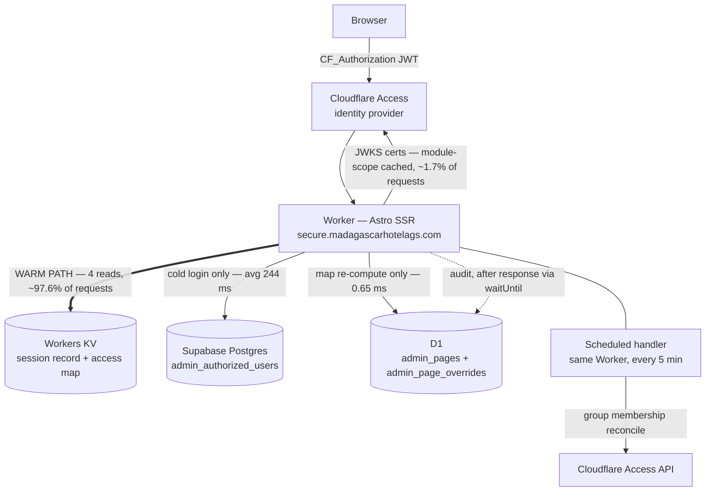

---

title: "Permissions System — RBAC, PLAC and ACM End to End"
status: active
audience: [ai, technical, operator]
last_verified: 2026-10-17
verified_against: [code, infra]
owner: harshil
related_docs: [plac-and-audit.md, ARCHITECTURE.md, ../features/USER-MANAGEMENT.md, ../features/SESSION-MANAGEMENT.md, ../security/SECURITY.md, ../reference/RBAC-AT-SCALE.md]
related_code: [src/pages/api/settings/testing-pass.ts, src/lib/auth/fresh-sign-in.ts, src/lib/approvals/, src/lib/users/manage-apply.ts, src/lib/access-center/profile.ts, src/lib/access-center/templates.ts, src/lib/auth/stages/decide.ts, src/lib/auth/decide-access.ts, supabase/migrations/20261016000000_role_check_add_viewer.sql, src/lib/access-changes/notify.ts, src/lib/access-requests/keys.ts, src/lib/access-center/temporary.ts, src/lib/auth/rbac.ts, src/lib/auth/plac.ts, src/lib/access-center/registry-access.ts, src/lib/auth/pipeline.ts, src/lib/auth/stages/, src/lib/auth/session.ts, src/lib/auth/guard.ts, src/lib/auth/routes.ts]
tags: [architecture, security, rbac, plac, authorization, performance]
---

# Permissions System — RBAC, PLAC and ACM End to End

> **TL;DR (non-technical):** Every screen in this admin portal is locked. Who can
> open which screen is decided in two steps: your job title gives you a baseline,
> and an administrator can then open or close individual screens for you
> personally. The decision is worked out once when you sign in, stored next to your
> session, and then re-checked on every single click without touching a database.
> A closed door always beats an open one — except for the two top tiers, the
> account holder and our own support tier, who are let through everywhere by
> design.

This document is the **authority** for the permission model. Where another
document restates any of it, this one wins; where this one disagrees with the
code, the code wins and this document is the bug.

It is written to be read cold, by someone comparing this design against Auth0,
Keycloak, Zanzibar/OpenFGA/SpiceDB, Cerbos, Casbin or a hand-rolled RBAC. Every
number is either **measured** — with its source, sample size and date — or
explicitly labelled as arithmetic. Nothing here is estimated and presented as
observed.

---

## 1. The model in one paragraph

Three layers stack, and they are frequently confused because two of them are
per-page:

| Layer | Name | What it answers | Where it lives |
|---|---|---|---|
| **ACM** | Access Control Map — the page registry | *What pages exist, and what is each one's default minimum rank?* | D1 `admin_pages` |
| **RBAC** | Role-based baseline | *What rank is this person?* | Supabase `admin_authorized_users.role` |
| **PLAC** | Page-Level Access Control | *Has an administrator overridden this person's access to this specific page?* | D1 `admin_page_overrides` |

The three are resolved together, once, into a flat `Record<string, boolean>` — the
**access map** — which is embedded in the session record in KV. Every subsequent
request reads KV and does one hash lookup. There is no policy engine, no policy
language, and no per-request database call on the happy path. *Corrected
2026-09-19: the warm path is **four** KV reads, not one — see §13.1.*

**Resolution order, exactly** (`src/lib/auth/decide-access.ts`):

0. `vendor_support` and `owner` resolve to allow before the map is consulted at
   all (ADR-0002: a self-inflicted lockout of the customer's top tier is the
   worse failure). A deny row written against either tier is stored, shown in
   the access UI, and has no effect. *Since 2026-10-15 one page is the exception: Page
   Registry, a grant-only page since 2026-10-17 (`src/lib/auth/page-floors.ts`), opens for
   the owner only when vendor support gives it, as for anyone else; the page and its routes
   check that before the key (§5).*
1. Explicit deny → 2. explicit grant → 3. role baseline.

Steps 1–3 are what `computeAccessMap` folds into the map; step 0 is applied at
read time, on every check. §6.2 states the two predicates in full.

---

## 2. Threat model — what this actually defends

Stating this first, because a permission system can only be judged against what it
is meant to stop.

| # | Threat | Defence |
|---|---|---|
| T1 | An unauthenticated stranger reaches any admin surface | Cloudflare Access sits in front of the entire origin; `workers_dev = false` in `wrangler.toml` means the Access-protected custom domain is the only ingress. *Corrected 2026-09-19: two prefixes are deliberately off Access — `/api/storage/share/` and `/api/storage/request/` are reached anonymously through Access path-based bypass policies and are authorized by an HMAC-signed token instead (`src/lib/auth/routes.ts`, `wrangler.toml`).* |
| T2 | A valid staff member reads a page above their rank | RBAC baseline computed from the page registry |
| T3 | A valid staff member with a page grant escalates to *other* pages | Grants are per-path and capped at the granting actor's own clearance |
| T4 | An administrator elevates themselves | Self-modification is refused outright; grants are capped at the actor's ceiling |
| T5 | A lower tier edits a higher tier's account | Rank supremacy — strictly higher privilege required, on the paths that route through `canManageUser`. *The two account actions that did not (§16 D6/D7) were fixed 2026-10-14.* |
| T6 | A revoked user keeps working from a live session | Three-layer revocation, including a Cloudflare API call that kills the edge cookie |
| T7 | A read-only user mutates through the API | Viewer tier refused on every non-idempotent method, before page resolution, except the one exact route for asking for access (§8.1) |
| T8 | An API route ships without a guard | Default-deny in the pipeline plus a CI inventory test |
| T9 | Session theft via XSS | `__Host-` cookie prefix, `HttpOnly`, strict CSP with nonces |
| T10 | Cross-site request forgery | Custom CSRF validation in `src/lib/csrf.ts` |

**What it explicitly does not defend.** It cannot express object-level permissions
("user X may edit document Y"). It has no relationship graph, no inheritance beyond
path prefixes, and no delegation of page access. See §15. *Since 2026-10-02 the
server console's capabilities can be delegated down the role ladder (§10.1);
page access still cannot.*

---

## 3. Topology — which store owns which fact



The thick edge is the only one on the hot path. Everything else runs on a cold
login, on a re-compute, or after the response has already been sent.

| Fact | Owner | Read on the hot path? |
|---|---|---|
| Is this a real, active human? | Cloudflare Access (IdP) | Yes — JWT signature |
| Is this email allowed in at all, and at what rank? | Supabase `admin_authorized_users` | **No** — cold login, the 30-minute re-check, and any request carrying a new `authz-changed` mark |
| What pages exist and their default rank | D1 `admin_pages` | No — cached |
| Per-user overrides | D1 `admin_page_overrides` | No — folded into the map |
| The resolved decision | KV, inside the session record | **Yes — the hot-path read**, alongside the three revocation/authz flags read with it (§13.1) |
| Group membership mirror | Cloudflare Access groups | No — reconciled by cron |

The split is the whole design: **identity is centralised, the decision is
edge-local.**

---

## 4. RBAC — the role ladder

Six tiers. Lower number means higher privilege (`src/lib/auth/rbac.ts`).

| Level | Canonical role | Stored value today | Assignable? | Summary |
|---:|---|---|---|---|
| 0 | `vendor_support` | `dev` | No | Supplier support tier. Visible in the registry by design, never in a role picker. |
| 1 | `owner` | `owner` | Yes | Account holder. Full authority. |
| 2 | `admin` | `super_admin` | Yes | Full operational control including settings and users. |
| 3 | `manager` | `admin` | Yes | Day-to-day operations. No user or platform administration. |
| 4 | `staff` | `staff` | Yes | Own area only. |
| 5 | `viewer` | `viewer` | Yes, since 2026-10-16 | Read-only. Opens the home page and only the pages given to them; refused on every mutation but asking for access. |

### 4.1 The vocabulary split, and why it exists

The code speaks canonical names; both databases still hold the old ones.
`normalizeRole()` translates on read, `toStoredRole()` on write, and
`ROLE_VOCABULARY` is the single switch that flips after the data migration.

This is not laziness — **the rename collides**. `super_admin` becomes `admin`, and
`admin` becomes `manager`. The string `"admin"` therefore means level 3 before the
migration and level 2 after it, and no amount of looking at a bare row tells you
which. Translating in code behind an explicit flag means the deployed Worker and
the database can never disagree about what a role means.
*Changed 2026-10-16 (permissions #30):* Viewer is stored under its own name, `viewer`. It was
never a stored name for another tier, so it cannot collide the way `admin` does, and it needed
no rename of any row: only the Supabase role check had to admit it
(`supabase/migrations/20261016000000_role_check_add_viewer.sql`, applied before the code). The
rename of the other four names stays optional (C-11). A page's default still cannot be Viewer
(`canBePageDefault`): a Viewer opens only the pages given to them, and the D1
`admin_pages.required_role` CHECK admits only the five old names. The home page (`/dashboard`,
`HOME_PAGE` in `decide-access.ts`) opens to every role, Viewer included: the gate always opened
it, and since 2026-10-16 `computeAccessMap`, `personOpens` and the access editor say so too.
Read live on 2026-10-16: all 117 rows of D1 `admin_pages` hold a legacy `required_role` (`dev`,
`owner`, `super_admin`, `admin`, `staff`), and the table's CHECK constraint still admits only
those five. Every canonical role now has a stored value, so `toStoredRole()` throws only if
`ROLE_VOCABULARY` names a vocabulary the data does not use: it never silently writes a
different role. The rename of the old names is tracked as C-11 in
`../MAINTENANCE.md` (private).

`canManageUser(actor, target)` requires *strictly* higher privilege, so nobody can
act on a peer through it. An untranslatable stored role returns `false` — there is
no safe level at which to compare it. Two account actions did **not** route through
it until 2026-10-14 and checked only that the target was not an owner or vendor
account; see §16 D6/D7.

### 4.2 Deprecated aliases are load-bearing

`isAdmin` is an alias for `isManagerOrAbove` (level 3) and `isSuperAdmin` for
`isAdminOrAbove` (level 2). The names moved; the levels deliberately did not.
Renaming the helpers without preserving their level would have silently shifted a
privilege boundary at ~200 call sites — invisible in review. (That figure is from
the rename in July 2026 and is history, not a current count; the ratchet counter
for deprecated-alias uses, `E1` in `.ratchet.json`, holds the current count.)

---

## 5. ACM — the page registry

D1 `admin_pages`, primary key `path`:

| Column | Purpose |
|---|---|
| `path` | A dashboard route, or a hash-fragment sub-page such as `/dashboard/sessions#revoke` |
| `required_role` | Default minimum rank (legacy vocabulary, see §4.1) |
| `is_active` | `0` removes the page from nav **and from the access map** |
| `parent_path` | Groups sub-features under their page |
| `label`, `description`, `icon` | The page's one name, summary and icon (see below) |
| `category` | The sidebar group: one of the seven in `src/lib/access-center/categories.ts` |
| `sort_order` | Order in the sidebar, in the access editors and in a page's tab row |

**Measured live, 2026-10-10** (after `migrations/0067`): 113 rows, **99 active**, **60** of
them hash-fragment permissions (55 active). Every active row's `category` is one of the seven
groups. The 2026-09-16 figures were 97/86/51/49. After `0068` and `0069` (re-measured the same
day): 117 rows, 100 active, 63 permissions (55 active).

**The registry is the one home of a page's name** *(2026-10-10, `migrations/0067`)*. The
sidebar and its groups, the browser tab title ("Section · Page — Madagascar Admin"), the
breadcrumbs, every page heading and the sub-page tab rows (Website Content, Chatbot, Cloud
Services) read `label`, `description`, `icon` and `category` through
`src/lib/auth/page-registry.ts`, and nothing in the code repeats a page's name. Renaming a page,
or moving it to another sidebar group, is one edit in Page Registry (`/dashboard/debug/pages`,
`PATCH /api/system/pages`, which now accepts `label` and `category`). Until then the sidebar
derived its groups from path rules in three places (`plac.ts`, `AccessPolicyGrid.tsx` (removed 2026-10-26),
`Sidebar/config.ts`), and pages, tabs and titles each carried their own copy of the name, so a
rename reached only the sidebar. A part of a page with no row of its own (one email section,
one person's access) names itself as a section beside its page's name; only the access-denied
card, which no row covers, passes its own title, and `test/page-registry.test.ts` fails the
build if another page does.

The registry is read straight from D1 once per isolate per minute (about 100 small rows; the
Worker runs next to the database since the placement hint of 2026-10-10). An edit through
`/api/system/pages` clears that isolate's copy; other isolates pick it up within a minute.
It replaced a KV copy (`system:admin_pages_cache_v2`, TTL 1 h) that cost a KV read on every
page and that a registry edit never cleared.

**Pages that ask for their own key exactly.** A new page row is invisible to a person's
access map until that map is recomputed (§11), and until then the pipeline lets the page
through on the inherited `/dashboard` row. A page that must fail closed therefore checks its
own key with `placRequireGrant`, which needs the exact key. The Email API page does this
(`denyEmailApi`), and since 2026-10-07 so does the GitHub page: `/dashboard/github`
(migration `0066`, stored role `owner`), whose `canViewGitHub` (`src/lib/auth/surface-guards.ts`)
also keeps an admin floor that no grant can lower. The floor is a row in
`src/lib/auth/page-floors.ts`, which `computeNavItems` applies too, so the sidebar never offers
a link the page would refuse. Since 2026-10-17 the file also lists the grant-only pages:
`/dashboard/debug/pages` opens by default for vendor support alone, the owner included, and
otherwise only by a personal grant that vendor support gives (below). The GitHub page has no API route; the check runs in the page itself
([`features/GITHUB.md`](../features/GITHUB.md)).

Hash fragments are the fine-grained layer. `/dashboard/sessions` is the page;
`#revoke`, `#unblock`, `#flush`, `#export` are separately grantable actions within
it. This is how a coarse per-page model reaches action-level granularity without a
policy language.

**A fragment key is not a descendant of its page, and a handler must check both.**
`resolveAccess` matches ancestors with `startsWith(key + '/')`; `#revoke` supplies
no `/`, so `/dashboard/sessions#revoke` inherits nothing from `/dashboard/sessions`.
Check only the page and a deny written on the fragment is ignored — the override is
stored, shown in the access UI, and has no effect at the one point that matters.
Check only the fragment and a user denied the whole page still reaches the action,
because an undefined key resolves `unknown` and `requirePageAccess` permits unknown.
`src/lib/auth/surface-guards.ts` exists to make that pair the default: `denyCron`, `denyEmailApi` (the Email API page and its four keys, migration `0062`) and
`denySessions` take the page key first, then the action. This was got wrong twice
before it was centralised — see MAINTENANCE.md D-4 and D-5.

**Every action key is checked on the server, or says why not.** *Added 2026-10-15.* Three
switches still only hid a button until that day: "View consent details"
(`/dashboard/privacy#forensics`: the consent routes sent every record's IP address, browser
and fingerprint; now `canViewConsentDetails`, and without it each record keeps only its row,
[`security/PRIVACY.md`](../security/PRIVACY.md) §1), "Design emails with AI" and "Manage
templates" ([`features/EMAIL-PORTAL.md`](../features/EMAIL-PORTAL.md) §4).
`test/action-keys-enforced.test.ts` lists every `/dashboard/x#y` key the migrations define,
with the file and the code that checks it, or the reason there is nothing on the server to
check (a preview drawn in the browser; an export of what is already on screen; a route only
the owner and vendor support reach; a switched-off row). A new key fails the build until it
has an entry, and a check that leaves its file fails it too.

**An action key fails CLOSED; a page key does not.** *Added 2026-09-20.* The two
guards in that module differ deliberately. `denySessions` refuses only an explicit
deny, which is `requirePageAccess`'s behaviour and is right for a page: a route
whose page key was never registered must keep working on its own role check.
`denyCron` goes through `placRequireGrant` (`guard.ts`) instead, which requires an
explicit **allow** — because an action key exists only where somebody wrote a
registry row for it, so `unknown` does not mean "no policy applies", it means the
row is missing or `is_active = 0`. Migration `0054` shipped exactly that state:
its three cron fragments were inserted with a NULL `icon` against a NOT NULL
column, `INSERT OR IGNORE` discarded all three silently, and every cron action
check was a no-op for every role until `0055`. Under an explicit-allow check that
same state refuses the action instead of opening it. The rows are asserted in
`test/migrations-replay.test.ts`, so losing one is a failing build.
*Corrected 2026-10-02:* `placRequireGrant` now requires the key itself to be in
the map. Until then it asked `resolveAccess`, which answers an absent key through
its longest ancestor, and every action key starts with `/dashboard/`, a staff-level
row in every map, so a missing row read as **allow** for staff and above; the
fail-closed tests passed only because their maps had no `/dashboard` key
(MAINTENANCE.md E-11, now pinned in `test/guard-plac.test.ts`). `denyEmailApi`
checks its page key the same way, as `mayUseConsole` does for the server console,
so the Email API page cannot open through `/dashboard` before `0062` is applied. The sessions
fragments are live and active (verified 2026-09-20) and could adopt the same
helper, but `#flush` is deliberately deny-only — it keeps a hardcoded owner check
alongside the PLAC one, so a grant alone must not become a capability — and
`#export` has no server route, so that switch is its own change.
*Added 2026-10-03:* the newest sessions key, `#alerts` (migration `0063`, "Sign-in
alerts"), is fail-closed from the start: `denySignInAlerts` checks the page and then
requires an explicit grant through `placRequireGrant`. It is also the one key read at
**sign-in**: bootstrap evaluates it against the map it has just computed and passes the
answer to the login event, so a person's sign-in alert settings
([spec](../specs/2026-10-03-sign-in-alert-settings-design.md)) apply only while they
hold it, unless an alert-policy holder set them for that person.
*Added 2026-10-03:* `#alert-policy` (migration `0065`, "Alert policy", default `owner`),
fail-closed the same way through `denyAlertPolicy`: the sign-in alert policy (recipients,
what each role's successful sign-ins send, which failed sign-ins are emailed, the repeat
window) and other people's alert mode, never included
([v2 spec](../specs/2026-10-03-sign-in-alerts-v2-design.md)). It is checked only by the
Sessions page and `/api/sessions/alert-policy`, not at sign-in.
*Added 2026-10-10:* the Configuration page and its keys (migration `0068`), all fail-closed
through `placRequireGrant` on the exact key, in the page and in `POST /api/configuration`:
`/dashboard/configuration` (the page, default `super_admin`, the stored name of the Admin
tier), `#edit` (change its settings, `super_admin`) and `#email-limit` (change the email
recipient limit, `owner`). Which key each setting needs is the setting's `permission` in
`src/lib/configuration.ts`. The same migration adds `/dashboard/settings#others` (change the
name of someone below your own role from Settings, `super_admin`), checked the same way by the
Settings page and `POST /api/settings/user`. Settings itself became each person's own page and
opens to every role (`staff`, migration `0069`), which also switched off its three retired
sections, `#portal-config`, `#feature-flags` and `#modules`.
*Changed 2026-10-10 (the owner's report that a grant on Developer Tools never worked):* the
Developer Tools pages and Page Registry ask for their own keys, `/dashboard/debug`
(`canUseDebug`) and `/dashboard/debug/pages` (`canUsePageRegistry`), each by exact key through
`placRequireGrant`, in the page and in its routes. Until then the four pages checked the role
alone (vendor support), so the sidebar, which follows the map, offered the page to a grantee
and the page refused them; the diagnostics routes honoured the grant, and the registry routes
did not. Both rows keep their stored role `dev`, so without a grant nothing changes below the
owner. Below vendor support, a registry editor changes a page's required role and switch only
within their own rank (`registryEditRefusal`, `src/lib/auth/registry-impact.ts`): a grant on
the registry cannot open a page above its holder. [`DEV-TOOLS.md`](../operations/DEV-TOOLS.md)
§2 has the routes. *From 2026-10-15 to 2026-10-17 no grant opened Page Registry; since then a
grant from vendor support does (below). The Developer Tools grant is unchanged.*
*Changed 2026-10-31 (the owner's pick of Developer Tools' first tools):* Developer Tools has
six parts and one action of its own, migrations `0091` and `0092`: `/dashboard/debug/migrations`,
`/dashboard/debug/switches`, `/dashboard/debug/documents`, `/dashboard/debug/deploys`,
`/dashboard/debug/keys`, `/dashboard/debug/links` and `/dashboard/debug#handoff` (Copy for
Claude), all stored role `dev`. `denyDebug` (`src/lib/auth/surface-guards.ts`) asks for the
hub key, then the part or the action, each by exact key, in the page and in
`GET /api/debug/handoff`; holding the hub alone opens none of them. The owner and vendor support
pass as on every key. They are not grant-only like Page Registry: a grant from the Access page
opens one ([`DEVELOPER-TOOLS.md`](../features/DEVELOPER-TOOLS.md)). Deploys and Keys and tokens
show what comes from the GitHub page only to someone `canViewGitHub` admits.
*Changed 2026-10-10 (the Sessions rebuild):* the Sessions page offers each action exactly when
its route will allow it. Until then it decided from the role: any admin saw the block
controls (`isSuperAdmin`) and the owner and vendor support saw Flush, whatever `#revoke`,
`#unblock` or `#flush` said. Now the page asks `denySessions` for `#revoke`, `#unblock`,
`#flush` and `#export`, the same calls its routes make, and keeps the hard owner check on
`#flush`. `#export` still has no server route: it governs the page's downloads only. Locking
a person out by name follows `/dashboard/users`, the page its route belongs to. The History
tab asks `canReadSignInHistory` (`surface-guards.ts`), which `GET /api/audit/login-logs` also
asks: a deny on `/dashboard/logs` first, then a grant or deny on `/dashboard/logs#security`,
else the owner and vendor support. A button the person's access does not cover stays visible
and switched off with its reason, as [`SESSION-MANAGEMENT.md`](../features/SESSION-MANAGEMENT.md)
describes.
*Changed 2026-10-14 (the access control room,
[spec](../specs/2026-10-14-access-control-room.md)):* Page Registry became the portal-wide view
of access: every page, person, personal setting and console permission, checks, the history of
every change, and personal settings for many people at once (§10.2). Two rules moved with it. A
change to a page's `required_role` or `is_active` now marks every active person for a re-check
at once (`PATCH /api/system/pages`); until then only when the editor ticked "apply now", so for
up to an hour a signed-in person kept the old answer. And Viewer is refused as a default
(`pageRegistryPatchSchema`, now `canBePageDefault`): a Viewer opens only the pages given to them,
and the `admin_pages` CHECK admits only the five old names (§4.1); until then the save failed
with a generic database error.
*Changed 2026-10-15 (the owner's decision):* signing someone out, `/dashboard/users#force-kick`
("Sign someone out", default `owner`), is enforced. The row had existed from the start with
nothing checking it, so any holder of the Users page could do it (D6). `denyForceKick`
(`surface-guards.ts`) checks the Users page and then the key through `placRequireGrant`, in
`DELETE /api/users/force-kick` and in the Users page, which switches "Sign out everywhere" in
the person's drawer ("Terminate All" in the old table until 2026-10-16) off with its reason
when the check fails. Below the owner and vendor support a person now needs a grant,
and the rank rule still applies on top of it. Suspending an account (`PATCH /api/users/manage`)
also ends its sessions and is not covered by this key: it follows the Users page and the rank
rule, as before.
*Changed 2026-10-15 (the owner's decision; replaced on 2026-10-17, next paragraph):* Page Registry (`/dashboard/debug/pages`) is
vendor support's alone. It decides every page's default role and everyone's personal page
settings, so neither the owner nor a grant of its key opens it any longer. The rule is a floor
in `src/lib/auth/page-floors.ts` that `canUsePageRegistry` checks before the key, in the page,
its hub card and every `/api/system/` route it calls (§10.2). It is the first floor that binds
the owner, a deliberate exception to step 0 of §1 (ADR-0002): the owner cannot lock themselves
out of a page they never held, and every change the registry makes can also be made person by
person on the Access page. Until then the owner passed, as everywhere, and a grant opened it
for anyone (the live grant on the Owner's account now does nothing). The rank rule for an
editor below vendor support (`registryEditRefusal`) and the visibility rules for a viewer below
vendor support (`buildOverview`) stay in the code behind the floor. *Since 2026-10-16 (open
item AC-9)* every screen that shows or changes access reads a page's floor first, as the pages
do: the Access page shows the row as *Not for this role* and offers only a Reset (so the
Owner's stored grant of this key can be removed), Page Registry shows the page as closed to
those roles and flags such a grant *No effect: page floor*, Settings → Your access never lists
it, and a new grant a floor would ignore is refused by `pageEditability`, `changeRefusal` and,
at an invitation, `inviteSettingRefusals` (`MAINTENANCE.md` (private)). Until then
the Access page offered this key, and the GitHub key to a Manager, as grantable.
*Changed 2026-10-17 (the owner's decision, "Vendor can grant"):* Page Registry is a grant-only
page (`isGrantOnlyPage`, `src/lib/auth/page-floors.ts`), no longer a floor. No role opens it by
default except vendor support's, the owner's bypass included, and a personal grant opens it for
anyone. Only vendor support gives it: Gate D refuses anyone else's grant of it by name, whatever
role is stored, and `PATCH /api/system/pages` keeps its stored role at `dev`. Gate C reads the
page's own rule, so a person who holds it may take it away from someone they outrank, and the
owner without a grant may not. `computeAccessMap` gives no role an entry of true there except
vendor support, so an entry of true is a grant in force; `pageFloorOpens` reads it for
`canUsePageRegistry` (the page, its hub card and every `/api/system/` route it calls), the
sidebar and the registry's tabs. On every access screen the owner is an ordinary role on this
page (`roleOnPage`): the Access page, Page Registry and See it as show it opened by a grant or
closed, never opened by full access. A person given it whose Developer Tools row is closed finds
Page Registry in that sidebar row (`grantOnlyDoor`), and See it as shows the same. It cannot be
asked for (`checkAsk`): a request the owner or an Admin decides could never open it, so the
Access denied card says to ask vendor support. Below vendor support the rank rule
(`registryEditRefusal`) and the visibility rules (`buildOverview`) apply again, as they did
before 2026-10-15. The Owner's grant of 2026-09-15 was removed on 2026-10-17 at the owner's
choice, an hour before this change went live, so it does not reopen the page (an activity-log
`reset_access` row records it). Settings → Your access still tells the owner "every page"
(`MAINTENANCE.md` (private)).
*Added 2026-10-17 (the owner's request to merge Diagnostics and Alerts):* System health
(`/dashboard/health`, migration `0072`, default `admin`, the stored name of the Manager tier) and
its five keys, all fail-closed through `placRequireGrant` on the exact key, the action after the
page (`denyHealth` and `healthCan`, `surface-guards.ts`), in the page and in every
`/api/system-health/` route: `#details` (See technical details, `super_admin`), `#run` (Test
again, `admin`), `#resolve` (Resolve problems, `admin`), `#resolve-anyway` (Resolve while still
failing, `owner`) and `#simulate` (Send a test alert, `dev`). The page shows each action exactly
when its route will allow it. It replaced two gates: Diagnostics asked for Developer Tools, and
Alerts for its own page, whose Scan ran the same tests past the Developer Tools key, and whose
`#resolve` were switched off by `0073` in the next push, once this code was live
([`SYSTEM-HEALTH.md`](../features/SYSTEM-HEALTH.md) §1).
*Added 2026-10-17 (System health part 2C, migration `0074`):* a sixth key, `#ack` (Acknowledge
and snooze, `admin`), checked the same way (`denyHealth(user, 'ack')`) on PATCH
`/api/system-health/problems`: "I'm on it" and a snooze of 1, 4 or 24 hours with a reason.
*Added 2026-10-17 (System health part 3, migration `0075`):* a seventh key, `#run-heavy` (Run
heavy tests, `owner`), checked the same way (`denyHealth(user, 'run-heavy')`) on POST and GET
`/api/system-health/heavy`: the storage write test, and a test email that goes only to the
presser's own address and is followed only by them.
*Added 2026-10-17 (System health part 3, migration `0076`):* an eighth key, `#configure` (Change
settings, `owner`), checked the same way (`denyHealth(user, 'configure')`) on POST
`/api/system-health/settings`: pausing a check, quiet windows and the two thresholds. Reading the
settings needs only the page.
*Added 2026-10-26 (Analytics, migration `0077`):* the inactive `/dashboard/analytics` row was
switched on (`admin`, daily group) with five sub-pages, one per part (`/visitors`, `/bookings`,
`/search`, `/experience`, `/traffic`), and two action keys, `#export` (Download analytics) and
`#refresh` (Refresh analytics now), all `admin`. `denyAnalytics(user, part?, action?)` in
`surface-guards.ts` checks the page, then the part, then the action with `placRequireGrant`, on
the pages and on `GET /api/analytics/{part}` (where `?format=csv` needs `#export` and `?fresh=1`
needs `#refresh`); the Summary shows only the parts `analyticsCan` allows
([`ANALYTICS.md`](../features/ANALYTICS.md) §3).
*Added 2026-10-26 (Analytics round 2, migration `0078`):* two more sub-pages, `/email` and
`/reliability`, both `admin`, checked the same way (`ANALYTICS_PARTS` now holds seven). The page's
own `?retry=1` (a read again after a source did not answer) needs no key of its own: it can only
re-read a part the person may already open.
*Added 2026-10-28 (PostHog, migration `0079`):* `/dashboard/posthog` (`admin`, daily group) with
three sub-pages, `/recordings` (`super_admin`: a recording shows what was on a guest's screen),
`/errors` and `/people` (both `admin`), and two action keys, `#people` (See who visitors are,
`owner`: PostHog's id for a visitor is a guest's email after a booking) and `#refresh` (Refresh
PostHog now, `admin`). `denyPostHog(user, part?, action?)` in `surface-guards.ts` checks the page,
then the part, then the action with `placRequireGrant`, on the pages and on
`GET /api/posthog/{part}` (where `?fresh=1` needs `#refresh`, and the reader's `#people` decides
whether PostHog is asked who a visitor is); `posthogCan` tells the page what to offer
([`POSTHOG.md`](../features/POSTHOG.md) §1).
*Added 2026-10-28 (Sentry, migration `0080`):* `/dashboard/sentry` (`super_admin`, system group,
as Control Plane's Sentry page was) with two sub-pages, `/issues` and `/logs` (both
`super_admin`), and three action keys, `#triage` (Resolve and archive issues, `super_admin`: it
changes Sentry, nothing on the website), `#refresh` (Refresh Sentry now, `super_admin`) and
`#details` (See full details, `owner`: error text and log lines unmasked, where an email or IP
address can appear). `denySentry(user, part?, action?)` in `surface-guards.ts` checks the page,
then the part, then the action with `placRequireGrant`, on the pages and on
`GET /api/sentry/{part}` (where `?fresh=1` needs `#refresh` and the reader's `#details` decides
whether text is masked) and `POST /api/sentry/issues` (the Issues part and `#triage`);
`sentryCan` tells the page what to offer ([`SENTRY.md`](../features/SENTRY.md) §1). Control
Plane's rows stay until its tools have moved and its pages lead to the new places.

*Added 2026-10-28 (Sentry settings, migration `0081`):* a third sub-page, `/dashboard/sentry/settings`
(`super_admin`), and two action keys, `#sampling` (Change what is sent to Sentry, `super_admin`,
as Control Plane's `#edit-sampling`: the website's Sentry rows of `service_config`, the rules per
page, the ignored errors and putting them back) and `#provider-write` (Change Sentry's own
settings, `owner`, as Control Plane's `#provider-write`: spike protection, filters and key limits
in Sentry itself). `GET /api/sentry/settings` checks the page and the Settings part; its `PATCH`
and a reset add `#sampling`, and a change in Sentry `#provider-write`. Control Plane's own keys
are unchanged until its pages lead here.

*Added 2026-10-28 (PostHog settings, migration `0082`):* a fourth PostHog sub-page,
`/dashboard/posthog/settings` (`super_admin`), and two action keys, `#sampling` (Change what is
sent to PostHog, `super_admin`, as Control Plane's `#edit-sampling`: the website's PostHog rows of
`service_config` and putting them back) and `#provider-write` (Change PostHog's own settings,
`owner`, as Control Plane's `#provider-write`: whether PostHog keeps recordings and the share it
records, in PostHog itself). `GET /api/posthog/settings` checks the page and the Settings part;
its `PATCH` and a reset add `#sampling`, and a change in PostHog `#provider-write`
([`POSTHOG.md`](../features/POSTHOG.md) §1). Control Plane's own keys are unchanged until its pages
lead here.
*Added 2026-10-28 (Configuration's request limits and Cloudflare section, migration `0083`):*
`/dashboard/configuration#cloudflare` (Change Cloudflare settings, `owner`, as Control Plane's
`#provider-write`: the site's security level and emptying the website's cache), checked with
`placRequireGrant` after the page key by `POST /api/configuration/cloudflare`. The website's
request limits need no new key: `/api/configuration/limits` reads behind the page key and changes,
resets and refreshes behind `#edit`, as the page's other settings
([`SETTINGS-AND-CONFIGURATION.md`](../features/SETTINGS-AND-CONFIGURATION.md)). Control Plane's
Cloudflare sub-page row stayed until Control Plane's rows were switched off (`0084`); its address
forwards to the Configuration page.
*Added 2026-10-28 (Control Plane retired, no migration):* Control Plane's five addresses forward
to the pages above and its `/api/control-plane/*` routes were removed, so its eight rows
(`/dashboard/control-plane`, its four sub-pages, `#edit-sampling`, `#purge-config` and
`#provider-write`) guard nothing; `test/action-keys-enforced.test.ts` lists the three keys as
having nothing on the server to check. A forward checks no key: each page it leads to checks its
own. The rows were switched off in the next push, not that one, because a migration runs just
before the new code and a switched-off row under the old page would have let its address fall
back to `/dashboard`'s access.
*Added 2026-10-28 (migration `0084`):* Control Plane's eight rows switched off (`is_active = 0`),
in the push after the code that stopped using them was live, as `0073` did for Alerts. An old
address now resolves to `/dashboard` and forwards; the page it leads to checks its own key.
`test/action-keys-enforced.test.ts` lists the three keys as retired.

*Added 2026-10-28 (Sentry stage 2, migration `0085`):* three more Sentry sub-pages,
`/dashboard/sentry/speed`, `/trends` and `/monitors` (all `super_admin`, sharing Logs' sort order
so the path orders the tabs). No new action key: switching an up-time check, a heartbeat or an
alert on or off (`POST /api/sentry/monitors`) asks `denySentry(user, 'monitors',
'provider-write')`, the page, the Monitors part and Change Sentry's own settings (`owner`), and
`sentryCan` offers the switch as `switchMonitors` ([`SENTRY.md`](../features/SENTRY.md) §1 and
§9).

*Added 2026-10-28 (Sentry stage 3, migration `0086`):* one more Sentry sub-page,
`/dashboard/sentry/releases`, Releases and updates (`super_admin`, sharing Logs' sort order). It
only reads, so no action key: `GET /api/sentry/releases` asks `denySentry(user, 'releases')`, the
page and the part, each exactly ([`SENTRY.md`](../features/SENTRY.md) §1 and §10).

*Added 2026-10-29 (Sentry Threats and notes, migration `0089`):* one more Sentry sub-page,
`/dashboard/sentry/threats`, Threats (`super_admin`, sharing Logs' sort order). It only reads, so
no action key: `GET /api/sentry/threats` asks `denySentry(user, 'threats')`, the page and the
part, each exactly. Adding a note to an issue needs no new key either: `POST /api/sentry/issues`
with `action: 'note'` asks `denySentry(user, 'issues', 'triage')` as Resolve does, and `0089`
renamed `#triage` to Resolve, archive and add notes (only where it still held its `0080` name)
([`SENTRY.md`](../features/SENTRY.md) §1, §4 and §11).

*Added 2026-10-30 (Website Content, migration `0090`, no new key):* each of the six website
sections is its own page key, checked exactly: `denyContent(user, section?)` in
`surface-guards.ts` asks `placRequireGrant` for the section's page (`/dashboard/content/hero`,
`/gallery`, `/services`, `/reviews`, `/faq`, `/about`), or for `/dashboard/content` for the
Overview, on the pages and on `GET`/`POST /api/content/sections/[id]` and
`GET /api/content/overview`. Both routes are mapped to `/dashboard` in `API_PAGE_MAPPING`, so a
section does not need the Overview, and `POST /api/media/upload` and `/api/media/library` are
mapped to `/dashboard` too: each asks for the key of the page the photo is for (the library, with
`?for=`, for "Choose from Photos"), or the Media page's (`/dashboard/content/media`). `contentCan` tells the Overview which sections and
whether the blog figures to show. Until 2026-10-30 the section routes checked the Overview's key
(a person kept from one section could change it while holding the Overview) and the upload route
a key no page registers. `0090` renamed four of the pages (Prices, Reviews, Questions, About
figures) and reworded six descriptions, each only where it still held its old words
([`CMS.md`](../features/CMS.md) §3.0).

*Added 2026-10-30 (Blog Studio, no migration, no new key):* the Blog Studio's page asks for
`/dashboard/content/blog` exactly (`placRequireGrant`) and no longer also asks for an admin role;
its two reads, `GET /api/content/blog/studio` and `/reach`, ask the same. The writing assistant's
routes (`/api/content/ai-generate-stream`, `/ai-prompt`, `/ai-visibility`) and the live-page check
(`/api/content/edge-verify`) are now mapped to the Blog Studio's key in `API_PAGE_MAPPING`, which
their handlers already checked: under `/api/content` they fell to the Overview's key, so a person
with the Blog Studio but not the Overview was refused. The upload route's new `blog-image` slot
asks for the Blog Studio's key too. The three powers stay as they were: `#bypass-quality-audit`,
`#edit-ai-prompts` and `#review-suggestions` ([`CMS.md`](../features/CMS.md) §3.4).

**Only depth-2 paths render as sidebar items** (`computeNavItems`); anything deeper
is reachable but not navigable. That rule is why promoting the sessions screen to a
top-level page required a migration rather than a re-link
(`migrations/0002_promote_sessions_page.sql`).

`is_active = 0` is a soft delete that keeps foreign keys and audit history intact.
It has a consequence worth knowing: the access map is built `WHERE is_active = 1`, so
a deactivated key is **absent** from it rather than denied, and a guard naming one
falls through to longest-prefix matching against its parent. The gate still fails
closed, but it is no longer the gate the code appears to name. That is what happened
to the sessions telemetry endpoint after `migrations/0002_promote_sessions_page.sql`
(MAINTENANCE.md D-3, fixed 2026-09-16).

---

## 6. PLAC — per-user overrides

D1 `admin_page_overrides`:

```sql
user_id TEXT NOT NULL,            -- Supabase admin_authorized_users.id
page_path TEXT NOT NULL,
granted INTEGER NOT NULL CHECK (granted IN (0, 1)),
granted_by TEXT NOT NULL,
granted_by_email TEXT NOT NULL,
reason TEXT,
expires_at TEXT,                  -- 0070: when it stops applying (ISO 8601 UTC), NULL = no end
PRIMARY KEY (user_id, page_path),
FOREIGN KEY (page_path) REFERENCES admin_pages(path) ON DELETE CASCADE
```

Keyed on `user_id`, not email — an email change does not orphan grants. The cascade
means retiring a page cleans up its overrides.

**An override can end** *(2026-10-14, `migrations/0070`)*. `expires_at` is the whole chosen day
in UTC (`2026-12-31T23:59:59.000Z`), at most 366 days ahead, set from a person's Access page or
from Page Registry; a reset takes none. *Since 2026-10-15 (#23)* a new grant above the person's
role starts with an end 90 days ahead in both editors (`DEFAULT_GRANT_DAYS` in
`src/lib/access-center/limits.ts`); "No end" is one tap away, and the server still accepts none. An ended override is ignored, not deleted: the role
decides again, and the screens say "ended on" until someone removes the row (Page Registry,
Personal settings) or, *since 2026-10-16 (#31)*, the monthly clean-up deletes it 30 days after
it ended ([CRON-CONTROL §3c](../features/CRON-CONTROL.md)). Every override made before `0070`
has `NULL` and keeps applying.

### 6.1 The resolution query

One batched LEFT JOIN, in `computeAccessMap()` (`src/lib/auth/plac.ts`):

```sql
SELECT p.path, p.required_role, o.granted, o.expires_at
FROM admin_pages p
LEFT JOIN admin_page_overrides o
  ON o.user_id = ?1 AND o.page_path = p.path
WHERE p.is_active = 1
ORDER BY p.sort_order
```

Then per row: the home page (`/dashboard`) is always `true`, whatever is stored (§4.1); an
override whose `expires_at` has passed counts as none; `granted = 0` → `false` (deny wins
absolutely); `granted = 1` → `true`; otherwise `userLevel <= requiredLevel`.
The earliest end still ahead becomes the map's `refreshAt`, and the access-map stage
(`stages/access-map.ts`) recomputes the map once it passes, so an ending override reaches the
person on their next request rather than within the hour.

The assignment goes through a guarded `Reflect.set` that refuses `__proto__` and
`constructor` — a prototype-pollution guard, because the keys are database-supplied
strings written into a plain object.

### 6.2 Checking a decision

One resolver, `resolveAccess()` in `src/lib/auth/decide-access.ts`, answers
`allow | deny | unknown`:

1. `vendor_support` **or `owner`** → `allow`, immediately, before the map is read.
   Both tiers are PLAC-exempt (ADR-0002).
2. No map on the session → `unknown`.
3. Exact match on the normalized path → its value. Keys are page paths *and* hash
   sub-permissions.
4. Otherwise the **longest ancestor across a `/` boundary** → its value. A deny on
   `/dashboard/content` therefore covers `/dashboard/content/blog`. The `/` is what
   makes the match safe: an ancestor key must be followed by a slash, so a key that
   is merely a string prefix of a longer page name never matches it.
5. Otherwise `unknown`.

*Corrected 2026-09-19: prefix matching inherits **whichever value the ancestor
holds**, allow or deny — the earlier claim that "it never grants" was wrong. A
PLAC grant on `/dashboard/users` therefore also opens the unregistered
`/dashboard/users/[id]/access` beneath it.*

Two predicates wrap the resolver, and they differ only on `unknown`:

| Predicate | Used by | `unknown` means |
|---|---|---|
| `decideAccess()` — only an allow opens the door | the middleware page gate (`src/lib/auth/stages/decide.ts`) and the sidebar | **deny** |
| `isExplicitlyDenied()` — only a deny closes it | `requirePageAccess()` / `placDenyResponse()` in `src/lib/auth/guard.ts` | **pass** — the route's own role check still applies |

`requirePageAccess()` additionally throws **403 on a missing map**. That is
fail-closed, deliberately: a session whose policy cannot be read costs a login,
whereas the other way round costs a page.

### 6.3 PLAC in production is barely exercised

**Measured live 2026-10-16: `admin_page_overrides` contains 4 rows, one of them a
deny, none with an end.** *(It held exactly one row when this section was written on
2026-08-23, and the same 4 on 2026-09-19.)*

This matters for an honest comparison. PLAC is a *designed* capability carrying
real complexity, but essentially all authorization decisions in this deployment are
made by the RBAC baseline. Anyone benchmarking this design should weigh the
override machinery as capability, not as exercised behaviour.

---

## 7. Request lifecycle

`src/middleware.ts` composes three handlers in order:

1. `sentryErrorBoundary` — catches downstream throws, tags them, returns JSON 500
   for `/api/*` and re-throws for pages.
2. `securityHeaders` — CSP with a per-request nonce (`src/lib/security/csp.ts`).
3. `authMiddleware` — everything below (`src/lib/auth/pipeline.ts`, a short
   orchestrator over the stage modules in `src/lib/auth/stages/` since chunk 10).

Ordered, with the file that owns each stage and the store it touches (chunk 10,
2026-09-02; files are under `src/lib/auth/stages/` unless the path says otherwise):

| # | Stage | File | Touches |
|---|---|---|---|
| 1 | Asset, webhook, public-page and public-API classification with the method rules; then the CSRF gate | `classify.ts` | — |
| 2 | Read `__Host-admin_session` → `session:{id}` from KV; refuse a revoked session (`revoked-session:{id}`, `revoked:{userId}`); read the user's `authz-changed:{userId}` mark | `session-stage.ts` | **KV ×4** (record + one bulk read of three keys, billed per key) |
| 3a | Warm session, every 30 min **or at once when the `authz-changed` mark is new**: re-read the identity row; missing, inactive or unrecognised ends the session (no sign-in block); a changed role or a new mark recomputes the map; a Supabase outage keeps the session for up to two intervals since the last good check | `refresh-role.ts` | Supabase HTTP; **D1 ×1** on a role change or a new mark; **KV ×1 read + ×1 write** (`patchSession` stores the verified role, timestamp and mark) |
| 3b | No session: verify the Cloudflare Access assertion (JWKS, RS256, audience, issuer, expiry) | `assertion.ts` | JWKS fetch (cached) |
| 3c | … bot score, header/claim email match, whitelist, revocation flag, stored role, session creation, `cf_sub_id` write-back, login event | `bootstrap.ts` | **Supabase HTTP**, **D1 ×1** (map), **KV ×1 read + ×2 writes** |
| 4 | A usable access map: missing, built for another role or older than 1 h → recompute; bounded fail-open on a D1 error when a prior map exists | `access-map.ts` | **D1 ×1** when recomputing, plus **KV ×1 read + ×1 write** to store the fresh map |
| 5 | The decision, as data: page or API resolution through the one page rule, the viewer-on-mutation refusal, `API_DENY_MODE`, and the audit events each outcome records | `decide.ts` (pure), `../decide-access.ts` | — |
| 6 | Audit rows, after the response, through the Ghost Audit engine | `record.ts` | **D1 ×1 per event, via `waitUntil`** |
| 7 | `locals.user`, then the Decision becomes a Response (`next`, redirect, rewrite, text or JSON) | `../pipeline.ts`, `decision.ts` | — |

Stages 3b–3c run only on a cold login and 3a every 30 minutes; 1, 2 and 4–7
are the warm path. Each stage returns either `continue` with the facts the next
one needs or a `Decision`; `decision.ts` is the only place a `Response` is
built and `record.ts` the only place a row is written, so every stage is
tested on its own against real KV and D1 (`test/pipeline-*.test.ts`).

---

## 8. What happens when someone without access signs in

The question this document exists to answer. Every rejection forks: `/api/*` gets
JSON with a status code; a page gets a redirect carrying an `?error=` code, so the
login screen can explain itself.

> **Both halves of that sentence became true on 2026-09-04.** Until then two
> branches did not fork — a request with no `CF-Access-Authenticated-User-Email`
> redirected to `/` even for `/api/*`, and an untranslatable stored role returned
> JSON 403 even on a page — and four `?error=` codes were appended to
> `/cdn-cgi/access/logout`, which is Cloudflare's endpoint and does not forward an
> `error` parameter to the application, so their screens could never render. Both
> are fixed and pinned: `test/pipeline-bootstrap.test.ts` asserts each fork in both
> directions, and `test/error-code-contract.test.ts` fails on any code without a
> card, any card without a code, and any redirect that puts a code on the
> Cloudflare logout endpoint. See `../MAINTENANCE.md` (private) C-20 and
> C-21, and
> [`../features/CFZT-EDGE-AUTHENTICATION.md`](../features/CFZT-EDGE-AUTHENTICATION.md)
> §4 for the full code list.

| Trigger | Status | Page behaviour | Audited |
|---|---|---|---|
| No Cloudflare identity header at all | 401 `{"error":"Missing identity"}` | → `/?error=missing_identity` | — |
| No `CF-Access-JWT-Assertion` header (the signed Access token) | 401 `{"error":"Missing auth token"}` | → `/?error=missing_token` | — *(corrected 2026-09-19: `stages/assertion.ts` returns before any login event is emitted)* |
| Invalid or expired JWT | 401 `{"error":"Invalid or expired auth token"}` | → `/?error=expired_token` | — *(same: no event)* |
| JWT valid, **email not in `admin_authorized_users`** | 403 `{"error":"Access denied"}` | → `/?error=access_denied` | **yes — `is_authorized_email = 0`** |
| Account exists but `is_active = 0` **at bootstrap** | 403 `{"error":"Access denied"}` — deliberately the same flat 403 as "not whitelisted", so the API never reveals directory membership | → `/?error=account_inactive` | yes — `account_inactive` |
| Account went inactive **during a warm session** (re-check) | 403 `{"error":"Account inactive"}` + `Clear-Site-Data` | → `/?error=account_inactive` | — (session ends; no sign-in block since 2026-09-16) |
| Identity row gone **during a warm session** | 403 `{"error":"Access denied"}` + `Clear-Site-Data` | → `/?error=access_denied` | — |
| Directory unreachable **at sign-in** | 503 `{"error":"Directory unavailable"}` | → `/?error=directory_unavailable` | yes — `directory_unavailable` |
| Stored role does not translate | 403 `{"error":"Account role not recognised"}` | → `/?error=role_unrecognised` | no — the one refusal in `stages/bootstrap.ts` that emits no login event |
| Warm session carries a revocation flag (`revoked-session:{sessionId}` or `revoked:{userId}`) | 403 `{"error":"Session revoked"}` + `Clear-Site-Data` | → `/?error=session_revoked` | — *(corrected 2026-09-19: `stages/session-stage.ts` emits no event)* |
| **`revoked:{userId}` present at sign-in** (the 24 h block the three-layer force-kick writes) | 403 `{"error":"Access revoked"}` + `Clear-Site-Data` | → `/?error=access_revoked` | yes — LOGIN_FAILED `revocation_block_active` |
| Re-check failed: Supabase unreachable past the grace window (or on a forced re-check), or D1 unreachable while recomputing the map | 503 `{"error":"Verification unavailable"}` + `Clear-Site-Data` | → `/?error=recheck_failed` | Sentry / cooled report |
| Bot score below threshold | 403 `{"error":"Automated traffic blocked"}` | 403 | yes — LOGIN_FAILED `bot_score_too_low_<score>` |
| The token's email differs from the identity header's | 403 `{"error":"Identity verification failed"}` | 403 | yes — LOGIN_FAILED `jwt_email_mismatch` |
| **PLAC deny on the page** | 403 `{"success":false,"error":"Forbidden"}` for `/api/*` — `api_authz_deny` | rewritten to `/dashboard/access-denied` (the address bar keeps the page asked for) | **API denials: yes. Page GETs: no** — *corrected 2026-09-19: `stages/decide.ts` records reads nowhere, "to spare the D1 write budget". A page **mutation** is recorded as `page_mutation_attempt` with `granted: false`.* |
| **Viewer attempting a mutation** (except asking for access, §8.1) | 403 `{"success":false,"error":"This account has read-only access."}` | rewritten to `/dashboard/access-denied` | yes — `viewer_write_blocked` |
| Access map cannot be computed (D1 failing) and the session has no earlier map to keep | the session is destroyed and the answer is a redirect to `/?error=system_error`, as for a page: `stages/access-map.ts` does not fork on API vs page (MAINTENANCE.md PD-2). A route that still finds no map answers 403 `Access policy unavailable for this session` (`guard.ts`) | destroy session → `/?error=system_error` | Sentry |
| CSRF failure | 403 | 403 | — |
| Method not allowed on a public route | 405 | 405 | — |

**The unauthorised-stranger case specifically.** A person with a valid Google
account who is not in `admin_authorized_users` *does* pass Cloudflare Access — the
IdP only proves who they are, not that they belong here. The Worker then fails them
at the whitelist lookup in stage 3c, writes an `admin_login_logs` row with `is_authorized_email = 0`, and
redirects to `/?error=access_denied`. Those rows are what the probes view in the
user registry surfaces: attempted access by people who authenticated successfully
but were never authorised.

### 8.1 Viewer enforcement runs early, on purpose

The read-only check sits **before the page decision is applied** — `decide.ts`
resolves the page first, then refuses the viewer ahead of any deny outcome — and it
covers page routes as well
as `/api/*` — Astro SSR pages accept POST, so an API-only check would leave a
mutation path open. It is deliberately not staged behind `API_DENY_MODE`: that flag
exists to protect legitimate traffic on routes that pre-dated it, and a brand-new
tier has none. A refused mutation is recorded as `viewer_write_blocked` rather than
a generic denial, so the audit trail distinguishes "wrong tier" from "wrong page".
One write is exempt, since Viewer could be given (2026-10-16): `POST /api/access-requests`,
asking for a page or a console permission (`READ_ONLY_MAY_ASK`, one exact path, so it cannot
widen by prefix). It changes nothing the portal holds; deciding a request
(`/api/access-requests/<id>`) stays refused, here and in the handler.

---

## 9. API authorization

`src/lib/auth/routes.ts` holds the route contract:

- `PUBLIC_ROUTES` — `/`, `/privacy`, `/terms`
- `PUBLIC_API_ROUTES` — four named routes: `/api/health`, `/api/emails/unsubscribe`, `/api/auth/logout`, `/api/auth/dev-login`
- `PUBLIC_API_PREFIXES` — two, both token-authorized: `/api/storage/share/`, `/api/storage/request/`
- `WEBHOOK_ROUTES` — `/api/emails/webhook` (signature-verified instead)
- `API_PAGE_MAPPING` — prefix → page entries, matched longest-prefix-first via `API_PAGE_MAPPING_KEYS`. The set is the file itself; do not restate it here.

> *Corrected 2026-09-19.* This list previously carried an `/api/auth/` **prefix**
> and a count of 39 mappings. The prefix was replaced by the two named `/api/auth/`
> routes above on 2026-09-04 (MAINTENANCE C-25) — as a prefix, any file added under
> `src/pages/api/auth/` became unauthenticated and PLAC-exempt the moment it
> existed. Counts in a doc drift, so `src/lib/auth/routes.ts` is cited instead of
> copied.

`resolveApiAuthz()` returns `public | webhook | mapped | null`. **`null` is
default-deny.** `API_DENY_MODE` in `wrangler.toml` selects the behaviour: `shadow`
allows the request but writes an `api_authz_shadow_deny` audit row recording what
*would* have been blocked; `enforce` returns 403. Any unset or unrecognised value
also enforces — an unreadable config must never silently reopen the gap. It has
been `enforce` since 2026-08-12.

Two independent mechanisms guard API routes, and both must pass:

1. The pipeline's mapping-driven default-deny (above).
2. Per-handler opt-in via `placDenyResponse(actor, pagePath)` from
   `src/lib/auth/guard.ts`.

`test/api-authz-inventory.test.ts` fails CI if any `/api/*` route is unmapped, which
makes "someone shipped a route without a guard" a build error rather than an
incident.

> **Added 2026-09-23 (chunk CB-2).** The backup console's API lives at
> `/dashboard/backup/app/api/…`, not under `/api/`, because it is cf-backup's own
> app framed through the gateway. The pipeline therefore authorizes it as a
> **page**: `decideAccess` on the path, which inherits the `/dashboard/backup`
> row across the `/` boundary (unknown → deny), and a signed-out or refused
> request gets the page answers (redirect, access-denied rewrite), not this
> section's JSON 401/403. `API_PAGE_MAPPING`, SEC-06/SEC-07 and
> `test/api-authz-inventory.test.ts` do not cover it; the gateway re-checks the
> page decision and same-origin itself and is pinned by
> `test/backup-gateway.test.ts`. What each person may do inside the console is
> cf-backup's capability model ([13](../program/cf-backup/13-access-control.md)).
> *Changed 2026-10-15:* the gateway now asks `mayUseBackupConsole`
> (`src/lib/backup-proxy.ts`), which needs the `/dashboard/backup` key itself, as the
> server console's `mayUseConsole` does, so a missing or switched-off Backups row no longer
> lets staff through on the `/dashboard` row.
>
> **Added 2026-09-30 (cf-vps console).** `/dashboard/vps/app/…` is a second
> gateway of the same shape ([VPS Console](../features/VPS-CONSOLE.md)), with one
> deliberate difference: its gateway and page do not use the inherited decision.
> `mayUseConsole` (`src/lib/vps-proxy.ts`) requires the `/dashboard/vps` key
> itself in the map (owner and vendor support still bypass), because an absent
> key would otherwise resolve through the staff-level `/dashboard` row — a map
> computed before migration `0059`, which a push deploys without, would open a
> root console to every staff member. Its WebSocket handshake is a GET, so the
> gateway checks `Origin` itself and refuses read-only roles; pinned by
> `test/vps-gateway.test.ts` and `test/vps-chain.test.ts`.

---

## 10. Provisioning gates

Every page override is written by the Access Center's save
(`POST /api/users/access-center`) or, since 2026-10-14, by Page Registry's
`POST /api/system/page-access` (§10.2). Both run five gates on each page change
before anything is written (`src/lib/access-center/page-gates.ts`, the same
function that marks which rows the editors let a viewer switch). The one-page
route `POST /api/users/access` that ran them until 2026-10-03 is retired.

| Gate | Rule | Prevents |
|---|---|---|
| — | Self-modification refused | Elevating yourself |
| **A** | Actor must strictly outrank the target; target's role is **read from the database**, never from the request body | Spoofing a low target role to bypass the hierarchy |
| **B** | Vendor Support and Owner accounts cannot be mutated by lower ranks | A manager editing the account holder |
| **C** | Actor must have access to the page they are granting | Granting a door you cannot open |
| **D** | A page whose required role sits above the **actor's** clearance cannot be granted to anyone | Manufacturing a super-user by accumulating grants |

*Since 2026-10-16* the page settings an invitation carries (`POST /api/users/manage`) meet
gates C and D and the page's floor too (`inviteSettingRefusals`); one refused setting refuses
the invitation, and nobody is invited. Until then they were written unchecked (MAINTENANCE
AC-10). The person gates are the invitation's own: the new role sits below the inviter's.

*Since 2026-10-16 (#8, #27)* a role change made on the Users page is confirmed first: the
dialog says which pages, actions and console permissions the person gains and loses, and which
personal page settings the change deletes (`GET /api/users/role-preview`,
`src/lib/access-center/role-preview.ts`, read only and refused to anyone PATCH would refuse).
The deletion itself is unchanged: `PATCH /api/users/manage` still calls `resetUserOverrides`, so
the new role starts from its own defaults; console grants are kept.

Gate A reading the target role from the database rather than the payload is the
single most important line in the file; trusting `body.targetUserRole` was a real
finding, hardened 2026-05-25.

*Corrected 2026-09-19: Gate D was described here as the **target's** ceiling. The
code compares the **actor's** level against the page's required level
(`grantRefusal` in `src/lib/access-center/page-gates.ts`), which is what T3 in §2 already said. Grants
above the actor's own clearance are refused; a grant at or below it is allowed
whatever the target's baseline rank.*

> **Gate D makes a `dev` baseline undelegatable by the customer, and that is
> easy to ship by accident.** *Added 2026-09-20.* The comparison is
> `ROLE_LEVEL[actor] > ROLE_LEVEL[page.required_role]`. A row storing `dev`
> normalises to `vendor_support` at level 0, and the owner is level 1, so `1 > 0`
> refuses **every grant the owner attempts** on that key — only vendor support
> can delegate it. `/dashboard/cron#trigger` and `#configure` shipped that way in
> `0054`/`0055` and were moved to the `owner` baseline by
> `migrations/0056_cron_action_roles.sql`, which changed no role's baseline
> access (an admin is level 2 and fails `2 <= 1` either way) and restored the
> owner's ability to delegate. **Before giving a registry row a `dev` baseline,
> decide whether the customer should be able to hand that capability out.** If
> they should, the lowest baseline that permits it is `owner`. The arithmetic is
> pinned in `test/cron-permissions.test.ts`.

### 10.1 The Access Center (one view of every system)

*Added 2026-10-02, rebuilt 2026-10-03 (v2).* A person's Access page is one
editor (`src/components/admin/users/access-editor/`, served by
`/api/users/access-center`): every page and `#` feature in this model, every
server-console and every backup-console capability, each with its default role,
the source that explains it (`role`, `grant`, `deny`, `top-tier`, and for a
console `expired` and `locked`) and what the viewer may change. Switches build a
draft; one save applies it: page changes through the gates above, in one D1
batch with one activity-log row each, and console changes by delegation
(whoever strictly outranks the person and holds a capability in the console may
give or take it away, never a floor). cf-admin names the person to each console
in its trusted target header with the role read from this database, and the
console re-checks every change. Since 2026-10-16 (#35) the header also carries
the person's account id (`admin_authorized_users.id`, the actor header's
`userId`), and the console binds the grant it saves to it: if the account is
removed and the email is later given a new account, the new account starts from
its role, not from the earlier person's grant. Since 2026-10-16 (#33) the portal can sign the
actor and target headers, and a console holding the same `CONSOLE_SIGNING_KEY` refuses any
request it did not sign ([CONSOLE-SIGNATURE](../features/CONSOLE-SIGNATURE.md)); until the owner
sets the key, the consoles trust the headers as before. The page registry lists the consoles'
capabilities under their pages, and vendor support can move a capability's
default role there. The screen and its data:
[ACCESS-CENTER](../features/ACCESS-CENTER.md); the design:
[v2 spec](../specs/2026-10-03-access-center-v2-design.md); the delegation rules:
[v1 spec](../specs/2026-10-02-access-center-design.md). Since 2026-10-14 it also has a History
tab (`GET /api/users/access-history`, read from the activity log) and *Copy access from…*, which
only fills the draft. Since 2026-10-16 (#22) it shows and keeps the console permissions given
for a while (§10.3): each has its own end, a save carries it back unchanged and never into the
allow list, and the early checks compare a change with what the console's `delegationBase`
would (`activeGrant` in `src/lib/access-center/rules.ts`). Since 2026-10-16 (#32) *Templates*
switches on, in the draft, a named set of pages, features and console permissions ("Front
desk"). Applying one only adds switches the viewer may set, so a template never gives more than
the person applying it could give by hand, and the save is the Access Center's with all its
gates. The Owner and Vendor support save and remove templates (`/api/users/access-templates`,
one `admin_portal_settings` row, `src/lib/access-center/templates.ts`); each change writes an
activity-log row (`access_template`).

### 10.2 Page Registry: many people at once

*Added 2026-10-14.* `POST /api/system/page-access` (`src/lib/access-center/registry-access.ts`)
takes up to 100 changes `{ userId, path, action, expiresAt? }` from someone allowed into
Page Registry: vendor support, and since 2026-10-17 the people vendor support gives it to (§5). Each change passes the same gates as above, plus: a switched-off page takes no
new grant or revoke (a reset is allowed), and a setting left by an account no longer in the
directory may only be removed, by vendor support. Every change is checked before any is
written; one refusal refuses the whole request. Then one D1 batch, one activity-log row per
change (`grant_access`, `revoke_access`, `reset_access`, surface `page-registry`), and one
`authz-changed` mark per person. A request counts once against the `plac` limiter (5 a minute),
which the Access Center's save shares. What the registry shows comes from one read,
`GET /api/system/access-overview`, which applies the viewer's rules on the server: hidden
accounts stay hidden below the owner and vendor support, and an owner's or vendor support's
overrides are vendor support's alone.

*Since 2026-10-16 (#26)* the registry's **See it as** tab shows, read-only, the sidebar a role or
one person gets, what each page holds for them and their console powers. It changes nothing and
signs in as nobody: the sidebar part is worked out on the screen from that same overview by
`personOpens`, over the pages the sidebar lists (`isNavPage` in `src/lib/auth/nav-pages.ts`,
which `computeNavItems` now reads too), and a person's console powers come from their Access
Center profile (`GET /api/users/access-center`). `test/see-as.test.ts` checks its answers
against `computeAccessMap`, `computeNavItems` and the page gate over the real D1.

### 10.3 Access requests

*Added 2026-10-15.* A person shut out of a page can ask for it from the Access denied card,
and the request is decided with the same gates as any page grant
([USER-MANAGEMENT §6.1](../features/USER-MANAGEMENT.md) is the screen and its routes;
the code is `src/lib/access-requests/`). Three rules matter here:

- **Refused at the ask, not at the approval (open item D11).** `checkAsk` refuses a page with a
  floor (§5), an address no registry page covers, a page the person already opens, and any ask
  from the owner or vendor support (they bypass every deny). Until 2026-10-15 such a request
  could be filed and then failed at approval, or approved without changing anything.
- **Who decides.** `/dashboard/users`, not read-only, then `personPageRefusal` (strict outrank,
  not yourself), the floor, and `pageEditability(...).canAllow` for that person and page: the
  owner and vendor support decide every request; anyone else decides those from the roles
  below theirs, for pages they may give (`decidesFor`, and the badge in the sidebar counts only
  those).
- **What an approval writes.** One D1 batch: the personal switch in `admin_page_overrides` with
  its end date (`INSERT OR REPLACE ... WHERE EXISTS` the pending request) and the decision
  (`UPDATE ... WHERE status = 'pending'`), so a decided request cannot be decided twice and a
  lost race writes nothing. A switch already there for longer, or with no end, is kept. Then one
  `authz-changed` mark (§11), one activity-log row, and an email to the person.

- **Why it is closed (#25, since 2026-10-16).** The card's `GET ?path=` answer also carries
  `whyClosed`, read from the person's own registry row for that page in computeAccessMap's
  order: a personal close, a personal grant whose end date has passed, else their role (with
  the role the page opens for). When none of those closes it, their access changed after the
  session was read, and the card offers a reload. A page switched off in Page Registry is named
  as such (`getSwitchedOffPageFor`) instead of "not a page", and cannot be asked for.

- **Console permissions, for a while (#22, since 2026-10-16).** From Settings → Your access a
  person may ask for one permission in the Backup or Server console. The request is a row of the
  same table, its `requested_path` the key `console:<console>:<permission>`
  (`src/lib/access-requests/keys.ts`). What may be asked for is the console's own catalog answer
  to the asker (`checkPowerAsk`): not a permission they hold, not one their role gives that a
  personal setting closes, not a floor. An approval always ends, at most 90 days ahead: the
  console keeps the permission in the person's grant as `temporary`, `{ until, note? }` per
  permission, and its `can()` counts it until `until`, whatever the grant's own end, after the
  deny check and before the allow list (`cf-backup/src/access/policy.ts`, `cf-vps/src/access/policy.ts`). The
  approval reads the person from the console as the decider; `powerApproval` refuses a floor and
  a personally closed permission (the deny would win, so it would open nothing, and when it ended
  the role default would not come back either), keeps a longer hold, and otherwise sends the grant
  as it stands plus the new power, which `checkConsoleGrant` and then the console check as any
  delegated change: an Admin gives only what they hold there. The request is marked approved
  before the console is written and put back to waiting on a refusal, so two deciders never both
  give it; the console's audit line becomes the activity-log row.

The routes are mapped to `/dashboard` (`src/lib/auth/routes.ts`), which every role has;
until 2026-10-15 they were mapped to `/dashboard/inquiries`, so someone without Inquiries could
not ask for anything.

### 10.4 Access changes are emailed

*Added 2026-10-15 (item #18).* The people on the sign-in alert list hear about the changes that
widen or reshape access, after each save has answered (`waitUntil`), through the email queue
(`src/lib/access-changes/notify.ts`):

| Change | Where it is made |
|---|---|
| A role changed; a person added, suspended, restored or deleted | Users (`/api/users/manage`) |
| An Owner-level page given: one whose default role is Owner or Vendor support | the Access Center, the Page Registry's people view, an approved access request |
| A page's default role moved, or a console permission's | the Page Registry (`/api/system/pages`, `/api/system/console-features`) |
| Backups or Server permissions given beyond what the person held | the Access Center, an approved console permission request (#22) |
| Backups or Server permissions changed on a console's own access screen | the console gateways; the console's audit line says how, not whose, so the email points to the activity log |

Removals, resets and ordinary page grants are not emailed; every one of them is in the activity
log (§12). The alert policy's **Access changes emailed** row
([SESSION-MANAGEMENT](../features/SESSION-MANAGEMENT.md), "Sign-in alert policy") chooses one
email per save (the default), one summary a day, or none. A summary-day change is kept as a
`notify` row in `admin_audit_log` (module `security`, target `access_change`/`daily`, so the
access history does not list the change twice); the `access-change-summary`
job ([CRON-CONTROL](../features/CRON-CONTROL.md) §3c) sends what was kept since the last summary
at 14:00 UTC, 08:00 in Aguascalientes, and marks it sent. A failure to send is reported, never
shown to the person who saved: their change stands.

### 10.5 Dangerous actions ask for a recent sign-in

*Added 2026-10-16 (items #14 and #15).* The Backups and Server consoles already asked for a
sign-in from the last 10 minutes before keys, downloads, restores and reboots. The portal and the
Email API Console now ask the same before the actions below
(`src/lib/auth/fresh-sign-in.ts`, `freshSignInRefusal`):

| Action | Route | When it asks |
|---|---|---|
| Change a person's role; suspend them | `PATCH /api/users/manage` | the role differs, or `is_active` goes from on to off |
| Delete a person | `DELETE /api/users/manage` | always |
| Sign a person out | `DELETE /api/users/force-kick` | always |
| End sessions, block an account | `DELETE /api/sessions/active-sessions` | someone else's session, or the block action; ending your own session does not ask |
| Sign everyone out | `POST /api/sessions/flush-sessions` | scope `all`; clearing orphaned sessions does not ask |
| Give an Owner-level page or action | the Access Center save, an approved access request | a grant of a page whose default role is Owner or Vendor support (`isOwnerLevelPage`), when the approval writes one |
| Page Registry changes that reach more than one person | `POST /api/system/page-access`; `PATCH /api/system/pages`; `PATCH /api/system/console-features` | page access for more than one person, or an Owner-level grant; a page's default role or switch (not its name or description); every console permission default |
| Delete sign-in, consent or email records, or activity entries past 180 days | `DELETE` on `/api/audit/consent`, `/api/audit/emails`, `/api/audit/delete-targeted`; `/api/audit/delete`; `/api/retention/purge` | always (the targeted delete's preview does not ask). Since 2026-10-16 no route deletes a younger activity entry ([`plac-and-audit.md`](plac-and-audit.md) §3.2) |
| Create or rotate an Email API token; rotate a webhook secret | `POST`/`PATCH` `/api/emails/api-tokens`, `/api/emails/api-clients` | always; checked in the portal before the Console is called |
| Approve a change waiting for a second person (§10.7) | `POST /api/users/approvals` | decision `approve`; declining and cancelling do not ask |
| Change how long the server keeps a log | the server console gateway, `POST /dashboard/vps/app/api/actions/run` with `retention.set` | always; the portal asks before it holds the change for a second person, and cf-vps asks again when it runs |

The time is the session's `signedInAt`, the Cloudflare Access assertion's issue time taken at
bootstrap (`signedInAtFromAssertion`); a session from before that field falls back to its
creation time. The rule: no more than 10 minutes old, and no more than 60 s ahead of the clock;
an unknown time (0) fails closed. Each route refuses in its own shape (a `fail(...)` route adds
`need: 'fresh_sign_in'`) and adds the header `x-fresh-sign-in: required`. The shell wraps
`fetch` once (`src/lib/fresh-sign-in-client.ts`, from `GlobalDialogProvider`) and on that header
opens **Confirm it's you**: *Sign in again* remembers the page in the browser, signs out of the
portal and of Cloudflare Access as Sign out does, and the first page after the next sign-in,
within 15 minutes, goes back to it. Nothing was written, so the person makes the change once
more.

The Email API Console also checks the time itself, because only it knows the stored values: the
portal sends `signedInAt` in the actor header (`src/lib/email-console.ts`, `userActor`), and the
Console refuses with code `fresh_sign_in` a token change that widens what it may do and a
settings change other than pausing the API. The portal turns that code into the same header.
Pausing never asks, so stopping the API is never held up.

On its own the rule proves only that someone could sign in again in this browser. It proves the
person once Cloudflare Access asks for its own second step at every sign-in (item #13, an owner
step in the Cloudflare dashboard).

**Testing pass** (*added 2026-10-17, the owner's choice*). Vendor support tests all day, so on
Settings they may switch on a pass for 1, 4 or 8 hours (`POST /api/settings/testing-pass`;
`DELETE` ends it). While it lasts, `confirmedAt` (`src/lib/auth/fresh-sign-in.ts`) is the
current time instead of `signedInAt`: `freshSignInRefusal` lets every action above through, and
the actor headers sent to the Backups, Server and Email API consoles carry that time as
`signedInAt`, so their own 10-minute checks pass too, with no change in those repositories. The
limits:

- **Vendor support only**, read from the session's role on every request: another role holding
  the field is ignored, and a role change ends the pass.
- **Started only from a real fresh sign-in**: `POST` reads `signedInAt` itself, never a pass, so a
  pass cannot renew itself. Its refusal opens **Confirm it's you** like any other.
- **Kept in the session** (`AdminSession.testingPassUntil`): bound to that browser, gone after a
  sign-out, a forced sign-out or the session's 24-hour end, and never past that end.
- **Only this rule.** Permissions, the two-person rule (§10.7) and every console check other than
  the sign-in time still apply. The server access notice's record keeps the real sign-in time.
- **Recorded**: `testing_pass_start` (hours, end time, the real sign-in) and `testing_pass_end`,
  module `auth`, in the Audit Log.

**Email code** (*added 2026-10-25, the owner's choice: signing out and in again to confirm was the
pain*). **Confirm it's you** now offers *Email me a code* first: `POST /api/settings/confirm-code
{ action: 'send' }` emails a 6-digit code to the person's own address through the email queue, and
`{ action: 'check', code }` with the right code writes `codeConfirmedAt` into the session. Until 10
minutes after that, `confirmedAt` reads the code time (`provenAt`, the later of `signedInAt` and
`codeConfirmedAt`): every action above goes through, and the Backups, Server and Email API
consoles receive it as `signedInAt` in their actor headers, so their own checks pass with no
change in their rules. The limits:

- **Only in this browser.** The code is kept as a SHA-256 hash in this session
  (`AdminSession.confirmCode`), never as the code itself, so it is useless in another browser,
  even to someone who reads the email or its Email Log row.
- **10 minutes, 5 tries, used once**; a new code needs a minute's wait. A code time ahead of the
  clock is ignored.
- **The person's own address**, the one they signed in with; any role.
- **Recorded**: `confirm_code_sent`, `confirm_code_ok`, `confirm_code_failed`, module `auth`.
- *Sign in again* stays the way out when no code can be sent. The Backups and Server consoles run
  in a frame on this origin: on their own refusal (cf-backup `reauth_required`, cf-vps
  `need: fresh_sign_in`) or their *Confirm it's you* button they post
  `cf-admin:confirm-it-is-you` to this page, which opens the dialog, and it answers
  `cf-admin:confirmed` once a code is entered (`isConfirmAsk`, from this origin only).

A code proves the person as far as their mailbox does; the testing pass still starts only from a
real sign-in.

### 10.6 The quarterly access review

*Since 2026-10-16 (permissions item #24).* Every 90 days the Owner or Vendor support walks
through every active account on Users and keeps or removes each line: the account, each page
given personally (a §6 override) and each console power given personally. What the role gives is
reviewed with the account. Removals are made through the Access Center and Users, so §10.1's and
§10.5's gates apply unchanged; the review adds no way to change access of its own. The sign-off
is one `access_review` row in the activity log (§12), and the sign-in alert list is emailed once
a week while a review is due. The screen and the rules:
[`../features/USER-MANAGEMENT.md`](../features/USER-MANAGEMENT.md) §6.2.

### 10.7 A second person for a few changes

*Since 2026-10-16 (permissions item #36).* Four changes wait for a second person instead of
being made at once: making someone **Owner or Vendor support**, **removing a person**,
**removing the last active Owner** (a role change or a suspension, which closes D14 in §16), and
changing **how long the server keeps a log**. The route makes all its usual checks (§10, §10.5),
then stores the change as waiting for 3 days in one `admin_portal_settings` row,
`approvals:pending`, and answers `202`. Any active Owner or Vendor support who did not ask
approves or declines it on the Users page (`GET`/`POST /api/users/approvals`); they are emailed
when it is asked. An approval takes the change off the list by compare-and-swap, checks it again
as of now as the person who asked (still active, their current role may still make it, the person
it is about unchanged), then makes it as the approver, and the activity log names both.

Suspending anyone but the last Owner stays immediate, so access can always be cut off at once.
**Lock out** on Security → Sessions is a suspension too, and follows the same rule (*2026-10-16*):
locking out the last Owner waits, and nobody is signed out until it is approved
([`../features/SESSION-MANAGEMENT.md`](../features/SESSION-MANAGEMENT.md)).
Inviting someone straight in as Owner or Vendor support is refused while someone else could
approve. When nobody else could, as when Vendor support makes a new portal's first Owner, the
change goes ahead alone and its activity row says `secondPerson: 'none available'`. Code:
`src/lib/approvals/`; the design and its decisions:
[`../specs/2026-10-16-two-person-rule.md`](../specs/2026-10-16-two-person-rule.md); the screen:
[`../features/USER-MANAGEMENT.md`](../features/USER-MANAGEMENT.md) §6.3.

---

## 11. Revocation, and how fast it actually takes effect

Three layers (`src/lib/auth/plac.ts`):

1. `revoked:{userId}` written to KV (TTL 24 h) — every session for that user fails
   its next request.
2. All `session:{id}` and `user-session:{userId}:{id}` keys deleted.
3. A Cloudflare Access API call invalidates the `CF_Authorization` cookie at the
   edge, so the user cannot simply re-enter with the token they still hold.

`revoked-session:{sessionId}` (TTL 24 h) does the same for one session — but not
only for that session: `revokeSingleSession` also fires layer 3, the
organisation-wide `POST /accounts/{id}/access/organizations/revoke_user` with
`devices: true`, which ends the user's Cloudflare Access session on every device.
Revoking one browser signs the person out everywhere. Tracked as open defect D8 in
the access-revocation design (§16).

**Permission changes do not revoke anything (2026-09-16).** Until then a single
page revoke, an access-request approval, a role change and a page-registry change
all called the three-layer force-kick above, and its `revoked:{userId}` flag
refused every sign-in for 24 hours — which is how the only Owner was locked out
on 2026-09-16 (`../specs/2026-09-16-access-revocation-remediation-design.md` (private)).
Those changes now write a random `authz-changed:{userId}` mark instead. The
session stage reads it in the same bulk KV read as the flags, and a session
whose stored `authzMark` differs re-reads its role from Supabase and its map from
D1 on that request. Grants and revocations therefore both reach a signed-in user
on their next request, subject only to KV's eventual consistency (about 60 s),
and nobody is signed out. The three-layer force-kick is left to force-kick,
deactivation, deletion and the Sessions page's block action. Stage 2 of the
remediation, which would retire its user-level flag, has not shipped.

*Since 2026-10-16 (permissions item #17)* the daily check of accounts nobody uses is a
fifth path: an account unused for 90 days is deactivated by `system` at the 14:00 UTC
check, with the same force-kick and an `authz-changed` mark, unless the alert policy
says to flag only. The Owner, Vendor support and an unreadable role are never
deactivated this way. The rule:
[`../features/USER-MANAGEMENT.md`](../features/USER-MANAGEMENT.md) §5.5.

**Console permissions** are not in a session: each console reads its policy row on the
request, through a copy each isolate keeps for 30 seconds. *Since 2026-10-16 (#35)* the
dangerous routes read the row itself, so a console permission taken away stops them at once:
in the backup console every destructive, secret and admin capability; in the server console
every change except typing into a terminal already open, and every read a floor guards
([cf-backup 13-access-control](../program/cf-backup/13-access-control.md) §3 rule 7, cf-vps
`documentation/security/PERMISSIONS.md`). Everything else stops within 30 seconds.

---

## 12. Audit

Authorization events are written to D1 `admin_audit_log` through the execution
context that `getCfContext()` (`src/lib/env.ts`) resolves, and its `waitUntil` —
the insert runs *after* the response is flushed, so the database write is off the
user's critical path entirely. *Corrected 2026-09-19: this said
`context.locals.runtime.waitUntil`; `locals.runtime` throws under Astro 6+, which
is why `src/lib/auth/stages/record.ts` goes through `getCfContext` and binds the
method before calling it.* Sign-in attempts, authorised or not, go to
`admin_login_logs` with full Cloudflare telemetry: IP, user agent, geo, ASN, colo,
TLS version, HTTP protocol, client RTT, Ray ID, Access method, identity provider,
JWT tail and bot score.

**Measured live 2026-10-16:** `admin_audit_log` holds **95** rows, the oldest from
2026-09-20, and `admin_login_logs` **442**. *(On 2026-09-19 it held 2: the table was
emptied through `DELETE /api/audit/logs` on 2026-09-18, a route removed on 2026-10-16.)*

IPs are stored as an HMAC-SHA256 hash keyed directly by `IP_HASH_SECRET` and
truncated to 16 hex characters (`src/lib/audit-helpers.ts`), computed once per
session creation, so the audit trail carries no raw IP. *Corrected 2026-09-19:
this attributed the hash to `src/lib/crypto/hkdf.ts`; HKDF subkey derivation is
used by the unsubscribe and share-token paths, not by IP hashing.*

**Integrity (since 2026-10-16, permissions item #21).** Nothing in the portal edits an
entry or deletes one younger than 180 days: `DELETE /api/audit/logs` and `/api/audit/prune`
are gone, the targeted delete refuses the activity log, and Data Retention keeps 180 days.
Each day is sealed the next morning: a fingerprint over its entries, chained to the day
before, kept in the log, in R2 and in an email, and checked again each morning and under
*Check seals* on the Audit Log page. Today's entries are unsealed until then, and someone
with database access can still change the table; the seals show it, they do not prevent it.
The sign-in log (`admin_login_logs`) is not sealed.
Page reads are not recorded (§8), except the sensitive reads that write a `view` row
([`../security/SECURITY.md`](../security/SECURITY.md) §0). [`plac-and-audit.md`](plac-and-audit.md)
owns the engine, what the log guarantees (§3.2) and the seal (§3.6). C-9 is closed.

---

## 13. Resource accounting

### 13.1 Operations per request, by path

Derived by reading `src/lib/auth/pipeline.ts` and `src/lib/auth/session.ts`.
This is a code-derived count, not a measurement.

| Path | KV reads | KV writes | D1 | Supabase | External |
|---|---:|---:|---:|---:|---|
| Warm authenticated page | **4** (3 on an isolate-cache hit) | 0 | 0, or 1 when the isolate's page-registry copy is over a minute old (+1 audit per event via `waitUntil`) | 0 | 0 |
| Cold login | 1 | **2** | 1 (map) + 1 (audit) | **1 GET + 1 PATCH** | JWKS if cache cold |
| Role re-check (30 min elapsed, or a new `authz-changed` mark) | 4 + 1 | 1 | 1 on a role change or a forced re-check | 1 | 0 |
| PLAC refresh (map > 1 h old) | 4 + 1 | 1 | 1 | 0 | 0 |
| Unauthenticated | 0 | 0 | 1 (login log) | 1 | JWKS if cold |
| Public/asset route | 0 | 0 | 0 | 0 | 0 |

**Why four, not one.** *Corrected 2026-09-19: §1, §3 and §15 all said one, while
§7 already said four.* A warm request reads `session:{id}` — skipped on the
5-second isolate-cache hit — and then does **one bulk `get` of three keys**:
`revoked-session:{sessionId}`, `revoked:{userId}` and `authz-changed:{userId}`
(`src/lib/auth/stages/session-stage.ts`). Cloudflare bills a bulk read **per key**,
so that bulk counts as three operations, not one. The third key arrived with the
2026-09-16 Stage 1 change; before it the warm path was three. The re-check and the
map refresh each add a `patchSession` read **and** write on top
(`src/lib/auth/session.ts`).

Session creation costs **two** KV writes, not one — the record plus the
`user-session:` reverse index that makes per-user revocation possible.

A sidebar render no longer reads KV *(2026-10-10)*: the page registry comes from D1 at
most once a minute per isolate (one small query, §5), so a warm dashboard page render is
**four** KV reads, or three on an isolate-cache hit. Until then it read the `system:admin_pages_cache_v2`
KV copy on every render, five and four.

### 13.2 Measured latency

**Source: Sentry, `cf-admin` project, 30-day window ending 2026-08-23, 10% trace
sampling (`tracesSampleRate: 0.1` in `src/workers/cf-entry.ts`).** Spans scoped to
the `GET /dashboard` transaction, n = 2,920 transactions.

| Span | Occurrences | avg | p50 | p95 |
|---|---:|---:|---:|---:|
| Supabase `GET admin_authorized_users` | 70 | **243.6 ms** | 198 ms | 401 ms |
| Supabase `PATCH admin_authorized_users` | 50 | 96.8 ms | 113 ms | 125 ms |
| Cloudflare Access JWKS `/cdn-cgi/access/certs` | 50 | 31.4 ms | 28 ms | 47 ms |
| Sign-in alert email (Brevo) | 40 | 145.8 ms | 144 ms | 167 ms |

Whole-transaction `GET /dashboard`: **avg 128.7 ms, p95 219.4 ms**.

**The two ratios that characterise this architecture:**

- The Supabase identity lookup runs on **70 of 2,920 requests — about 2.4%**. The
  KV session cache absorbs roughly **97.6%** of traffic with no origin round trip.
- The JWKS fetch runs on **50 of 2,920 — about 1.7%**; the module-scope certificate
  cache is doing its job.

**So the honest performance story is bimodal, and most descriptions of this system
tell only the fast half.** A warm request resolves authorization from KV, with no
origin round trip. A cold login pays roughly **240 ms to Supabase**, plus ~31 ms
for JWKS if the certificate cache is cold. "Sub-millisecond edge authorization" is
true of the decision, and not true of the login. *Corrected 2026-09-19: this
sentence added "~97 ms for the login-counter write". The PATCH in the table above
is the one-off `cf_sub_id` write-back on first login, not a counter, and it runs
inside `waitUntil` after the response — so it does not sit on the user's path at
all (`src/lib/auth/stages/bootstrap.ts`).*

**Source: Cloudflare D1, live query 2026-08-23.** The exact `computeAccessMap`
query against production:

| Metric | Value |
|---|---|
| Rows returned | 81 |
| **Rows read** (the billing unit) | **173** |
| SQL duration | **0.65 ms** |

That is materially faster than the "~2 ms" budget asserted in the source comments.

**Access map size:** 2,143 bytes of path strings across 81 entries (mean path 26.5
chars, max 44) → roughly **2.9 KB** serialised, comfortably inside KV's 25 MB value
limit and cheap to parse.

### 13.3 Quota ceilings — where this design runs out

Cloudflare limits, from Cloudflare documentation retrieved 2026-08-23:

| Resource | Free | Paid |
|---|---|---|
| Worker CPU time | **10 ms / invocation** | 30 M CPU-ms/mo included |
| KV reads | 100,000 / day | 10 M/mo, then $0.50/M |
| **KV writes** | **1,000 / day** | 1 M/mo, then $5.00/M |
| D1 rows read | 5 M / day | 25 B/mo |
| D1 rows written | 100,000 / day | 50 M/mo |

**The binding constraint is KV writes, not reads** — and this is the single most
useful capacity fact about the design.

The arithmetic (labelled as arithmetic, not measured), **redone 2026-09-19**: one
working day per staff member costs 2 writes at login, plus 1 `patchSession` write
per 30-minute role re-check (~16 in an 8-hour day), plus 1 per hourly access-map
refresh (~8). That is about **26 writes per person per day**, not the ~18 this
section claimed, so roughly **38 concurrent daily users on the free plan** before
writes fail. Every `authz-changed` mark an administrator writes adds to that, as
does each session the target then re-verifies.

**The 1,000 writes/day quota is account-wide, not per Worker.** It is shared with
cf-astro's `ISR_CACHE` — the CMS publish path and its rate-limit fallback, which
writes one KV key per booking and per consent POST. Budgeting cf-admin sessions
against the full 1,000 overstates the headroom. See
[`KV-RESILIENCE.md`](KV-RESILIENCE.md) for the cf-astro side.

Reads scale further, but not as far as this section used to claim: at 4–5 KV reads
per authenticated page request (§13.1), 100,000 reads/day supports roughly
**20,000–25,000 page requests/day**, not 100,000. The asymmetry still holds — the
free tier prices writes 100× higher — and writes remain the binding constraint.

D1 is not close to a limit: 173 rows read per map computation against 5 M/day.

**Worker CPU time is not measurable from here.** No read-only MCP tool exposes
per-invocation CPU, and the portal sits behind Cloudflare Access so it cannot be
driven from this environment. What can be said structurally: the warm path performs
one KV read plus one bulk read of three flag keys, one `JSON.parse` of ~2.9 KB,
and one hash lookup, with no cryptography
— the JWT is verified only when a session is being created. Whether that fits the
10 ms free-plan ceiling should be confirmed with `wrangler tail` or Workers
analytics before anyone quotes a number.

---

## 14. Failure modes

| Dependency fails | Behaviour | Fail-open or closed? |
|---|---|---|
| KV read fails / session missing | Falls through to full JWT + Supabase login | **Closed** |
| Access map missing from session | `requirePageAccess` throws 403 | **Closed** |
| D1 unreachable during map recompute, **no** prior map | Session destroyed → `/?error=system_error` | **Closed** |
| D1 unreachable during map recompute, prior map exists | Prior map extended with a new `computedAt` | **Open, bounded** — serves the last known-good policy rather than locking everyone out |
| Supabase unreachable at login | Login fails | **Closed** |
| JWKS fetch fails | JWT cannot be verified → 401 | **Closed** |
| Page registry read fails | No retry: the sidebar falls back to a plain list built from the person's own access map, and the page is headed by its address | **Closed** — nothing beyond the person's own map is shown |

Every branch except one fails closed. The exception is deliberate and bounded: an
already-authenticated user with a valid map keeps their existing policy through a
D1 outage rather than being ejected mid-task. That is a defensible trade, and it is
the kind of decision a comparison should surface rather than bury.

**KV eventual consistency.** Workers KV is eventually consistent across regions.
A session write is not guaranteed instantly visible at every edge location, so in
the worst case a just-revoked session could be served briefly from a stale replica —
which is precisely why revocation is *three* layers rather than one, with the
Cloudflare Access cookie invalidation as the backstop that does not depend on KV
propagation.

---

## 15. Where this sits against the industry

Judged honestly, this is a **coarse-grained, per-page ACL with an edge-cached
decision point**. It is not a relationship-based authorization system and does not
try to be.

| Dimension | This system | Zanzibar / OpenFGA / SpiceDB | Auth0 / Keycloak RBAC | Cerbos / Casbin / OPA |
|---|---|---|---|---|
| Model | Role rank + per-page override | Relationship tuples | Roles + scopes | Policy language |
| Granularity | Page and hash-fragment action | Any object, any relation | Role/scope | Arbitrary, policy-defined |
| Decision latency (warm) | KV reads already on the session path, no extra network hop | Network call to the PDP | Token claims, or a network call | Sidecar or network call |
| Decision latency (cold) | ~240 ms measured (Supabase) | PDP round trip | IdP round trip | Sidecar startup |
| Infra to operate | None beyond Cloudflare | A PDP cluster + datastore | Hosted or a Keycloak cluster | A sidecar per service |
| Expresses "user X can edit doc Y" | **No** | Yes | Not natively | Yes |
| Policy change propagation | Denies and grants alike on the next request (§11) | Immediate, consistency-tokened | Token TTL | Immediate |
| Audit of decisions | Mutations and API denials, to D1; page reads are not recorded (§8) | Yes | Varies | Varies |
| Cost at this scale | $0 | A cluster | Per-MAU | Compute per service |

**Where it genuinely wins.** There is no policy decision point to run, scale, patch
or pay for. The decision is co-located with the request and travels inside the
session record, so authorization adds no network hop to a request that was going to
hit KV for the session anyway — the marginal latency cost of authorization is close
to zero. For an admin console with a fixed, small set
of pages and a handful of staff, this is a proportionate design, and its measured
97.6% cache-hit rate shows the caching strategy working as intended.

**Where it would lose.** The moment permissions need to depend on the *object*
rather than the *page* — "this manager may see only their own branch's bookings" —
the model has no way to express it, and the honest answer is a rewrite onto a
relationship model, not an extension. Prefix-based propagation is a weak substitute
for inheritance — and it inherits grants as readily as denies (§6.2), which is a
sharper edge than it looks. *Corrected 2026-09-19: this paragraph also cited "the
one-hour grant delay". Stage 1 removed it on 2026-09-16; §11 has the mechanism.*

Prior comparative research lives in
`../reference/RBAC-AT-SCALE.md` (private) and
[`../reference/PERMISSION-ARCHITECTURE-ASSESSMENT.md`](../reference/PERMISSION-ARCHITECTURE-ASSESSMENT.md);
a proposed successor model is sketched in
[`../reference/DYNAMIC-ROLES-PBAC-DESIGN.md`](../reference/DYNAMIC-ROLES-PBAC-DESIGN.md).
Those are `draft` and forward-looking. **This document describes what is built.**

### 15.1 Compliance mapping

| Framework | Control | Where satisfied |
|---|---|---|
| SOC 2 | CC6.1 logical access | Cloudflare Access + RBAC baseline |
| SOC 2 | CC6.2 registration/authorisation | `admin_authorized_users`, §10 gates |
| SOC 2 | CC6.3 role-based restriction | §4–§6 |
| ISO 27001 | A.9.2 user access management | §10, access-review export, the quarterly access review (§10.6, A.9.2.5) |
| ISO 27001 | A.9.4 system access control | §7–§9 |
| OWASP ASVS L2 | V1/V4 access control | [`../security/compliance/ASVS-L2.md`](../security/compliance/ASVS-L2.md) |

*The A.9.x identifiers are ISO/IEC 27001:**2013** Annex A numbering. They were not
re-checked against the 2022 edition, which restructured Annex A.*

---

## 16. Known limits

These are limits of the design as built, not open security defects; the live backlog,
with every defect and its fix, is `../MAINTENANCE.md` (private).

| # | Limit | Impact |
|---|---|---|
| C-11 | Role vocabulary migration outstanding (§4.1). Since 2026-10-16 Viewer is stored as `viewer` and can be given; what is left is renaming the four old names. | None for the running portal: the translation layer keeps code and data agreeing. |
| D8 | `revokeSingleSession` calls the organisation-wide `revoke_user` with `devices: true` (§11). | Ending one session signs the person out on every device: more than asked, never less. |
| — | 4 overrides in production, 1 of them a deny (§6.3), none on any cron key and none with an end date. | PLAC is near-unexercised capability. |
| — | A `dev`-baseline registry row cannot be delegated by the owner (§10). Page Registry's Checks tab lists every such row. | A capability the customer can hold but never hand on; visible, not prevented. |
| — | Cold login costs ~240 ms to Supabase (§13.2). | Identity is not edge-local; only the decision is. |

**Closed:** the force-kick and Sessions block rank rules (D6, D7, 2026-10-14; §5 and
`test/session-rank.test.ts`), the last-Owner guard (D14, 2026-10-16; §10.7) and the
tamper-evident audit log (C-9, 2026-10-16; §12). D-3 to D-5, the sessions permission
mismatches, closed on 2026-09-16.

---

## 17. What the tests actually pin

| Test | Guarantees |
|---|---|
| `test/rbac-roles.test.ts` | Ladder ordering, translation, `canManageUser` semantics |
| `test/plac.test.ts` | Map computation against a real D1 registry, deny-beats-grant |
| `test/guard-plac.test.ts` | `requirePageAccess` exact match, prefix propagation, fail-closed on a missing map, owner bypass, an unknown key is not a deny |
| `test/decide-access.test.ts` | The one page-access rule: vendor and owner bypass, exact key, longest-ancestor inheritance, unknown vs deny |
| `test/pipeline-session.test.ts`, `test/pipeline-bootstrap.test.ts`, `test/pipeline-decision.test.ts` | Every status, redirect, rewrite, header, KV effect and audit row of the middleware on real KV and D1 (**53** cases on 2026-10-16): session read, both revocation flags and the `authz-changed` mark; the 30-minute re-check, **including that a supabase-js 5xx keeps the session inside the grace window and only then ends it with `recheck_failed`**; the Cloudflare Access bootstrap with a real RS256 key and a stubbed identity store; the access-map refresh and its bounded fail-open; the viewer rule; `API_DENY_MODE`; the rows `recordEvents` writes |
| `test/authz-signal.test.ts` | The Stage 1 mark: `markAuthzChanged` writes and TTLs, and `isAuthzStale` comparison (4 cases) |
| `test/api-authz-inventory.test.ts` | **Every `/api/*` route is mapped** — CI fails otherwise |
| `test/action-keys-enforced.test.ts` | **Every action key is checked on the server**, or carries the reason it cannot be; and "View consent details", "Design emails with AI" and "Manage templates" refuse or withhold for someone whose switch is off (added 2026-10-15) |
| `test/cron-permissions.test.ts` | The two-key guard end to end: a page deny reaching the action, an action grant not opening its siblings, a **missing registry row failing closed**, a session with no access map refused, the owner/vendor bypass — and Gate D's arithmetic, which is why `0056` exists (added 2026-09-20) |
| `test/migrations-replay.test.ts` | The four cron registry rows exist, are active, have non-null icons and carry the expected `required_role` — the assertion `0054` needed and did not have (added 2026-09-20) |
| `test/access-center-rules.test.ts`, `test/access-center-profile.test.ts`, `test/access-center-api.test.ts` | The Access Center (§10.1): the sources and edit rules as case tables, the profile against a real registry and a faked console (answering, unavailable, refusing), and the API reading the person's role from the database whatever the body claims (added 2026-10-02) |
| `test/access-center-end-dates.test.ts`, `test/plac.test.ts` | End dates (added 2026-10-14): an ended override counts as none, `refreshAt` is the earliest end ahead and the stage recomputes when it passes, and a save refuses an end in the past, more than a year ahead or on a reset |
| `test/registry-access.test.ts` | Page Registry's overview and `POST /api/system/page-access` (added 2026-10-14): vendor support and, since 2026-10-17, a person given it; the owner without a grant refused; only vendor support grants it, and a holder may take it back (Gate C); the visibility rules for a viewer below vendor support (`buildOverview`), the page gates on every change, nothing written when one change is refused, switched-off pages and removed accounts |
| `test/see-as.test.ts` | Page Registry's See it as (added 2026-10-16, §10.2): the pages the sidebar lists, grouped like it; each answer, personal settings and floors included, equal to `computeAccessMap`, `computeNavItems` and the page gate over the real D1; console powers count capabilities only |
| `test/access-history.test.ts` | The access history (added 2026-10-14): which activity rows count, the cursor, the keys, an owner's history kept for vendor support |
| `test/session-rank.test.ts` | D6 and D7 (added 2026-10-14): force sign-out, ending and blocking sessions need a strict outrank below the owner; no self-block; a failed account update answers 502. Since 2026-10-15 also `#force-kick`: refused without a grant or under a denied Users page, a grant does not lift the rank rule, and the Users page's button follows the same check |
| `test/fresh-sign-in.test.ts` | The recent sign-in (added 2026-10-16, §10.5): the 10-minute and skew rule, an unknown time failing closed, the return path after signing in again, each guarded route refusing a stale session with the header and allowing the parts that do not ask, and the exact list of files that call `freshSignInRefusal`. `test/session-rank.test.ts`, `test/registry-access.test.ts` and `test/access-center-api.test.ts` cover the sign-outs, Page Registry and the Access Center |
| `test/two-person-rule.test.ts` | The second person (added 2026-10-16, §10.7): which changes wait and which do not, the last Owner (D14) included; who may approve; the waiting list written only over the exact value read; a removal that waits removes nothing and emails the approvers; a change made alone when nobody else could approve; the invitation refused; a mixed edit refused; the asker unable to approve their own; a recent sign-in to approve; the checks made again at approval; decline and cancel; the server log hold at the gateway and the approval sent to cf-vps as the approver |
| `test/access-requests.test.ts`, `test/access-console-requests.test.ts` | Access requests (added 2026-10-15 and 2026-10-16, §10.3): asking with a reason and a length, the refusals at once (Page Registry among them since 2026-10-17), who may decide, approving with an end date or declining with a note, the emails; a console permission asked for and given for a while, kept by the Access Center and removed by the review |
| `test/access-changes.test.ts` | Access-change emails (added 2026-10-15, §10.4): each change, one summary a day or off; what each save point says; the daily summary job |
| `test/role-preview.test.ts`, `test/access-why.test.ts`, `test/access-templates.test.ts` | The role change preview, "Why can't I?" and page floors, and access templates (added 2026-10-16) |
| `test/unused-accounts.test.ts`, `test/ended-settings-cleanup.test.ts`, `test/access-review.test.ts` | Accounts nobody uses (flag at 45 days, suspend at 90, never the Owner or Vendor support), the monthly clean-up of ended settings, and the quarterly access review (added 2026-10-16, §10.6, §11) |
| `test/sensitive-views.test.ts`, `test/audit-seal.test.ts` | One `view` row for each sensitive read, none for a refused one; the daily seal, what each kind of tampering shows, and the delete routes that are gone or floored at 180 days (added 2026-10-16, §12) |
| `test/console-signature.test.ts` | The portal's signature on the console identity headers, against vectors computed outside this code, and nothing changed until `CONSOLE_SIGNING_KEY` is set (added 2026-10-16) |
| `test/sessionRisk.test.ts` | Session risk scoring |
| `test/cf-access-sync.test.ts` | Group sync behaviour |

---

## Verification log

| Date | Checked by | Method | Result |
|------------|-----------|-------------------------------|------------------------|
| 2026-10-31 | claude | **Scope-limited to the Developer Tools parts paragraph, wave 2.** Read `DEBUG_PARTS`, the three new pages under `src/pages/dashboard/debug/` (each `denyDebug(user, '<part>')`, and `canViewGitHub` before the GitHub snapshot) and `migrations/0092_developer_tools_wave2.sql`, and the three rows read back live through the D1 connector; `test/devtools-wave2.test.ts` and `test/debug-access.test.ts` pass | The paragraph matches the code; `last_verified` left as it was |
| 2026-10-31 | claude | **Scope-limited to the Developer Tools parts paragraph.** Read `denyDebug` in `src/lib/auth/surface-guards.ts`, the three new pages under `src/pages/dashboard/debug/`, `src/pages/api/debug/handoff.ts`, `API_PAGE_MAPPING` (`/api/debug`) and `migrations/0091_developer_tools.sql`, and the four rows read back live through the D1 connector; `test/devtools.test.ts` passes | The paragraph matches the code; `last_verified` left as it was |
| 2026-10-30 | claude | **Scope-limited to the Blog Studio paragraph.** Read `API_PAGE_MAPPING` in `src/lib/auth/routes.ts`, `src/pages/dashboard/content/blog.astro`, `src/pages/api/content/blog/studio.ts`, `reach.ts`, the four AI and live-check handlers and `src/pages/api/media/upload.ts`; `test/content-blog-studio.test.ts` passes. Nothing else re-checked | The paragraph matches the code; `last_verified` left as it was |
| 2026-10-30 | claude | **Scope-limited to the Website Content paragraph's photos sentence.** Read `src/pages/api/media/library.ts` and `API_PAGE_MAPPING`; `test/content-photos.test.ts` passes. Nothing else re-checked; `last_verified` left as it was |
| 2026-10-30 | claude | **Scope-limited to the Website Content paragraph.** Read `surface-guards.ts` (`denyContent`, `contentCan`), `API_PAGE_MAPPING` in `src/lib/auth/routes.ts`, `src/pages/api/content/sections/[id].ts`, `overview.ts`, `src/pages/api/media/upload.ts`, the two pages and `migrations/0090_content_studio.sql`; `test/content-studio.test.ts` passes | The paragraph matches the code; `last_verified` left as it was |
| 2026-10-29 | claude | **Scope-limited to the Sentry Threats and notes paragraph.** Read `surface-guards.ts` (`SENTRY_PARTS`, `denySentry`, `sentryCan`), `src/pages/api/sentry/[part].ts` (GET `threats`, POST `note`) and `migrations/0089_sentry_threats.sql`; read the live rows back through the D1 connector after `0089`; `test/sentry-threats.test.ts` passes | The paragraph matches the code; `last_verified` left as it was |
| 2026-10-28 | claude | **Scope-limited to the Sentry stage 3 paragraph.** Read `surface-guards.ts` (`SENTRY_PARTS`, `denySentry`, `sentryCan`), `src/pages/api/sentry/[part].ts` and `migrations/0086_sentry_releases.sql`; read the live row back through the D1 connector after `0086`; `test/sentry-stage3.test.ts` passes | The rest of the document; `last_verified` left as it was |
| 2026-10-28 | claude | **Scope-limited to the Sentry stage 2 paragraph.** Read `surface-guards.ts` (`SENTRY_PARTS`, `denySentry`, `sentryCan`), `src/pages/api/sentry/[part].ts` (`switchOne`) and `migrations/0085_sentry_speed_trends_monitors.sql`; read the three live rows back through the D1 connector after `0085`; `test/sentry-stage2.test.ts` passes | The rest of the document; `last_verified` left as it was |
| 2026-10-28 | claude | **Scope-limited to the two Control Plane paragraphs.** Read the five forwards in `src/pages/dashboard/control-plane/`, `API_PAGE_MAPPING` in `src/lib/auth/routes.ts` and `migrations/0084_retire_control_plane.sql`; read the eight live rows before (all active) and after `0084` through the D1 connector; `test/control-plane-retired.test.ts` and `test/action-keys-enforced.test.ts` pass | The paragraphs match the code and the live rows; `last_verified` left as it was |
| 2026-10-28 | claude | **Scope-limited to the Configuration Cloudflare paragraph.** Read `src/pages/api/configuration/limits.ts` and `cloudflare.ts`, `src/pages/dashboard/configuration.astro` and `migrations/0083_configuration_cloudflare.sql`; read the live row back through the D1 connector after `0083` was applied; `test/configuration-limits-cloudflare.test.ts` and `test/action-keys-enforced.test.ts` pass | The paragraph. The rest of the document not re-read |
| 2026-10-28 | claude | **Scope-limited to the PostHog settings paragraph.** Read `surface-guards.ts` (`POSTHOG_PARTS`, `denyPostHog`, `posthogCan`), `src/pages/api/posthog/settings.ts` and `migrations/0082_posthog_settings.sql`; read the three live rows back through the D1 connector after `0082` was applied; `test/posthog-settings.test.ts` and `test/action-keys-enforced.test.ts` pass | The paragraph. The rest of the document not re-read |
| 2026-10-28 | claude | **Scope-limited to the Sentry settings paragraph.** Read `surface-guards.ts` (`SENTRY_PARTS`, `denySentry`, `sentryCan`), `src/pages/api/sentry/settings.ts` and `migrations/0081_sentry_settings.sql`; read the three live rows back through the D1 connector after `0081` was applied; `test/sentry-settings.test.ts` and `test/action-keys-enforced.test.ts` pass | The paragraph. The rest of the document not re-read |
| 2026-10-28 | claude | **Scope-limited to the Sentry sentence.** Read `surface-guards.ts` (`SENTRY_PARTS`, `denySentry`, `sentryCan`), `src/pages/api/sentry/[part].ts`, the two pages and `migrations/0080_sentry_page.sql`; read the six live rows back through the D1 connector after `0080` was applied; `test/sentry.test.ts` and `test/action-keys-enforced.test.ts` pass | The sentence matches the code and the live rows; `last_verified` left as it was, since the rest of the document was not re-read |
| 2026-10-28 | claude | **Scope-limited to the PostHog sentence.** Read `surface-guards.ts` (`POSTHOG_PARTS`, `denyPostHog`, `posthogCan`), `src/pages/api/posthog/[part].ts`, the two pages and `migrations/0079_posthog_page.sql`; read the six live rows back through the D1 connector after `0079` was applied; `test/posthog.test.ts` and `test/action-keys-enforced.test.ts` pass | The sentence. The rest of the document not re-read |
| 2026-10-26 | claude | **Scope-limited to the Analytics round-2 sentence.** Read `ANALYTICS_PARTS` in `surface-guards.ts`, `src/pages/api/analytics/[part].ts` (`retry`) and `migrations/0078_analytics_email_reliability.sql`; read the two new live rows back through the D1 connector after 0078 was applied; `test/analytics-round2.test.ts` passes (403 for a person without the part, 200 for the Owner) | The sentence. The rest of the document not re-read |
| 2026-10-26 | claude | **Scope-limited to the Analytics sentence.** Read `surface-guards.ts` (`ANALYTICS_PARTS`, `denyAnalytics`, `analyticsCan`), `src/pages/api/analytics/[part].ts`, the two pages and `migrations/0077_analytics_page.sql`; read the eight live `/dashboard/analytics` rows back through the D1 connector after 0077 was applied (`admin`, active, parent and group); `test/analytics.test.ts` and `test/action-keys-enforced.test.ts` pass | The sentence. The rest of the document not re-read |
| 2026-10-17 | claude | **Scope-limited to the `#configure` sentence.** Read `surface-guards.ts` (`HEALTH_ACTIONS`, `denyHealth`, `healthCan`), `src/pages/api/system-health/settings.ts` and `migrations/0076_health_configure.sql`; read the live `/dashboard/health#configure` row back through the D1 connector after 0076 was applied (`owner`, active); `test/system-health-settings.test.ts`, `test/system-health.test.ts` and `test/action-keys-enforced.test.ts` pass | The sentence matches the code. The rest of the document not re-read |
| 2026-10-17 | claude | **Scope-limited to the `#run-heavy` sentence.** Read `surface-guards.ts` (`HEALTH_ACTIONS`, `denyHealth`, `healthCan`), `src/pages/api/system-health/heavy.ts` and `migrations/0075_health_run_heavy.sql`; read the live `/dashboard/health#run-heavy` row back through the D1 connector after 0075 was applied (`owner`, active); `test/system-health-heavy.test.ts`, `test/system-health.test.ts` and `test/action-keys-enforced.test.ts` pass | The sentence matches the code. The rest of the document not re-read |
| 2026-10-17 | claude | **Scope-limited to the `#ack` sentence.** Read `surface-guards.ts` (`HEALTH_ACTIONS`, `denyHealth`, `healthCan`), the PATCH handler in `src/pages/api/system-health/problems.ts` and `migrations/0074_health_ack_snooze.sql`; read the live `/dashboard/health#ack` row back through the D1 connector after 0074 was applied (`admin`, active); `test/system-health-ack.test.ts`, `test/system-health.test.ts` and `test/action-keys-enforced.test.ts` pass | The sentence matches the code. The rest of the document not re-read |
| 2026-10-25 | claude | **Scope-limited to §10.5's new Email code paragraph.** Read `src/lib/auth/fresh-sign-in.ts` (`provenAt`, `confirmedAt`), `src/pages/api/settings/confirm-code.ts`, `src/lib/fresh-sign-in-client.ts`, `session.ts` and `pipeline.ts` (`codeConfirmedAt`), the three actor builders, and in cf-backup and cf-vps the consoles' frame messages; `test/confirm-code.test.ts`, `test/testing-pass.test.ts` and `test/fresh-sign-in.test.ts` pass | The paragraph. The rest of §10.5 and the document not re-read |
| 2026-10-17 | claude | **Scope-limited to §10.5's testing pass paragraph.** Read `src/lib/auth/fresh-sign-in.ts` (`testingPassActive`, `confirmedAt`, `freshSignInRefusal`), `src/pages/api/settings/testing-pass.ts`, `session.ts` (`testingPassUntil`, `patchSession`), `pipeline.ts`, the three actor builders (`backup-proxy.ts`, `vps-proxy.ts`, `email-console.ts`) and `vps-notice-record.ts`; `test/testing-pass.test.ts` and `test/fresh-sign-in.test.ts` pass | The paragraph. The rest of §10.5 and the document not re-read |
| 2026-10-17 | claude | **Scope-limited to the System health keys.** Read `surface-guards.ts` (`denyHealth`, `healthCan`), the five routes under `src/pages/api/system-health/`, `src/pages/dashboard/health.astro` and `migrations/0072_system_health.sql`; `test/system-health.test.ts` and `test/action-keys-enforced.test.ts` pass | The paragraph matches the code. The live rows are read back once 0072 is applied (schema change ledger) |
| 2026-10-17 | claude | **Scope-limited to Page Registry as a grant-only page.** Read `page-floors.ts` (`isGrantOnlyPage`, `roleOnPage`, `pageFloorOpens`, `grantOnlyDoor`), `plac.ts` (`computeAccessMap`, `computeNavItems`), `surface-guards.ts` (`canUsePageRegistry`), `page-gates.ts`, `access-center/rules.ts`, `pages.ts`, `overview.ts`, `see-as.ts`, `access-requests/rules.ts` and `api/system/pages.ts`; read the live `/dashboard/debug/pages` row (`dev`, active) and its one stored grant (2026-09-15) through the D1 connector, then removed that grant at the owner's choice with one `reset_access` activity-log row and read both back; `test/debug-access.test.ts`, `test/registry-access.test.ts`, `test/registry-console-features.test.ts`, `test/access-why.test.ts`, `test/access-requests.test.ts` and `test/see-as.test.ts` pass | §1's floor sentence, §5's two Page Registry notes and the new paragraph, §10.2, the §17 rows. Not re-derived: every other section |
| 2026-10-16 | claude | **Docs pass after the 41 permission items, scope-limited to §4.1, §4.2, §5's Viewer note, §6 to §9, §11, §12, §13.1, §14, §16 and §17.** Read `src/lib/auth/stages/assertion.ts`, `bootstrap.ts`, `decide.ts`, `decision.ts` and `access-map.ts` (each refusal's status, body and audit reason; a page refusal is a rewrite; the access-map refusal redirects an API call too), `src/lib/auth/rbac.ts` (`ROLE_VOCABULARY`, `canBePageDefault`), `src/lib/access-center/limits.ts`, `src/lib/auth/page-registry.ts` and `src/layouts/AdminLayout.astro` (one read a minute per isolate, no retry, the sidebar's fallback), `src/lib/audit-seal/seal.ts` (`admin_audit_log` only); counted the `it(` cases in the three pipeline tests (53); through the D1 connector: `admin_pages` (117 rows, all legacy names, the CHECK) and `admin_page_overrides` (4, 1 deny, none with an end date) | §8's refusal table, §9's count, §11's stage 2, §12's unsealed sign-in log, §13.1's registry read, §14's registry row and §17's count corrected; §16 rewritten as the design's known limits, with the closed defects in one line. **Not re-derived:** §13.2 and §13.3's figures (2026-08-23 and 2026-09-19), §15's comparison and §15.1's control ids |
| 2026-10-16 | claude | **Scope-limited to §10.7's Lock out sentence.** Read `src/pages/api/sessions/active-sessions.ts` (`block_account`) and `src/lib/approvals/ask.ts` (`personChangeGate`); `test/two-person-rule.test.ts` passes | The sentence matches the code. The rest of the document not re-read |
| 2026-10-16 | claude | **Scope-limited to §10.1's signature sentence (#33).** Read `src/lib/console-signature.ts` and the three binding accessors that wrap with it; `cf-backup/src/gateway/signature.ts`, `cf-vps/src/gateway/signature.ts` and their routers, `cf-email-consumer/api/src/signature.ts` and `handleConsole`; `test/console-signature.test.ts` and each console's signature test pass | The sentence matches the code. The rest of the document not re-read |
| 2026-10-16 | claude | **Scope-limited to §10.7, new, the two §10.5 rows, D14 in §16 and the §17 row (#36).** Read `src/lib/approvals/` (`rules.ts`, `store.ts`, `ask.ts`, `handlers.ts`, `retention.ts`, `mail.ts`), `src/lib/users/manage-apply.ts`, `src/pages/api/users/manage.ts` (POST, PATCH, DELETE), `src/pages/api/users/approvals.ts` and the gateway `src/pages/dashboard/vps/app/[...path].ts`; in cf-vps the Log storage screen's answer to `second_person`; `test/two-person-rule.test.ts` (22 tests), `test/fresh-sign-in.test.ts`, `test/vps-gateway.test.ts` and `test/vps-chain.test.ts` pass | §10.7 and the rows match the code. The rest of the document not re-read |
| 2026-10-16 | claude | **Scope-limited to §10.1's target-header sentence and §11's console paragraph (#35).** Read `consoleTarget` (`src/lib/access-center/profile.ts`) and its callers in `handlers.ts`, `role-preview.ts` and `profile.ts`; the bootstrap stage (`src/lib/auth/stages/bootstrap.ts`, session `userId` = the `admin_authorized_users` row id); in cf-backup `grantFor`, `readsFresh` and the router, in cf-vps `grantFor` and `FRESH_POLICY_ROUTES`; `admin_authorized_users.id` is `uuid` (Supabase connector); `test/access-center-api.test.ts`, `access-center-profile.test.ts` and `role-preview.test.ts` pass | Both match the code. The rest of the document not re-read |
| 2026-10-16 | claude | **Scope-limited to §10.1's templates sentence (#32).** Read `src/lib/access-center/templates.ts` (`manager`, `parseTemplates`, `postTemplate`, `deleteTemplate`), `draft.ts` (`templateItems`, `applyTemplate`, `allowedOverride`), `TemplatesDialog.tsx` and `src/lib/auth/routes.ts` (`/api/users` → `/dashboard/users`); `test/access-templates.test.ts` and `test/access-center-draft.test.ts` pass | §10.1 matches the code. The rest of the document not re-read |
| 2026-10-16 | claude | **Scope-limited to §10.5's delete row, §12's measurement and integrity paragraph, and §16's C-9 row (#21).** Read `src/pages/api/audit/logs.ts` (no `DELETE`), `delete-targeted.ts` (`targetTabOf`, the fresh sign-in on `DELETE`), `src/pages/api/retention/purge.ts` (the 180-day floor), `src/lib/audit-seal/` and `src/workers/scheduled-audit-seal.ts`; searched `src/` for any other delete from `admin_audit_log` (none); counted `admin_audit_log` and `admin_login_logs` through the D1 connector | §10.5 now lists the delete routes that exist; §12 says what the log guarantees and links §3.6 of plac-and-audit.md; C-9 closed. The rest of the document was not re-read, and §8 still does not describe the sensitive reads recorded since #20 (the docs pass after the build) |
| 2026-10-16 | claude | **Scope-limited to §5's `#force-kick` sentence after the Users page rebuild (#29).** Read `PersonDrawer.tsx` (`forceKickRefusal` from `people.ts`, the `canForceKick` prop from `denyForceKick` in `src/pages/dashboard/users/index.astro`); `test/session-rank.test.ts` passes | The sentence matches the code. The rest not re-read |
| 2026-10-16 | claude | **Scope-limited to §10.2's See it as paragraph (#26) and its §17 row.** Read `src/lib/access-center/see-as.ts`, `src/lib/auth/nav-pages.ts`, `computeNavItems` in `plac.ts` and `SeeAsPanel.tsx`; `test/see-as.test.ts` and `test/page-registry.test.ts` pass | The paragraph and the row match the code. The rest of the document not re-read |
| 2026-10-16 | claude | **Scope-limited to §10.6, new, and §15.1's A.9.2 row.** Read `src/lib/access-review/` (`rules.ts` `reviewLines`, `removalPlan`; `handlers.ts`; `store.ts`), `AccessReviewPanel.tsx` and `src/workers/scheduled-access-review.ts`; `test/access-review.test.ts` passes | §10.6 matches the code. The rest of the document not re-read |
| 2026-10-16 | claude | **Scope-limited to §11's automatic deactivation (#17).** Read `src/workers/scheduled-unused-accounts.ts` (`checkUnusedAccounts`: `suspendIfActive`, `forceLogoutUser`, `markAuthzChanged`) and `src/lib/unused-accounts.ts` (`neverSuspended`); `test/unused-accounts.test.ts` passes | §11's new paragraph. The rest of the document not re-read |
| 2026-10-16 | claude | **Scope-limited to §10.5, new.** Read `src/lib/auth/fresh-sign-in.ts`, `src/lib/fresh-sign-in-client.ts`, `GlobalDialogProvider.tsx`, `stages/bootstrap.ts` (`signedInAtFromAssertion`), `pipeline.ts`, every route that calls `freshSignInRefusal` (18 files), `src/lib/email-console.ts` (`userActor`, `consoleErrorResponse`) and cf-email-consumer's `api/src/console.ts` (`requireFreshSignIn`); `test/fresh-sign-in.test.ts`, `test/session-rank.test.ts`, `test/registry-access.test.ts` and `test/access-center-api.test.ts` pass | §10.5 and the §17 row. The rest of the document not re-read |
| 2026-10-16 | claude | **Scope-limited to the role change confirmation (#8, #27) and the monthly clean-up (#31).** Read `role-preview.ts`, `UsersTable.tsx`, `RoleChangePreview.tsx`, `api/users/manage.ts` (PATCH), `scheduled-access-summary.ts` (`clearEndedSettings`); ran `test/role-preview.test.ts` and `test/ended-settings-cleanup.test.ts` | §6's end-date paragraph and §10's role-change paragraph match the code. The rest not re-read |
| 2026-10-16 | claude | **Scope-limited to Viewer (#30).** Read `src/lib/auth/rbac.ts` (both name maps, `canBePageDefault`), `decide-access.ts` (`HOME_PAGE`), `stages/decide.ts` (`READ_ONLY_MAY_ASK`), `plac.ts` (`computeAccessMap`), `access-center/overview.ts` (`personOpens`), `pages.ts` (`pageItem`), `schemas/admin.ts`; `test/rbac-roles.test.ts`, `test/plac.test.ts`, `test/pipeline-decision.test.ts`, `test/role-preview.test.ts` pass. Live, through the Supabase connector: `admin_authorized_users_role_check` before and after `20261016000000_role_check_add_viewer`, and the role counts (one each of the five old names, no `viewer` yet); through the D1 connector: the `admin_pages` CHECK and that no person has a setting on `/dashboard` | T7, §4's Viewer row, §4.1's new note, §8.1's exemption and C-11 in §16 only |
| 2026-10-16 | claude | **Scope-limited to console permissions given for a while (#22).** Read cf-backup and cf-vps `src/access/policy.ts` (`temporaryUntil`, `liveTemporary`, `liveGrant`, `can()`), `delegate.ts` (`changedCapabilities`, `delegationBase`) and the save validation; cf-admin `access-center/temporary.ts`, `rules.ts`, `profile.ts`, `draft.ts`, `handlers.ts`, `access-requests/keys.ts`, `rules.ts` (`checkPowerAsk`, `powerApproval`) and `handlers.ts` (`askForPower`, `decidePower`); `test/access-console-requests.test.ts` (21 tests) and both consoles' `test/access-temporary.test.ts` | §10.1's new sentence, §10.3's new bullet and §10.4's row only |
| 2026-10-16 | claude | **Scope-limited to page floors on the access screens (AC-9), invitation gates (AC-10) and the Access denied reason (#25).** Read `page-floors.ts` (`pageFloor`), `access-center/rules.ts` (`pageEditability`), `pages.ts`, `overview.ts`, `page-gates.ts` (`inviteSettingRefusals`), `api/users/manage.ts`, `access-requests/rules.ts` (`whyClosed`, `checkAsk`) and `handlers.ts`, `your-access.ts`; ran `test/access-why.test.ts`, `test/access-center-api.test.ts`, `test/registry-access.test.ts` and `test/access-requests.test.ts` | §5's floor paragraph, §10's invitation paragraph and §10.3's new bullet match the code. The rest of the document not re-read |
| 2026-10-15 | claude | **Scope-limited to §10.4, new.** Read every save point it names (`api/users/manage.ts`, `access-center/handlers.ts`, `registry-access.ts`, `registry.ts`, `api/system/pages.ts`, `access-requests/handlers.ts`, both console gateways) and the live `admin_pages.required_role` values through the D1 connector (owner 28, dev 3); `test/access-changes.test.ts` (20 tests) | §10.4 only; the rest of the document was not re-checked in this pass |
| 2026-10-15 | claude | **Scope-limited to §10.3, new.** Read `src/lib/access-requests/` (`rules.ts`, `handlers.ts`), `AccessRequestRepository.ts` (`approve`, `decline`, `getPendingCount`), `page-gates.ts`, `access-center/rules.ts` and `routes.ts`; read the live `admin_access_requests` table before and after `0071` through the D1 connector (9 rows, none pending); `test/access-requests.test.ts` (17 tests) and `test/permission-change-no-lockout.test.ts` pass | §10.3 only; the rest of the document was not re-checked in this pass |
| 2026-10-15 | claude | **Scope-limited to screen-only action keys.** Listed every `/dashboard/x#y` key in `migrations/*.sql` (63) and read the live rows through the D1 connector (63, 55 active); grepped `src/pages/api` and `src/lib` with comments stripped for each; read `receipts.ts`, `enrich.ts`, `consent.ts`, `bookings/[id].ts`, the Inquiries page and export, `ai-generate.ts`, `templates.ts`, `retention/purge.ts` and the email preview path; `test/action-keys-enforced.test.ts` fails when the AI or consent check is reverted | §5's new paragraph and the §17 row. Not re-derived: every other section |
| 2026-10-15 | claude | **Scope-limited to Page Registry's floor.** Read `page-floors.ts`, `surface-guards.ts` (`canUsePageRegistry`), the four pages under `src/pages/dashboard/debug/`, `registry-access.ts`, `registry.ts`, `history.ts` and `api/system/pages.ts`; read the live `/dashboard/debug/pages` row (`dev`, active) and its one grant (the Owner's) through the D1 connector; `test/debug-access.test.ts`, `test/registry-access.test.ts` and `test/registry-console-features.test.ts` refuse the owner and a granted Admin and admit vendor support | §1 step 0's exception, §5's floor sentence and new paragraph, §10.2, the §17 row. Not re-derived: every other section |
| 2026-10-15 | claude | **Scope-limited to `#force-kick`.** Read the live `/dashboard/users#force-kick` row through the D1 connector (`required_role` `owner`, active), `surface-guards.ts`, `api/users/force-kick.ts`, `pages/dashboard/users/index.astro` and `ExpandedRow.tsx`; `test/session-rank.test.ts` fails without the new check and passes with it | §4.1's D6/D7 sentence, §5's paragraph, D6 in §16, the §17 row. Not re-derived: every other section |
| 2026-10-14 | claude | **Scope-limited to the access control room.** Read `plac.ts` (`computeAccessMap`), `stages/access-map.ts`, `registry-access.ts`, `history.ts`, `api/system/pages.ts`, `api/users/force-kick.ts`, `api/sessions/active-sessions.ts` and `schemas/admin.ts`; applied `migrations/0070` and read back the column and its ledger row, 117 registry rows (100 active) and 4 overrides (none with an end date) through the D1 connector; `npx vitest run`: 2,374 pass | §5's new paragraph, §6's end dates, §6.1's query, §10.2, D6 and D7 closed in §16, four rows in §17. Not re-derived: every other section, §13's figures included |
| 2026-10-10 | claude | **Scope-limited to the Sessions page's keys.** Read `src/pages/dashboard/sessions/index.astro` (→ `[...section].astro` since 2026-10-24) before and after the rebuild, `surface-guards.ts` (`denySessions`, `canReadSignInHistory`), `src/pages/api/sessions/active-sessions.ts` and `src/pages/api/audit/login-logs.ts`; `test/sessions-console.test.ts` pins `canReadSignInHistory` and the refusals the page shows | §5's Sessions paragraph. Not re-derived: every other section; the live registry rows for the sessions fragments (last read 2026-09-20) |
| 2026-10-10 | claude | **Scope-limited to the Developer Tools and Page Registry keys.** Read the four pages under `src/pages/dashboard/debug/`, the diagnostics and `api/system/` routes, `surface-guards.ts`, `registry-impact.ts` and `access-center/registry.ts`; read the live `/dashboard/debug` and `/dashboard/debug/pages` rows (both `dev`, active) and their grants through the D1 connector; `test/debug-access.test.ts` pins the keys, the rank rule and that no debug page checks the role alone | §5's new paragraph. Not re-derived: every other section |
| 2026-10-10 | claude | **Scope-limited to the Configuration and Settings keys.** Read `src/lib/configuration.ts`, `src/pages/api/configuration.ts`, `src/pages/api/settings/user.ts`, both pages and `migrations/0068`/`0069`; `test/api-configuration.test.ts` and `test/api-settings-user.test.ts` pin the exact-key checks (a map holding only `/dashboard` is refused) and the rows | §5's new paragraph, and the live counts after both migrations (117 rows, 100 active, 63 permissions, 55 active, read through the D1 connector) |
| 2026-10-10 | claude | **Scope-limited to the registry's names and groups.** Applied `migrations/0067` through the D1 connector and read back the live counts (113 rows, 99 active, 60 fragments, 55 active) and the category of every active row; read `page-registry.ts`, `plac.ts` (`computeNavItems`), `AdminLayout.astro`, `RegistryTabs.astro` and `api/system/pages.ts`; `test/page-registry.test.ts` pins the lookups, the one-minute copy, the groups and the rows `0067` writes | §5: the column table, the live counts, and the registry as the one home of names. §13.1: the sidebar's KV read is gone. Not re-derived: §13.2's latency figures, §11's revocation timings |
| 2026-10-07 | claude | **Scope-limited to `/dashboard/github`.** Read `surface-guards.ts` (`canViewGitHub`), `guard.ts` (`placRequireGrant`), `decide-access.ts`; `test/github-access.test.ts` pins the role-by-grant matrix and the `0066` row | §5's exact-key paragraph added. Not re-derived: the registry counts (last measured 2026-09-16) |
| 2026-08-24 | antigravity | Full read of `src/lib/auth/*`; live D1 queries via Cloudflare MCP (registry counts, access-map query timing, schema); Supabase user counts; Vitest auth suite execution (223/223 pass) | pass — all figures verified against live code and database |
| 2026-09-02 | claude | chunk 10: §7 rewritten from the stage modules after the decomposition (`wc -l src/lib/auth/stages/*.ts`, `git show 794bc34`); §17 from the suites that ran (`npx vitest run`: 279 cases across the 11 auth-path files, 717 across the repository). §13.1's KV-read figures were not re-verified here — chunk 10b owns that correction | §7 and §17 match the code at `794bc34` |
| 2026-10-03 | claude | **Scope-limited to the `#alert-policy` key.** Read `surface-guards.ts` (`denyAlertPolicy`), `src/pages/dashboard/sessions/index.astro` (→ `[...section].astro` since 2026-10-24), `src/lib/login-alerts/policy-handlers.ts` and `migrations/0065_alert_policy_permission.sql`, applied to production and read back; the row pinned by `test/migrations-replay.test.ts` and the fail-closed gate by `test/login-alert-policy.test.ts` | One addition to §5. Nothing else re-derived |
| 2026-10-03 | claude | **Scope-limited to the `#alerts` key.** Read `surface-guards.ts` (`denySignInAlerts`), `stages/bootstrap.ts` and `migrations/0063_sign_in_alerts_permission.sql`; the row pinned by `test/migrations-replay.test.ts` and the fail-closed gate by `test/login-alert-settings.test.ts` | One addition to §5. Nothing else re-derived; the 2026-09-16 registry counts in §5 are dated and were not re-taken |
| 2026-09-20 | claude | **Scope-limited to the fragment/action model.** Read `guard.ts`, `decide-access.ts`, `surface-guards.ts` and `api/users/access.ts`; traced Gate D's arithmetic for a `dev` baseline; took live D1 counts for `admin_pages` (97 rows, 86 active, 51 fragments) and `admin_page_overrides` (4 rows, none on a cron key) | Three additions: an action key now fails closed where a page key does not (§5), a `dev`-baseline row cannot be delegated by the owner at all (§10, new gap row in §16), and two new test rows in §17. **Not re-derived:** §13's resource accounting, §11's revocation timings, §15.1's control ids |
| 2026-09-19 | claude | Full re-derivation against `06f8ab7`. Read `decide-access.ts`, `guard.ts`, `routes.ts`, `pipeline.ts` and every module in `stages/`, plus `plac.ts`, `session.ts`, `rbac.ts`, `audit-helpers.ts`, `api/users/access.ts`, `api/users/force-kick.ts`, `api/sessions/active-sessions.ts` and `api/audit/logs.ts`; counted `API_PAGE_MAPPING` entries and `it(` cases; took live D1 counts for `admin_page_overrides`, `admin_audit_log` and `admin_login_logs` from the 2026-09-18 fact sheet | 17 corrections applied. Load-bearing: the owner/vendor bypass is now step 0 of §1 and §6.2; prefix matching inherits grants, not only denies; the warm path is 4 KV reads, reconciled across §1/§3/§7/§13/§15; the `/api/auth/` public prefix and the "39 mappings" count are gone; page-GET denials are not audited; Gate D caps at the actor's clearance; §13.3 arithmetic redone (~26 writes → ~38 users); §15/§16's "grant ≤ 1 h" and §17's "5xx revokes like a missing row" retired; D6/D7/D8 added to §16. **Not re-derived:** §13.2's Sentry figures (2026-08-23) and §15.1's ISO control ids |

## Related

- [`plac-and-audit.md`](plac-and-audit.md) — Ghost Audit engine internals
- [`ARCHITECTURE.md`](ARCHITECTURE.md) — the wider request lifecycle
- [`../features/USER-MANAGEMENT.md`](../features/USER-MANAGEMENT.md) — account lifecycle and the admin UI
- [`../features/SESSION-MANAGEMENT.md`](../features/SESSION-MANAGEMENT.md) — the sessions console
- [`../security/SECURITY.md`](../security/SECURITY.md) — route tables and posture
- [`../security/login-forensics.md`](../security/login-forensics.md) — sign-in telemetry
