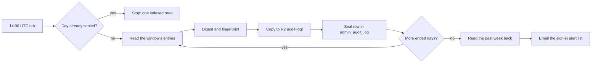

---

title: "The Ghost Audit Engine (and where the permission model lives)"
status: active
audience: [ai, technical]
last_verified: 2026-10-16
verified_against: [code, infra]
owner: harshil
related_code: [src/lib/audit.ts, src/lib/audit-helpers.ts, src/lib/audit-views.ts, src/lib/audit-seal/seal.ts, src/lib/audit-seal/check.ts, src/workers/scheduled-audit-seal.ts, src/pages/api/audit/seals.ts, src/lib/auth/stages/record.ts, src/lib/auth/stages/decide.ts, src/lib/auth/guard.ts, src/lib/retention-tables.ts, src/pages/api/audit/logs.ts]
related_docs: [PERMISSIONS-SYSTEM.md, ARCHITECTURE.md, ../security/THREAT-MODEL.md, ../MAINTENANCE.md]
tags: [architecture, audit, logging, security, plac]
---

# The Ghost Audit Engine (and where the permission model lives)

> **Scope.** The permission *model* — the role ladder, the PLAC resolution
> algorithm, API authorization, provisioning gates, revocation timing and measured
> cost — is owned by [`PERMISSIONS-SYSTEM.md`](PERMISSIONS-SYSTEM.md). §1 and §2
> below are **pointers** to it, kept at their original numbering so existing
> `§1.2` / `§2.5` references still land. (Until 2026-09-19 they restated it, and had
> drifted into describing behaviour the code does not have.) This document owns the
> **Ghost Audit engine** (§3): how it writes, what the log guarantees (§3.2) and the
> daily seal (§3.6). Where the two overlap, the permissions document wins.

> **TL;DR (non-technical):** How the portal records sensitive actions, and a few
> sensitive reads, for accountability; what that record does and does not prove; who can
> erase it; and how each day of it is sealed the next morning so a later change shows.

This document covers the implementation, execution lifecycle and operational rules
of the Audit Engine. The Cloudflare Workers Free plan allows **10 ms of CPU per
invocation** ([`../operations/OPERATIONS.md`](../operations/OPERATIONS.md) §3.1),
which is why the engine defers every write until after the response is sent.

---

## 1. The RBAC foundation — see PERMISSIONS-SYSTEM.md

RBAC gives every account an integer rank, lower meaning more privilege, so a role check is an
integer comparison. The ladder, the translation between stored and canonical names and the
helpers live in `src/lib/auth/rbac.ts` and are documented in
[`PERMISSIONS-SYSTEM.md`](PERMISSIONS-SYSTEM.md) §4.

### 1.1 The six-tier role hierarchy

→ [`PERMISSIONS-SYSTEM.md`](PERMISSIONS-SYSTEM.md) §4.

What the audit log sees of the sixth tier: since 2026-10-16 (permissions #30) Viewer is stored
as `viewer` and can be given. A Viewer opens the Overview (`/dashboard`) and the pages given to
them, and makes one write: asking for access (`POST /api/access-requests`, `READ_ONLY_MAY_ASK`
in `src/lib/auth/stages/decide.ts`). Every other mutation is refused, with a 403 `This account
has read-only access.` on the API or a rewrite to `/dashboard/access-denied` on a page, and is
recorded as `viewer_write_blocked` (§3). Viewer cannot be a page's default role
(`canBePageDefault` in `src/lib/auth/rbac.ts`). [`PERMISSIONS-SYSTEM.md`](PERMISSIONS-SYSTEM.md)
§8.1 owns the rule.

### 1.2 Naming, and why stored values differ from labels

→ [`PERMISSIONS-SYSTEM.md`](PERMISSIONS-SYSTEM.md) §4.1, which carries the
stored→canonical translation table and the warning about the `super_admin` →
`admin` → `manager` rename collision.

### 1.3 No hardcoded bypass

> [!IMPORTANT]
> **There is no break-glass list, no hardcoded super-admin emails, no fallback
> grant path.** Every authenticated request must clear (a) Cloudflare Zero Trust at
> the edge, (b) the `admin_authorized_users` whitelist with `is_active = true`, and
> (c) the relevant role/PLAC gate. A previously-existing `BREAK_GLASS_EMAILS` array
> and the `isBreakGlassAdmin()` / `isHardcodedSuperAdmin()` helpers were removed
> from `src/lib/auth/rbac.ts` — confirmed by the 2026-05-24 deep review
> (`../security/reviews/2026-05-24-security-review.md`) and re-verified in the
> 2026-05-25 review.

What the two top tiers *do* get is a PLAC exemption, not a bypass of
authentication: `vendor_support` and `owner` resolve to allow on every page
([`PERMISSIONS-SYSTEM.md`](PERMISSIONS-SYSTEM.md) §6.2, ADR-0002).

**Lockout recovery:**

1. If the whitelist row for a stranded admin is wrong, a still-active admin fixes
   it through `/dashboard/users`. Making someone Owner waits for a second person
   when one could approve ([`PERMISSIONS-SYSTEM.md`](PERMISSIONS-SYSTEM.md) §10.7).
2. If every admin is locked out, the row is fixed directly in Supabase (Studio or
   `psql`) using `SUPABASE_SERVICE_ROLE_KEY`.
3. **Fixing the row is not enough on its own.** A `revoked:{userId}` flag in KV
   refuses sign-in for 24 hours whatever the directory says
   (`src/lib/auth/stages/bootstrap.ts`), and the three-layer force-kick writes that
   flag. That is how the only Owner was stranded on 2026-09-16 with a correct
   `role=owner, is_active=true` row. Clear the flag too: Sessions → *Sign-in
   blocks* → *Lift the block* (`DELETE /api/sessions/active-revocations`), or
   reactivate the account through `/dashboard/users`, which deletes the flag in the
   same change (`applyUserUpdate`, `src/lib/users/manage-apply.ts`).

The incident, the design and the staged remedy are in
`../specs/2026-09-16-access-revocation-remediation-design.md` (private).

### 1.4 Helper functions

Exported from `src/lib/auth/rbac.ts` and `src/lib/auth/guard.ts`.
[`PERMISSIONS-SYSTEM.md`](PERMISSIONS-SYSTEM.md) §6.2 owns how the two PLAC helpers resolve a
key.

| Function | Description |
|----------|-------------|
| `isVendorSupport` | Exact vendor-support (level 0) check |
| `isOwnerOrVendor` | Vendor-support-or-Owner; used for privileged-account edit protection |
| `isAdminOrAbove` | Level ≤ 2 |
| `isManagerOrAbove` | Level ≤ 3 |
| `isReadOnly` | The Viewer tier, refused on every mutation but asking for access (§1.1) |
| `canManageUser(actor, target)` | Strictly higher privilege; vendor support may act on anyone; an unreadable target role is a no |
| `canBePageDefault(role)` | May a page's default role be this one: not Viewer |
| `requireAuth(context, minRole?)` | (`guard.ts`) Server-side auth gate for pages and API routes. Returns the user on success; throws `AuthError` 401 or 403 on failure |
| `requirePageAccess(user, pagePath)` | (`guard.ts`) Throws `AuthError(403)` on an explicit deny of `pagePath`. **Vendor support and owner are exempt; a missing map is a 403** |
| `placDenyResponse(user, pagePath)` | (`guard.ts`) Response-returning wrapper around `requirePageAccess`. Returns `null` if allowed, or a fully-formed `403` JSON `Response` if denied |
| `placRequireGrant(user, actionKey)` | (`guard.ts`) The fail-closed counterpart for an action key: the exact key must be in the map and allowed. Vendor support and owner are exempt |

**Deprecated aliases.** The pre-rename names are still exported and still used in
`.astro` pages. They are *aliases*, not separate logic — but three of the four now
read as a different tier than they check, which is why they are being retired
(ROADMAP chunk 20):

| Deprecated alias | Actually calls | Reads as | Really means |
|---|---|---|---|
| `isDev` | `isVendorSupport` | "developer" | Vendor support, level 0 |
| `isOwnerOrDev` | `isOwnerOrVendor` | — | Level ≤ 1 |
| `isSuperAdmin` | `isAdminOrAbove` | "super admin" | **Admin**, level ≤ 2 |
| `isAdmin` | `isManagerOrAbove` | "admin" | **Manager**, level ≤ 3 |

> `isAdmin` is the dangerous one: it does **not** mean canonical Admin. It admits
> Managers. Prefer `isManagerOrAbove` / `isAdminOrAbove`, which say what they check.

---

## 2. Page-Level Access Control — see PERMISSIONS-SYSTEM.md

PLAC is the per-user override layer over the role baseline: grants and denies keyed on
`(user_id, page_path)` in D1 `admin_page_overrides`, folded once into a flat access map that
rides inside the KV session record. [`PERMISSIONS-SYSTEM.md`](PERMISSIONS-SYSTEM.md) owns all
of it. The subsections below are pointers, kept at their numbers so older `§2.x` links still
land, with what the audit engine needs to know.

### 2.1 The "compute on write, read from cache" pipeline

→ [`PERMISSIONS-SYSTEM.md`](PERMISSIONS-SYSTEM.md) §7 (the request lifecycle, stage by stage)
and §13.1 (what each path costs).

### 2.2 The D1 schema integration

→ [`PERMISSIONS-SYSTEM.md`](PERMISSIONS-SYSTEM.md) §5 (the `admin_pages` registry) and §6
(the `admin_page_overrides` schema).

### 2.3 The "deny wins" resolution algorithm

→ [`PERMISSIONS-SYSTEM.md`](PERMISSIONS-SYSTEM.md) §6.2. Vendor support and the Owner resolve
to allow before the map is read, so a deny row against either has no effect.

### 2.4 Granular permission model (sub-features)

→ [`PERMISSIONS-SYSTEM.md`](PERMISSIONS-SYSTEM.md) §5. A sub-feature is a hash key on a
registered page (`/dashboard/logs#export`), resolved by the same map lookup. A hash key is not
a descendant of its page and inherits nothing from it, so a handler checks both;
`src/lib/auth/surface-guards.ts` makes that pair the default. The registered set is data:
D1 `admin_pages` where `path LIKE '%#%'`.

### 2.5 Provisioning gatekeepers (anti-escalation measures)

→ [`PERMISSIONS-SYSTEM.md`](PERMISSIONS-SYSTEM.md) §10: the five gates on every page change
the Access Center and Page Registry save (`src/lib/access-center/page-gates.ts`), and §10.7,
the few changes that wait for a second person. Gate D caps a grant at the **actor's**
clearance, not the target's.

### 2.6 PLAC enforcement on API routes (`placDenyResponse`)

→ [`PERMISSIONS-SYSTEM.md`](PERMISSIONS-SYSTEM.md) §9 and §6.2. Two layers apply to every
`/api/*` request. The pipeline resolves the path through `API_PAGE_MAPPING` and denies an
unmapped one (`src/lib/auth/stages/decide.ts`; `API_DENY_MODE = "enforce"` in `wrangler.toml`),
recording `api_authz_deny` (§3). A handler that gates on another page or on an action key also
calls `placDenyResponse` or `placRequireGrant` (`src/lib/auth/guard.ts`) itself. The route
table, with each route's gate, is [`../security/SECURITY.md`](../security/SECURITY.md) §6a, and
the rate limits are in §6b.

> **Known stale code comment.** The docblock above `requirePageAccess` in
> `src/lib/auth/guard.ts` still says the Astro middleware "deliberately skips PLAC for
> /api/\*". The code below it is correct; the comment is not. Flagged 2026-09-19, still there
> on 2026-10-16.

### 2.7 What a permission change actually does

→ [`PERMISSIONS-SYSTEM.md`](PERMISSIONS-SYSTEM.md) §11. A grant, revoke, role change,
access-request approval or Page Registry change writes an `authz-changed:{userId}` mark
(`src/lib/auth/authz-signal.ts`): the person's next request re-reads role and map, and nobody
is signed out. The three-layer force-kick is kept for removing a person: deactivation,
deletion, *Sign someone out* on Users, *Lock out* on Sessions, and the check of accounts unused
for 90 days. [`../security/SECURITY.md`](../security/SECURITY.md) §5 lists the code of each.

### 2.8 Admin Pages Registry Manager

`/dashboard/debug/pages` (Page Registry) edits the registry itself. Since 2026-10-15 it is for
Vendor support only, the owner's decision: `canUsePageRegistry`
(`src/lib/auth/surface-guards.ts`) applies a floor in `src/lib/auth/page-floors.ts` that binds
the Owner too, then the page's own key. [`PERMISSIONS-SYSTEM.md`](PERMISSIONS-SYSTEM.md) §5 and
§10.2 own the rules. What the audit log gets from it:

- Every registry change (`PATCH /api/system/pages`) writes a `registry_update` row with the
  page's values before and after; page settings saved for many people at once
  (`POST /api/system/page-access`) write one row per change.
- Registry changes are limited to 3 a minute (`registry`). A change of a page's default role or
  switch needs a sign-in from the last 10 minutes
  ([`PERMISSIONS-SYSTEM.md`](PERMISSIONS-SYSTEM.md) §10.5) and marks every active person for a
  re-check; a change of default role answers with its impact (`summarizeRoleChangeImpact`,
  `src/lib/auth/registry-impact.ts`).
- Viewer cannot be a page's default (`canBePageDefault`), and the debug pages cannot be switched
  off, so nobody locks themselves out of the registry.

---

## 3. The Audit Engine

The Audit Engine is the forensic record for `cf-admin`. Because there is no
monolithic backend, a blocking logger would sit on the edge hot path, so writes are
deferred until after the response is sent.

**What it records, precisely** (not "every action": the last two rows below are the
paths that skip a write):

| Event | Recorded? | Where |
|---|---|---|
| Any non-idempotent request (POST/PUT/PATCH/DELETE), allowed or refused | Yes — `api_mutation_attempt` / `page_mutation_attempt`, carrying `granted` | `src/lib/auth/stages/decide.ts` |
| An API authorization denial | Yes — `api_authz_deny`, or `api_authz_shadow_deny` in shadow mode | same |
| A read-only account attempting a mutation | Yes — `viewer_write_blocked` | same |
| Domain mutations in handlers (users, content, settings, control plane, cron, …) | Yes — the typed action for that operation | the handler, via `auditLog()` |
| A sensitive read: a consent record's details, a person's sign-in history, an Email API message with its body (since 2026-10-16) | Yes — one `view` row (§3.5) | `recordView` in `src/lib/audit-views.ts` |
| A backup console file preview or restore-test file (since 2026-10-16) | Yes — `backup_data_access` / `backup_restore_test` (§3.5) | the backup console gateway, from the `x-backup-audit` header |
| Sign-in attempts, authorised or not | Yes, to `admin_login_logs` (not sealed, §3.6) | `src/lib/auth/login-event.ts` |
| **Any other page or API read, allowed or denied** | **No** — deliberately, to spare the D1 write budget | — |
| **An insert that fails** | **No** — it is lost. `auditLog` has no retry; the only fallback is a v1-shaped insert for missing-column errors | `src/lib/audit.ts` |

Retry policy belongs to the engine and is scheduled as ROADMAP chunk 15; the
pipeline's own recorder deliberately does not carry one
(`src/lib/auth/stages/record.ts`).

### 3.1 The concept: deferred execution

A D1 write costs milliseconds the user should not pay for. The engine therefore
uses `ExecutionContext.waitUntil(promise)`: the handler returns its HTTP response
immediately, and the isolate stays alive to perform the insert.

The context is resolved through `getCfContext()` (`src/lib/env.ts`) and its
`waitUntil` is **bound** before use — workerd's `waitUntil` is a native method and
throws "Illegal invocation" when called detached from its receiver.

### 3.2 What the log guarantees, and what it does not

*Rewritten 2026-10-16 (permissions item #21, `../MAINTENANCE.md` (private) C-9).*

**Inserts only.** `auditLog()` and `auditLogOnce()` (`src/lib/audit.ts`) insert; no route
edits an entry. Since 2026-10-16 no route deletes an entry younger than 180 days either. One
path deletes from `admin_audit_log` at all:

| Path | Who | What it deletes |
|---|---|---|
| `DELETE /api/retention/purge` (the Data Retention page, `src/pages/api/retention/purge.ts`) | The Owner or Vendor support only: any other role is refused 403, reported to Sentry and emailed to the security alert address. Then a sign-in from the last 10 minutes ([`PERMISSIONS-SYSTEM.md`](PERMISSIONS-SYSTEM.md) §10.5), and the account read again from the directory and refused unless it is still an active Owner or Vendor support. The route also asks `/dashboard/retention#purge` and the page, which both roles pass, so the role is the gate | entries older than the threshold chosen, which for this table is never under 180 days: `minDays` in `src/lib/retention-tables.ts`, and the route answers 400 below it |

Removed on 2026-10-16: `DELETE /api/audit/logs` (*Delete selected* on the activity tab, which
emptied the live table on 2026-09-18), `DELETE /api/audit/prune` (*Prune*, which deleted every
entry older than 30 days) and the activity tab of `/api/audit/delete-targeted`. The targeted
delete (`src/pages/api/audit/delete-targeted.ts`, the Owner and Vendor support) now refuses
any tab but emails, consent, security, requests and seo with a 400, and its `DELETE` needs a
sign-in from the last 10 minutes; its preview (`POST`) does not. `test/audit-seal.test.ts`
covers all three, and the 180-day floor.

**Sealed each morning (§3.6).** An entry of a sealed day edited, added or removed, or a seal
edited or removed, shows in the next morning's check, in its email, and under *Check seals*
on the Audit Log page.

**What it does not guarantee:**

- Today's entries are sealed at 08:00 tomorrow in Aguascalientes. Until then, someone with
  database access can change them without a trace.
- Anyone with Cloudflare dashboard or API access can still run any SQL against the table. The
  seals make a change visible, not impossible. Someone who rewrites a day's entries and every
  seal after it leaves a database that checks out, so each seal also leaves the database
  twice: as a copy in R2 saved with its fingerprint, which the check compares, and in the
  morning email. A bucket lock on `audit-log/` (an owner step, MAINTENANCE AL-1) keeps the
  copies from being deleted or overwritten. An account administrator can remove a lock; the
  emails already sent are then the last record.
- An insert that fails is lost (the table in §3).
- Entries older than 180 days can be removed on Data Retention. Their seals then read *Past
  retention*, not *Changed*.

[`../security/THREAT-MODEL.md`](../security/THREAT-MODEL.md) scores what is left.

> **Terminology rule (2026-07-29, amended 2026-10-16).** Do not describe this log as
> *immutable*, *append-only*, *tamper-proof* or *a ledger*, in engineering docs or in
> customer-facing copy: entries older than 180 days can still be removed, and today's are not
> sealed yet. *Tamper-evident* is allowed only for the sealed days, with that limit in the same
> sentence: "each day of the log is sealed the next morning, and a later change to a sealed day
> shows in the daily check". Velox's `copy-lint.test.ts`, outside this repository, still fails
> the marketing build on the word; changing that is a separate decision.
>
> The accurate claim: **"every privileged mutation is audit-logged with actor, role, path and
> hashed IP; nothing in the portal edits an entry or deletes one younger than 180 days, and
> each day is sealed the next morning, with its fingerprint emailed and a copy kept in R2."**

**Defence in depth:** the audit logger factory validates table-name configuration
against an internal allowlist. Since D1 does not support parameterised table names,
this closes SQL injection through that argument.

### 3.3 Typed actions and modules

The engine uses strict typed unions rather than arbitrary strings, so the log can
be queried reliably: `AuditAction` and `AuditModule` in `src/lib/audit.ts`.

**Read the unions in the file; they are not restated here.** They have roughly
doubled since this document last listed them — the additions cover the control
plane, the cron surface, storage, AI inference telemetry and the auth pipeline's
own rows (`page_mutation_attempt`, `viewer_write_blocked`, `api_authz_deny`,
`api_authz_shadow_deny`), which were written by inline SQL and absent from the
union until chunk 10. *Corrected 2026-09-19: the lists that stood here named 13
actions and 14 modules.*

### 3.4 The details payload — v2, and the redaction chokepoint

Every row carries identity (`user_id`, `user_email`, `user_role`), behaviour
(`action`, `module`), impact (`target_id`, `target_type`, `target_label`) and
request context (`session_id`, `request_method`, `request_path`, `cf_ray_id`,
`ip_hash`, `correlation_id`).

`session_id` holds the session's handle (`sessionRef`, `src/lib/auth/session-ref.ts`), the same
one the Sessions page shows, never the session's ID: the ID is the session cookie, and the Logs
page shows this column to everyone who can read the log. `auditLog` and `createAuditLogger`
hash it for every caller (since 2026-10-11, MAINTENANCE SP-9).

The `details` column is a JSON string built by **`buildAuditDetails()`**
(`src/lib/audit-helpers.ts`), and that function is the **single redaction
chokepoint** — it moved there on 2026-09-07 so that no caller has to remember to
mask anything (`../records/reports/2026-09-07-audit-log-hardening-sentry-and-dev-server.md` (private)).

Shape (v2 rows carry `{ "v": 2 }` so the UI can tell the formats apart):

| Field | Meaning |
|---|---|
| `summary` | One human-readable line |
| `reason` | The actor's stated reason, when the surface collects one |
| `diff` | `FieldDiff[]` — `{ field, old, new }`, plus `isRedacted` where masked |
| `changeCount` | Length of `diff` |
| `context` | Free-form structured extras for that action |

Redaction rules worth knowing:

- `isSensitiveKey()` matches on **name segments**, not substrings: a key is split
  on case boundaries and non-alphanumerics, so `apiKey`, `api_key` and
  `providerApiKey` all match while a benign allowlist (token counts, and similar)
  is exempted first.
- A redacted `diff` field **also** poisons `context`: the field name plus `old`,
  `new` and `value` are added to the redaction set for the context pass. Without
  that, control-plane and settings mutations masked a secret in the diff and
  echoed it verbatim in the context, which made the mask cosmetic.
- `details` is truncated at **500,000 characters** with a `... [TRUNCATED]` marker.
- An insert that fails with a missing-column error is retried once against the
  **v1** column set. Any other failure is reported to Sentry and console, and the
  row is lost.

### 3.5 Reads: navigation is not logged, sensitive reads are

**Navigation is not logged.** `src/lib/auth/stages/decide.ts` records nothing for a page or
API read, allowed or denied — its own comment says reads are skipped "to spare the D1 write
budget" — and a denied page is *rewritten* to `/dashboard/access-denied` with the URL
preserved. (An "In-Accessible Page Tracer" that wrote a `view` row for every navigation was
described here until 2026-09-19; it had been deleted on 2026-08-06.)

**Sensitive reads are (since 2026-10-16, permissions item #20).** Opening something that shows
another person's private data writes one `view` row, after the answer, through `recordView`
(`src/lib/audit-views.ts`):

| What was opened | Route |
|---|---|
| A consent record's details: the session, trace and network lookups | `GET /api/audit/enrich` (`src/pages/api/audit/enrich.ts`) |
| A person's sign-in history | `GET /api/users/[id]/login-history` (`src/pages/api/users/[id]/login-history.ts`) |
| An Email API message with its subject, addresses and body (with Read mail; a masked answer is not recorded) | `GET /api/emails/api-messages` (`src/pages/api/emails/api-messages.ts`) |

The backup console's content reads, a file preview and a restore test's file, are recorded by
the portal's gateway instead, from the `x-backup-audit` header cf-backup sends with them
(`AUDIT_HEADER` in `src/lib/backup-proxy.ts`), as `backup_data_access` and
`backup_restore_test`; any other header on a read is ignored. Lists and masked reads are not
recorded. A `view` row that cannot be written is reported to Sentry, and the data is still
shown. `test/sensitive-views.test.ts` and `test/backup-gateway.test.ts` pin both.

**Who tried to reach what they may not** is answered without read logging:

- **Mutations** carry `granted: false` when refused, so attempted writes against a
  denied surface are visible (`page_mutation_attempt`, `api_mutation_attempt`).
- **API denials** are recorded as `api_authz_deny`, including the reason
  (`plac_denied` or `unmapped_route`).
- **Sign-in attempts** are in `admin_login_logs` with `is_authorized_email`, which
  is where probing by non-whitelisted identities shows up.

Recording every navigation would mean one D1 write per page view against a 100,000 rows/day
free-tier budget; if it is wanted, it should be designed with sampling or an aggregate.

### 3.6 The daily seal

*Added 2026-10-16 (permissions item #21). Code: `src/lib/audit-seal/` (the rules, pure),
`src/workers/scheduled-audit-seal.ts` (the job), `src/pages/api/audit/seals.ts` (the check on
the page). Tests: `test/audit-seal.test.ts`.*

**When.** The `audit-seal` job runs in the five-minute tick. It reports the next 14:00 UTC
(08:00 in Aguascalientes) as its due time, so the dispatcher wakes it hourly at most
([`../features/CRON-CONTROL.md`](../features/CRON-CONTROL.md)), and an hour that finds the day
sealed costs one indexed read. A run that misses a day seals it the next time.

**What a seal covers.** A hotel day runs from midnight to midnight in Aguascalientes (UTC-6
all year), 06:00 to 06:00 UTC. A day with more than 500 entries or about 64 KB is split into
windows, at a whole second. For each window:

1. Every entry, ordered by `created_at` then `id`, becomes one line: the JSON array of its 17
   columns (`SEAL_COLUMNS` in `src/lib/audit-seal/seal.ts`, every column of the table).
2. The **digest** is the SHA-256 of those lines joined by a newline.
3. The **fingerprint** is the SHA-256 of
   `madagascar-audit-seal|v1|<from>|<until>|<count>|<digest>|<prev>`, where `<prev>` is the
   fingerprint of the window before (`start` for the first seal).

The same entries always give the same seal, so two runs at once write it once
(`auditLogOnce`), and the chain never forks.

**Where it is kept.**

| Copy | Where | What protects it |
|---|---|---|
| The seal row | `admin_audit_log` itself: action `audit_seal`, `target_type` `audit_seal`, `target_id` the window's start, the seal in `details.context.seal`. No new table | The next day's seal covers it, as it covers every entry |
| The copy | R2, the `STAFF_STORAGE` bucket, `audit-log/<year>/<month>/<start>.json`: the entries' lines exactly as hashed, and the seal, with the fingerprint in the object's metadata. It is written before the seal row, so a seal never names a copy that does not exist | A bucket lock on `audit-log/` (MAINTENANCE AL-1) |
| The fingerprint | The morning email to the sign-in alert list | The recipients' mailboxes |

A copy can be checked with any SHA-256 tool: write each entry of `rows` as JSON, join them
with newlines, and hash; the result is `digest`. The copy's `check` field says the same.

**The morning check.** After sealing, the job reads back the seals of the week before
(`src/lib/audit-seal/check.ts`); *Check seals* on the activity tab reads them a page at a
time, for the Owner and Vendor support (`GET /api/audit/seals`). For each seal:

| Shows | Means |
|---|---|
| *Matches* | The entries give the seal's digest |
| *Changed* | An entry was edited, added or removed after sealing (the email gives the count then and now) |
| *Seal edited* | The seal no longer gives its own fingerprint |
| *Unreadable* | The seal row is not a seal any more |
| *Past retention* | Fewer entries, in a day older than 180 days: removed on Data Retention, not a problem |
| Not linked, or the seal before is missing | A seal before it was edited or removed |
| Its copy has another fingerprint | The seal, and perhaps its entries, were rewritten after the copy was saved |
| Its copy is missing | The morning check saves it again while the entries still match |

The two cases a check of old seals cannot see are caught by the job itself. When the newest
seals are removed, the job seals those days again; their first copies are still in R2, so a
day sealed again with other entries differs from its copy, and the email says so at once.
When the newest seal is edited until it is not a seal, nothing more is sealed until someone
restores it from its copy; Sentry hears of it each hour (`cron.audit_seal.unreadable`), and the
morning check still runs and emails.

**The email.** To the sign-in alert list, from the access mail sender. The alert policy
(*Sessions → Alert policy → Audit log seal*) sends it every morning with the fingerprint (the
default), or only when something changed. A warning always goes.

**What is not sealed.** The sign-in log, `admin_login_logs`, is not sealed:
`src/lib/audit-seal/seal.ts` seals `admin_audit_log` only. Its entries can be removed by the
Owner and Vendor support through the targeted delete (§3.2) and on Data Retention.

**Why windows and not a chain on each row.** The first design (C-9) chained each row to the
one before. Rows are written after the response (`waitUntil`), many at once, so a row reading
its predecessor would fork the chain under load. Sealing day-old rows, which nothing writes to
any more, from one job needs no lock and no Durable Object.

**CPU.** Hashing costs about 20 µs a KB (parsing the rows, writing their lines and the copy,
SHA-256; measured 2026-10-16). A run hashes at most 256 KB (about 5 ms), a page of the check
128 KB, and both stop at their budget and say where to go on; a usual day is a few KB.

---

## Verification log

| Date | Checked by | Method | Result |
|---|---|---|---|
| 2026-10-16 | claude | Read `src/lib/auth/rbac.ts` (`canBePageDefault`, `isReadOnly`, `canManageUser`), `src/lib/auth/stages/decide.ts` (`READ_ONLY_MAY_ASK`), `guard.ts` (`placRequireGrant`, the stale docblock), `surface-guards.ts` (`canUsePageRegistry`), `src/pages/api/system/pages.ts`, `src/lib/access-center/registry-access.ts`, `src/lib/users/manage-apply.ts`, `stages/bootstrap.ts`, the Sessions console (`SessionsConsole.tsx`), `src/lib/audit-views.ts` and its three callers, `src/lib/backup-proxy.ts`, `src/lib/backup-audit.ts` and the backup gateway (`RECORDED_READS`), `src/pages/api/retention/purge.ts`, `src/pages/api/audit/delete-targeted.ts`, `src/lib/audit-seal/seal.ts` and `AuditLogRepository.ts` (the seal reads `admin_audit_log` only), and `src/lib/audit.ts` (truncation, v1 fallback, table allowlist, the action union) | §1 and §2 trimmed to pointers to PERMISSIONS-SYSTEM.md, with what the audit log needs: Viewer is stored and given since #30, may only ask for access, `viewer_write_blocked`, not a page default; Page Registry is vendor support only (`canUsePageRegistry`), the lock-out recovery names *Sign-in blocks*. §3's table and §3.5 now record the sensitive reads (`view` rows, the backup gateway's two read actions). §3.2's purge row gives the real gates (the role, not `#purge`) and the targeted delete's. §3.6 says the sign-in log is not sealed; the flowchart's labels are quoted so it renders. No test run (shared checkout). Not re-checked: §3.6 beyond the new paragraph (row below) |
| 2026-10-16 | claude | Read `src/lib/audit-seal/` (`seal.ts`, `check.ts`, `mail.ts`), `src/workers/scheduled-audit-seal.ts`, `src/pages/api/audit/seals.ts`, `src/lib/audit.ts` (`auditLogOnce`), `src/lib/retention-tables.ts` (`minDays`), `src/pages/api/retention/purge.ts`, `delete-targeted.ts` (tab allow-list) and `logs.ts` (no DELETE); `prune.ts` deleted. `test/audit-seal.test.ts` (26 tests) passes. Live D1 `pragma_table_info('admin_audit_log')` read through the Cloudflare connector: 17 columns, the same as `SEAL_COLUMNS` | §3.2 rewritten, §3.6 added, the terminology rule amended. §3, §3.1, §3.3 to §3.5 not re-checked |
| 2026-10-16 | claude | Read the recent sign-in check in `src/pages/api/audit/logs.ts`, `prune.ts`, `delete-targeted.ts` (DELETE only), `consent.ts`, `emails.ts`, `delete.ts` and `src/pages/api/retention/purge.ts`; `test/fresh-sign-in.test.ts` pins the list | §3.2's new sentence under the deletion table. Nothing else re-checked |
| 2026-10-11 | claude | Read `src/lib/audit.ts` (`withSessionHandle`) and `src/lib/auth/session-ref.ts`; `test/pipeline-session.test.ts` asserts the handle in the column | §3.4's `session_id` paragraph. Nothing else re-checked |
| 2026-10-07 | claude | Read `src/lib/ratelimit.ts` and `src/lib/dal/RateLimitRepository.ts` | The rate-limiting step (changed 2026-10-04): one-minute limits on the `RL_PER_MIN_<n>` bindings, hour and day limits as D1 counter rows, no Upstash client left. Nothing else re-checked |
| 2026-09-19 | claude | Re-derived against `06f8ab7`. Read `src/lib/audit.ts`, `src/lib/audit-helpers.ts`, `src/lib/retention-tables.ts`, `src/lib/auth/stages/decide.ts`, `record.ts`, `bootstrap.ts`, `guard.ts`, `authz-signal.ts`; and every handler under `src/pages/api/audit/`. Live `admin_audit_log` state taken from the 2026-09-18 fact sheet (2 rows, the bulk delete and its own attempt row, `request_path` NULL) | §1 and §2 reduced to pointers; §3 rewritten. Load-bearing corrections: the middleware does **not** skip `/api/*`; `requirePageAccess` exempts owner as well as vendor and 403s on a missing map; permission changes write an `authz-changed` mark, not a force-logout; the §3.5 "view" telemetry never existed after 2026-08-06; the deletion-path table now names `DELETE /api/audit/logs` and drops `/api/audit/delete`; the "insert-only application path" phrasing is withdrawn |

## Related

- [`PERMISSIONS-SYSTEM.md`](PERMISSIONS-SYSTEM.md) — **the permission model, authoritative**
- [`ARCHITECTURE.md`](ARCHITECTURE.md) — the wider system overview
- [`../security/THREAT-MODEL.md`](../security/THREAT-MODEL.md) — the residual-risk scoring for audit erasure
- [`../security/login-forensics.md`](../security/login-forensics.md) — `admin_login_logs`, the sign-in telemetry subsystem
- `../MAINTENANCE.md` (private) — C-9 (resolved by the daily seal) and AL-1 (the bucket lock)
