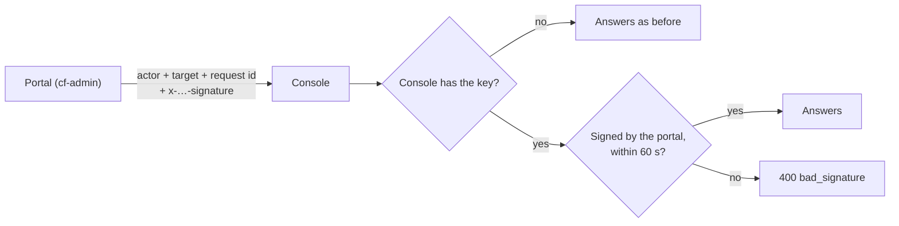

# Console signature

> **In one minute.** The portal tells the Backups, Server and Email API consoles who is asking in
> a "who you are" header. Until now the consoles believed that header because only the portal can
> reach them. Once the owner sets one shared key, `CONSOLE_SIGNING_KEY`, on the portal and on a
> console, the portal signs the header and that console refuses anything it did not sign. Nothing
> changes until the key is set. Permissions item #33, approved by the owner on 2026-10-15.

## 1. What it protects against

The three consoles have no web address. cf-backup and cf-vps are private Workers, and the email
service's `Console` door is a named entrypoint with no route. The only way in is a Cloudflare
service binding, and only cf-admin has one, so each console trusts the header cf-admin adds:

| Console | Worker | Headers it trusts |
|---|---|---|
| Backups | `cf-backup` | `x-backup-actor`, `x-backup-target`, `x-backup-request-id` |
| Server | `cf-vps` | `x-vps-actor`, `x-vps-target`, `x-vps-request-id` |
| Email API | `cf-email-api` (`Console` entrypoint) | `x-email-actor` (its list of powers, `caps`, included), `x-email-request-id` |

Cloudflare lets any Worker in the account be given a binding to these Workers. A Worker added
later, or a mistake in one, could then send the header and claim to be the Owner
([MAINTENANCE](../MAINTENANCE.md) AC-3). The signature closes that: a console with the key
answers only requests the portal signed.

What it does not protect against: a Worker that holds the key. The same key sits on all four
Workers, so any of them could sign for the others. It also does not cover the request body
(below).

## 2. How it works



Every call to a console goes through its binding accessor (`backupBinding`, `vpsBinding`,
`emailConsoleBinding`). With the key set, the accessor returns the binding wrapped by
`signingBinding` (`src/lib/console-signature.ts`), which adds one header to each request:

```text
x-backup-signature: v1.<Unix seconds>.<HMAC-SHA256, unpadded base64url>
```

(`x-vps-signature` and `x-email-signature` for the other two.) The HMAC is over this text, one
field per line:

```text
cf-console-signature-v1
<console: backup | vps | email>
<Unix time in seconds>
<method, upper case>
<path and query>
<actor header, or empty>
<target header, or empty; always empty for email>
<request-id header, or empty>
```

A header value cannot hold a line break, so no field can run into the next. Each console rebuilds
the same text from the request it received and checks the HMAC with `crypto.subtle.verify`, which
compares in constant time. It accepts a time up to 60 seconds either side of its own clock.

So the signature names the console, the person, the path and the minute. Taken from one request,
it cannot be used for another person, another path or another console, or after a minute. The
body is not signed: the gateway streams it, and a signature that names this person on this path in
the last minute is what a forger would lack.

Every caller goes through the accessors, so all of them are signed:

- the Backups and Server gateways, the server terminal's WebSocket included;
- the Access Center;
- the second-person hold for server log retention;
- the `backup-tick` and `email-api-sweep` jobs.

A browser cannot send the header. Each gateway forwards only an allow-list of headers.

The key is read with surrounding spaces and line breaks removed, on all four Workers, so a pasted
value with a trailing newline still matches.

## 3. Turning it on (the owner)

The key is a long random value, the same on four Workers. It is optional:

- It is not in any `[secrets] required` list, so a deploy never waits for it.
- A console without the key ignores the signature.
- The portal signs only once it has the key.

Set it on cf-admin first. From then on the portal signs every request, and each console starts
checking as soon as it gets the key, so nobody is refused at any step.

1. Make the value: a password generator, 40 or more letters and digits.
2. For each Worker in this order: `cf-admin`, `cf-backup`, `cf-vps`, `cf-email-api`:
   1. Open Cloudflare dashboard → **Workers & Pages** → the Worker → **Settings** → **Variables and
      Secrets** → **Add**.
   2. Choose type **Secret**, name `CONSOLE_SIGNING_KEY`, and paste the value.
   3. Tap **Deploy**.
3. Open **Backups**, **Server** and **Email API** in the portal. Each opens as before.

If a console then shows "signature … does not match", that Worker's value differs from cf-admin's:
paste it again on that Worker.

**Rotating the key:** set the new value on all four Workers, one after the other. Between the
first and the last, the consoles that do not yet match answer `400 bad_signature`.

**Turning it off:** delete the secret from cf-admin and the three consoles, consoles first.
Deleting it from cf-admin first makes every console that still has it refuse.

## 4. When it refuses

| Answer | Meaning | What to do |
|---|---|---|
| `400 bad_signature`, "not signed by cf-admin" | The console has the key and the request had no signature: the portal has no key, or the caller is not the portal | Set the same key on cf-admin |
| `400 bad_signature`, "does not match" | The two values differ, or the headers were changed after signing | Paste the same value on both |
| `400 bad_signature`, "more than 60 seconds" | The request took over a minute to arrive, or a clock is wrong | Try again; if it repeats, report it |

The consoles never answer 401 for this: 401 means "signed out", and only the portal says that.
The Access Center counts `bad_signature` as the portal's own fault (`OUR_FAULT` in
`src/lib/access-center/console-client.ts`). It shows "could not complete the request" and logs
the code. Each console also logs its refusals (`signature_refused`).

## 5. Cost

One HMAC per console request, over well under 5 KB of text. The key is imported once per isolate.
Both are microseconds, far inside the 10 ms CPU budget.

## 6. Tests

- `test/console-signature.test.ts` pins the signature against vectors computed outside this code
  with Python's `hmac`. The same vectors are pinned in `cf-backup/test/signature.test.ts`,
  `cf-vps/test/signature.test.ts` and `cf-email-consumer/test/api-signature.test.ts`, so the
  four Workers cannot drift apart unnoticed.
- It also checks:
  - Without the key, the binding is handed back unchanged and no header is added.
  - A browser's copy of the header is never passed on.
  - With the key, the gateways, the backup tick, the Access Center (with its target) and the
    Email console are all signed.
  - Changing the actor's powers after signing breaks the signature.

## Verification log

| Date | Checked | Result |
|---|---|---|
| 2026-10-16 | The code and tests above in all four repositories; the dashboard steps against Cloudflare's "Secrets" documentation (Settings → Variables and Secrets → Add → Secret → Deploy) | Built and tested. Not checked: a signed request in production, which waits for the owner to set the key |
