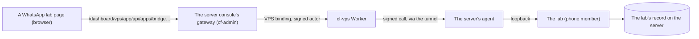

# WhatsApp lab — testing the hotel's WhatsApp bot from the Chatbot section

> **TL;DR (non-technical):** The WhatsApp lab is a private copy of the hotel's WhatsApp bot that
> runs on our server beside the real one and can never reach WhatsApp or a real customer. In the
> Chatbot section, **WhatsApp lab** lets you write to it as a customer would and watch it
> answer, see under each answer which AI models it used, how many tokens, how long it took and
> what it cost, open every step it took, and switch any of its AI steps to another Claude or
> Gemini model for one chat to compare them. Nothing here changes the real bot.

This document is cf-admin's side: the three pages, who may open them and how they reach the
lab. The lab itself (its test WhatsApp, its model gateway, how a copy of the bot is made, its
record) is cf-vps's, and its guide is `documentation/features/WHATSAPP-LAB.md` in the cf-vps
repository; where the two disagree, the cf-vps code wins.

## 1. The pages

**Chatbot → WhatsApp lab**, the last group in the Chatbot section's row of tabs, set apart
from the website chatbot's tabs by a short divider and shown in WhatsApp's green, has three
pages:

| Tab | Page | What it shows |
|---|---|---|
| Test chat | `/dashboard/chatbot/whatsapp` | Laid out as WhatsApp is (remade 2026-11-05, below): the test chats, one chat with its answers, ratings and figures, and the chat's info with its tools and models |
| Usage | `/dashboard/chatbot/whatsapp/usage` | What the tests spent, turns, model calls and failures, tokens and ratings as small figures in the page's bar; the comparison **by model** and **by step and model** (each model with its maker: calls, failures, average time, average tokens read and written, cost, cost per call), the average time and the cost per call each with a bar against the slowest and the dearest row; the last 100 turns, each with Details. The Chatbot section's Models page draws the same comparison for the lab and the real bot (CHATBOT.md §0.1, since 2026-11-06); this page's tab comes off once lab 1.14.0 is installed and the owner has seen it there |
| Set-up | `/dashboard/chatbot/whatsapp/setup` | Whether the lab is ready, as a checklist where each line says its state in words as well as its mark (its copy of the bot, its n8n, the copy switched on, the Anthropic and Gemini keys, PostHog), the PostHog panel (below), what the copy holds (the bot's AI steps with their live models and temperatures, what was replaced to keep it inside the lab), the price list every cost comes from with each model's maker and the sources, and the last 50 changes made in the lab and by whom, as a timeline |

The three pages are tabs in the section's one row (since the evening of 2026-11-05, the
owner's "2 layer tabs are bad looking"): after the divider a small green **WhatsApp lab**
caption, then **Test chat**, **Usage** and **Set-up**, each in the lab's green whichever page is
on screen (`RegistryTabs.astro` `expand`, set in `src/layouts/ChatbotLayout.astro`). Only the
pages the person may open are shown, by the sidebar's rule (`src/lib/auth/registry-tabs.ts`);
if they may open just one, the single **WhatsApp lab** tab stays. Each page then opens on the
section's slim page bar ([frame design](../specs/2026-11-05-chatbot-section-frame.md)): the
page's icon and name, one line on what it shows (hidden on a phone), and its buttons on the
right (`src/components/admin/chatbot/PageBar.tsx`). There is no second row of tabs.

### The Test chat

The page has no head of its own: the Chatbot section's tabs and the page's bar (its name,
and **Ready** or how many things are left to fix) are the whole header, and the chat starts
under them. Its layout follows the room the page has, not the screen's: from 42rem wide the
chats and the chat sit side by side, and from 62rem the chat's info is a third column (narrower,
it opens from the chat's top bar). On a phone the list and the chat are two screens, as in
WhatsApp: a press on a chat opens it, the arrow goes back, and a press on the chat's name opens
its info. Since the second pass of 2026-11-05 every part is drawn as WhatsApp draws it
([design](../specs/2026-11-05-whatsapp-lab-test-chat.md), §6).

- **The list**, the latest activity first: each chat's round badge in its own colour (the same
  colour every time; the owner's chat a phone), name, time, one tick or two on the customer's
  last message, the last message (or "The bot is writing…" in the lab's green), and its turns
  and cost since its last reset. Above it: Refresh, **New chat** (each chat gets its own testing
  number, so the bot sees a new customer), a search box for a chat's name or last message,
  **Chats** and **Archived** with their counts, and **Compare**. Under it, what every test has
  spent and how many answers were rated 👍 and 👎.
- **The chat**, on a dotted background in the lab's green: the day ("Today", "Yesterday", then
  the date) over its first message; the customer's bubbles on the right with the hour and one
  tick when sent, two once the bot has read them; the bot's and the hotel's phone's on the left,
  the first bubble of a run with its corner squared toward the sender. A reaction shows on the
  bubble it answers, and as a line ("The hotel's phone reacted 👍 to …"). Three moving dots
  while the bot is writing (still for people who ask their phone for less motion). Since
  2026-11-07, while a person has the chat (the hotel's phone wrote after the bot's last answer
  and nobody has reacted 👍 since) there are no dots and no "the bot is writing…": a line says
  the bot is paused, because the bot really stays silent then, with no ticks and no typing, as
  on a real phone (the owner's tester saw endless dots in chat 232). Under each
  answer one row of small figures: the models, the time to the first answer, tokens read and
  written, cost, and any failed call; then 👍 and 👎 and **Details**. 👎 asks at once what was
  wrong (optional); either verdict can carry a note, and a second press takes it back. Tapping a
  message offers the hotel's reactions: 👍 brings the bot back, ✅ approves. The top bar has the
  chat's badge, name and models in one line ("Gemini 3.8 Flash on every step, cached"), or "the
  bot is writing…", then **Models**, **Reset** and, where the info is not a column, **Info**.
- **The composer**: a two-way switch to write as the **Customer** or as the **Hotel's phone** (a
  person taking over), and **Try**: a sideways row of short names ("Greeting", "Room this
  weekend", "Price for a cat" …) that each put a common first message, in the customers'
  Spanish, in the box. Then the photo button and a box that grows with the text, in one rounded
  field, and the round Send (Ctrl+Enter on a computer).
- **An empty page** (no chat open) says what the lab is, offers **New chat**, and three tips:
  the models from the chat's top bar, Compare, and the ratings.
- **The chat's info**, as WhatsApp's contact page: the chat's large badge, name and testing number
  written in groups (+52 1 000 000 0101), when it was made or reset; the tools as a grid of
  buttons: **Reset**, **Copy**, **Rename**, **Archive** (or **Bring back**), **Text file**,
  **JSON file** and **PostHog**; since the last reset its turns, spend, ratings, tokens read and
  written, and failed calls as small figures; each AI step's model (a changed one in the lab's
  green), caching (and for how long), lean side steps (lab 1.3.0), checked dates and how hard the
  reply thinks (lab 1.4.0), and **Change models**.
- **Change models** is a drawer (remade again on 2026-11-05, on the owner's "extreme makeover"
  ask): one line per AI step, with the model it runs on in this chat (a changed one in the lab's
  green, with a dot), the live bot's model under the step's name, and **≈ a call**: what one of
  that step's calls costs on that model, from the step's average tokens read and written in the
  lab so far at the model's list price (an estimate, before any cache discount; a step that has
  not answered yet shows only prices). A press on a line opens its choices as cards, every model
  in view and none off the screen, grouped by who makes it (Anthropic, Google, Cloudflare), each
  with its own ≈ a call and its price in and out per million tokens; the live bot's model is
  marked Live, and a press picks it and closes the line. **Every step at once** heads the list
  and puts the whole chat on one model (or back on the live bot's models). Under the list, **How
  the bot is sent**, each setting with what it does and its choices in view: caching of the bot's
  instructions (Off or On); from the lab's 1.3.0, **Lean side steps** (Off or On); from 1.4.0,
  **Keep the cache for** (5 minutes or 1 hour, while caching is on), **Checked dates** (Off or
  On) and **How hard the reply thinks** (Default, Low, Medium or High). A setting shows only when
  the lab's answer for the chat carries it, and **Save models** sends back only those.
- **Reset** (after a confirm) starts the chat again as a new customer: the lab gives it the next
  testing number, never one used before, so the bot has no memory of it, and the chat starts empty.
  Its models stay, its earlier turns stay on the Usage page, and the chat says how many there
  were. It is refused while the bot is still working on the chat. **Copy** makes a new chat with
  the same models on its own number, to change one thing and compare. **Archive** takes a chat
  out of the list and deletes nothing. The owner's chat (where the bot writes to the hotel's
  owner) cannot be reset or copied.
- **Compare** puts up to three chats side by side (swiped sideways on a phone), each with its
  models in a line and its spend, and one message from the composer goes to all of them, so
  three setups answer the same question. **Done** goes back to one chat.
- **Export**: **Text file** is every message with its time and each turn's line of figures and
  rating; **JSON file** is the chat exactly as the lab answered it. The file is made in the
  browser.

**Details** (a drawer, the shared Dialog) is one turn in full: its status and start, then its
cost, model calls, time to the first answer, tokens read and written and failed calls as small
figures; each AI step's model (and the live model it stood in for, when it was changed), time,
tokens read, written, read from and written to the cache, cost, stop reason and the lab's notes
(what it adapted for a model), with **Show what was sent and the answer**; the bot's n8n runs,
each step a bar placed at its start and as long as it took, so the slow step stands out, a
failed step in red with its error; and what the bot sent to the lab's test WhatsApp.

When something stops a test, each page says so at the top, with where to fix it: no copy of the
bot yet, its n8n not answering, the copy switched off, or no Anthropic key (set on the Server
page: Apps, then `whatsapp-lab.phone`, then Keys).

The totals under each turn and the Usage page's figures need the lab's version 1.0.1; reset,
copy, rename, archive, ratings and the list's last message and cost need 1.1.0. Both are on the
server since 2026-11-05. An older lab still shows its chats and turns, and a button it cannot
answer says the lab needs its 1.1.0 update. The Usage page shows the ratings too: how many
answers were rated good and bad, and each turn's verdict and note.

**PostHog** (lab 1.2.0). With PostHog's project token set on the Server page (Apps, then
`whatsapp-lab.phone`, then Keys, `POSTHOG_API_KEY`), the lab sends every test chat to PostHog's
AI observability, each message with its English: cf-vps's guide, "PostHog", says what goes. The
Set-up page's PostHog panel shows the token (set, the wrong kind, or not set), whether the
English is on, paused or off, what PostHog has, what is waiting, and the last failure with when
the lab tries again, and links to the lab's traces in PostHog. Each reply's details open its
turn in PostHog ("Open in PostHog"), and a chat's info its session (the PostHog chip); the links
show only when the lab sends to PostHog, and only an `https` address the lab gives is used, in a
new tab. The Usage page names the lab's own English step "English for PostHog (the lab's own)":
its cost is the lab's, never a turn's. A lab older than 1.2.0 shows "sends nothing to PostHog
yet".

**A turn** is one customer burst and everything the bot did about it. The bot waits on purpose
(10 s to gather a burst, more before a booking draft), so a turn shows "Bot working" for a while
after its answer; while one is open the page reads the chat again every 3 seconds, and stops
once it ends (30 s of quiet after the answer, 60 s without one, at most 5 minutes; the lab's
rule).

**Models.** A choice applies from the chat's next message: each turn keeps the models it started
with, so a chat can compare Sonnet on one question with Haiku on the next. The models offered are
those the lab has a price for. Gemini models are offered once a Gemini key is set in the lab. A chat left as it is runs every step on the live bot's Claude models, so it needs the Anthropic key even when a Gemini key is set; **Every step** → a Gemini model runs it on Gemini alone. A
newer Claude model that refuses sampling settings, or thinks before it answers, is adapted by
the lab, and the call's notes say what was changed.

**Lean side steps and Workers AI** (lab 1.3.0, on the server since 2026-11-05). **Lean side
steps** tries on one test chat the cost clean-ups planned for the live bot: the payment check is
sent a few lines of instructions instead of a long copy of an old bot prompt, and a Claude 5.x
model on a side step thinks at low effort. What the customer reads is never changed, and each
change is noted on the call; cf-vps's guide, "Choosing models", has the detail. The switch shows
in Change models and the chat's info only when the lab sends it, so an older lab shows neither.
**Workers AI** models (Cloudflare's, such as Gemma 4 26B A4B IT) are offered after Claude's and
Gemini's, once the lab has a price for them. From the lab's 1.4.0 its status says whether both
Workers AI keys are set: with both, their cards are offered as any other; without, they are
greyed and their group says it needs the lab's two Workers AI keys. A lab before 1.4.0 does not
say, so their cards stay offered with that line (a call without the keys fails and says so).

**Checked dates, reply effort and a 1-hour cache** (lab 1.4.0). **Checked dates** adds to the
reply step's message one checked line for each date the customer writes, looked up in the
calendar the bot already sends, so a wrong day name ("domingo 23" when the 23rd is a Monday) is
caught. **How hard the reply thinks** sets the reply step's thinking effort on a Claude 5.x model
or a Cloudflare model; any other model is sent as it is, and the call's notes say so.
**Keep the cache for** an hour writes the cached instructions at twice the input price instead of
1.25 times, and pays when the next message usually comes 5 to 60 minutes later. Each change is
noted on the call; cf-vps's guide, "Choosing models", has the detail. The chat's info and its
one-line summary show them (for example "cached for an hour, dates checked, low effort").

**Run as the real bot's door** (the lab's `door`, lab 1.5.0; shown only when the lab sends it).
On, the chat runs as the model door runs the real bot: the door sorts each call into its step
by the request's words and sends it on the model, cache, effort and lean side steps the lab's
**Models** settings give (Chatbot → Settings → Models, lab 1.17.0; before 1.17.0 the door's
built-in table), in place of the choices on this drawer; each call's notes say which step the
door saw. So a change to the lab's Models settings is tried here before it is saved for the real
bot. The chat's info says "Runs as the real bot's door: On".

**New chats start on the bot's settings** (lab 1.24.4, the owner's ask of 2026-11-07: a new chat
started on the live bot's Sonnet 4.6, about US$0.061 a reply). The lab gives a new chat `door`
on, so it runs the lab's saved Models settings, which the tests chose as the cheapest set-up that
answers well (cf-vps's guide, "Since 1.24.4", has each step's choice and why); a chat made before
keeps its own. In Change models, **Every step at once** then reads "The bot's settings", its first
choice (above "The live bot's models"); each step shows the model those settings give it, read
from the lab's `record/settings` when the drawer opens (`settingsModel` in `format.ts`, the brake
and a door set to `pass` included), under "From the bot's settings". Picking a model for one step
starts the chat's own choices from the settings (`setupFromSettings`: each step's model, the cache
for an hour, the payment check's lean for every side step, the reply's checked dates and effort)
with only that step changed, and turns the switch off. The chat's one-line summary says "The
bot's settings". The chat's info shows, for each step, the model the settings give it and under it
every switch they apply (`settingsSwitches`: the reply's thinking effort, checked dates and the
price calculator, lean on a side step, the cache for an hour; "as the bot sends it" when none),
then when the settings were saved and the month's brake; the chat's own cache, lean, dates and
effort rows, which such a chat does not use, are left out (the owner's screenshot of 2026-11-07
showed them as "Off, as the live bot" while the settings had them on). Under the models, **Safety
and hours** lists what such a chat's replies follow besides them (`rulesRows` in `ChatInfo.tsx`,
cf-vps lab 1.26.0): the hand-over to a person and its words, after hours, the longest reply, the
backup model, the opening days and hours, and the Mexican holidays with the days closed or open
besides, each changed under Chatbot → Settings with Lab picked. A chat on its own choices, which
follows none of them, says it copies the live bot and to turn on Run as the real bot's door in
Change models (the owner's "I dont see additional configs in it", 2026-11-07).

**Photos** are made smaller in the browser before they are sent (a JPEG of at most 1,280
pixels, stepped down until it fits the 256 KiB a server-console change may carry). **Voice notes
are not offered**: the lab has no Whisper yet.

## 2. Who can open them

The three rows (migration `0093`) are stored at role `owner`: the Owner and Vendor support open
them, and anyone else only with a grant on the Access page. Their data comes through the server
console, so a person also needs what the console asks of everyone: the Server page's own key
(`/dashboard/vps`, never inherited), the server access notice accepted in this sign-in before
any change, and in cf-vps the `apps.bridge.view` capability to read and `apps.bridge.operate` to
write (both in the Owner's defaults). Without them the page opens and says, in words, which is
missing ([PERMISSIONS-SYSTEM](../architecture/PERMISSIONS-SYSTEM.md)).

## 3. How the pages reach the lab

The pages add no route, key, table or binding: they call the server console's existing gateway
(`src/pages/dashboard/vps/app/[...path].ts`), exactly as the console's own screens do. A read is
a GET of `apps/bridge/view?app=whatsapp-lab&member=phone&path=…`; a change is a POST of
`apps/bridge` with `{ app, member, level: "operate", path, body }`. The gateway checks the person,
the notice and same-origin, and records each change in the audit log as `vps_app_bridge` (the
path only, never the message). cf-vps signs the call, its agent hands it to the lab on the
server's loopback, and the lab checks that signature itself and records who made each change.
`src/components/admin/chatbot/whatsapp/lab-api.ts` is the one place that builds these calls, and
it turns any layer's refusal into one sentence for the screen.

What the pages show lives in the lab on the server: test chats on testing numbers, every model call
with its request and answer, and the bot's runs. Nothing about a test is stored in this portal
beyond the audit row per change.

## 4. Limits and what comes next

- **A judge's score and a simulated customer** (step 3 of the plan). Side by side is built
  (Compare, above), and the tester's own 👍 and 👎 are the score until then. PostHog's checks
  on every reply and its whole-chat review come next, set up in PostHog; a later lab version
  then reads their verdicts back, and these pages show them on each reply.
- **Client access**: the pages need the Server page's key, which also opens the server's
  terminal. Giving the client's staff the lab without the server needs its own route first.
- **Voice notes**: the lab needs a Whisper member.
- **A new copy of the bot** (after the live bot changes) is made on the server, with the
  owner's yes for reading the live bot: cf-vps's guide, "Putting it on the server", steps 7 and 8.

## Verification log

| Date | Who | What was checked | Not checked |
|---|---|---|---|
| 2026-11-07 | claude | §1's Safety and hours in a chat's info (`rulesRows` and the older chat's note in `ChatInfo.tsx`), against cf-vps lab 1.26.1's `record/settings` shapes; `test/whatsapp-bot-hotel.test.ts` | The panel on a phone (the owner's test) |
| 2026-11-07 | claude | §1's chat info on the bot's settings: `ChatInfo.tsx` (each step's model and `settingsSwitches`, the version and the brake, the chat's own switches hidden), the switches in `ChatModels.tsx`'s step lines, `.wl-steps` in `chatbot.css`; `test/whatsapp-lab-pages.test.ts` | The panel on a phone (the owner's test) |
| 2026-11-07 | claude | §1's new chats on the bot's settings: `ChatModels.tsx` (Every step at once's first choice, each step's model from `readBotSettings('lab')`, a step's pick starting from the settings), `ChatInfo.tsx`, `modelsSummary`, `stepKind`, `settingsModel` and `setupFromSettings` in `format.ts` (tested in `test/whatsapp-lab-pages.test.ts`), read against cf-vps `apps/whatsapp-lab/src/` at 1c28c0c (`store.ts` NEW_CHAT_SETUP, `settings.ts` `planOf` and DEFAULT_SETTINGS, `transform.ts` step names) | The drawer on a phone against lab 1.24.4 on the server (the owner's test); the rest of the document not re-read |
| 2026-11-07 | claude | The paused chat: `pausedByStaff` in `format.ts` (tested in `test/whatsapp-lab-pages.test.ts`), its use in `ChatThread.tsx` and both top bars of `LabChat.tsx`; the bot's own silence while paused read from lab chat 134 (turn 363) on the server: a staff text at 03:17:54, two customer texts with no seen, typing or reply, the staff 👍 at 03:19:01 and the reply at 03:19:06 | The page on a phone (the owner's test); the chat list's row still says "The bot is writing…" while a turn is open, paused or not (it has no messages to tell) |
| 2026-11-06 | claude | §1's Run as the real bot's door (`ChatModels.tsx` Options, `ChatInfo.tsx` row, `draftSetup` in `format.ts`, `Setup.door` in `lab-api.ts`; `test/whatsapp-lab-pages.test.ts`), read from cf-vps `apps/whatsapp-lab/src/` at a8ab434 (`lab.ts`: the setup's `door`; `gateway.ts` `asSetUp` and `doorPlans`: the lab's own settings in place of `DOOR_PLAN`) | The switch against lab 1.17.0 on the server (not installed); the rest of the document not re-read |
| 2026-11-06 | claude | §1's Usage row: the Models page's step-by-model comparison (`BotInsights.tsx` `ModelsPart`, cf-vps lab 1.14.0 `record/models`), and that this page stays until that package is installed; `test/whatsapp-bot-sections.test.ts` | The rest of the document not re-read |
| 2026-11-05 | claude | Lab 1.4.0's settings in Change models and the chat's info (`ChatModels.tsx`, `ChatInfo.tsx`, `draftSetup` and the summary in `format.ts`, tested in `test/whatsapp-lab-pages.test.ts`), read from cf-vps `apps/whatsapp-lab/src/` at 4b8ebca (`lab.ts`: the setup's `facts`, `effort`, `cacheTtl` and the status's `keys.workersAi`; `gateway.ts` and `facts.ts`: what each does; `models.ts`: which Claude models take effort); the drawer at 390 and 1,440 pixels in a local preview on sample data, never committed, with Save off until a setting changes and the cache lifetime shown only while caching is on | The settings against lab 1.4.0 on the server (installed 2026-11-05 07:07Z by the cost work, not read back here); a test chat with each one on (the owner's phone test) |
| 2026-11-05 | claude | One row of tabs (the owner's "2 layer tabs are bad looking"): §1 against `RegistryTabs.astro` (`expand`), `ChatbotLayout.astro`, the three pages' `.astro` files and islands (`LabChat.tsx`, `LabUsage.tsx`, `LabSetup.tsx` on a plain `PageBar`), `PageBar.tsx` (`SubNav` removed) and the `--tab-group` tint in `chatbot.css`; `test/chatbot-look.test.ts`, `test/whatsapp-lab-look.test.ts` and `test/whatsapp-lab-ssr.test.ts` (each page renders in workerd with its name in the bar and no second row) | The row in a phone browser (the owner's phone test); the rest of the document not re-read |
| 2026-11-05 | claude | Change models remade on the owner's "extreme makeover" ask (`ChatModels.tsx`: one line per step, the choices as cards grouped by maker, Every step at once, How the bot is sent), its estimates (`stepAverage`, `perCall`, `dollars`, `providerOf` in `format.ts`, tested in `test/whatsapp-lab-pages.test.ts`) against the lab's `usage` by-step rows; "testing number" in place of "fake number" in every lab page and the text export; the drawer at 390 and 1,440 pixels, dark and light, on the lab's real price list (cf-vps `apps/whatsapp-lab/prices.json`) and sample usage, in a local preview never committed | The drawer in a phone browser against the lab on the server (the owner's phone test) |
| 2026-11-05 | claude | The second pass over the three pages (Harshil's "make EVERYTHING modern … especially /whatsapp", with their yes to local screenshots): every part of the Test chat, Usage, Set-up and Details redrawn as described in §1, from the code (`LabChat.tsx`, `ChatList.tsx`, `ChatThread.tsx`, `Composer.tsx`, `ChatInfo.tsx`, `ChatModels.tsx`, `LabUsage.tsx`, `LabSetup.tsx`, `ReplyDetails.tsx`, `LabNotices.tsx`, `format.ts`, the lab block of `chatbot.css`); the helpers (`dayLabel`, `sameDay`, `clock`, `tint`, `phone`, the Workers AI names, the chip order, the lean summary) in `test/whatsapp-lab-pages.test.ts`; the look rules in `test/whatsapp-lab-look.test.ts`; each page at 390 and 1,440 pixels wide, dark and light, in a local preview on sample data (never committed); lab 1.3.0's `lean` and Workers AI fields read from cf-vps `apps/whatsapp-lab/` (`lab.ts`, `prices.json`) and its install from cf-vps `program/HANDOFF.md` | The pages in a phone browser against the lab on the server (the owner's phone test); a lean or Workers AI test chat |
| 2026-11-05 | claude | The section's new frame (Harshil's "complete makeover" ask): the three pages' bar is the shared `PageBar` with the lab's pages as a segmented row (`SubNav`) handed over by the server (`registryTabs`), the pages in WhatsApp's green (`hue="whatsapp"`), the Test chat filling the screen (`fill`); the old `whatsapp/PageBar.tsx` and the second tab row are gone. Checked by `test/whatsapp-lab-look.test.ts`, `test/chatbot-look.test.ts` and `test/whatsapp-lab-ssr.test.ts` (each page renders in workerd with three tabs and the right one marked) | The pages in a phone browser (the owner's phone test) |
| 2026-11-05 | claude | Usage and Set-up's page head replaced by one slim line (`PageBar.tsx`, `.wl-pagebar` in `chatbot.css`), checked by `test/whatsapp-lab-look.test.ts` (no `<Head`, a screen-reader `<h1>`, the one-line rule) and `test/whatsapp-lab-ssr.test.ts` (both still render in workerd) | Both pages in a phone browser (the owner's phone test) |
| 2026-11-05 | claude | The Test chat page answered 500 since the remake (Sentry CF-ADMIN-2V, `location is not defined`): `LabChat.tsx` read `?chat=` while rendering, and the Worker renders the page first, where there is no `location`. It now starts on the list and reads `?chat=` in an effect. `test/whatsapp-lab-ssr.test.ts` renders all three pages inside workerd: it failed with the same error before the fix and passes after | The page in a phone browser after the deploy (the owner's phone test) |
| 2026-11-05 | claude | The PostHog panel and links, from the code: `LabSetup.tsx` (`PostHogPanel`), `ReplyDetails.tsx`, `ChatInfo.tsx`, `LabUsage.tsx`, `postHogLink` and `ENGLISH_STEP` in `format.ts` (`test/whatsapp-lab-pages.test.ts`), the new-tab rule (`test/whatsapp-lab-look.test.ts`), and the lab's `status`, `chat` and `turn` fields in cf-vps `apps/whatsapp-lab/src/posthog.ts` and `lab.ts` (`cf-vps/test/lab/posthog.test.ts`) | The panel against the lab on the server (1.2.0 is not installed yet); a real send to PostHog |
| 2026-11-05 | claude | The Test chat remake, from the code: `LabChat.tsx`, `ChatList.tsx`, `ChatThread.tsx`, `ChatInfo.tsx`, `ChatModels.tsx`, `Composer.tsx`, `useChat.ts`, the helpers in `format.ts` (tested in `test/whatsapp-lab-pages.test.ts`), the look rules (`test/whatsapp-lab-look.test.ts`), the lab's new paths in cf-vps `apps/whatsapp-lab/src/admin.ts` and `lab.ts` (`cf-vps/test/lab/chats.test.ts`), and lab 1.1.0 on the server (its `status` and `chats` read back) | The page in a phone browser (the owner's phone test); a reset, copy, rating or Compare against the lab on the server |
| 2026-11-05 | claude | The Every step row (`ChatModels.tsx`, `everyStep` and `oneModel` in `format.ts`, tested in `test/whatsapp-lab-pages.test.ts`); that a chat left as it is uses only Claude, read from the lab's `gateway.ts` and the server's log of the first test | A whole chat on Gemini against Google (no Gemini call has run yet) |
| 2026-11-05 | claude | Written from the code: the three pages and their components, `ChatbotLayout.astro`, migration `0093`, the gateway's change path (`src/pages/dashboard/vps/app/[...path].ts`: notice, CSRF, audit) and cf-vps's bridge routes and lab paths (`contract/bridge.ts`, `apps/whatsapp-lab/src/admin.ts`, `store.ts`, `lab.ts`). `test/whatsapp-lab-pages.test.ts` and `test/whatsapp-lab-look.test.ts` pass | The pages in a phone browser against the lab on the server (the owner's phone test); the lab's `usage` read and the chat's `sums` need lab version 1.0.1 on the server |
