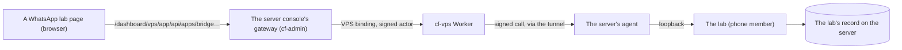

# WhatsApp lab — testing the hotel's WhatsApp bot from the Chatbot section

> **TL;DR (non-technical):** The WhatsApp lab is a private copy of the hotel's WhatsApp bot that
> runs on our server beside the real one and can never reach WhatsApp or a real customer. In the
> Chatbot section, **WhatsApp lab** lets you write to it as a customer would and watch it
> answer, see under each answer which AI models it used, how many tokens, how long it took and
> what it cost, open every step it took, and switch any of its AI steps to another Claude or
> Gemini model for one chat to compare them. Nothing here changes the real bot.

This document is cf-admin's side: the three pages, who may open them and how they reach the
lab. The lab itself (its fake WhatsApp, its model gateway, how a copy of the bot is made, its
record) is cf-vps's, and its guide is `documentation/features/WHATSAPP-LAB.md` in the cf-vps
repository; where the two disagree, the cf-vps code wins.

## 1. The pages

**Chatbot → WhatsApp lab**, the last tab of the Chatbot section, has a row of its own:

| Tab | Page | What it shows |
|---|---|---|
| Test chat | `/dashboard/chatbot/whatsapp` | The test chats as a row of chips, and New chat (each chat gets its own fake number, so the bot sees a new customer). In a chat: the messages, grouped by turn, and under each turn its status, the models used, tokens read and written, cost and the time to the bot's first answer, with **Details**. A box to write as the customer or as the hotel's phone (a person taking over), with an optional photo. Tapping a message offers the hotel's reactions: 👍 brings the bot back, ✅ approves. **Models for this chat**: each of the bot's AI steps with its model as a row of chips (the live bot's own model first), and caching of the bot's instructions |
| Usage | `/dashboard/chatbot/whatsapp/usage` | What the tests spent, turns, model calls and failures, tokens; the comparison **by model** and **by step and model** (calls, failures, average time, average tokens read and written, cost, cost per call); the last 100 turns, each with Details |
| Set-up | `/dashboard/chatbot/whatsapp/setup` | Whether the lab is ready (its copy of the bot, its n8n, the copy switched on, the Anthropic and Gemini keys set or not), what the copy holds (the bot's AI steps with their live models and temperatures, what was replaced to keep it inside the lab), the price list every cost comes from with its sources, and the last 50 changes made in the lab and by whom |

**Details** (a drawer, the shared Dialog) is one turn in full: each AI step's model (and the
live model it stood in for), time, tokens read, written, read from and written to the cache,
cost, stop reason and the lab's notes (what it adapted for a model), with **Show what was sent
and the answer**; the bot's n8n runs, step by step with times and errors; and what the bot sent
to the lab's fake WhatsApp.

When something stops a test, each page says so at the top, with where to fix it: no copy of the
bot yet, its n8n not answering, the copy switched off, or no Anthropic key (set on the Server
page: Apps, then `whatsapp-lab.phone`, then Keys).

The totals under each turn and the Usage page's figures come from the lab's version 1.0.1. Until
that version is on the server, each turn shows its status and Details only, and the Usage page
says the lab needs its 1.0.1 update.

**A turn** is one customer burst and everything the bot did about it. The bot waits on purpose
(10 s to gather a burst, more before a booking draft), so a turn shows "Bot working" for a while
after its answer; while one is open the page reads the chat again every 3 seconds, and stops
once it ends (30 s of quiet after the answer, 60 s without one, at most 5 minutes; the lab's
rule).

**Models.** A choice applies from the chat's next message: each turn keeps the models it started
with, so a chat can compare Sonnet on one question with Haiku on the next. The models offered are
those the lab has a price for. Gemini models are offered once a Gemini key is set in the lab. A
newer Claude model that refuses sampling settings, or thinks before it answers, is adapted by
the lab, and the call's notes say what was changed.

**Photos** are made smaller in the browser before they are sent (a JPEG of at most 1,280
pixels, stepped down until it fits the 256 KiB a server-console change may carry). **Voice notes
are not offered**: the lab has no Whisper yet.

## 2. Who can open them

The three rows (migration `0093`) are stored at role `owner`: the Owner and Vendor support open
them, and anyone else only with a grant on the Access page. Their data comes through the server
console, so a person also needs what the console asks of everyone: the Server page's own key
(`/dashboard/vps`, never inherited), the server access notice accepted in this sign-in before
any change, and in cf-vps the `apps.bridge.view` capability to read and `apps.bridge.operate` to
write (both in the Owner's defaults). Without them the page opens and says, in words, which is
missing ([PERMISSIONS-SYSTEM](../architecture/PERMISSIONS-SYSTEM.md)).

## 3. How the pages reach the lab

The pages add no route, key, table or binding: they call the server console's existing gateway
(`src/pages/dashboard/vps/app/[...path].ts`), exactly as the console's own screens do. A read is
a GET of `apps/bridge/view?app=whatsapp-lab&member=phone&path=…`; a change is a POST of
`apps/bridge` with `{ app, member, level: "operate", path, body }`. The gateway checks the person,
the notice and same-origin, and records each change in the audit log as `vps_app_bridge` (the
path only, never the message). cf-vps signs the call, its agent hands it to the lab on the
server's loopback, and the lab checks that signature itself and records who made each change.
`src/components/admin/chatbot/whatsapp/lab-api.ts` is the one place that builds these calls, and
it turns any layer's refusal into one sentence for the screen.

What the pages show lives in the lab on the server: test chats on fake numbers, every model call
with its request and answer, and the bot's runs. Nothing about a test is stored in this portal
beyond the audit row per change.

## 4. Limits and what comes next

- **Comparisons side by side, a judge's score and a simulated customer** (step 3 of the plan):
  the same conversation on two setups, scored. Until then, compare by step on the Usage page.
- **Client access**: the pages need the Server page's key, which also opens the server's
  terminal. Giving the client's staff the lab without the server needs its own route first.
- **Voice notes**: the lab needs a Whisper member.
- **A new copy of the bot** (after the live bot changes) is made on the server, with the
  owner's yes for reading the live bot: cf-vps's guide, "Putting it on the server", steps 7 and 8.

## Verification log

| Date | Who | What was checked | Not checked |
|---|---|---|---|
| 2026-11-05 | claude | Written from the code: the three pages and their components, `ChatbotLayout.astro`, migration `0093`, the gateway's change path (`src/pages/dashboard/vps/app/[...path].ts`: notice, CSRF, audit) and cf-vps's bridge routes and lab paths (`contract/bridge.ts`, `apps/whatsapp-lab/src/admin.ts`, `store.ts`, `lab.ts`). `test/whatsapp-lab-pages.test.ts` and `test/whatsapp-lab-look.test.ts` pass | The pages in a phone browser against the lab on the server (the owner's phone test); the lab's `usage` read and the chat's `sums` need lab version 1.0.1 on the server |
