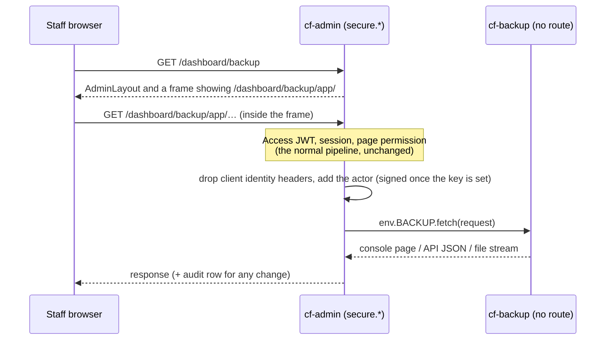

<!-- docs-check: proposed-paths -->
<!-- Built and deployed 2026-09-23/24; the "As built" notes record where the build differs from the plan. It names routes, files and folders in both cf-admin's and cf-backup's repositories, so cf-admin's path check cannot resolve all of them. -->

# 02 — How cf-admin embeds cf-backup, and why it cannot break

> **Revised 2026-09-22 (owner decision, OD-8/OD-18).** The first draft had cf-backup
> describe itself in a manifest and cf-admin render it with its own view primitives. It
> is replaced by an **embedded app**: cf-backup ships its whole console, and cf-admin
> shows it in a same-origin frame, forwarding every request over the private service
> binding. The requirement is unchanged: *changes in cf-backup show up in cf-admin
> automatically, and the integration never breaks.*

## 1. The model: cf-admin is the gateway, cf-backup is the app



Three ways to "load one app inside another" were considered; only the third is safe:

| Way | Verdict |
|---|---|
| **Remote script**: cf-admin loads cf-backup's JavaScript into its own page | **Rejected.** Code from another deploy would run with full admin powers, and cf-admin's `script-src` would have to widen |
| **Frame on its own address** (for example `backup.madagascarhotelags.com`) | **Rejected.** It gives the system that holds the GitHub key and the backups a public address, needs its own Access application, and needs a second copy of the login, role and permission code, which chunk 10 spent a whole chunk untangling |
| **Frame through cf-admin**: the frame's pages come from `/dashboard/backup/app/*` on cf-admin's own origin, and cf-admin forwards each request over the binding | **Chosen.** One login system, one permission system, no public address, and cf-backup still owns every screen |

## 2. Paths

| Path | Served by | What it is |
|---|---|---|
| `/dashboard/backup` | cf-admin | The page: `AdminLayout` (sidebar, header, theme) and one frame filling the content area |
| `/dashboard/backup/app/` and below | cf-backup, through the gateway | The console app shell, its built files and every screen |
| `/dashboard/backup/app/api/*` | cf-backup, through the gateway | The console API (JSON, file streams) |
| anything else | never forwarded | cf-backup's jobs are reached only by cf-admin's tick, directly through the binding (§8), never through the gateway |

The Vite build sets `build.assetsDir: 'dashboard/backup/app/assets'`, so built files sit
under the base path and the Worker hands requests to ASSETS unchanged. The **dev server**
serves Vite's own modules (`/@vite/client`, `/src/…`) at the root, which the router passes
through **in dev only**.

## 3. The gateway route (cf-admin)

One endpoint, `src/pages/dashboard/backup/app/[...path].ts`, that does exactly this and
nothing feature-specific:

1. **Runs behind the normal pipeline.** Access, session and role refresh are the middleware's job, as for every page; nested paths resolve through their longest ancestor key (`resolveAccess`, `src/lib/auth/decide-access.ts`). The gateway then asks for the `/dashboard/backup` key itself (`mayUseBackupConsole`, `src/lib/backup-proxy.ts`): Owner and Vendor support always pass, anyone else needs that key allowed in their access map. Since 2026-10-15 a missing key is a deny, never decided by the staff-level `/dashboard` row, so the one page row gates every forwarded request.
2. **Forwards only an allow-list of request headers**: `Accept`, `Accept-Language`, `Content-Type`, `Range`, `If-None-Match` (`FORWARDED_REQUEST_HEADERS`). `Content-Length` is not copied: the runtime sets it from the buffered body, which is capped at 1 MiB (413 otherwise). Every other header the browser sent stays behind, among them `Cookie`, `Authorization`, `Cf-Access-Jwt-Assertion` and any `X-Backup-*`, because the outgoing headers are built from nothing rather than copied and pruned. cf-backup never sees cf-admin's session cookie or the Access token.
3. **Adds the actor** as `X-Backup-Actor` (base64url JSON, §4) and `X-Backup-Request-Id`, and, once `CONSOLE_SIGNING_KEY` is set on cf-admin, `X-Backup-Signature` over them (§4).
4. **Guards every change** (POST, PUT, PATCH, DELETE; GET and HEAD are reads, any other method is 405). A change from a read-only role (the Viewer, `isReadOnly`) is refused with **403 `read_only`** before cf-backup is called. A change must also be same-origin: the same check the rest of cf-admin applies (`validateCsrf`, re-applied in the gateway so this rule is provable by the gateway's own test alone), 403 `cross_origin` otherwise.
5. **Calls `env.BACKUP.fetch()` with 10 s to the answer's headers**; the body then streams untimed, so file downloads are never buffered. If the call fails, it answers with its own small "Backup console unavailable" page, or a JSON error for `/api/*`.
6. **Passes the response through**, including cf-backup's own security headers (§5). It removes any `Set-Cookie`, since cf-backup has no reason to set one.
7. **Audits** every change (and, as built since 2026-10-16, the two reads below) into `admin_audit_log` through the existing `buildAuditDetails` chokepoint: actor, method, path (no query string), status, request id, and the one-line summary cf-backup returns in `X-Backup-Audit`. `action` must be one of the closed list in `src/lib/backup-audit.ts` (`BACKUP_AUDIT_VERBS`, C5), which [BACKUP-CONSOLE.md](../../features/BACKUP-CONSOLE.md) §4 sets out with each action's audit verb; an unknown or missing action is recorded as `backup_run` with the summary "unrecognised action" and a Sentry warning. The request body is never logged. An `access.edit` that cf-backup accepted (a change on the console's own Access screen) is also sent to the people on cf-admin's sign-in alert list, as one email per save or in the daily summary, as the alert policy says (`noteAccessChanges`, `src/lib/access-changes/notify.ts`, cf-admin permissions #18).
8. **Wakes the `backup-tick` job** after every change cf-backup answered (or may have), so the next five-minute tick calls it whatever sleep it last reported (§8, Contract A).

> **As built (2026-10-16, permissions item #20).** Two reads hand over content, so cf-backup
> stamps `X-Backup-Audit` on them from their handlers and the gateway records them too: a file
> preview (`run.download via=preview`) and a restore test's encrypted file (`restore.test
> op=download`). The route table still gives no GET an audit action; on a read the gateway
> accepts only those two actions and ignores any other header. Details:
> [BACKUP-CONSOLE.md](../../features/BACKUP-CONSOLE.md) §4.

> **As built (full build, 2026-09-23).** Every change leaves **two** audit rows: this
> gateway's `admin_audit_log` row (the summary above) plus the auth pipeline's own
> `page_mutation_attempt` row it already writes for any portal mutation. The gateway row's
> `delivered` field says what is actually known: `false` ("not delivered") only when the
> request certainly never left cf-admin — the `BACKUP` binding was unbound, the body was
> over the size cap, the path failed the confinement check below, or the browser
> disconnected before the body could be read. Every other failure (a timeout, or an answer
> cf-admin could not use) is recorded as **`'unknown'`** ("outcome unknown"), because
> cf-backup may have received and acted on the request anyway. A delivered change records
> `true`.
>
> **Path confinement (`bad_path`, both sides).** The gateway rejects, before forwarding, any
> forwarded path containing `//`, a backslash, or an encoded slash/dot-segment
> (`%2f`, `%5c`, `%2e`, any case) that is not exactly under `/dashboard/backup/app/`, and
> logs a `bad_path` line to observability (no Sentry). cf-backup's own router applies the
> same `hasUnsafePathSegment` confinement independently, and refuses anything outside
> `/dashboard/backup/app/` or `/internal/*` with 404. **Known limitation:** neither check can
> see a *pure* encoded dot-segment once the URL parser has already collapsed it — this is
> safe only because routing beyond that point is exact-segment and capability-checked; any
> future file-serving path must not trust the path string on its own.

## 4. Identity: the binding is the trust

cf-backup trusts `X-Backup-Actor` **only because nothing but cf-admin can reach it**: it
has no route, `workers_dev = false`, `preview_urls = false`, and only a Worker the account
owner configured with a binding can call it. This is the opposite of the cf-chatbot pattern
(a shared literal header over the public internet), which must never be copied.

```json
{
  "v": 1,
  "kind": "user",
  "userId": "…",
  "email": "…",
  "role": "owner",
  "signedInAt": "2026-10-04T09:02:11Z",
  "requestId": "…"
}
```

- `kind` is `user` for the gateway and `system` for cf-admin's jobs (§8).
- `userId` is the person's cf-admin account id. A user actor without it is refused (400 `bad_actor`). Since 2026-10-16 (cf-admin permissions #35) a grant saved through cf-admin's Access Center is bound to that id, so another account with the same email gets nothing from it (doc 13 §4).
- `role` is the canonical role after `normalizeRole()`.
- `signedInAt` **is the Cloudflare Access assertion's `iat`** (as built, doc 09 §7), recorded when cf-admin's session is created. It is deliberately not the session's own creation time: cf-admin can re-create a session from an assertion that is hours old without a fresh sign-in, so `createdAt` would let a stolen Access cookie look fresh. A missing `iat` reads as `0` (never fresh); sessions created before this field existed fall back to their `createdAt` until they expire (24 h). It backs the "fresh sign-in" (≤ 10 min) rule (§6). Access assertions carry no `auth_time`, so the 10 minutes count from when Access issued the assertion. The refusal (403 `reauth_required`) says to sign out, which also ends the Access session, and back in, so the next sign-in is a full one; what that proves is set out in cf-admin's [PERMISSIONS-SYSTEM.md](../../architecture/PERMISSIONS-SYSTEM.md) §10.5. One exception since 2026-10-17: while Vendor support holds a testing pass (1, 4 or 8 hours, started only within 10 minutes of a real sign-in), cf-admin sends the current time as `signedInAt`, so the rule passes for that session until the pass ends (same section).
- `v` is the header's schema version. cf-backup answers a major it does not know with 409 `actor_version_mismatch`, which the console shows as "cf-admin and cf-backup versions do not match" (§7), never a guess.

Proven by tests on both sides: cf-backup's public-surface test asserts the deployed
configuration has no route, no `workers.dev` and no previews. cf-admin's gateway test
asserts a browser-supplied `X-Backup-Actor` never reaches the binding.

**The signature (2026-10-16, cf-admin permissions item #33).** Any Worker in the account can be
given a binding to cf-backup, so the binding alone does not prove the caller is cf-admin. Once
the owner sets `CONSOLE_SIGNING_KEY` on both Workers, cf-admin adds
`X-Backup-Signature: v1.<seconds>.<HMAC-SHA256, unpadded base64url>` to every call it makes over
the binding: the gateway's, the Access Center's and the tick's. The signed text is one field per
line: `cf-console-signature-v1`, `backup`, the Unix time in seconds, the method, the path with its
query, then the `x-backup-actor`, `x-backup-target` and `x-backup-request-id` headers (empty when
absent). The body is not signed.
cf-backup (`src/gateway/signature.ts` in its repository) checks it on any request that carries an
actor, on the console path and on `/internal/*`, before it reads the actor: a missing or wrong
signature, or one more than 60 seconds from cf-backup's clock either way, is refused with
**400 `bad_signature`**. Without the key on cf-backup the signature is ignored, so cf-admin gets
the key first and cf-backup refuses no one when it gets it too. A signed actor of an unknown
version is still 409 `actor_version_mismatch`. The owner's steps:
[CONSOLE-SIGNATURE.md](../../features/CONSOLE-SIGNATURE.md).

> **Decided 2026-09-23 (Phase 1a build review):**
>
> 1. **The `sessionId` field is dropped.** cf-backup never needs cf-admin's session; `requestId` covers correlation, and per-person limits (doc 13 §2 — cooldowns, reveal/rotate rate limits) key on the email, not a session id.
> 2. **Actor errors are 400 `bad_actor`** (missing, too large, malformed or invalid) **and 409 `actor_version_mismatch`** (an unsupported major). **cf-backup never returns 401.** 401 means only "signed out", and it comes from cf-admin, never from cf-backup.
> 3. **503 `not_configured`** answers any action or endpoint whose backend is not bound yet, with a reason naming what is missing (for example "BACKUPS bucket binding not configured"). It is sent only after the 403 capability check, so a person lacking the capability still gets 403 first.
> 4. **`GET /api/health` returns `capabilities: string[]`**, the actor's effective capabilities, computed server-side from the same policy doc 13 describes. The console gates every tab and button on that list, never on a client-side guess.

## 5. Security headers: one narrow exception

cf-admin sends `X-Frame-Options: DENY` and `frame-ancestors 'none'` on every response
(*measured*, `src/lib/security/csp.ts`; re-read 2026-10-17). Its CSP already allows a
same-origin frame (`frame-src 'self'`, in the same file).

- **The exception (OD-18):** responses under `/dashboard/backup/app/` carry `X-Frame-Options: SAMEORIGIN` and `frame-ancestors 'self'`. Nothing else changes. A cf-admin guard test fails if any other path stops sending `DENY` / `'none'`.
- **cf-backup's own policy** travels on its responses and the gateway keeps it: `default-src 'self'; script-src 'self'; style-src 'self' 'unsafe-inline'; img-src 'self' data:; connect-src 'self'; object-src 'none'; base-uri 'none'; form-action 'self'; frame-ancestors 'self'`. The console is a built single-page app with no inline scripts, so it needs no nonce. (`style-src 'unsafe-inline'` matches cf-admin's and is needed by the dialog pattern in RULESAd §7.8.)
- **Downloads** of encrypted runs go out with `Content-Disposition: attachment` and `X-Content-Type-Options: nosniff`.
- **What same-origin means.** The frame's code can read the parent page, because they share an origin. cf-backup's browser code is therefore trusted exactly like cf-admin's, which is acceptable only because cf-backup has no public surface and a small, owner-approved dependency list (doc 05, T18). A `sandbox` attribute without `allow-same-origin` was considered and rejected: the frame would lose cf-admin's `SameSite=Strict` session cookie, so every call would need a separate token scheme.

## 6. Permissions: cf-admin opens the door, cf-backup decides the action

| Layer | Rule |
|---|---|
| The door (cf-admin) | `/dashboard/backup` has one `admin_pages` row, seeded for **Admin and above**. The gateway asks for that key itself (§3 rule 1) and denies before cf-backup is called. A read-only role let in can look, but every change it sends is refused (403 `read_only`, §3 rule 4) |
| The actions (cf-backup) | A closed catalog of 32 capabilities (view, run, cancel, bypass the cooldown, edit config and the schedule, prune, export activity, see and rotate keys, restore tests, manage access…), role defaults plus per-person grants, managed by Owner/Vendor on the console's Access screen and, for one person below the editor, from cf-admin's Access Center (doc 13 §4). Every endpoint enforces its capability against the actor's `role`, `email` and `userId`. **Full design: [13-access-control.md](13-access-control.md)**; every route and the capability it needs: cf-backup's generated `docs/reference/PERMISSIONS.md` |
| Floors | Nine capabilities stay **Owner and Vendor support only**, whatever the policy says: the secret class (`keys.reveal`, `keys.rotate`, `keys.rekey`, `restoretests.run`, `restoretests.configure`), `keys.status`, `runs.download`, `runs.prune` and `access.manage` (doc 13 §3 rule 4, doc 09 K-3) |
| Fresh sign-in | The handler asks for a sign-in within the last 10 minutes (from `signedInAt`, §4), or answers 403 `reauth_required`, before rotating the key, revealing the recovery kit, downloading a run's encrypted data (from the run or from the Files section), preparing a restore test or unlocking its copy with the Vault key, and changing the Restore tests settings or pinning the lab key. Typed confirmations are listed per capability in doc 13 §2 |

Cooldowns and rate limits (Run now 6 h by default, rotate 1/day, reveal 3/day per person)
are enforced in cf-backup: the cooldown is counted from the `backup_runs` table, rotations and
reveals from the key registry (`backup:key-registry`, doc 09 §4).

## 7. The frame, as a user sees it

- **Size.** The frame fills the content area at full height and scrolls internally, so it reads as part of the page.
- **Live.** The console refreshes itself while anything runs (every 5 s by default, Settings → Live view, [14](14-live-operations-view.md)); every refresh is an ordinary gateway request, authenticated like any other.
- **Theme.** Same-origin, so the app reads the parent's theme attribute on load and watches it for changes. No message protocol needed.
- **Dialogs** follow RULESAd §7.8 (`showModal()`), but they cover the frame, not the sidebar. This is an accepted cosmetic limit.
- **Session expiry.** The frame never navigates to a login page. A sign-in flow inside a frame is fragile, and whether Access allows its login page to be framed is not something to depend on. Every API call uses `redirect: 'manual'`. An opaque redirect or a 401 makes the app show "Your session has ended" with a **Reload the page** button; clicking it reloads the top page (`window.top`), and the full page then goes through sign-in normally. A 409 `actor_version_mismatch` instead shows "cf-admin and cf-backup versions do not match" (§4). Anything else not ok shows failed, with the envelope's own message. The reload is user-initiated, not automatic, because an automatic reload would loop if the session stayed expired (decided 2026-09-23, §4).
- **Deep links** (optional, later): the app mirrors its route into the parent URL's hash, so `/dashboard/backup#/runs/<runKey>` opens that run.

## 8. Jobs: cf-admin's tick drives, cf-backup does the work

> **As built (full build, 2026-09-23, D-4).** The Vite-plugin question below is answered:
> **internal paths outside the gateway prefix**, never RPC. There is **one** job, not two —
> it supersedes the `backup-reconcile` (daily) / `backup-meter` (hourly) design this section
> first proposed.

| Job (cf-admin job registry) | Cadence | Calls | Notes |
|---|---|---|---|
| `backup-tick` | on cf-admin's five-minute tick, tier `essential`; since 2026-10-04 only when cf-backup's last answer said it has work (Contract A, below), at least once an hour, and within five minutes of any console change | `POST /internal/tick` | Computes due schedule slots from `backup:config.schedule` and dispatches them; runs reconcile/postrun, the daily record, the weekly key check, live-folder cleanup, prune chunks and the usage meter as budget-limited chores (C3); returns `alerts[]` for cf-admin to queue and ack (D-11) |

- **Reached only over the binding**, as internal paths (`/internal/tick`, `/internal/alerts/ack` and, as built, `/internal/alerts/delivery`, where the job reports each alert's delivery outcome) that the gateway never forwards — `/dashboard/backup/app/*` is a disjoint prefix. `/internal/*` accepts only `actor.kind === 'system'` with `job === 'backup-tick'`; anything else is 403, and a user actor is refused here just as a system actor is refused on the console API (C3).
- **The call:** `env.BACKUP.fetch('https://cf-backup/internal/tick', { method: 'POST' })` with headers `x-backup-actor` (the system actor JSON) and `x-backup-request-id`, a 25 s timeout, and a body `{ tickAt: ISO }`.
- **The answer says when to call next (Contract A, 2026-10-04).** The tick's JSON answer carries an optional `nextTickAt`: an ISO-8601 time, or `null` for "no opinion", never later than the request's `tickAt` plus 60 minutes. cf-admin stores it as `backup-tick`'s next due time in its Cron Control document and does not call before it, with three guards on its side: it never sleeps more than 60 minutes after the last call whatever the answer says; it ignores a missing, malformed or long-past value, and any tick that left an alert or a delivery report unsettled, and calls on the next tick instead; and every change (any method but `GET` and `HEAD`) through `/dashboard/backup/app/*` wakes the job, so the next five-minute tick calls. A cf-backup without the field, or a cf-admin that ignores it, means a call every five minutes, as before. cf-admin's side: `src/workers/scheduled-backup-tick.ts` (`nextTickDue`) and `src/lib/jobs/control.ts` (`MAX_SLEEP_MS`); the record is cf-admin's resource usage optimisation of 2026-10-04 (private), and cf-backup's own is `docs/records/2026-10-04-resource-usage-tick.md` in its repository.
- **The tick has its own budget**, independent of cf-admin's job budget: it stops starting new chores after 20 s of wall time or 30 external subrequests (the Free limit is 50 per invocation).
- **The meter rule (factor C2)** still applies to the job itself: `backup-tick` costs cf-admin **0 D1 rows** on success (its own real-path test asserts zero queries), because every D1 read and write it triggers happens inside cf-backup, not in cf-admin.
- **If `BACKUP` is unbound**, the job logs `skipped: binding missing` and returns; it never throws.
- **Alerts:** the job enqueues each of the tick's `alerts[]` on cf-admin's own `EMAIL_QUEUE` (`projectSource: 'cf-admin'`; since 2026-10-10 `purpose: 'template_email'` on the email service's stored template `tpl_hotel_notice`, with the job's own design as the `fallback` the consumer sends if the template fails, and `custom_email` in that design for an alert longer than 10,000 characters; `custom_email` for every alert before), then calls `POST /internal/alerts/ack {ids}` with the ids that sent. An alert not acked is offered again next tick; the email consumer dedupes repeats, so a warning goes out at least once, not twice. Since 2026-09-24 each alert may carry a `sender` (cf-backup's `alerts.senderEmail`/`senderName`); the job checks it again (an address on madagascarhotelags.com, a name without quotes, brackets or control characters) and puts it in the message's `data.from`, which the consumer uses for both purposes; without one, or when it is refused, the consumer sends from its `SENDER_EMAIL`. The address must be a verified sender in Brevo, or the provider rejects the email.
- **The cron page** shows one read-only **Backups** row: the schedule, last run, last `ok` and verdict, read from `backup:status`, plus a link to the console. The first draft's `external` job kind is dropped. Scheduling controls live in the console, where the schedule's owner lives.

## 9. Local development

| Mode | How | For |
|---|---|---|
| **Standalone** | `npm run dev` in cf-backup. The dev server injects a **local-only Owner actor**, and only when the site URL is `localhost`, the same fail-secure test as cf-admin's `isLocalDev()`. R2 and D1 are local simulations seeded with fixture run folders; GitHub calls go to a stub unless dev credentials are present | Building and testing every screen without cf-admin |
| **Integrated** | Because the gateway forwards only `/dashboard/backup/app/*` (§2), and the dev server's own modules live outside that path, integrated testing through cf-admin uses a **built** cf-backup (`vite build` then `wrangler dev`), not the hot-reload dev server. cf-admin's `BACKUP` binding resolves to the running cf-backup, because separate dev commands can call each other through service bindings (*confirmed*, Cloudflare multi-Worker development docs). Seeing it work under cf-admin's Astro dev server is **to verify in Phase 2a** | Testing the gateway, the frame and permissions end to end |
| **Tests** | cf-admin binds `BACKUP` to a tiny fixture Worker in its test pool. cf-backup's tests exercise its API with fixture actors | Both repos' `verify` |

## 10. "Never break it": the rules and the machinery

| # | Rule | Enforced by |
|---|---|---|
| 1 | **The gateway is dumb.** It knows a path prefix, a header list and the audit call, and nothing about backups, so backup features never require a cf-admin change | Code review + the gateway's own tests |
| 2 | **The actor header is versioned** (`v`). cf-backup accepts its known majors; a new field is additive | Contract test in cf-backup over fixture headers |
| 3 | **Unavailable is visible, not fatal.** A dead or slow cf-backup gives an error page inside the frame; the portal keeps working | Gateway timeout test |
| 4 | **Deploy order.** cf-backup first (the binding target must exist), cf-admin second; rollback in reverse. **As built:** confirmed as owner instructions, not just a plan — a cf-admin deploy that binds a Worker which does not exist fails outright | Runbook (doc 06); operator steps in `documentation/features/BACKUP-CONSOLE.md` §9 |
| 5 | **The deploy runs the gate.** Workers Builds for cf-backup runs `npm run verify` before `wrangler deploy` | Configured in Phase 0 (OD-10) |
| 6 | **No public surface, ever.** A test fails the build if `wrangler.json` gains a route, a custom domain, `workers_dev` or preview URLs | cf-backup `test/public-surface.test.ts` |
| 7 | **The header exception cannot widen.** | cf-admin guard test (§5) |
| 8 | **Post-deploy smoke.** After a cf-backup deploy the owner opens `/dashboard/backup` once (no browser automation) | Runbook |

What this does **not** promise: that a job which "succeeds" really did its work. That is
what the backup verification rules (doc 03 §5) and the evidence bundle (doc 11) exist for.
