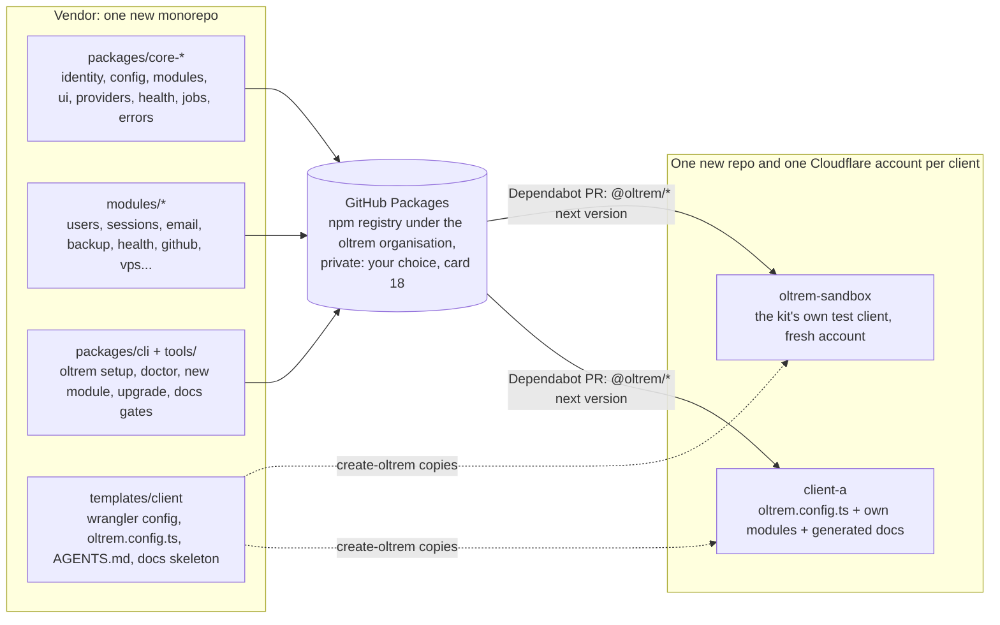
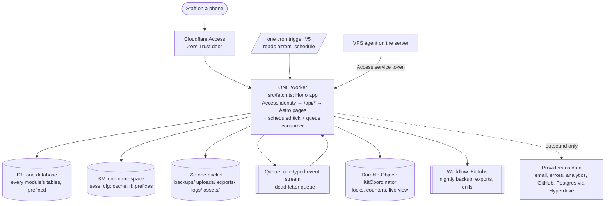
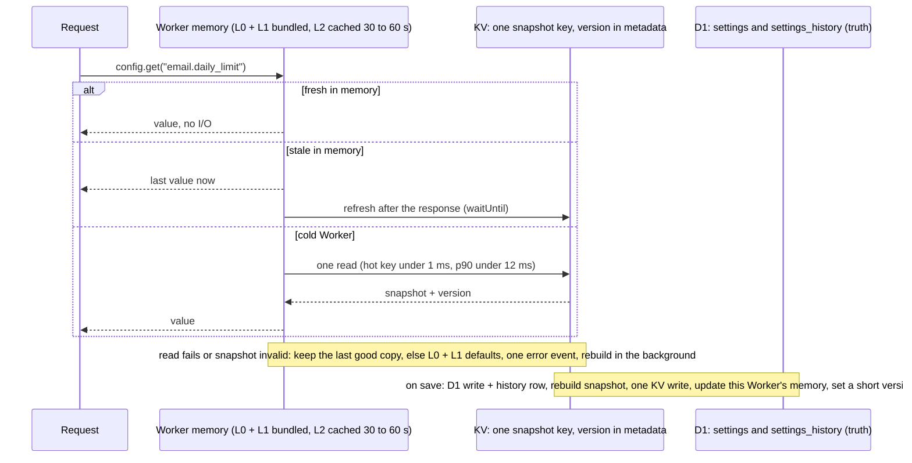
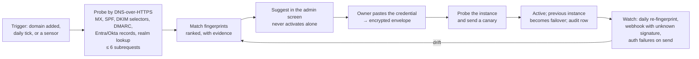

<!-- docs-check: proposed-paths -->
<!-- Every path, package and file name in this plan is a proposal for new repositories, not a file in this one. -->

# Oltrem, the platform kit: the plan (v2, 2026-10-18)

**Oltrem** (oltrem.com) is a reusable, modular platform that Harshil hands to each new client as a blank repository with the core already inside (dashboard, users, sessions, permissions, email, health and debugging, backup, GitHub, an optional server console), built fresh on Cloudflare within the free plan's limits, with a fully dynamic permission system, configuration set by the Vendor in layers, one of each resource per client, and provider integrations that are data rather than hand-written code.

Version 2 folds in the owner's instructions of 04:34 and the four research passes finished after version 1 (configuration layers, the visual stack, resources and release engineering, AI-ready repositories). The eight research files sit beside this plan; every figure below carries its source there. All sixteen round-three cards were answered on 2026-10-18 between 12:58 and 13:13 (§1 and §20); each answer is folded into its section as **Your choice**. Two went against the recommendation, GitHub Actions as the gate (§14.1) and GitHub Packages as the registry (§15.7), and the plan was rewritten there. The three round-two cards were answered at 13:33 to 13:34 (flat groups first, one scope tree, SMS as a later optional module), all as recommended. The kit was named at 16:33: **Oltrem**, with the domain oltrem.com already bought. The GitHub organisation, the npm scope (`@oltrem/*`), the command line (`oltrem setup`), the config file (`oltrem.config.ts`) and the table prefix (`oltrem_`) carry the same name. The eight research files predate the name and still write `kit` where this plan writes `oltrem`.

**Contents:** [0 In one page](#0-in-one-page) · [1 Answers and instructions](#1-your-answers-and-your-0434-instructions) · [2 Why rebuild](#2-why-rebuild-instead-of-refactor) · [3 Non-negotiables](#3-non-negotiables) · [4 Shape](#4-shape-of-the-kit) · [5 Configuration](#5-configuration-global-client-and-system-settings) · [6 Identity](#6-identity-and-sign-in) · [7 Permissions](#7-permissions-iam) · [8 Providers](#8-providers-as-data) · [9 Resources and credentials](#9-resources-credentials-and-budgets) · [10 Data](#10-data-and-migrations) · [11 Performance](#11-performance-within-10-ms) · [12 Visual stack](#12-visual-stack-and-the-ui-kit) · [13 Security](#13-security-built-in-from-the-first-commit) · [14 Test before production](#14-test-before-production-releases-and-upgrades) · [15 Built for AI agents](#15-built-for-ai-agents) · [16 No vendor console](#16-no-vendor-console) · [17 Madagascar](#17-madagascar-client-1-later-in-a-new-repository) · [18 Build order](#18-build-order-and-acceptance) · [19 Risks](#19-risks-and-controls) · [20 Round three](#20-questions-for-round-three)

---

## 0. In one page

**What goes wrong today.** Six repositories, about 300,000 lines, written over months by many AI sessions. The same job is done three to five times in different ways: three console gateways, four permission catalogs, five security-header implementations, five health systems, five places that store settings, three outboxes, four places that keep email templates. Business logic of the pet hotel is mixed into the framework. One shared database is fed by three migration series and 26 numbers collide. Provider code is called straight from feature code in 50 to 100 files per provider. Secrets and IDs sit in committed config. Four D1 databases, three KV namespaces, six or more R2 buckets, four queues and a pile of API tokens serve a platform whose real traffic would fit in one of each.

**What Oltrem is.** One monorepo that publishes versioned packages (`@oltrem/core-*`, `@oltrem/module-*`, `@oltrem/cli`). Each client gets a thin repository made from a template: its Cloudflare config without a single hand-pasted ID, its chosen modules listed in one file, its own business modules, generated docs. A fix in the core reaches every client by moving to the next version, after that client's own test run in GitHub Actions. Each client has their own Cloudflare account, so each gets the full free quota and total data separation. The kit is built and proven in **new repositories only**; the Madagascar repositories are not touched.

**What makes it hold together.**

| Principle | What it means in practice |
|---|---|
| One module model | Every feature, core or client-specific, is a module with the same manifest: capabilities, pages, API, migrations, settings, jobs, health checks, provider needs, error codes, key recipes, docs. Boilerplate generated by one command. |
| One permission model | Capabilities registered by modules; roles, groups and scopes created by the client; one Vendor principal built in; the whole decision compiled once into the session, checked in microseconds. |
| Configuration in layers | Kit defaults in code, client config as a typed file in the client repo, system config edited live in the portal, secrets apart. Read from the Worker's memory on every request; D1 is the truth and one KV snapshot is the distribution. |
| One of each | One Worker, one D1 database, one R2 bucket, one KV namespace, one queue, one cron trigger, one Access application per client. A manifest lists them; a verify gate refuses a second one without a written reason. |
| Providers are data | Eight auth schemes, five webhook verifiers and a handful of transport engines are code. Which provider, which URL, which field maps to what, is a row the client can change. The kit detects the provider from DNS and suggests. |
| Budgets are gates | 10 ms CPU, 1,000 KV writes a day, 5 million D1 rows a day, 10,000 queue operations a day, 500 MB per database, 64 variables: each is a counter in `verify` and a tile in System health, never a hope. |
| Test before production | GitHub Actions runs the full verify on every push to `main` and, only when it is green, applies the migrations and deploys (your choice, card 16); a short branch gets a preview link for the phone when a change touches the database or sign-in. One deploy token per client lives in that client's GitHub repository, and nowhere else. |
| Rules are tests | Every invariant that matters (one of each resource, no secret in a variable, every route mapped to a capability, every migration owned by a module, no hand-edited generated file) is a test that fails the build. |
| Built for AI agents | Every repository starts with ai.md, the one file every AI reads first; it carries the rules in one line each and routes every task to its document, and rules.md owns the full rules with their enforcement. One token registry per repository, with reuse before create. Procedures as Skills, hard blocks as hooks and gates, reference docs generated from the code, a setup check whose output is the same in the terminal, the portal and the docs. |

**Order of work.** New repositories and a sandbox client in a fresh Cloudflare account first; then the core runtime with the configuration layers; then identity and permissions, because everything else hangs on them; then the module system and the generator; then the core modules, each proven on the sandbox with synthetic data. Madagascar joins last, in a new repository of its own, when the owner says so (§17).

---

## 1. Your answers, and your 04:34 instructions

| # | Question | Your answer | Plan v2 does |
|---|---|---|---|
| 1 | Own copy per client or one shared system | **Own copy per client** (03:19) | Own Cloudflare account, own repo, own quota |
| 2 | Core database | **Cloudflare D1 only** (03:24) | One D1 database per client; Postgres only as an optional module |
| 3 | Screens | **Keep Astro + Preact** (03:24) | Astro 7 + Preact with a measured CPU budget per screen (§11) |
| 4 | Sign-in | **Zero Trust door + own accounts** (03:25) | §6 |
| 5 | Permission shape | **Groups + permission sets at any level** (03:28) | §7 |
| 6 | How fixes travel | **Versioned core packages** (03:28) | §4.1 and §14 |
| 7 | Madagascar | **Client 1, but nothing in its repositories is touched** (your words, 04:34) | §17: the kit is proven in new repositories first; Madagascar joins later in a new repository of its own |
| 8 | Vendor view | **No central view** (03:34) | §16 |
| 9 | Cloudflare plan | **Free by default, paid when needed** (03:10) | Every free limit is a measured budget (§9) |
| 10 | Who owns a client's Cloudflare account | **Chosen per client at setup** (your words, 04:34): preferably a blank email the client gives you; on your own email when the contract needs it; you pay all usage and bill the client | §4.1: `oltrem setup` works the same either way and records the choice in the client config |
| 11 | Groups inside groups | **Flat groups first** (13:33) | §7.1: groups hold people, not other groups, in version 1; nesting stays a later option |
| 12 | One scope tree or two dimensions | **One tree** (13:34) | §7.1: company, sites, teams as one tree; a department is a node under its site |
| 13 | Where the packages live | withdrawn; re-posed as card 18, and still tapped at 13:34: **GitHub Packages in your organisation**, the same answer as card 18 | §15.7 |
| 14 | Preview deployment per client | withdrawn; re-posed as card 17, and still tapped at 13:34: **optional preview per client**, which matches card 17 (a preview link only for database and sign-in changes) | §14.2 |
| 15 | SMS and WhatsApp | **An optional module, later** (13:34) | §4.4: `sms` stays on the optional list, not in version 1 |
| — | A working name for the kit | **Oltrem**, with oltrem.com bought (16:33, typed in words after two lists of suggestions) | the name is used throughout this version: organisation, scope, command, config file and table prefix |

**Round three** (sixteen cards posted 2026-10-18 with this version; numbered 16 to 31 in the decisions log). All sixteen were answered between 12:58 and 13:13.

| # | Question | Your answer | Plan v2 does |
|---|---|---|---|
| 16 | Where the automatic tests run before anything goes live | **GitHub Actions, then deploy** (12:58), against the recommendation | §14.1 rewritten: one workflow per client repository runs verify, then applies migrations and deploys with wrangler-action; one Cloudflare deploy token per client in GitHub (§9.2); Workers Builds is not connected |
| 17 | How you push | **Straight to `main`** (12:58) | §14.2: `main` stays the daily habit, the workflow is the gate; a short branch gets a preview link for database and sign-in changes |
| 18 | Where the kit's packages live | **GitHub Packages** (13:04), against the recommendation | §15.7 rewritten: private packages under your GitHub scope; client workflows install with their own `GITHUB_TOKEN` once each repository is granted read access in the package settings; one read-only classic token per machine that installs (your PC, each AI tool's cloud environment); the release workflow publishes with its own token; Dependabot instead of Renovate in client repositories (§9.2) |
| 19 | The licence on the kit | **Apache-2.0** (13:05), **overridden 2026-10-20 by the Oltrem Licence 1.0**: personal use free, free under a revenue ceiling of one million US dollars a year, a paid Commercial Licence above it, and no change to the code without permission (decisions log, "The licence") | §15.7: every package carries the Oltrem Licence; who can install is controlled by the private registry, the licence says what they may do once they can |
| 20 | Where the backup copy lives | **The client's own account only** (13:05) | §9.3: no cross-account key; the onboarding checklist states that a lost client account loses its copies |
| 21 | How fast a saved setting must reach everyone | **The admin at once, everyone within a minute** (13:05) | §5.2 as designed |
| 22 | Page names | **Client-chosen addresses set at onboarding** (13:06) | §5.4: slugs and menu labels recorded at onboarding, shipped with the deploy; a later change is a vendor task with a redirect row |
| 23 | How a vendor-wide change reaches every client | **With the next kit release** (13:07) | §5.1 as designed: no central config server |
| 24 | Styling | **Tailwind v4** (13:07) | §12.2 as designed |
| 25 | Components | **Own primitives plus Zag.js** (13:08) | §12.3 as designed |
| 26 | How a client's brand reaches the screen | **One per-client stylesheet** (13:08) | §12.4 as designed |
| 27 | Charts | **Server SVG plus uPlot** (13:11) | §12.4 as designed |
| 28 | Email templates | **Maizzle** (13:12) | §12.4 as designed: compiled at build, tokens substituted with escaping at send time |
| 29 | How much to lean on one AI tool's features | **Portable files plus Claude and Cursor hooks** (13:12) | §15.1 and §15.2 as designed |
| 30 | How strict the quality gate is | **The standard gate** (13:12) | §15.6 as designed, under 10 minutes on the GitHub runner (§14.1) |
| 31 | Madagascar's timing | **Sandbox first, then Madagascar** (13:13) | §17 and the phase order of §18 as written |

Your 04:34 message added ten instructions. Each has a home in this version:

| Instruction (your words, shortened) | Where |
|---|---|
| "do not touch anything in madagascar and any of its connected repo … do everything in new repos" | §3 item 1, §4.1, §17, §18 |
| "I DO NOT WANT you to copy-paste, clone-use, refer-use any type of code from existing repos … understand them … remake from scratch / use better from outside" | §2.1 |
| "global_config, client_config, system_config … set by Vendor … name, sub-domain, page name … read thousands of times per day … very fast" | §5 |
| "I dont want 10+ API tokens … I dont like having 6 R2 buckets" | §9 |
| "compatible with big changes, improvements, upgraded package, test before pushing to prod" | §14 |
| "all repos, systems, features, parts, docs fully compatible for AI … any upcoming AI model" | §15 |
| "better libraries, best in class … visuals such as tailwind" | §12 |
| "not just for website … open scope" | §4.3, §15.8 |
| "automated setup and requirements check, fallback, error features, API key instructions in portal and docs so AI can guide" | §15.3, §15.4 |
| "extremely smart, lightweight, core usable" | §3 and the budgets in §9 and §11 |

Your 20:08 message, sent while reviewing, added three more:

| Instruction (your words, shortened) | Where |
|---|---|
| "strict rules for any ai touching codebase to begin it with ai.md file (its basically main.md that we have) it referes all important docs" | §15.1, §15.5, §18 phase 0 |
| "we need rules.md (like rulesAD.md we have)" | §15.1 |
| "creating and addition of any API token need docs and info so if needed we can use same api token in future rather then creating new one" | §9.4, and the doctor checks in §15.3 |

---

## 2. Why rebuild instead of refactor

The estate inventory (research file 10) found these facts in the checked-out code:

| Finding | Evidence |
|---|---|
| ~300k lines; cf-admin alone 155k in `src/`, 168 API route files, 54 migration files, 17 cron jobs on 2 triggers, 189 test files | measured with `find`/`wc` |
| Three near-identical console gateways (382, 476, 385 lines) and three receivers | the admin, backup, VPS and email repositories |
| Four permission models (portal page keys, 32 backup capabilities, 25 VPS capabilities, implicit email capabilities), re-aggregated only in one screen | the permissions documents of three repositories |
| Five settings stores | portal settings, service config with history, feature flags, site settings, the email policy table |
| Alert and contract-sync code duplicated in two repositories and diverged (270 vs 417 lines) | both repositories |
| Five security-header/CSP implementations, five health systems, three outboxes, four template stores, three design-system docs with three Preact component trees | inventory §5 |
| One D1 database fed by three migration series; 26 duplicated numbers; two tables created by two repositories | the migration rule in the admin repository, both migration trees |
| The email provider called directly from the admin portal in 6+ routes beside the queue path; 53 files mention it, 101 mention the error tracker, 119 mention the Postgres host | grep counts |
| DSNs, account id, database id and Access audience committed in config variables; the admin Worker at 42 of 64 allowed entries | inventory §0 |
| Open security items the repositories list about themselves, five of them at the time of writing; they are named in the private maintenance and backlog documents and not repeated here, since this folder is on the public docs mirror from 2026-10-18 | the maintenance and backlog documents (private) |
| Pet-hotel domain not separable from the framework; no fleet tooling | the maintenance document, items M-1 and M-3 |

Each of these could be fixed in place. Together they say the shape is wrong: there is no module boundary, so every feature grew its own plumbing. A kit needs the boundary first, and the boundary cannot be retrofitted onto 168 routes without rewriting them anyway.

### 2.1 Design, not code (your rule)

The old repositories are a **study object**, not a source. The plan reads them to learn what each part is for, what it does well and where it hurts, and then designs the kit's answer fresh, preferring a better outside concept when one exists. Concretely:

- No file, function, schema, SQL statement, component or test is copied, adapted or "ported" from the six Madagascar repositories into any kit repository. A gate in the kit monorepo scans every commit for the old repositories' distinctive names (their table names, binding names, route paths, document titles) and fails the build when one appears.
- What does travel is **understanding**: the list of jobs the platform must do (users, sessions, permissions, email, health, backup, server console, docs), the failure modes seen in production (stale permissions after a revoke, three places storing one setting, migration numbers colliding, secrets in committed config, a token per integration), and the owner's working rules.
- Where the research found a better outside design than today's, the kit takes the outside design: cloud-IAM bindings on a scope tree with Discord's evaluator instead of six fixed tiers; providers as data with a capability-degradation layer instead of one hand-written client per vendor; a module manifest instead of hand-wired routes; generated reference docs instead of hand-maintained tables; a layered config store with a snapshot instead of five settings tables; Cloudflare's builder as the gate instead of nothing; one instruction file every coding tool reads instead of a contract per repository.

---

## 3. Non-negotiables

1. **New repositories only.** The kit lives in new GitHub repositories (§4.1). Nothing is read from, written to, deployed beside or connected to the six Madagascar repositories, their Cloudflare account, their databases, buckets, namespaces, queues, secrets or domains. The kit's test client runs in its own new Cloudflare account.
2. **Design, not code** (§2.1).
3. **Free plan first.** 10 ms CPU per request, 100k requests a day, 5M D1 rows read and 100k written a day, **500 MB per D1 database** (the free figure; 10 GB is paid), 1,000 KV writes a day, 10k queue operations a day, 5 cron triggers, 64 variables and secrets per Worker, 3,000 build minutes a month. Every one is a budget the kit measures and shows. Paid-only products are not used.
4. **One of each per client.** One Worker, one D1 database, one R2 bucket, one KV namespace, one queue with its dead-letter queue, one Durable Object class, one Workflow, one cron trigger carrying every job, one Access application. Adding a resource needs a written reason in the resource manifest, and the verify gate agrees (§9).
5. **The fewest credentials possible**, each named in the manifest with its scope and owner: one stored Cloudflare token per client account, zero Cloudflare tokens anywhere in GitHub (§9.2).
6. **Zero growth of variables.** Settings live in D1 through the config layers (§5); the few true secrets are declared in `secrets.required` so a deploy fails when one is missing; `vars` hold only the three identity values; the committed config holds no IDs because wrangler provisions resources on first deploy.
7. **One module model, one permission model, one config store, one audit log, one outbox, one gateway, one design kit.** Each exists once, in a core package.
8. **Test before production.** Nothing reaches a client's production Worker without the full verify run having passed on that exact commit, inside the client's own Cloudflare account (§14).
9. **Fail closed.** Unknown capability, missing compiled map, unknown migration owner, unmapped route, unknown config key, missing manifest label, hand-edited generated file: refuse and fail the build.
10. **Readable by machines and people alike.** Every manifest, config key, error code, resource, key recipe and setup check is data first; the docs, the portal's Setup page, the `oltrem doctor` command and any AI agent render from the same data (§15).
11. **Docs mirrored to a public repository** from day one, so nothing identifying is ever written in them, and every published fact carries its source and date.
12. **Phone first.** Every screen designed for a phone, every option visible in a sideways-scrolling row, every dialog through the one dialog system, every chip at least 44 px tall.

---

## 4. Shape of the kit

### 4.1 Repositories (all new)



- **The monorepo** (pnpm workspaces with a `catalog:` pinning each third-party version once, Turborepo for the task graph and free remote cache) holds every package, the client template, the CLI, the Skills, the key recipes and the docs generators. It has one AGENTS.md at the root and one per package (§15.1).
- **Packages** are versioned with Changesets (one fixed version for `@oltrem/core-*`, independent versions for modules) and published to **GitHub Packages** under the `oltrem` GitHub organisation by the monorepo's release workflow with its own `GITHUB_TOKEN`, so no publish token exists anywhere (your choice, card 18; the mechanics and the honest token count are in §15.7). A vendored copy (`oltrem vendor`) stays as the emergency path if GitHub is unreachable.
- **A client repository** is small: `oltrem.config.ts` (modules on or off, the client's name, locale, hostname, brand tokens, page slugs), a wrangler config with bindings declared by name and no IDs, `oltrem.manifest.json` (the allowed resources, §9), `migrations/` for the client's own numbers, `src/index.ts` (one call that builds the Worker), `modules/` for the client's own business modules generated by `oltrem new module`, AGENTS.md plus the one-line pointer files for every coding tool, and `docs/` with a generated reference. The client's GitHub Actions workflow runs `verify`, then migrates and deploys on push to `main` (§14.1).
- **The sandbox client** `oltrem-sandbox` is the first client, created in a fresh Cloudflare account that belongs to you. Every core module is proven there with synthetic data, and every kit release deploys there before it is tagged.
- **Account ownership (answered 04:34).** At setup the Vendor records in `oltrem.config.ts` who owns the account (a blank address the client supplied, or your own); `oltrem setup` and the token model are identical in both cases, and the portal's About page states it.

### 4.2 Runtime topology for one client: one Worker, one of each



- **One Worker, not two.** Version 1 had a `portal` and a `worker`. The research (file 16) changed that: service-binding calls count as Worker requests against the same 100k a day; a Preview cannot bind to a Preview of another Worker; the 64 MiB bundle, 1 s startup and 64 variables leave ample room for Astro, Hono and every module in one script. Astro 7's `src/fetch.ts` with `astro/hono` makes one Hono app the single pipeline: the Access identity check first, then `/api/*` routes, then Astro pages. A second Worker is justified only for a separately billed module, a different compatibility date, a public asset host or a client who pays for isolation; the signed-gateway pattern stays in the toolbox for that case.
- **Private surfaces without a private Worker.** Today's separate backup Worker exists to have no public route. In the kit the same property comes from Access in front of the one Worker plus route guards: the backup console is `/backup/*` behind the same door.
- **Static Assets** serve the client build (Preact islands, CSS, fonts): free and unlimited requests.
- **The server agent** (optional VPS module) is not a Worker; it calls the portal through Access with a service token under a Service Auth policy (strict mode, which new Zero Trust organisations cannot turn off).
- **The docs explorer** (today a separate static site) becomes `/docs` served from the same Worker's assets.

### 4.3 The module model

A module is a package (or a folder in the client repo) that exports one manifest and nothing else is wired by hand:

```ts
export default defineModule({
  id: 'email',                       // stable, lowercase, unique
  version: '1.0.0',
  bitPlane: 4,                        // permission bit plane, assigned once by the registry
  surfaces: ['api', 'ui', 'jobs'],    // a headless client mounts only what it asks for
  capabilities: [                     // registered into IAM at deploy
    { id: 'email.send', class: 'operate', label: {...} },
    { id: 'email.templates.manage', class: 'admin' },
    { id: 'email.providers.manage', class: 'admin', freshSignIn: true },
  ],
  roleTemplates: [{ id: 'email-operator', capabilities: ['email.send', 'email.read'] }],
  pages: [{ path: '/m/email', entry: './pages/Emails.astro', capability: 'email.read', nav: {...} }],
  api: emailRouter,                   // a Hono sub-app; every route declares its capability and its schema
  migrations: './migrations',         // owned by this module; one ledger, numbers in the kit's range
  settings: emailSettings,            // defineSetting(...) entries: typed, layered, self-describing
  resources: { r2Prefixes: ['exports/email/'], kvPrefixes: ['email:'], eventTypes: ['email.send', 'email.event'] },
  jobs: [{ id: 'email.reconcile', every: '15m', tier: 'normal', budgetMs: 4 }],
  health: [{ id: 'email.provider-reachable', lane: 'email', run: probeProvider }],
  providers: ['email'],               // provider kinds this module consumes
  recipes: ['EMAIL_PROVIDER_KEY'],    // key recipes it needs (§15.3)
  errors: emailErrors,                // stable codes with meaning, "what to do now", docs anchor
  i18n: { es: esStrings, en: enStrings },
  docs: './docs',                     // how-to and explanation only; the reference is generated
});
```

What the core does with it:

| Manifest field | Core behaviour |
|---|---|
| `capabilities`, `roleTemplates`, `bitPlane` | Upserted into IAM at deploy; a test fails the build if two modules claim one bit plane, a capability lacks a label, or a route checks an unknown capability. |
| `surfaces`, `pages` | Pages injected through the Astro integration API (`injectRoute`, `addMiddleware`); the sideways module row is built from manifests, not a table; a page with no capability does not compile; a client that disables the `ui` surface ships no renderer at all. |
| `api` | Mounted under `/api/<module>/`; every route declares `capability`, `schema` (Standard Schema), `csrf`, `freshSignIn`, `secondPerson`; the router applies them before the handler runs; an OpenAPI document is generated from the same declarations. |
| `migrations` | Applied by the deploy command before the new code goes live, recorded in the one ledger `oltrem_migrations`; a changed applied file fails the build; kit numbers `0001` to `4999`, client numbers `5000` and up; no second series ever. |
| `settings` | Entries in the one config registry (§5.3): the Settings page, the D1 seed, the snapshot validator, the JSON Schema and the reference page are all generated from them. |
| `resources` | Checked by the `oltrem manifest` gate against the client's manifest: a prefix, event type or schedule kind not registered fails the build; a module can never add a bucket, namespace, queue or database. |
| `jobs` | Registered in the one job registry (tiers, budgets, leases, pause, throttle); the single cron tick reads `oltrem_schedule` and dispatches to the queue or the Workflow. |
| `health` | Registered in System health (lanes, two-fails-open, acknowledge and snooze, heavy runs). |
| `providers`, `recipes` | The module receives an adapter from the provider registry (§8) and never imports a provider SDK; its recipes generate the `secrets.required` block, the Setup page rows and the docs. |
| `errors` | Merged into the error registry; RFC 9457 problem responses and the generated error reference come from it (§15.4). |
| `i18n` | Strings merged; the client's locales set in `oltrem.config.ts`; es and en shipped. |
| `docs` | Indexed by the docs gate; the reference (routes, capabilities, settings, errors, resources) is generated and fails the build when stale. |

`oltrem new module <name>` writes the boilerplate: manifest, one page, one route, one migration, one test, one settings entry, one error code, one how-to. Client-specific features (a booking system, a loyalty programme, a device fleet) are modules made this way and live in the client repo; nothing else about them is special. **Open scope** follows from the same rule: the core knows identities, config, modules, providers, jobs, health and errors, and nothing about HTTP routes, HTML, domains or "visitors"; a client that is a data pipeline or a pure API enables no `ui` surface and exports only `scheduled` and `queue` handlers (§15.8).

### 4.4 Modules in version 1

| Tier | Module | Replaces today | Notes |
|---|---|---|---|
| Core (always on) | `iam`: identity, sessions, permissions, groups, scopes, access requests, reviews | auth pipeline, Access Center, Page Registry, sessions, four catalogs | §6 and §7 |
| Core | `users`: people, invitations, group membership, service accounts, Access group sync | Users page, Access group sync | |
| Core | `config`: the three layers, the snapshot, the Settings page | five settings stores | §5 |
| Core | `audit`: log, daily seal, export, "see it as" | audit log and seal, API events, backup and VPS audit writers | one writer, one table, one seal |
| Core | `jobs`: registry, the tick, the Workflow wrapper, outbox and replay | cron control plane, three outboxes | |
| Core | `health`: checks, problems, diagnostics, budgets, provider status pages, the **Setup** page | System health, diagnostics, five health systems | adds free-plan budget tiles and `oltrem doctor` in the browser |
| Core | `alerts`: platform alerts, notification routing, quiet windows | two alert gates, platform alerts table | one copy |
| Core | `email`: outbox, consumer, templates compiled at build time, suppression, delivery events, console; optional public API | the email consumer, Email Portal, email API | provider through the registry |
| Core | `providers`: registry, credentials, detection, probes, key recipes | scattered provider code | §8 |
| Core | `backup`: Time Travel view, nightly export Workflow, restore drills | the backup Worker and its GitHub Actions engine | §9.3, no GitHub Actions |
| Core | `github`: repository view, build status, docs mirror status, kit version and "a newer version exists" | GitHub page, four docs-mirror workflows | |
| Core | `home`: dashboard home with module widgets | dashboard metrics | widgets come from modules |
| Core | `ui`: tokens, the primitives, dialogs, tables, forms, phone layout | three design systems, three component trees | §12 |
| Optional | `vps`: server console, agent contract, host modules, jobs on the server | the VPS repository | same door, Access service token |
| Optional | `storage`: staff drive | Staff Managed Storage | uploads under the one bucket's `uploads/` prefix |
| Optional | `cms`, `seo`, `inquiries`, `privacy` (consent, data requests, retention), `analytics`, `postgres` (Hyperdrive + Drizzle), `sms` (your choice, card 15: later, not in version 1) | the matching admin and website features | privacy keeps the audit-first and replay design |
| Optional | `site`: a public website shell (i18n routes, security headers, rate limits, heartbeat, forms) | the website's plumbing | a client's pages and booking become that client's own modules |
| Client | Madagascar: `bookings`, `hotel-content`, `hotel-email-purposes`, `agent-skills` | the pet-hotel logic | written fresh with `oltrem new module` in Madagascar's new repository, §17 |

Not carried over: the Mailroom, the Minecraft proposal, the chatbot admin pages (a module later if wanted), the docs explorer as a separate site.

---

## 5. Configuration: global, client and system settings

Your request: settings set by the Vendor at several levels (`global_config`, `client_config`, `system_config`), with a client's name, subdomain and page names unique per client, read thousands of times a day, so very fast. The research (file 14) compared Spring's precedence list, 12-factor, Vercel's Edge Config, LaunchDarkly's and Flagsmith's edge patterns, the OpenFeature evaluation API, and every store Cloudflare offers, with their published limits.

### 5.1 Four layers, not three

| Layer | Your name | Who sets it | Where it lives | Changes when | Holds |
|---|---|---|---|---|---|
| L0 kit defaults | `global_config` | Vendor, in the kit's code | Inside every kit release | On the next kit release | Every key's default, bounds, label, description, who may edit it |
| L1 client config | `client_config` | Vendor, at onboarding | One typed file in the client repo, `oltrem.config.ts`, bundled into the Worker; three identity values mirrored into `vars` as a boot check | On a deploy of the client repo | Display name, hostname, locales, timezone, enabled modules, brand tokens, page slugs and menu labels, the Access application, who owns the account |
| L2 system config | `system_config` | The client's admins, inside the bounds L0 and L1 allow | D1 table (the truth) → one versioned KV snapshot → the Worker's memory | Live: the saver sees it at once, everyone within about a minute | Toggles, limits, thresholds, provider choice, retention days, alert recipients, feature flags |
| L3 secrets | — | Vendor or the client's owner | Worker secrets declared in `secrets.required`, or Cloudflare Secrets Store later; never in a config object | Without a code deploy | Provider keys, signing keys, the one ops token |

Precedence: L2 over L1 over L0, except keys marked `locked` (hostname, client id, Access application), which only L0 and L1 may set, so no runtime edit can take a portal down. L3 is never merged into config; config holds *which* provider is chosen, never its key.

Two findings that change your suggestion:

- **`.dev.vars` is local-only.** It is read by `wrangler dev` and nothing else. In production the only JSON-shaped mechanisms are `vars` objects (5 KB each, 64 per Worker on the free plan) and `wrangler secret bulk`; both need a deploy. So L1 lives in a bundled TypeScript file (zero cost to read, typed, versioned in git) and `vars` carry only `CLIENT_ID`, `PUBLIC_HOST` and `ENVIRONMENT`.
- **There is no shared store for "global" with one Worker per client account.** A vendor-wide change travels in the next kit release, or the Vendor edits one client's L2 through that client's own admin API. A vendor server that every client polls would be a new outside service and a single point of failure for every client. **Your choice (card 23, 13:07): a vendor-wide change travels with the next kit release.**

### 5.2 The fast read path

Anything read on every request must come from the Worker's own memory. KV allows 100,000 reads a day on the free plan and Durable Objects 100,000 requests a day: both run out at exactly the day's request allowance if read per request. D1 counts rows scanned, so a 400-row settings table read per request exhausts 5 million rows at about 12,500 requests a day. The Cache API is not available for Workers behind Cloudflare Access, so it is not an option either.



What it costs (figures from Cloudflare's limits pages, read 2026-10-18):

| Traffic | KV reads a day without the memory cache | With a 60 s memory cache | D1 rows read a day | KV writes a day |
|---|---|---|---|---|
| 1,000 requests | 1,000 (1% of the allowance) | far fewer | 400 per save | 1 per save |
| 10,000 requests | 10,000 (10%) | about 1,440 per warm Worker instance, roughly 4,000 to 7,000 | 400 per save | 1 per save |
| 100,000 requests | 100,000 (the whole allowance) | roughly 4,000 to 7,000 (4 to 7%) | 400 per save | 1 per save |

Parsing is not the cost: a 53 KB snapshot parses in about 0.33 ms (measured in Node on the research container, not on Workers; V8's published parser throughput agrees). Schema validation of 400 keys would be the cost, so it runs on save and on cache fill, never per request.

Read-your-writes for the admin who just saved: the save updates the memory of the Worker instance that handled it; the response sets a `cfg_v` cookie for 90 seconds, and any request carrying a newer version than the instance's snapshot reads the D1 document once and refreshes; Settings pages always read D1. When Cloudflare's KV Instant leaves private beta (p99 read 1.62 ms, replication p99 256 ms, built for exactly this use), the cookie trick goes and nothing else changes. **Your choice (card 21, 13:05): the admin at once and everyone within a minute**, exactly the path above. KV Instant, once out of beta, tightens the minute without a redesign.

Other rules: the snapshot carries `schema_version` and `config_version`; a config migration is a pure function run on cache fill; unknown keys stay in D1 and show as "no longer used"; a new key falls through to its default so adding one never needs a migration; rollback is a forward write ("restore version N" writes N+k with a history row); every history row carries the Worker version id from the version-metadata binding; a preview environment gets its own D1 and KV and the save handler refuses to write when the environment in L1 does not match the bindings.

### 5.3 Every setting self-describing

One registry, one entry per key, everything else generated from it:

```ts
defineSetting({
  key: 'email.daily_limit',
  schema: z.number().int().min(0).max(10_000).meta({
    title: 'Daily email limit',
    description: 'Hard cap on emails sent per UTC day. 0 disables sending.',
  }),
  default: 500,
  layer: 'system',            // 'client' = L1 (deploy to change), 'system' = L2 (live)
  editableBy: 'owner',        // 'vendor' | 'owner' | 'admin'
  takesEffect: 'immediately', // or 'next-deploy'
  module: 'email',
  sensitive: false,
});
```

From that list the kit renders the Settings page (grouped by module, control chosen by type, disabled for viewers who may not edit, a badge when a deploy is needed), the D1 seed, the snapshot validator, a JSON Schema at an authenticated `/api/config/schema` for tooling and AI agents, and a Markdown reference page generated at build time that the docs gate compares with the committed copy. Validation library: **Zod 4 Mini** (3.9 to 6.9 kB; native JSON Schema export with `.meta()`; Standard Schema, so Hono's validators and forms stay neutral; Astro ships Zod 4 for Actions). Valibot is smaller and a one-day swap if size ever decides.

### 5.4 Per-client identity, domains and page names

- The Worker never discovers its client: the client **is** the deployment. `oltrem.config.ts` is L1; `CLIENT_ID`, `PUBLIC_HOST` and `ENVIRONMENT` are mirrored into `vars` and checked at boot through `astro:env`; a mismatch is a hard error. One `meta` row in D1 holds the client id so a Worker pointed at the wrong database refuses to start.
- A hostname per client: `custom_domain = true` on the route makes Cloudflare create the DNS record and certificate, as long as the zone is active in the same account and the hostname has no existing CNAME; both are checks in `oltrem doctor`. The Access application is a separate object created at onboarding by `oltrem setup` through the Cloudflare TypeScript SDK (whether wrangler config can create it is a gap to confirm).
- **Page names as data.** Module URLs stay fixed (`/m/email/...`) so links in emails and docs never break. The client's own slugs and menu labels are L1 data (`routes: { correo: '/m/email', equipo: '/m/users' }`, `nav` labels per locale), served by one catch-all route that rewrites to the module page in memory (Astro's `rewrite`). Because slugs are L1 they change by a deploy, so an admin cannot lock themselves out of their own portal. **Your choice (card 22, 13:06): client-chosen addresses set at onboarding.** During onboarding the Vendor records the client's slugs and menu labels in `oltrem.config.ts`, so they ship with the first deploy and are read from memory on every request. A later change is a vendor task, not a Settings toggle, and the old slug gets a redirect row so links already sent in emails keep working.

### 5.5 Gaps the first weeks must close

Whether a Secrets Store binding counts toward the 64-variable cap (test with a Worker at 63 vars); KV Instant access and pricing; the number of warm Worker instances a small portal keeps (one week of counting fixes the KV estimate); D1 round-trip latency from the Worker (not published); whether wrangler can create the Access application.

---

## 6. Identity and sign-in

**Answered (card 4): the Zero Trust door in front, the kit's own accounts behind it.**

1. **Cloudflare Access protects the Worker** (Access for Workers, GA 2026-08-14). The Worker reads the verified identity with `ctx.access.getIdentity()`: no JWT crypto in the request path. The JWKS path stays only for machine callers that cannot use the binding.
2. **The kit keeps its own account record** (`iam_principals`) keyed by the Access subject and email, with kinds `person`, `service`, `vendor`. Sessions are KV records carrying the compiled access map (§7), revocation flags, sign-in time and device, with a 24 h hard expiry, written once with a sliding TTL refreshed at most every few minutes (KV's 1,000 writes a day are the scarcest quota), the `__Host-` cookie and Origin-based CSRF. Revoking one device is possible. Astro's own session runtime is switched off (`session: false`) to shrink the Worker.
3. **Sign-in methods are captured, not coded.** Cloudflare Access already models identity providers as data (one-time PIN, Google, GitHub, Microsoft Entra, Okta, generic OIDC and SAML). When the client's email domain is added, the kit reads its DNS (MX, SPF, the Entra and Okta records, Microsoft's realm lookup) and **suggests** "this looks like Google Workspace" or "Microsoft 365, federated to Okta"; the admin confirms and pastes the client id and secret; the kit creates the Access identity provider and policies through the API. Passkeys remain available through Access's one-time PIN plus the kit's own WebAuthn step for dangerous actions (the fresh sign-in rule).
4. **Group sync**: Access groups (and later SCIM) map to kit groups with `source` and `external_id`; synced groups are read-only in the kit's UI, roles are still bound locally.
5. **Setup is scripted**: `oltrem setup` creates the Access application for the hostname, the identity providers, the reusable policies ("staff", "owner", "service"), and one Service Auth policy for machines, through the Cloudflare SDK under your own signed-in session, so no token is stored for it. The free seat limit (widely stated as 50) is checked live during setup and shown in System health.
6. **Fallback when Access is not yet configured** (§15.4): own-account mode, where the single owner account set at setup may sign in with a magic link and every other sign-in is refused; the portal shows "Access door not configured" with the exact step.

---

## 7. Permissions (IAM)

**Answered (card 5): groups and permission sets applied at any level of a scope tree, one Vendor built in.**

The research (file 12) compared fixed tiers, dynamic RBAC with groups, cloud-IAM bindings at hierarchy nodes (Google Cloud, Azure, AWS), Zanzibar-style relationship tuples (OpenFGA, SpiceDB), policy languages (Cedar, OPA, Cerbos), Kubernetes RBAC and Discord's bitfield model, and the embeddable engines (Cedar WASM, Casbin). The recommendation: **roles as capability bundles plus groups, bound at nodes of a client-defined scope tree, evaluated Discord-style (deny-then-allow per scope, bitsets per module), with Kubernetes' escalation rule (you may only write a role whose permissions you hold).** It is the Google Cloud and Azure shape with Discord's evaluator. Zanzibar servers need a database and a server of their own; policy languages are written by engineers, not hotel managers. No engine is embedded; a hand-rolled compiled form is smaller, faster and auditable.

### 7.1 Entities

```text
iam_tenants        (id, name, policy_version, vendor_access: always | approval | incident_only)
iam_principals     (id, kind: person | service | vendor, subject, email, is_active)
iam_modules        (id, bit_plane, version)                                -- from manifests
iam_capabilities   (id, module_id, bit, class: read | operate | admin, floor, fresh_sign_in,
                    second_person, resource_type, label, is_active)        -- from manifests
iam_scopes         (id, parent_id, kind: tenant | department | team | location | custom, name, external_id)
iam_groups         (id, parent_id, name, source: manual | access | scim, external_id)
iam_group_members  (group_id, principal_id)
iam_roles          (id, name, position, is_template, template_source)
iam_role_caps      (role_id, capability_id)
iam_bindings       (id, subject_kind: principal | group, subject_id, role_id, scope_id,
                    effect: allow | deny, eligible, starts_at, expires_at, granted_by, reason)
iam_overrides      (principal_id, capability_id, scope_id, effect, expires_at, granted_by, reason)
iam_resource_scopes(resource_type, resource_id, scope_id)   -- or a scope_id column on scoped tables
iam_access_requests, iam_approvals, iam_reviews, iam_policy_compiles (who, version, hash)
```

Everything a client creates is a row. The only built-in principal is the Vendor (`kind = vendor`, no tenant).

### 7.2 The check

At sign-in, and whenever the person's `authz-changed` mark or the tenant's `policy_version` moves, the kit **compiles** the person's access: walk their groups (depth 3 at most), collect bindings, and for each scope compute allow and deny bitsets per module by OR-ing role bitsets, then apply overrides. The result, about 2 to 6 KB, rides inside the session record. The compile is one batched D1 query set.

`can(session, capability, scope?)`:

1. Unknown capability: deny. Vendor principal: allow, unless the tenant has set Vendor access to "approval needed" or "incident only". Owner role: allow, except vendor-only floors.
2. Walk from the scope up to the tenant root (4 steps at most). A deny bit on any node wins. Collect allow bits.
3. Allowed on any node: allow; otherwise deny.
4. A floor capability is allowed only when granted through the Owner role or the Vendor (stamped at compile time).
5. Routes flagged `fresh_sign_in` or `second_person` run those gates after.
6. Dangerous routes re-read `policy_version` from D1 first and recompile if it moved: this closes the window where a stale session answers after a revoke, at the cost of one D1 read on those routes only.

Cost: a few hash lookups and one bit test, no network. Row-level reads use `allowedScopes(session, capability)` and the repository layer appends `WHERE scope_id IN (...)`; a test fails when a read on a scoped table forgets it.

### 7.3 Governance

| Rule | In the kit |
|---|---|
| Deny beats allow | at every layer, including scope overwrites |
| No one grants what they do not hold | a role may be created or edited only with capabilities the editor holds in that scope; a binding only below the editor's own role position and inside the editor's scope subtree |
| Self-edit refused; target role read from the database | always |
| Expiring grants (90 days default, 366 max), temporary console powers, access requests decided by whoever could grant | plus "eligible" bindings a person activates for N hours with a reason (just-in-time elevation) |
| Second person | a flag on the capability (set by the module) or on the client's policy; the approver must hold the capability and not be the requester |
| Fresh sign-in (10 minutes) | with a testing pass |
| Quarterly access review | scoped per group owner so a large client can split it |
| Sealed daily audit chain | every compile and every decision-relevant row carries the compiled policy hash |
| Read-only "See it as" | never a real impersonated session |
| Last-Owner guard | always |
| Service accounts | principals of kind `service`; a token may carry a subset mask, never a superset |
| Fail closed | unknown capability, missing map, missing manifest label: refuse |

### 7.4 The Vendor and the handover

- The Vendor principal exists from the first migration, holding every capability and floor. Only it can create a tenant.
- Creating a tenant creates the root scope, the Owner role (position 0, all non-vendor capabilities, with a protected minimum that includes managing roles, bindings and viewing the audit log), and **one single-use invitation** (7 days) to the client's first Owner.
- Handover is the moment the first Owner accepts. From then on the Vendor cannot hold the Owner role; making or removing an Owner needs a second Owner (or the Vendor plus an Owner); the last Owner cannot be removed; **every Vendor action in the tenant is emailed to the Owners and sealed in the audit log**; the tenant may set Vendor access to `always`, `approval needed` (a time-boxed eligible binding an Owner activates) or `incident only` (break-glass, loud).
- Vendor-only floors stay the Vendor's: platform-level module settings, the bit-plane registry, tenant creation, seal verification keys.

### 7.5 The screens (phone first)

Borrowed as ideas from the systems non-technical admins already use: GitHub custom roles ("start from a template, tick add-ons; pages you do not cover are hidden"), Google Workspace ("choose the scope at assignment time, not in the role"), Discord (three-state switches inherit / allow / deny per scope; a draggable role order that is the hierarchy; you edit only roles below yours), Notion and Slack (additive add-on roles such as "Audit viewer"). On the phone: templates first, one capability per row grouped by module with its icon and a three-state control, a sticky "what changes" preview, the full matrix only in landscape or as an export.

**Your choice (card 11, 13:33): flat groups first.** A group holds people, never another group, in version 1; the compiled permission map stays a plain join and the screens stay one level deep. Nesting can be added later without a schema break (a `parent_group_id` column and a compile step that flattens). **Your choice (card 12, 13:34): one tree.** Scopes form a single tree (company, then sites, then teams or departments under a site); a binding at a node applies to everything below it, and a person who works across sites gets one binding per site rather than a second dimension.

---

## 8. Providers as data

**Requirement:** no hand-written integration per provider; auto-detection of email providers, sign-in methods and security posture; change of provider handled.

### 8.1 What is code and what is data

Code, written once and tested once:

- About eight **auth schemes**: bearer, basic, API key in header, OAuth2 client credentials, AWS SigV4, SMTP PLAIN, SMTP LOGIN, none.
- Five **webhook signature verifiers**: Standard Webhooks (Svix; Resend, Supabase, Twilio, OpenAI and Anthropic are on or adopt it), HMAC over timestamp+token (Mailgun), ECDSA with a public key (SendGrid), SNS RSA (Amazon SES), shared secret or basic auth (Postmark).
- **Transport engines**: an HTTP template engine (URL, headers and JSON body from `{{placeholders}}`, response fields read by JSONPath), an SMTP client over `cloudflare:sockets` (ports 587 and 465 work; 25 is blocked), S3 SigV4 (covers R2, S3, MinIO, Backblaze, Wasabi), the Sentry envelope writer (covers Sentry, GlitchTip, Bugsink), a Segment-compatible batch writer (covers Jitsu, RudderStack; PostHog is close), a Statuspage v2 reader, an OpenAI-compatible chat client (Workers AI and AI Gateway expose it), one OIDC client, one SCIM server, one WebAuthn relying party.
- Envelope encryption and rotation, the idempotency lease, scheduling, the DNS-over-HTTPS fingerprint engine, the detection screens.
- Thin hand-written clients only for categories without a wire standard: SMS and WhatsApp (Meta Cloud API), payments, git hosting. Their credential storage, probe, capability flags and screens are still the generic ones.

Data, editable from the admin screens with no deploy:

- **Provider definitions**: id, kind, transport (`http` with templates, `smtp`, `s3`), auth scheme, `capabilities[]` (`send`, `batch`, `idempotency`, `templates`, `schedule`, `webhooks:standard-webhooks`...), webhook field map (which JSONPath is the event type, message id, recipient, timestamp, reason; an event map to the kit's nine event kinds), **fingerprint** (SPF includes, DKIM selectors, DKIM CNAME suffix, MX suffix, verification TXT prefix), probe request, docs link, and the **key recipe** (where to create the key, which scopes, how to test it, how to rotate it, what the kit does without it; §15.3). The kit ships a starter table of about forty definitions.
- **Per-tenant instances**: definition, encrypted credential envelope, status (`suggested | confirmed | active | failover | disabled`), last probe, detected-by evidence, failover order.
- Identity-provider rows, thresholds, scanner schedules, published-posture caveats.

The kit **degrades gracefully by capability**: when a provider lacks idempotency, templates or scheduling, the kit does it itself (its own D1 lease per message key, templates compiled at build time, its own queue delay). This is the one thing no integration platform studied (Nango, Composio, n8n, Pipedream) formalises; it is the kit's own addition.

### 8.2 Adapter contract (email as the example)

```ts
interface Adapter<Config> { kind: 'email'|'storage'|'sms'|'errors'|'analytics'|'status'|'ai'|'idp';
  capabilities: ReadonlySet<string>; probe(cfg: Config): Promise<ProviderHealth> }
interface EmailAdapter extends Adapter<EmailConfig> {
  send(cfg, m: EmailMessage): Promise<{ providerMessageId: string }>;   // m.messageKey is the kit's idempotency key
  verifyWebhook(cfg, req: Request): Promise<{ ok: boolean; rawBody: string }>;
  normaliseEvents(cfg, rawBody: string): EmailEvent[];                  // JSONPath-driven, nine event kinds
}
```

Only two email adapters are code: `HttpTemplateEmailAdapter` and `SmtpEmailAdapter`. Brevo, Resend, Postmark, SendGrid, Mailgun, SES and Cloudflare's own email service (SMTP since 2026-06) are rows.

### 8.3 Detection, suggestion, confirmation, drift



Sensors for "the provider changed": the daily DNS fingerprint hash moves; a webhook arrives with an unknown signature scheme; sends fail with auth errors. The kit never switches on its own; it suggests, the Owner confirms, a canary proves it.

### 8.4 Credentials

Many tenants times many providers cannot be Worker secrets (64 per Worker) and do not fit Secrets Store (beta, 100 per account). The kit uses **envelope encryption in D1**: one key-encryption key as a Worker secret; a per-tenant data key generated with WebCrypto and wrapped by it; each credential encrypted with AES-GCM using the tenant id and provider id as additional authenticated data (so a ciphertext cannot be moved between rows); a random 96-bit IV per record; a versioned envelope; rotation by a dual-key window. Decrypt only inside the request that uses it, never log it, audit every create, rotate and failed use. The handful of kit-level secrets (session key, the ops token, the key-encryption key, an optional backup public key) are Worker secrets named in `secrets.required`, so a deploy with one missing fails and lists it.

### 8.5 Security posture captured automatically

A daily job (on the one tick) collects and stores with `observed_at` and `source`: HTTP security headers (Mozilla Observatory v2, no key), TLS (SSL Labs v4, registered once, polled slowly), CSP violation reports to the kit's own endpoint, DNS posture by DNS-over-HTTPS (DMARC `p=reject`, SPF `-all`, CAA, DNSSEC, MTA-STS, TLS-RPT, scored like internet.nl), Cloudflare controls through the one read-scoped ops token (zone settings, WAF rulesets, Access apps and policies, audit log), dependency audit and secret scan from `verify`, breached-password checks with the HIBP range API (k-anonymity, no key), passkey adoption. Published facts describe posture, never gaps, and every compliance claim carries a caveat and a date.

---

## 9. Resources, credentials and budgets

Your words: "I dont want 10+ API tokens for such basic operations, I dont like having 6 R2 buckets for close to nothing usage." The research (file 16) priced every option against Cloudflare's published limits. The free plan allows far more of each resource than one; **the cap is a discipline the kit enforces**, not a platform limit.

### 9.1 The per-client resource manifest

| Binding | What it is | What goes in it | Free-plan limits that matter | Rule for one more (enforced by `oltrem manifest` in `verify`) |
|---|---|---|---|---|
| `DB` | D1 database `<client>-oltrem` | Every module's tables with a module prefix, plus `oltrem_migrations` (the one ledger), `oltrem_settings` and `oltrem_settings_history`, `oltrem_schedule`, `oltrem_events_log`, `oltrem_audit_log` | **500 MB per database**, 10 databases and 5 GB per account, 5M rows read and 100k written a day (errors at the limit since 2026-09-01), 50 queries per invocation, Time Travel 7 days | exactly one; alarm at 300 MB; a second only for a paid jurisdiction split, or the staging copy made for a migration rehearsal and deleted after |
| `STORE` | R2 bucket `<client>-oltrem` | Prefixes `backups/` (locked), `uploads/`, `exports/`, `logs/`, `assets/`; lifecycle rules and event notifications per prefix; bucket lock on `backups/` | 10 GB storage free (figure to re-verify), zero egress, REST API 1,200 requests per 5 minutes | exactly one; a new data kind is a new registered prefix with its lifecycle rule; a second bucket only for a public custom-domain asset host |
| `CACHE` | KV namespace `<client>-oltrem` | Prefixes `sess:`, `cfg:`, `cache:`, `rl:`, each with a TTL; nothing authoritative | 100k reads and **1,000 writes** a day, 1 GB | exactly one; keys built by one `kvKey(prefix, id)` helper and a test rejects unregistered prefixes; no per-request writes |
| `EVENTS` + `EVENTS_DLQ` | Queue `<client>-oltrem-events` and its dead-letter queue, producer and consumer in the same Worker | One typed envelope `{ type, v, payload, idempotencyKey }`; the consumer dispatches on `type`; R2 event notifications land here too | 10,000 operations a day across all queues, 24 h retention, 128 KB message, 100 per batch | at most these two; a new event is a new `type` in the TypeScript union, never a new queue; batches, never a per-request log |
| `COORD` | Durable Object class `KitCoordinator` (SQLite) | Named singletons: migration lock, backup-run lock, live operations view, exact account-wide counters | SQLite-backed only on free; previews get their own namespace automatically; daily compute limits (numbers to confirm) | at most two classes; a new class needs a dated spec; never read per request |
| `JOBS` | Workflow `oltrem-jobs` | Nightly backup, exports, upgrade checks, restore drills; its own `schedules` do not consume a cron trigger | 100k executions a day shared with Workers, 1,024 steps, 10 ms per step, 3 days of state | exactly one; a new job is a new `kind` in the same class |
| `triggers.crons` | exactly one, `*/5 * * * *` | The tick: reads `oltrem_schedule`, dispatches due work to the queue or the Workflow; every time-based thing in every module is a row, not a cron | 5 triggers per account | exactly one, leaving the client's other four untouched |
| `ASSETS` | Static Assets | The Astro client build | 20,000 files, free unlimited requests | file-count budget in `verify` |
| `RATE_LIMITER` | Rate-limit binding | Per-location limits for sign-in, API tokens, webhooks; exact global limits go through `COORD` | per Cloudflare location, not global | one binding; new limits are new namespace ids in the manifest |
| `secrets.required` | Worker secrets | `SESSION_KEY`, `KEK` (credential envelopes), `KIT_OPS_TOKEN`, `ACCESS_AUD`, optional `BACKUP_PUBLIC_KEY`; module recipes add theirs | 64 variables and secrets per Worker, 5 KB each | at most 12; `vars` hold only the three identity values; everything else is a `oltrem_settings` row |
| Access | One application on the portal hostname, one Allow policy for people, one Service Auth policy for machines | The door | Zero Trust free seats (50, to confirm live); strict service tokens for organisations created after 2026-10-05 | one application per client Worker |

**How the gate works.** `oltrem.manifest.json` in each client repo lists the allowed bindings, prefixes, event types and schedule kinds. `verify` runs `oltrem manifest check`, which parses the wrangler config, compares counts and names, scans the code for `env.<BINDING>` uses not in the manifest, and fails with the sentence "adding a resource needs a manifest entry and the owner's yes". The same check is the first step of the deploy workflow (§14.1), so a drive-by second bucket can never deploy.

**What to watch on the free plan.** A per-client admin portal with a few staff users sits far below 100,000 requests and 5M rows a day. The two numbers to watch are KV writes (1,000 a day: sessions write once, refresh rarely) and queue operations (10,000 a day: batch, never log per request). The 500 MB database gets an alarm at 300 MB; the planned answer is the $5-a-month paid plan for that client (10 GB, 30-day Time Travel, six builds at a time), not a second database.

### 9.2 Credentials: from "10+" to one

| Purpose | Today (as the owner describes it) | The kit, per client account | What remains stored |
|---|---|---|---|
| Deploy on push | A build token per Worker, six Workers; some repos also deploy from GitHub Actions | **GitHub Actions and wrangler-action, one Worker** (your choice, card 16). One Cloudflare API token per client, created in that client's account with only the deploy permissions (Workers Scripts, D1, KV, R2, Queues), stored with the account id as two secrets in the client's GitHub repository | **one**, in GitHub |
| Developer deploy from a laptop | `wrangler login` per developer | the same, your user is a member of each client account | nothing stored |
| Create the resources for a new client | by hand in the dashboard, or ad hoc tokens | `oltrem setup` runs `wrangler deploy` with bindings declared **without IDs**; wrangler provisions KV, R2, D1 and Queues on first deploy and writes the ids back; the Access door and anything wrangler lacks go through the Cloudflare TypeScript SDK under your signed-in session | your session during setup; nothing stored |
| Nightly database export | a D1 token in the backup Worker, GitHub secrets for the engine, S3 keys for uploads, a Supabase token | **one account-owned token `KIT_OPS_TOKEN`** (not tied to a person), scoped to D1 (and R2 lifecycle if needed) on that one account, stored with `wrangler secret put`, used only by the Workflow | **one** |
| GitHub to Cloudflare | the GitHub App per repo plus personal tokens in the docs-mirror workflows | the GitHub App only; a docs mirror, if kept, uses the repository's own token | nothing for Cloudflare |
| Dependency updates in client repositories | none | Dependabot: a repository granted read access to a package in its settings also gives Dependabot that access, with no token | nothing |
| Publishing the kit packages | not applicable | the monorepo's release workflow publishes to GitHub Packages with its own `GITHUB_TOKEN` (`packages: write`) | nothing |
| Installing the kit packages | not applicable | in a client's workflow, its own `GITHUB_TOKEN` (`packages: read`), after the client repository is added under the packages' "Manage Actions access"; on a machine (your PC, an AI tool's cloud environment) one classic token with `read:packages` only, since GitHub Packages accepts no other token type | one read-only token per machine that installs |
| Machines calling the portal (VPS agent) | signed headers and a console signing key between Workers | one Access **service token** per agent, Service Auth policy | client id and secret on the server only |
| Error tracking, analytics | DSNs and tokens per repo | a DSN is a public identifier, kept as a `oltrem_settings` row | not a token |

**Net effect:** two stored Cloudflare tokens per client, the deploy token in that client's GitHub repository and the export token inside that client's account; zero or one service token per machine; one read-only GitHub token on each machine that installs the kit, and none in any client repository or workflow. The count no longer grows with modules or Workers, only with clients and with the machines you develop from. Phase 0 checks whether Cloudflare can accept GitHub's own short-lived identity (OIDC) in place of the stored deploy token; if it can, the GitHub-side token goes away.

### 9.3 Backups without a token zoo

| Layer | What | Needs a token? |
|---|---|---|
| Time Travel | Always on; restores the database in place to any minute in the last 7 days (30 paid); the portal shows the bookmark and the owner takes one before any risky step | no (your login) |
| Nightly export | The Workflow calls the D1 export API at the quiet hour, polls until the signed URL appears, streams the dump into `STORE` under `backups/d1/<date>.sql.age`, records a row in `backup_runs`; the database is briefly unavailable during the export, which takes seconds for an admin portal | yes: `KIT_OPS_TOKEN`, the one |
| Encryption | X25519 is in Workers Web Crypto; the `age-encryption` package's Workers support is a gap to test in the first week; failing that, an age-compatible envelope written with Web Crypto alone. Only the public key is in the Worker; the private key stays with you, offline | no |
| Retention and tamper protection | A bucket lock rule on `backups/` (35 days, nothing can delete or overwrite a fresh copy) plus a lifecycle rule expiring old copies; both set once at `oltrem setup` | no |
| Restore drill | Monthly: download the newest dump, decrypt, load into a scratch database, run the kit's smoke queries, delete the scratch database; recorded in `backup_runs` and shown in the backup module | your login |
| Off-site copy | **Your choice (card 20, 13:05): inside the client's own account only.** No cross-account key and nothing you pay storage for; the onboarding checklist and the backup module's About panel state plainly that a client who loses their Cloudflare account loses these copies too, and that the monthly restore drill is the proof they exist | no |

What this replaces: the GitHub Actions engine and its secrets, the S3 credentials, the separate backup Worker and its signing key. What stays: recorded run evidence, now a D1 table shown in the portal, and the two-provider idea for the key (data at Cloudflare, key with you).

### 9.4 The token registry: reuse before create

Your instruction (20:08): creating or adding any API token needs documentation and information, so that an existing token can be used again later instead of a new one being made.

- **One registry per repository.** `tokens.registry.ts` in the kit (the core tokens) and in each client repository (that client's), with `docs/reference/tokens.md` generated from it. One row per token, key or secret the system uses: the secret's name (never its value), the provider and account, what it may do (the exact scopes or permissions), what uses it (which Worker, workflow or machine), where it is stored (a GitHub repository secret, a Worker secret, a Vault, a machine), who created it and when, when it expires, how to rotate it (the key recipe of §8.4), and the reason it exists.
- **Reuse before create.** Before anyone, a person or an AI, creates a token, the procedure is: read the registry; if a row with the needed scopes exists, use it; if a row is close, widen it only when its stored scopes are a subset of the new need, and say so in the row; only then create a new one, with its row in the same commit and a one-line reason why no existing row served. ai.md carries this as one of its rules and a Skill (add or rotate a credential) walks through it step by step.
- **Enforced, not hoped.** `oltrem check:tokens` in `verify` and in the deploy workflow fails when a secret name appears in code, a wrangler config, a workflow or a recipe without a registry row, or when a row has no scopes, no owner or no reason. `oltrem doctor` (TOKEN-01 and TOKEN-02, §15.3) reports a required row whose secret is not set, and a set secret that has no row: drift in both directions, by name only. Values never reach a file, a log or a chat, so the registry is safe to publish on the docs mirror.
- **One answer per client.** The kit's rows ship in the client template; a client's own rows live in its repository. There is no central store (your choice, §16), so "do we already have a token for this" is answered by one page per client, in that client's repository.

---

## 10. Data and migrations

- **One D1 database per client** holds core and module tables, prefixed by module. A module may never declare its own database; the manifest gate refuses it.
- **Migrations are owned by modules** and numbered in the kit's range (`0001` to `4999`, copied into the client's folder by `oltrem upgrade` with a checksum); client-specific migrations use `5000` and up. The ledger is `oltrem_migrations`, wrangler's own migrations table renamed through `migrations_table`, so there is exactly one ledger and one writer. The deploy command is `wrangler d1 migrations apply DB --remote && wrangler deploy`, so a failed migration fails the deploy and the order is fixed in one place. A changed applied file fails the build.
- **Expand, then contract.** A release adds tables and nullable columns (`CREATE TABLE IF NOT EXISTS`) and ships code that handles both shapes; the next release drops the old shape. SQLite has no `ADD COLUMN IF NOT EXISTS`, so a module never `ALTER`s a table another module owns; it creates its own. A destructive migration goes in a later release than the code that stops using the structure, with a `-- contract:` marker and the owner's yes.
- **Rehearsing a major upgrade against real data.** Time Travel cannot fork a database yet, so the rehearsal path is export to a dump, load into a scratch database, bind a Preview to it, apply the new migrations, deploy the Preview, test on the phone, delete the scratch database.
- **One settings store**, `oltrem_settings` with `oltrem_settings_history` (§5). **One audit log**, `oltrem_audit_log`, written after the response with `waitUntil`, sealed daily into the bucket's `logs/` prefix. **One outbox**, `oltrem_outbox`, with replay, used by email, webhooks and the audit-first pattern for life-safety writes (consent, bookings): write the attempt row first, then the truth, then replay what did not land.
- **Budgets are visible**: System health shows the day's D1 rows read and written against 5M and 100k, the database size against 500 MB, KV writes against 1,000, queue operations against 10,000, requests against 100k, the Worker's CPU p95 against 10 ms, and the month's build minutes against 3,000. A job that would cross a budget pauses itself.
- IDs are text, never 64-bit integers (D1's export notes precision loss above 52 bits).

---

## 11. Performance within 10 ms

Facts from Cloudflare's own pages: the average Worker uses about 2.2 ms of CPU; auth plus server rendering typically costs 10 to 20 ms; waiting on D1, KV or fetch does not count; consistent overrun gives Error 1102. So the kit treats 10 ms as a hard budget with a ratchet.

| Technique | Where |
|---|---|
| Let Access verify the JWT (`ctx.access.getIdentity()`), no crypto in the request | the one Hono pipeline |
| Config from memory (§5); one KV read per request for the session and compiled access map; KV written only on change | `config`, `iam` |
| Astro 7's queued renderer (Astro reports about 2.4× faster than the old one); `session: false`; no `ClientRouter`; server islands (`server:defer`) only for slow widgets, since each is another Worker invocation with its own budget | `ui` |
| Small islands (`client:idle`, `client:visible`); server-rendered tables with server-side paging; no per-row components | `ui` |
| Audit rows and email enqueues after the response with `waitUntil`; email, webhooks and fan-out through the queue; multi-step jobs through the Workflow | `audit`, `email`, `jobs`, `backup` |
| `wrangler check startup` and a bundle-size budget in `verify`; a CPU p95 counter from Workers Observability in the ratchet; a budget per screen in the module manifest, measured in a test with a representative request | `tools` |
| Smart Placement with hints when a client uses Postgres through Hyperdrive | `postgres` |
| Logs sampled, not written per request (Observability pricing changes 2026-12-01) | `health` |

**Measurement before commitment (card 3).** No public Astro-versus-Hono CPU figure exists for workerd. Phase 0 measures three representative sample screens **in the sandbox repository** (Astro + Preact island, Astro with no island, Hono JSX) with `wrangler check startup` and Workers Observability CPU time. Nothing is measured on the Madagascar systems. The plan assumes Astro stays; the numbers decide the per-screen budget.

---

## 12. Visual stack and the UI kit

Your words: "better libraries, best in class … better stacks and libs for visuals such as tailwind and others." The research (file 15) read Astro 7's release notes and docs, measured bundle sizes locally with esbuild against exact versions (hosted size services were blocked), and checked each library's health on GitHub and npm on 2026-10-18.

### 12.1 Astro 7, what matters for the kit

- **One pipeline.** `src/fetch.ts` exports a standard `fetch` handler and `astro/hono` exposes Astro's pages, Actions, middleware and i18n as Hono middleware. So: one Hono app, Access identity first, `/api/*` next, then Astro. The Cloudflare adapter 14.4 (Astro 7.4, wrangler 4.125+) ships handlers for `ASSETS`, `waitUntil`, the client IP and prerendered error pages.
- **CSP is hash-based, not nonce-based.** Astro's built-in CSP (stable since 6.0) hashes every script and style it emits, island hydration scripts included, into a `<meta>` policy; 7.1 adds `*-src-elem` and `*-src-attr`. There is no nonce option. Header-only directives (`frame-ancestors`, `report-to`) come from Hono's `secureHeaders`. The two policies stay disjoint: Astro owns `script-src` and `style-src`, Hono owns the rest. CSP is off in `astro dev`, so the CSP smoke test runs against `build` + `preview`. Kit rule: no `style` prop in server-rendered output (it becomes an inline attribute the policy blocks); dynamic values go through classes or data attributes, or the one documented relaxation `style-src-attr 'unsafe-inline'` while `style-src-elem` stays hash-only.
- **Actions with `accept: 'form'`** give forms that work with zero JavaScript; Zod 4 ships with Astro for server validation; `Astro.getActionResult()` re-renders errors next to the field.
- **The Fonts API** self-hosts Fontsource or local fonts with metric-matched fallbacks and preload: no layout shift, no third-party request. **Images**: the adapter's `cloudflare-binding` service, `compile` for prerendered pages, `passthrough` otherwise; nothing provisioned silently.
- **AI tooling built in** (7.0 and 7.1): agent detection, a background dev server with `stop`, `status` and `logs`, JSON logs, a lockfile against duplicate dev servers.
- Gap: no published CPU-per-page figure for workerd; Phase 0 measures it.

### 12.2 Styling: Tailwind CSS v4

| Criterion | Tailwind v4 (4.3.3) | UnoCSS | Panda CSS | vanilla-extract | Plain CSS |
|---|---|---|---|---|---|
| Output for a 1,495-class admin sample | **17.1 KB gzipped** (measured) | comparable by design | not measured | as large as written | as large as written |
| Per-client theming without a rebuild | utilities reference `var(--color-primary)`; a tiny per-client stylesheet overrides | same idea | tokens compiled | tokens compiled | native |
| CSP | static CSS, no runtime injection | same | same | same | same |
| Health | 97.9k stars, Tailwind Labs | 19k stars | 6.2k stars | 10.4k stars | — |
| AI familiarity | highest | a second configuration language | lower | lower | high, but consistency depends on the author |

**Recommendation: Tailwind v4** with a short `@theme` token list (§12.5). UnoCSS, Panda and vanilla-extract are healthy but add a layer that buys nothing here. **Your choice (card 24, 13:07): Tailwind v4.**

### 12.3 Components: our own primitives on native elements, Zag.js for the hard three

**Your choice (card 25, 13:08): own primitives plus Zag.js for combobox, menu and date range.**

| Approach | Verdict |
|---|---|
| **Own primitives on native elements** (`<dialog>`, the popover API, `<details>`, anchor positioning, all Baseline), about 18 of them, plus **Zag.js state machines through its official Preact adapter** for the three widgets that are genuinely hard (combobox, menu with submenus, date range) | **Recommended.** Dialog with adapter measured at 17.2 KB gz; all three Zag widgets at 46.3 KB gz, loaded per island only where used; we own the accessibility and the look is identical across clients |
| A CSS-only library on Tailwind (daisyUI 5, Basecoat) | A finished look on day one at 10 to 20 KB more CSS, but a second colour vocabulary next to ours; Basecoat depends on one maintainer |
| shadcn/ui through `preact/compat` | The Preact port has 28 stars; not a foundation |
| Headless libraries (Radix, Headless UI, Ark, Kobalte, Melt) | None supports Preact natively except Zag.js, which Ark is built on |
| Web components (Web Awesome, Lit) | 34 KB gz for one button, nothing shows until scripts run, Astro dropped first-party Lit support in 5 |

The primitive set the kit ships: button, icon button, chip row (the sideways navigation), input, textarea, select, combobox, switch, checkbox and radio, date range, dialog (modal; bottom sheet on phones), drawer, popover and menu, tabs, table (server-rendered, card list under 640 px), pagination, badge and status pill, toast, skeleton, empty state, confirm dialog, form field with error, command row. (Your choice, card 25.)

### 12.4 Icons, fonts, images, data, forms, email

- **Icons**: Lucide (`lucide-preact`, ISC): one icon 1.8 KB gz, twenty 3.3 KB gz; in `.astro` files Astro's native `.svg` imports (zero JS).
- **Fonts**: Astro's Fonts API with Fontsource, variable `woff2`, `display: swap`, metric-matched fallbacks.
- **Tables**: server-side paging and a server-rendered `<table>` by default; TanStack `table-core` v9 (11.9 KB gz for sort, filter, paginate) only inside an island when client sorting is needed; TanStack Virtual only for very long lists.
- **Charts**: hand-written SVG on the server for sparklines and bars (0 KB JS); **uPlot** (23 KB gz) for time series; Chart.js 4 is CSP-clean but 55 to 70 KB. **Your choice (card 27, 13:11): server SVG plus uPlot.**
- **State and validation in islands**: `@preact/signals` (3.5 KB gz); `zod/mini` (5.6 KB gz) or Valibot (1.5 KB gz) for client-side checks; the server re-validates with the same Standard Schema.
- **Brand per client**: a tiny `/theme.css` generated from `oltrem.config.ts` and cached, setting the `--brand-*` variables; no rebuild, no inline style to hash. **Your choice (card 26, 13:08): one per-client stylesheet.**
- **Email HTML**: templates compiled **at build time** into static HTML with `{{tokens}}` in both languages; the Worker only substitutes tokens with escaping. Engine: Maizzle 6 (Tailwind for email, one visual vocabulary, one maintainer, Vue templates) or MJML 5 (the most battle-tested Outlook output, its own tags). **Your choice (card 28, 13:12): Maizzle.**

### 12.5 Phone-first UX rules and the token list

Borrowed as ideas from GitHub Primer, Shopify Polaris and Vercel Geist, and from WCAG 2.2:

1. **Navigation**: your sideways rows, formalised. Level 1 is a horizontally scrolling module row under the header with every module visible and the current one scrolled into view; level 2 is that module's views; level 3 is the command row for the current record. Three rows at most, nothing in a hamburger. Every chip at least 44 px tall with 8 px gaps; fade edges hint at more; rows are `<nav>` lists so screen readers get counts.
2. **Density**: lists and tables dense (44 px rows), editing screens roomy (56 px); never mixed inside one card.
3. **Tables on a phone**: under 640 px a table becomes a card list with the row header, at most three data points and the status pill; the full table with a sticky header appears from 640 px; never a horizontally scrolling table as the only way to see a field.
4. **Empty states**: an icon, one primary line, one secondary line, one action; three kinds (not yet used, nothing right now, failed to load).
5. **Destructive actions**: red reserved for destruction; the confirm dialog names the object and the consequence in one sentence; typed confirmation for data loss; the destructive button last and never default-focused; soft delete with a 10 s undo where possible.
6. **Health colours**: four states only (ok, attention, failing, unknown or paused), always with an icon and a word, contrast 4.5:1.
7. **Forms**: one column, labels above, native inputs with the right `type`, `inputmode` and `autocomplete`, errors beside the field and summarised at the top, the primary action sticky at the bottom inside the safe area, prefill what is already known.
8. **Dialogs**: one system; `<dialog>` for decisions, a bottom sheet on phones; never a dialog inside a dialog; focus returns to the trigger; sticky bars never cover a focused field.
9. **Two languages**: Spanish runs 20 to 30% longer; no fixed-width buttons; chips may wrap to two lines; dates and numbers through `Intl`; `lang` on `<html>`.
10. **Skeletons** for content with a known shape, a spinner only for actions under a second, a progress sentence beyond; `motion-reduce` disables shimmer.
11. **Respect preferences**: colour scheme, reduced motion, contrast, browser font size (`rem` everywhere), a 320 px minimum viewport.
12. **Words**: verbs first, plain language, the same term for the same thing in both languages.

Tokens (Tailwind `@theme`, deliberately short so an agent holds it in its head): semantic colours `bg`, `surface`, `surface-raised`, `border`, `fg`, `fg-muted`, `primary`, `ok`, `attention`, `danger`, `info`, `focus` (each with a `-fg` where text sits on it; light and dark pairs); brand from the client config `brand-primary`, `brand-accent`, `brand-radius`, `brand-font`; spacing on Tailwind's 4 px scale with `gutter 16px`, `row-h 44px`, `row-h-form 56px`, `touch 44px`; radius `sm 4`, `md var(--brand-radius, 8px)`, `lg 12`, `full`; type scale `xs 12/16` to `2xl 24/32`, weights 400/500/600, `tabular-nums` for data; two shadows; motion `fast 120ms`, `base 200ms`, `ease-out`, all enter and exit through `@starting-style`; no z-index layers because `<dialog>` and `popover` use the top layer.

### 12.6 Quality gates for the screens

`@axe-core/playwright` on an iPhone 13 profile in light and dark across the module pages (contrast, labels, duplicate ids); Playwright screenshots of the primitives gallery at 390 px wide in both themes; a mobile check that no page scrolls sideways and every button and link is at least 24 by 24 px (WCAG 2.2 2.5.8); `size-limit` budgets per island (an island under 25 KB gz, a page's JavaScript under 60 KB gz); a CSP smoke test collecting `securitypolicyviolation` events after `build` + `preview`; Lighthouse CI on two pages, on `main` only. A run is 3 to 5 minutes; nightly plus per-push stays under about 300 GitHub minutes a month for the kit monorepo, and client repos run none of it (their builder runs `verify`).

---

## 13. Security built in from the first commit

| Item | How the kit does it |
|---|---|
| No IDs or secrets in committed config | wrangler auto-provisioning writes ids back; `secrets.required` lists every secret by name; a `verify` test fails on a UUID, DSN or token shape in the config or the docs |
| CSP from day one | Astro's hash-based CSP for scripts and styles, Hono's secure headers for the rest, the no-inline-style rule, a CSP smoke test in `verify` |
| Every API route validated | the router refuses a route without a schema; OpenAPI generated from the same declarations |
| Every route mapped to a capability | the router refuses a route without one; a test lists the inventory |
| One door | Access in front of the one Worker; machines through Service Auth policies in strict mode; no public route to any admin surface; Previews behind Access too |
| Stale permissions after revoke | revocation marks on the next request, policy version re-read on dangerous routes, fresh sign-in for destructive actions |
| Horizontal escalation | scope filters in the repository layer, tested |
| Rate limits | one rate-limit binding declared in the manifest, applied by the router; exact counters in the coordinator object |
| Backups | encrypted at rest with a key the Worker cannot read, a bucket lock, restore drills recorded |
| Audit | sealed daily chain, Vendor actions loud, policy hash on decisions |
| Public docs | allow-list mirror with an identifier scanner that fails closed, shared by every client repo |
| Supply chain | exact pins through the pnpm catalog, `pnpm audit` in `verify`, a dependency-rules test (no runtime tool installed as a package), gitleaks secret scan, Dependabot with a cooldown period before an upgrade is offered |
| AI-written code | module boundaries, dead-code and generated-file gates (§15.6) so a model cannot quietly duplicate or hand-edit its way around a rule |

---

## 14. Test before production, releases and upgrades

Your words: "compatible with big changes, improvements, upgraded package, test before pushing to prod (github actions or local or by AI)." The research (file 16) costed three pipeline shapes in minutes and tokens.

### 14.1 The pipeline: GitHub Actions runs the gate, then deploys (your choice)

| Shape | What happens on a push to `main` | Minutes a month at 30 pushes | Cloudflare tokens outside the client account | Gates production? |
|---|---|---|---|---|
| A. Workers Builds only (was recommended): build command `pnpm verify && pnpm build`, deploy command `wrangler d1 migrations apply DB --remote && wrangler deploy`; Previews on for branches | Cloudflare clones, runs verify, builds, deploys; a red verify is a failed build and no deploy, and you get the failure on your phone | about 150 of the client's own 3,000 free build minutes; 0 GitHub minutes | **none** | **yes**, fail-closed on a direct push |
| B. GitHub Actions verifies, Workers Builds deploys | two systems start at once; the deploy does not wait for the tests unless branch protection forces pull requests | about 120 to 150 GitHub minutes **per client** from your single shared pool of 2,000 | none | no, for a direct push to `main` |
| **C. GitHub Actions does everything with wrangler-action** (your choice, 12:58) | tests, build and deploy on GitHub | about 150 to 180 GitHub minutes per client from the shared pool | **one Cloudflare token and account id per client stored in GitHub**: the token pile you want to end | yes |

**Your choice: shape C.** You answered card 16 with "GitHub Actions, then deploy", so the gate and the deploy both live in one GitHub Actions workflow in each client repository, and Workers Builds is **not connected** to the repository (two deployers would race). How it works:

- One workflow, `deploy.yml`, written by `oltrem setup` from the template. On a push to `main` it installs with a frozen lockfile, runs `pnpm verify` and `pnpm build`, then, only if both passed, `wrangler d1 migrations apply DB --remote` and `wrangler deploy` through `cloudflare/wrangler-action`. The deploy is a later step of the same job, so a red verify never reaches production: fail-closed without branch protection.
- A `concurrency` group named `production` with `cancel-in-progress: false`, so two pushes close together deploy one after the other, in order.
- Two repository secrets, `CLOUDFLARE_API_TOKEN` and `CLOUDFLARE_ACCOUNT_ID`. `oltrem setup` prints the exact token template (the five deploy permissions, that one account, no expiry shorter than a year) and the command that stores both; you create the token in the client's dashboard, since tokens cannot be created without a token. `oltrem doctor` checks that both secrets exist and that the token verifies against the right account, and the portal's Setup page shows the same check with the same instructions, so an AI can guide the step.
- **Minutes.** The research costed this shape at about 150 to 180 GitHub minutes per client per month at 30 pushes, from your single pool of 2,000 free minutes for private repositories. That is room for about ten clients. `oltrem doctor` shows the month's minutes used; before the eleventh client, one of three controls: a self-hosted runner, public client repositories (minutes are free there), or paid minutes. `verify` stays budgeted under 10 minutes and Turborepo caches what did not change.
- **Node version** on the runner comes from the kit's `engines` field through `actions/setup-node`; the Workers Vitest plugin runs on the GitHub runner, which Phase 0 confirms in the sandbox.

### 14.2 How you push

**Your choice (card 17, 12:58): straight to `main`.** "Work on `main`, push to `main`" stays the daily habit; the workflow of §14.1 is the gate, and nothing you do changes. For a change that touches the database, sign-in or permissions, push a short branch to the same repository first: the same workflow, on a branch, runs verify and then `wrangler versions upload`, which uploads the new code as a version **without deploying it** and prints a preview URL (preview URLs are on, and sit behind Access) in the run summary. You open it on the phone, then the branch is merged with a fast-forward push to `main`, which deploys. A version preview runs the new code against the Worker's own bindings, the production database included, so a schema change is rehearsed on the sandbox client before it is pushed anywhere near a client; Phase 0 checks whether a version preview can be pointed at a staging database instead. Rollback is `wrangler rollback` to any of the last 100 versions; gradual deployments can split traffic between two versions for a careful release. Neither touches D1, which is why migrations expand first and contract later (§10).

### 14.3 Versions, upgrades and big changes

- **Semantic versions through Changesets**: a change carries a human-written note; the "Version Packages" pull request is the release; merging it publishes. Major = a migration that is not purely additive or a config change the client must make; minor = a new module or feature; patch = fixes. One fixed version for `@oltrem/core-*`, independent for modules.
- **A client takes a new version through Dependabot**: one grouped pull request per kit release, with a cooldown of a few days so a bad release can be pulled before it reaches anyone; patch releases may automerge once the workflow is green on the branch; majors never automerge and arrive with `oltrem upgrade` notes. Dependabot rather than Renovate because a repository granted access to the packages gives Dependabot the same access with no token (§9.2).
- **`oltrem upgrade` is a doctor first**: it checks wrangler and Node against the kit's `engines`, the compatibility date against the kit's policy, pending kit migrations and duplicate numbers, every `secrets.required` entry present, the manifest against the wrangler config, bundle size and startup time, then prints the release notes that apply to this client's enabled modules; it writes nothing until green.
- **Compatibility date policy**: set in each kit release, inherited on upgrade, bumped at most monthly through a minor release, always tested on the sandbox first.
- **Feature flags are `oltrem_settings` rows**, so a module can ship dark and be switched on per client from the portal without a deploy.
- **Major upgrades of Node, Vite or Astro** happen in the monorepo against the sandbox, with the rehearsal path of §10 for data.
- **Testing the kit itself**: Vitest inside workerd through Cloudflare's Vitest plugin with per-file storage isolation; each module package tests against the kit's migrations, so a module cannot ship a query the schema does not support; contract tests are generated from the manifests (§15.6).

---

## 15. Built for AI agents

Your words: "AI is also used extensively in development so we have to ensure to make all repos, systems, features, parts, docs are fully compatible for AI to use and for any upcoming AI model" and "automated setup and requirements check, fallback, error features, API key instructions in portal and docs as well so AI can guide!" The research (file 17) read the current state of every coding tool's instruction format, the Agent Skills standard, and the doctor commands of Homebrew, Flutter, Expo, Nx, Rails, Supabase and Wrangler.

### 15.1 One instruction file every tool reads: ai.md, with rules.md behind it

- **ai.md is the source of truth** (your instruction, 20:08): the one file every AI, and every person, reads first in every Oltrem repository (the monorepo root, each package or module, the client template and every client repository). It is the kit's `main.md`, written fresh: what the project is; the session-start procedure (read it to the end, acknowledge with the words "ai.md loaded" and the rules in one line each, check git, then read only what the routing table names); the five commands (`pnpm setup`, `pnpm doctor`, `pnpm verify`, `pnpm dev`, `pnpm docs:check`); the rules in one line each; a routing table "task → which document or Skill to open" that names every important document; the "which document to update" table; and the "before you say done" checklist. The root file stays under 8 KB and about 150 lines. **No number that comes from code or infrastructure lives in it**; those live in generated reference files it links to. Studies the research cites show compliance falls as the number of simultaneous instructions grows, so ten strong rules beat fifty weak ones; the long sections become rules.md, generated docs and Skills.
- **rules.md owns the full rules** (your instruction, 20:08; the kit's `RULESAd.md`): every numbered rule with its reason, its scope and what enforces it (a `verify` gate, a hook, a doctor check, or "the owner's yes"); a rule with no enforcement says so. ai.md summarises, rules.md decides, and the two are checked against each other: every rule line in ai.md names a rule number in rules.md, and `oltrem check:agents` fails on a number that does not exist. Both files are kit-authored and copied into each client repository by `oltrem init`; a client's additions go in marked sections so `oltrem upgrade` can refresh the kit's part without losing them.
- **Pointer files are generated, never written by hand**: AGENTS.md, the file Codex, Cursor, GitHub Copilot's agents, Gemini CLI, Antigravity and Claude Code read natively, is a few lines that send the tool to ai.md and rules.md; `CLAUDE.md` is one line that imports ai.md; Copilot's instructions file is three lines; Gemini's settings name AGENTS.md; Cursor and Antigravity rule folders hold only path-scoped rules. `oltrem check:agents` in `verify` asserts both root files exist and are under budget (8 KB for ai.md, 32 KB for rules.md), the pointers match the template byte for byte, no copied facts (digits next to table, migration, route or binding words; UUID shapes; hostnames) appear in them, and the sum of always-loaded files stays under 24 KB so no tool truncates.
- **Rules are context, not enforcement**: every tool says so. Hard blocks are hooks (Claude Code and Cursor support them today: deny edits to generated files, deny bypassing verify) plus the `verify` gates and CI. **Your choice (card 29, 13:12): portable files plus Claude Code and Cursor hooks.** Nothing the kit relies on exists only in one tool; the hooks add enforcement where you work today.

### 15.2 Skills, hooks, MCP, llms.txt

- **Skills** in the open Agent Skills format (a folder with a SKILL.md, under 5,000 tokens each), copied into each client repo by `oltrem init`: add a module, run a migration, rotate a key, release the kit, write a changeset, triage a doctor report. Cloudflare already ships Skills that wrangler installs for detected agents.
- **Hooks** for the two tools that support them (§15.1). **A repo-local MCP server** comes in phase 2, once `oltrem doctor --json` and the manifests exist, because it is a thin wrapper around them. **`llms.txt`** for the public docs is cheap and done.

### 15.3 Automated setup and requirements check: `oltrem setup` and `oltrem doctor`

- **`oltrem setup`** is idempotent in the Rails sense: install with a frozen lockfile, generate types and docs, write local templates with names only, create missing resources through wrangler and the Cloudflare SDK (§9.2), write the deploy workflow from the template and print the token template and the command that stores the two repository secrets (§14.1), apply migrations, then run the doctor. `--ci` disables prompts and prints a device-login URL instead.
- **`oltrem doctor [--json] [--fix] [--only id] [--strict] [--list-checks]`**: one line per check for people (the Expo doctor shape), a stable JSON for agents (the Homebrew shape), exit codes `0` pass, `1` a failure, `2` warnings only, `3` the doctor itself could not run. Each check has a stable id, a severity, a one-line summary, and a **remediation** with the exact command, a docs anchor and the portal path. It never prints a secret value; presence is reported by name.

| Id | Check | Remediation printed |
|---|---|---|
| NODE-01, PM-01, LOCK-01 | Node and pnpm match `engines` and `packageManager`; lockfile in sync | the exact version command |
| CF-AUTH-01, CF-ACCT-01 | wrangler signed in; the account matches the config | `wrangler login --device`; fix `account_id` |
| CF-BIND-01..n | every manifest binding exists remotely and ids match | the exact create command with `--update-config`, so nobody types an id |
| CF-SEC-01..n, CF-SEC-02 | every required secret present by name; the required block equals the recipes of enabled modules | `wrangler secret put NAME` plus the recipe's create URL and scopes |
| CF-ACCESS-01, CF-DNS-01 | the Access application covers the hostname; the custom domain route exists and the zone is ready | the dashboard path, or the setup step |
| D1-MIG-01 | all migrations applied remotely | the apply command |
| CFG-01 | `oltrem.config.ts` valid, no unknown keys | the path and the expected type |
| PROV-01..n | each enabled provider's key works (a 3 s probe from its recipe) | the recipe steps |
| TIME-01, GH-APP-01 | clock within 60 s; the GitHub App installed when the module is on | enable NTP; the install URL |
| DOCS-01, AGENTS-01, CPU-01 | generated docs fresh; instruction files in sync; startup profile within budget | the build command; regenerate; the largest imports |
| TOKEN-01, TOKEN-02 | every secret name used by code, the wrangler config, a workflow or a recipe has a row in the token registry (§9.4); every required row's secret is set, by name | the registry row to write, with its reason; or `wrangler secret put NAME` with the row's create URL and scopes |

**Same checks, three surfaces.** The check registry is data. The CLI runs it with Node and wrangler; the portal's **System health → Setup** page runs the subset that can run inside the Worker (bindings present, migrations applied, secrets present by name, provider probes) and shows for each missing key the provider, where to create it, which scopes it needs and a **Test** button; the docs generator renders the setup page and one page per key recipe from the same data. An AI agent reads the same text the owner sees, in the terminal, the portal or the docs.

**Key recipes** (one per external secret, shipped with the module that needs it): name, provider, purpose, where to create it, scopes, a probe (method, URL, success predicate, body never logged), rotation (how and how often), the fallback mode when it is missing, and the docs anchor. The `secrets.required` block is generated from the recipes of the enabled modules, so wrangler itself refuses a deploy with a missing key and lists it.

### 15.4 Fallbacks, degraded modes and errors

A missing key or binding degrades a feature, never the portal. Each degraded mode is declared in the module manifest, surfaced by the doctor, shown as a banner in the portal and documented from the same data.

| Missing or down | Degraded mode | What the owner sees |
|---|---|---|
| Email provider key | messages written to the outbox as `held`; a job retries when the key appears; nothing lost | "Email is on hold: no provider key. Add it in Setup." with the count |
| Second email provider down | the first stays; if it fails, the queue retries with backoff then fails over; dead letters recorded | the provider's state on the health card |
| Cloudflare Access not configured | **own-account mode**: the one owner account set at setup signs in with a magic link; every other sign-in refused | "Access door not configured" with the create step |
| KV missing | config and session caches fall back to D1 reads with a short TTL | "Cache is off" banner, a warning |
| Queue missing | jobs run inline with a hard time budget, or are stored and run by the tick | banner |
| D1 migrations pending | read-only mode for the affected module; write routes return a problem with the exact apply command | banner with the command |
| R2 missing | backup and uploads disabled, module hidden from the row | banner |
| A provider rate-limited or failing | queue with exponential backoff; the circuit opens after N failures | "degraded" on the health card |

**Errors.** Every error the kit raises has a stable code (`KIT-E-1203`), a one-sentence meaning, a "what to do now" and a docs URL; the registry is a TypeScript file and the error reference is generated from it. API responses use RFC 9457 Problem Details (`type` is the docs URL for the code, plus `code` and `requestId`); HTML error pages show the same code, meaning and next step. On a phone the code alone is enough to paste into a chat, and the agent looks it up in the generated docs. Logs carry the code and request id, never the body.

### 15.5 Docs that cannot drift

- **Generated reference, gated.** Routes, capabilities, settings keys, error codes, the resource manifest, the migration ledger, the key recipes and a repository map are generated into `docs/_generated/` on every build; `oltrem docs:check` fails when a committed copy is stale (the pattern wrangler itself uses for its types). A hand-written reference table is a bug.
- **Diátaxis for the rest**: tutorials, how-to guides, explanations and decisions (MADR records), each with front matter (`owner`, `last_verified`, `sources`), "one fact, one home" linking, a size budget per document so an agent can load one whole, a link checker, and an index as JSON for machines and Markdown for people.
- **ai.md and rules.md are the contract** (§15.1): the rules in one line each in ai.md, the full text with its enforcement in rules.md; the rest of today's long contracts becomes Skills and generated references. The token registry (§9.4) is the third file every change that touches a credential must update, in the same commit.
- **Change records** for big changes, with before and after mermaid flowcharts, written for staff and engineers alike.
- **The public mirror** publishes an allow-list through a workflow with an identifier scanner that fails closed; `llms.txt` points agents at it.

### 15.6 Guardrails for AI-written code

| Adopt | Catches |
|---|---|
| Module boundaries: eslint-plugin-boundaries while editing, dependency-cruiser in `verify` (its rule file doubles as the architecture diagram) | a module importing another's internals; core importing a module |
| TypeScript project references, `tsc -b` | hidden cross-package relative imports |
| knip | silent duplication (a second helper nobody imports), stale dependencies after a refactor |
| publint and arethetypeswrong (release job only) | broken package exports |
| size-limit per Worker entry and per island, with `wrangler check startup` | a dependency blowing the CPU or startup budget |
| expect-type tests per core package | manifest or config types widened to `any` |
| Contract tests generated from manifests | a route without a manifest entry, a setting without a default, an error without docs |
| Cloudflare's Vitest plugin (tests inside workerd) | code that passes in Node and fails in the Worker |
| "No hand-edited generated files": a header, a rebuild-and-diff in `verify`, a hook that denies the edit | an agent fixing the symptom in the generated file |
| gitleaks and the identifier scan | a real key or an invented UUID in code or docs |
| One `pnpm verify` entry point: quick gates first (agents sync, docs check, generated files, markdown lint, identifier scan, secret scan), then typecheck, lint, boundaries, knip, tests, size budgets; one line per gate and the full output of the failing one | "I ran the tests" without the gates |
| Deterministic generators (sorted keys, stable ids, no timestamps; a test regenerates twice and asserts byte equality) | spurious diffs that teach agents to ignore the docs check |
| File-size cap (300 lines for source), one exported component per file, predictable names (`manifest.ts`, `*.test.ts` beside the source) | models losing precision in long files, and searching instead of knowing |
| lefthook `pre-push` running `verify` (no slow pre-commit hooks); commitlint in CI only | pushing red; unreadable history |
| A Stop hook asking whether the diff touched files outside the task's packages | drive-by refactors |

Skipped for now: mutation testing (slow and noisy for a small team; revisit for the identity package), pre-commit formatting hooks, Nx-style generators, a second linter, Husky. **Your choice (card 30, 13:12): the standard gate.** Mutation testing stays on the list to revisit for the identity package once the suite is stable.

### 15.7 Monorepo and distribution

- **pnpm workspaces + Turborepo**: the `catalog:` protocol pins one version per dependency across the workspace; Turborepo's remote cache is free on all plans and self-hostable; its docs ship `llms.txt` and an agents file. Nx is heavier for about fifteen packages; moon's hosted cache was shut down; pnpm alone is fine until `verify` passes two minutes.
- **Changesets** for versions; the release workflow publishes to GitHub Packages with its own `GITHUB_TOKEN` (`packages: write`), so no publish token exists.
- **How a client repo gets `@oltrem/*`** (this re-posed card 13 as card 18; the table is the research's comparison, corrected below for how GitHub Packages grants workflow access):

| Channel | Read tokens needed | If GitHub is down | Code visibility | Verdict |
|---|---|---|---|---|
| **GitHub Packages (private)**, your choice (card 18) | none in any client workflow once the repository is granted read access in the package settings (`GITHUB_TOKEN`); one classic token with `read:packages` on each machine that installs: your PC and each AI tool's cloud environment | nothing installs anywhere; `oltrem vendor` is the fallback | private | **chosen** |
| Public npm under your own scope | zero; publish through OIDC | unaffected | world-readable; the licence says what others may do | was recommended |
| JSR | no private packages either | unaffected | public | no advantage |
| Git tag dependencies | a Git credential on every machine and runner; slow installs | stops | private | reject |
| Vendored copy (`oltrem vendor <version>`) | zero | unaffected | mirrored into each repo | **the emergency command** |

**Your choice (card 18, 13:04): GitHub Packages.** The research's "26 copies" figure assumed a personal token in every build; the GitHub documentation (read 2026-10-18) is more favourable for a one-organisation setup, and the kit uses it like this:

- Every `@oltrem/*` package is scoped to the `oltrem` GitHub organisation (the name was free on GitHub when checked at 16:40 on 2026-10-18; the organisation must exist before the first publish) and stays **private**. The monorepo's release workflow publishes with its own `GITHUB_TOKEN` and `packages: write`.
- Each client repository is added once under the package's **Manage Actions access** with the Read role (`oltrem setup` prints the steps; the GitHub API does not expose this setting, so it is a dashboard step). From then on the client's workflow installs with its own `GITHUB_TOKEN` and `permissions: packages: read`: nothing stored. Dependabot gets the same access from the same grant, which is why client repositories use Dependabot rather than Renovate (§9.2, §14.3).
- Outside GitHub Actions, GitHub Packages accepts only a **classic** personal access token (no fine-grained tokens, and even a public package needs a token to install). One token with the single `read:packages` scope and a one-year expiry goes on each machine that installs the kit: your PC's `~/.npmrc` and each AI tool's cloud environment, as that environment's secret. `oltrem doctor` reads the token's expiry from GitHub's response header and warns thirty days ahead; the portal's Setup page carries the same instruction.
- Client repositories stay private: GitHub warns that a public repository granted access to a private package can leak it through forks.
- If GitHub is down, nothing installs from the registry; `oltrem vendor <version>` copies the packages into the repository as the emergency path, and Turborepo's cache covers the rest of a build.

- **Licence (your choice, card 19, 13:05, overridden by your instruction of 2026-10-20): the Oltrem Licence 1.0** on every package, a source-available licence written in plain words: personal use free; free for an organisation under one million US dollars of yearly revenue; a separate, paid Commercial Licence above that; no change to the kit's code without your prior written permission and review, even locally, while configuring and building a client repository on the documented interfaces stay allowed. The kit is therefore not open source. The registry decides who can install; the licence decides what they may do with it once they can. A lawyer's review of the text is still owed before the kit reaches anyone outside your own clients.

### 15.8 Open scope: keeping "website" out of the core

Core packages may know identities, roles and capabilities; the configuration layers; the module contract; providers as interfaces with Cloudflare implementations; the error registry; the UI kit as a library of components with no pages. Core must not import Astro, define a route, a layout or a nav, or assume a browser, a domain or a visitor. Modules own routes, pages, tables, settings, jobs, provider needs, capabilities and docs, and declare `surfaces`. The thin client repo must contain at minimum `oltrem.config.ts`, the wrangler config, `src/index.ts`, AGENTS.md and the generated docs.

| Shape | Modules | Handlers | UI |
|---|---|---|---|
| Admin portal (today's cf-admin) | users, sessions, email, backup, health | `fetch` (Astro + Hono), `scheduled`, `queue` | Preact islands |
| Internal tool with forms | users, sessions, a custom module | the same | yes |
| Data pipeline console | health, jobs, a custom pipeline module | `fetch` (Hono JSON), `scheduled`, `queue` | a tiny status page or none |
| Device fleet dashboard | health, a fleet module ingesting through `fetch` or the queue | `fetch`, `queue`, `scheduled` | yes |
| Pure API or headless worker | health, jobs, email | `scheduled`, `queue`, optionally `fetch` for `/healthz` only | **none**; `size-limit` proves no renderer is in the bundle |

The health module always exposes `/healthz` so a monitor, or another client's portal, can read it; the Setup page is itself a module, so a headless client gets the same checks through `oltrem doctor --json`.

---

## 16. No vendor console

Answered 03:34: no central view. Nothing in a client's system reports outward; the Vendor opens each client's portal by hand. Two things take the console's place so version drift still gets noticed: the GitHub module shows, inside each client's portal, the kit version it runs and whether a newer one is published; and Renovate's pull request plus `oltrem upgrade` are the only way a client moves versions, so every move is a commit the Vendor can see in that client's repository. A light console could be added later as an optional module; nothing in this plan depends on it.

---

## 17. Madagascar: Client 1, later, in a new repository

Your instruction: Madagascar is Client 1, and nothing in its six repositories or their connected accounts is touched. So the kit is **not** proven by moving Madagascar's features over, as version 1 planned. Instead:

1. **A sandbox client comes first.** Phase 1 creates `oltrem-sandbox`, a new client repository in a fresh Cloudflare account that belongs to you. Every core module is proven there with synthetic data: a made-up tenant, made-up people, roles, emails to a test inbox, a backup of its own database. It is also the kit's permanent test bed: every kit release deploys to the sandbox before it is tagged.
2. **Madagascar joins when you say so, in a new repository.** When the core modules pass their acceptance tests on the sandbox, a new repository (name yours to pick) is created from the client template, in a new Cloudflare account or a new zone, with the hotel's own modules (bookings, hotel content, hotel email purposes, agent skills) generated with `oltrem new module` and written fresh. The old repositories keep running untouched the whole time.
3. **Data moves by export and import, never by shared access.** The old systems are never connected to the new one. When the switch is planned, a one-off export (database dumps and bucket copies you run or approve) is loaded by the kit's import tools (`oltrem import --from d1-dump`, `--from postgres-dump`, `--from r2-prefix`), each run reporting counts and differences. Roles, overrides and page keys are mapped into one tenant's roles, groups and capabilities by a mapping file you approve. Until the switch, both systems run side by side; the switch itself is a DNS change you make, and a rollback is the same change back.
4. **What is not carried**: the Mailroom, the Minecraft proposal, the chatbot admin pages, and any feature that no longer earns its keep; the docs explorer can keep reading the public docs mirror as it does today.

Nothing in this section starts before you say the kit is ready for it; the sandbox is enough to build and prove every core module. **Your choice (card 31, 13:13): sandbox first, Madagascar afterwards in a new repository.** The phase order in §18 stands as written.

---

## 18. Build order and acceptance

No dates; each phase ends when its acceptance test passes on the sandbox client.

| Phase | Builds | Done when |
|---|---|---|
| 0 Set up and measure | The new GitHub repositories (kit monorepo, client template, `oltrem-sandbox`), your fresh Cloudflare account for the sandbox, the verify chain skeleton with the old-identifier scan, ai.md, rules.md, the token registry and the generated pointer files, and a CPU measurement of three sample screens (Astro + Preact island, Astro with no island, Hono JSX) with `wrangler check startup` and Workers Observability, in the sandbox | numbers in the thread; the screen budget in §11 confirmed or revised; the first week's gaps (§5.5, the `age-encryption` test, the Vitest plugin on the GitHub runner, Secrets Store versus the 64 cap) closed or scheduled |
| 1 Core runtime and config | `@oltrem/core-*` (the Hono pipeline, errors, outbox, audit), `@oltrem/core-config` (the four layers, the fast read path, `defineSetting`), `@oltrem/core-ui` (tokens and the primitives of §12), `@oltrem/cli` (`setup`, `doctor`, `manifest`, `docs`, `check:agents`, `check:tokens`), the client template, the resource manifest gate | a blank client repo deploys to a fresh Cloudflare account from GitHub with no hand-pasted ID and one stored token; `oltrem doctor` is green; `verify` runs in GitHub Actions and a deliberately red push is not deployed; a config edit appears on the sandbox within the target of §5.2 |
| 2 IAM and users | `iam` + `users`: principals, sessions, scopes, groups, roles, bindings, overrides, compile and `can()`, Vendor and handover, access requests, reviews, seal; the phone screens | a synthetic tenant with 3 locations, 4 departments, 12 roles and 40 people: every decision in a 300-case table is reproduced by a test over the compiled map; `can()` under 0.2 ms in a benchmark; a revoke visible on the next request |
| 3 Module system | manifest, generator, migration ledger, jobs and the tick, health, alerts, i18n, generated references, contract tests | `oltrem new module` produces a module that deploys with a page, a route, a migration, a job, a check, a settings entry, an error code and a how-to, with no edits; a module that forgets one, or declares a second bucket, fails the build |
| 4 Providers and email | registry, key recipes, envelope encryption, detection, HTTP template and SMTP adapters, webhook verifiers, outbox consumer, templates compiled at build time, console | two email providers defined as rows (free tiers, test accounts you create); detection names the sandbox domain's provider from DNS with evidence; a canary send and a delivery webhook round-trip; failover proven by disabling the active row; the Setup page shows a missing key with its recipe and a Test button |
| 5 Backup, GitHub, home, health | the modules | a nightly export of the sandbox lands encrypted under `backups/` behind the bucket lock with the one token, and a restore drill passes; the GitHub module shows the kit version; System health shows every budget of §10 |
| 6 Release pipeline and upgrade | Changesets, publishing to GitHub Packages from the release workflow, Dependabot on the sandbox, `oltrem upgrade`, Previews on a branch | a deliberate breaking change in a core package is caught before production; a sandbox upgrade across a major version runs migrations and passes the doctor; a Preview of a branch opens on the phone behind Access |
| 7 Optional modules | `vps`, `storage`, `cms`, `seo`, `inquiries`, `privacy`, `analytics`, `postgres`, `site`, `sms` if chosen | each proven on the sandbox with synthetic data |
| 8 Second client | a second blank repo with a different module set, in a second fresh account, including one headless shape | created, deployed, doctor green and handed over to a first Owner without a code change |
| 9 Madagascar on the kit | §17, only when you say so | a new repository, imported data reconciled, phone test, DNS switch |

Within each phase the work follows your rules: smallest change, tests first, verify before every push, docs in the same commit, phone test steps at the end.

---

## 19. Risks and controls

| Risk | Control |
|---|---|
| 10 ms budget broken by server rendering | Phase 0 measures first; per-screen budget tests; islands discipline; server islands only for slow widgets; a Hono-only screen path decided by the numbers |
| Daily limits hit at month end (D1 rows, KV writes, queue operations) | budget tiles and self-pausing jobs; row-read accounting per screen in tests; sessions write once; queue batching |
| The 500 MB database fills | alarm at 300 MB; the paid plan for that client is the answer, written into the client agreement |
| Config cache serves a stale or corrupt snapshot | last good copy, then bundled defaults; validation on save and fill; Settings pages read the truth; a Sentry event per isolate per version |
| The shared 2,000 free GitHub minutes run out as clients grow, or `verify` outgrows its budget | `verify` budgeted under 10 minutes; Turborepo cache; `oltrem doctor` shows the month's minutes; a self-hosted runner, public repositories or paid minutes before the eleventh client (§14.1) |
| Workers Vitest plugin or `age-encryption` fail inside Cloudflare's environment | both tested in Phase 0; fallbacks: Node-side tests for the affected packages, an envelope written with Web Crypto alone |
| Scope creep: rebuilding every feature at once | module order fixed by dependency; a feature moves only with its phone test; the Stop hook flags diffs outside the task's packages |
| Permission model too abstract for staff | templates first, three-state switches, "what changes" preview; flat groups unless a client needs more |
| Vendor as a hidden superuser | handover rules, loud Vendor actions, tenant-controlled Vendor access |
| Provider detection wrong | suggestion only, evidence shown, canary before activation, old instance kept as failover |
| Version drift between clients | Dependabot pull requests, `oltrem upgrade` with a doctor and release notes, the GitHub module showing each client's version; the Vendor checks client repos by hand (no central view, by choice) |
| The kit copied by a competitor | the packages are private on GitHub Packages (card 18) and carry the Oltrem Licence (card 19, overridden 2026-10-20) for whoever is granted access: no change without permission, a paid Commercial Licence above the revenue ceiling; the Vendor's value is composition, operation and the client relationship |
| Free seat limit of Zero Trust unverified | checked live in `oltrem setup` and shown in System health; confirm with Cloudflare's plans page before promising it |
| AI-written code drifting from the rules | AGENTS.md under budget, generated references, boundaries, knip, generated-file and identifier gates, hooks, one `verify` (§15.6) |
| Two sessions pushing to one repo | fetch and rebase before every commit; the workflow's concurrency group serialises deploys |

**Answers that differed from the assumptions, folded in:** GitHub Actions as the gate (§14.1, §9.2) and GitHub Packages as the registry (§15.7, §9.2). **Still conditional:** Madagascar built in parallel changes §18's phase order (card 31 chose sandbox first, so this no longer applies); a different styling or component choice changes §12 only.

---

## 20. Questions for round three

Posted as cards in the thread, in this order, and all answered the same day (the answer is in bold at the end of each line):

1. Where the automatic tests run before anything goes live: inside Cloudflare's builder in the client's account (recommended), on GitHub, or GitHub for everything (§14.1). **Answered 12:58: GitHub Actions, then deploy.**
2. How you push: straight to `main` with the workflow blocking a bad push, plus a preview link for database and sign-in changes (recommended); or every change on a short branch first (§14.2; replaces card 14). **Answered 12:58: straight to `main`.**
3. Where the kit's packages live: public npm under your scope (recommended), GitHub Packages, or a copy in every client repo (§15.7; replaces card 13). **Answered 13:04: GitHub Packages.**
4. The licence on the kit: Apache-2.0 (recommended), PolyForm Shield, or Business Source 1.1. **Answered 13:05: Apache-2.0. Overridden 2026-10-20: the Oltrem Licence 1.0 (decisions log).**
5. Where the backup copy lives: the client's own account only (recommended), also your archive account, or a GitHub nightly job (§9.3). **Answered 13:05: the client's own account only.**
6. How fast a saved setting must reach everyone: the admin at once and everyone within a minute (recommended), everyone within a second, or at the next deploy (§5.2). **Answered 13:05: within a minute.**
7. Page names: fixed addresses with client menu names; client-chosen addresses set at onboarding (recommended); or admins renaming pages themselves (§5.4). **Answered 13:06: set at onboarding.**
8. How a vendor-wide change reaches every client: with the next kit release (recommended), you editing each client's settings, or a central config server every client calls (§5.1). **Answered 13:07: with the next release.**
9. Styling: Tailwind v4 (recommended), plain CSS, or UnoCSS (§12.2). **Answered 13:07: Tailwind v4.**
10. Components: our own primitives plus Zag.js for the hard three (recommended), a CSS component library, or web components (§12.3). **Answered 13:08: own primitives plus Zag.js.**
11. How a client's brand reaches the screen: one small per-client stylesheet (recommended), inlined colours, or baked in at build (§12.4). **Answered 13:08: one per-client stylesheet.**
12. Charts: server SVG plus uPlot (recommended), Chart.js, or numbers only (§12.4). **Answered 13:11: server SVG plus uPlot.**
13. Email templates: Maizzle (recommended), MJML, or hand-written tables (§12.4). **Answered 13:12: Maizzle.**
14. How much to lean on one AI tool's features: portable files plus Claude and Cursor hooks (recommended), portable only, or deep integration from day one (§15.1). **Answered 13:12: portable plus hooks.**
15. How strict the quality gate is: the standard gate (recommended), standard plus mutation testing, or lighter (§15.6). **Answered 13:12: the standard gate.**
16. Madagascar's timing: sandbox first and Madagascar afterwards in a new repository (recommended), in parallel from the start, or decide later (§17). **Answered 13:13: sandbox first.**

The round-two cards were answered on 2026-10-18 13:33 to 13:34: nested groups (11) flat first; one scope tree or two (12) one tree; SMS and WhatsApp (15) an optional module later. The name came at 16:33: **Oltrem** (oltrem.com). Nothing is open.

---

## Sources

The eight research files beside this plan: `10` the estate inventory (file paths and counts), `11` Cloudflare limits and tooling (a URL for every figure), `12` the permission-model comparison, `13` the provider and detection study, `14` configuration layers and the read path, `15` the visual stack with locally measured bundle sizes, `16` resources, credentials and release engineering, `17` AI-ready repositories. Figures that could not be verified are marked **GAP** in each file and collected in §5.5 and the Phase 0 row of §18.
