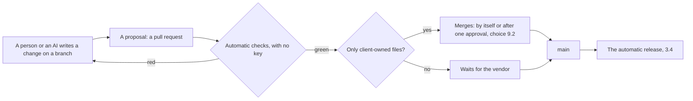
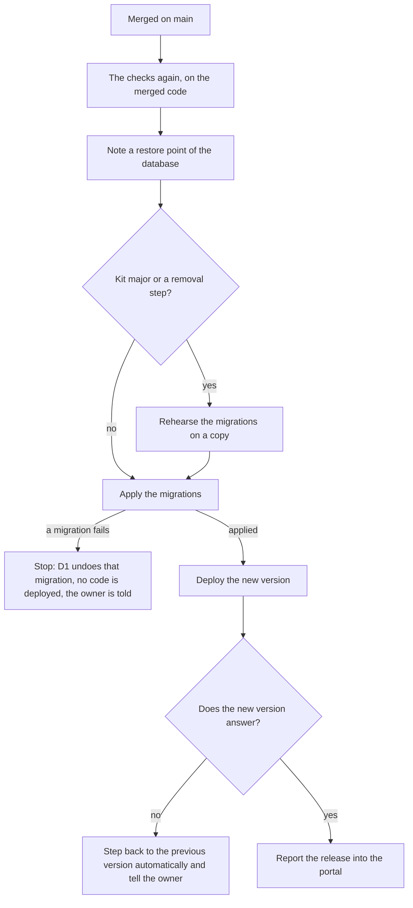
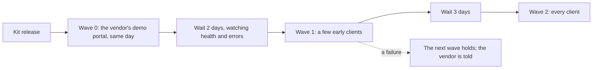

<!-- docs-check: proposed-paths -->
<!-- Paths named here describe the kit's own repositories, not files in this repository. -->

> **Research and proposal, written 2026-10-24.** Written for the platform kit plan
> ([`01-plan.md`](01-plan.md)). Every outside fact carries a numbered source; the list is at the
> end. The pages were read on 2026-10-24, most of them through a search service's copy of the
> page because the documentation sites did not load directly, so a page changed that day may
> differ. Anything not confirmed is marked **GAP**. The proposal waits on the owner's two
> answers (section 9); nothing in it is built yet.

# Automated delivery, strict checks and limits on customization

## In plain words

Harshil asked (2026-10-24 18:00) whether an all-access Cloudflare key stored in GitHub would let
an AI run migrations and commands by itself, and asked for a researched design on how
professional teams and large companies handle this: everything automatic and configured without
anyone typing commands, strict checks, client developers or AI adding features, and
customization kept in bounds so every client can still be upgraded.

- **The key: no.** Migrations and deploys already run by themselves in a client repository's
  workflow, with a narrow key. An all-access key adds only risk: anyone, or any AI, who can push
  to that repository could use it for anything in every Cloudflare account it reaches, and a key
  that can make keys survives its own removal. No professional setup works this way.
- **The design in one line:** three kinds of change (settings in the portal, a client's own
  modules, the kit itself); one door for every code change (a proposal that automatic checks must
  pass); an automatic release with a restore point and an automatic step back; a fixed menu of
  operations instead of a command line; and kit upgrades that reach clients in waves.
- **What it needs from the owner:** two choices (section 9). The first is GitHub's Team plan for
  the organisation that holds the client repositories, about US$4 a month per person with access.
  The second is whether a change to a client's own features merges by itself once every check
  passes.

## 1. The question: an all-access Cloudflare key in GitHub

| Question | Answer |
|---|---|
| Would Claude then run migrations automatically? | They already run automatically. A client repository's workflow applies the migrations, then deploys, on every push to `main`, with a key scoped to that client ([`01-plan.md`](01-plan.md) §14.1). A bigger key adds nothing here. |
| Would Claude run "any command"? | Claude never sees a GitHub secret. It can only change a workflow, or start one, and read its log. So "any command" would mean a workflow that runs whatever it is given with that key. GitHub states that anyone with write access to a repository can read all its repository secrets this way [28]. |
| What would a leak cost? | A person's key set to "all accounts" reaches every Cloudflare account that person belongs to, the Madagascar production account included. A key holding "API Tokens Edit" can create keys "with access to any of a user's resources" [4], which keep working after the leaked one is removed. The Global API Key cannot be narrowed and never expires. |
| Can GitHub sign in to Cloudflare without a stored key? | No. Cloudflare offers no short-lived sign-in from GitHub Actions (OIDC) as of 2026-10-24; the requests for it are still open [6], and Cloudflare's own guide for GitHub Actions uses a stored key [7]. A stored key is unavoidable, so its reach is what has to be small. |

What professional setups do instead:

- **One key per job.** The key is owned by the account, not a person, so it outlives staff
  changes [1].
- **The narrowest role.** Since 2026-09-15 a key can be an Editor of one named Worker. That is
  enough to deploy it, roll it back and set its secrets [2].
- **An end date, and an address filter where possible** [3].
- **No key that makes keys** [4].
- **One-click creation.** A link opens the dashboard with the right permissions already ticked
  [5].
- **A record of every action, with the key that did it,** kept 18 months [17].
- **The key goes only to reviewed code on the main branch** [24].

Section 3.6 applies this to Oltrem.

## 2. What the professionals do

| # | Practice | Who does it, and how | What it means for Oltrem |
|---|---|---|---|
| 1 | Customization is mostly data, which the vendor always upgrades | Salesforce stores every customer's customizations as metadata rather than code [36]. ServiceNow's rule is "configure before customizing" [44]. Odoo's upgrade service carries Studio changes forward but not custom modules [47]. | Lists, forms, roles, places, branding and switches are rows in the portal, not code |
| 2 | Nobody edits the core; extensions plug into declared points | WordPress: "Don't touch WordPress core" [46]. SAP's clean core allows released APIs only and enforces it with a syntax check [48]. Shopify apps add blocks instead of editing themes [41]. Shopify also removed `checkout.liquid` in favour of checkout extensions that run sandboxed and draw only Shopify's components [43]. | A client's code lives in its own modules; the kit's files are locked |
| 3 | Drift is detected, not hoped away | ServiceNow logs every edited built-in record; upgrades skip them, and an admin must review each one [44]. Salesforce's manageability rules say, for each component, who may edit it and whether an upgrade overwrites it [39]. | Every kit file in a client repository is checked against its released copy |
| 4 | Extensions declare what they need; a new power needs a yes | An Atlassian Forge app lists its scopes and network access in a manifest. A change to them is a major version that site admins must approve [45]. Chrome disables an extension whose update asks for a new permission until the user accepts [65]. | A module's manifest names its capabilities, tables and routes, and a proposal's summary shows them |
| 5 | Extension code runs within limits | Salesforce stops code that runs too long or uses too much ("governor limits") [38]. Shopify Functions are capped at 256 kB and 11 million instructions [42]. | Size, startup, CPU and per-request query budgets are checked |
| 6 | Tests before code may ship; the vendor runs customers' tests against its next release | Salesforce will not deploy Apex code without 75% test coverage [37]. Its "Hammer" ran about 60 million customer tests on the current and next release and caught about 25 regressions (2013) [40]. | A client module must test what it declares, and the kit runs every client's tests before a major release |
| 7 | One supported way to build, kept current by automation | Spotify's golden paths [49]. Its fleet automation has merged over 300,000 changes, 75% of them without a person [49]. Netflix's paved road wins adoption by being the better way, not by mandate [50]. | `oltrem new module` is the way to add a feature; the kit opens upgrade proposals in every client repository |
| 8 | One copy per customer, upgraded in waves, at most one version behind | GitLab Dedicated (one copy per customer) runs one minor version behind the latest. It upgrades regions 5, 6 and 10 days after a release, in fixed windows, with an emergency path [51]. GitLab also sets upgrade stops that cannot be skipped [52]. AWS releases in waves with waiting times and automatic rollback on alarms [53]. Azure goes from canary to pilot to the rest [54]. Google canaries one change at a time, judged on a few metrics [55]. | The vendor's demo portal first, then early clients, then everyone |
| 9 | Database changes in steps, so old code runs on the new schema | Expand, then contract [56]. GitLab adds tables and columns in migrations that run before the new code, and removes things only after it [57]. Stripe writes to both shapes before moving reads [58]. SQLite can only add, rename or drop a column; anything else rebuilds the table [59]. | A client migration only adds; a removal comes in a later release |
| 10 | Code from outsiders and AI goes through the same gates, walled in | GitHub's coding agent works on its own branch, cannot approve or merge, and its workflows wait for a person [30]. Claude's GitHub action gets a short-lived key and cannot write workflow files [31]. Claude Code's permission rules are enforced by the tool, not the model [32]. Spotify's agent must pass the repository's checks before it may open a proposal [61]. The Linux kernel requires an `Assisted-by:` line on AI-assisted work [62]. AI models name packages that do not exist (5.2% of suggestions from commercial models) [63]. OpenSSF asks for the same review for AI code as for any other [64]. | AI uses the same door as people, behind a list of allowed packages and locked paths |

## 3. The proposed design

### 3.1 Three kinds of change

| Kind | What it is | Who makes it | How it reaches production | What it may never do |
|---|---|---|---|---|
| **Settings** | Lists, forms, roles and places, branding, email templates, providers, switches: rows in the portal's database | The client's own admins, on a phone | At once, with no deploy | Nothing to forbid: it is data the kit understands |
| **A client module** | Code in the client repository's `modules/` folder, made with `oltrem new module`: its own tables, routes, screens and capabilities, its numbers from 5000 | The client's developers, the vendor, or an AI | Through the door (3.2) | Edit or import the kit's internals, change a table it does not own, or add a dependency, binding or variable that is not on the lists |
| **The kit** | The packages every client shares | The vendor only, in the kit repository | As a new version, in waves (3.8) | Be changed for one client |

**The rule that keeps every client upgradeable:** when a client needs something a module cannot
do, the kit gains a general setting or extension point that every client gets. No client ever
gets an edited core. The kit already enforces part of this. Its migrations are checked by
checksum, client numbers start at 5000, the kit's module ids are reserved, and the resource
manifest caps bindings and variables.

**Who owns each file in a client repository** (the manageability idea from Salesforce [39]):

| Owner | Files | On an upgrade | If someone edits it |
|---|---|---|---|
| The kit | the workflows, the Worker's entry file, the scripts, the rules files AIs read first, the kit's migrations (`0001`–`4999`) | Rewritten from the new version | The checks refuse the change |
| The client | `modules/`, the values in `oltrem.config.ts`, branding, migrations from `5000` | Never touched | Normal |
| Generated | the module list, `docs/_generated/` | Regenerated | The checks refuse an edit by hand |

### 3.2 One door for every code change

Nothing else reaches `main`:

- no direct push and no force push;
- no edit to a workflow or a kit file without the vendor's approval;
- the release key sits in a GitHub environment that only `main` may use, so a branch never sees
  it, however its workflow is changed [24, 28].

These locks exist for private repositories only on a paid GitHub plan. They are protected
branches, rulesets, rules on file paths, organisation-wide rules and environments [21, 22, 23, 24].
That is choice 9.1.

The kit repository keeps the owner's own rule: he and his AI push straight to `main`.

### 3.3 The checks

The proposal's checks run in GitHub Actions on `pull_request`, with no key. They are the same
`pnpm verify` a person or an AI runs before proposing.

The client template's checks today:

- types and tests;
- the resource manifest's caps;
- the kit's migrations by checksum and number;
- the generated reference;
- the AI entry files;
- the key registry;
- the build size.

The new checks:

| # | Check | What it catches |
|---|---|---|
| 1 | **Kit integrity:** every kit-owned file equals its copy in the pinned kit version | An edited workflow, entry file or kit migration: drift, refused instead of found at the next upgrade |
| 2 | **The change summary**, in plain words, on the proposal: what it adds (tables, routes, capabilities, settings, screens) and which files it touches, by owner | A new power slipping in unseen (the Forge and Chrome idea [45, 65]) |
| 3 | **The module contract:** imports only the kit's public entry points; numbers, table prefix, route prefix and error codes inside the module's own range; a valid manifest | A module reaching into the kit, or colliding with another module |
| 4 | **Migration rules for SQLite:** a client migration may create its own tables and indexes, add a column that is nullable or has a default, and insert rows. Anything else is refused unless it is marked as a removal step, which waits for the vendor and ships in a later release (drop, rename, rebuild, another module's table) [56, 57, 59]. | A migration that breaks the previous code, which would make the automatic step back unsafe |
| 5 | **Tests for what a module declares:** each route and capability in its manifest is exercised by a test, from tests generated from the manifest | A feature with no test; it needs no coverage tool, so no new dependency |
| 6 | **Dependencies only from the allowed list**, each with its recorded reason | Invented or unvetted packages [63] |
| 7 | **Budgets:** bundle size and startup time (today only in `oltrem upgrade`), on every proposal; D1's 50 queries per request [20] counted in tests | A feature that breaks the 10 ms or 50-query limits in production |
| 8 | **Secrets and identifiers:** the kit's scanner | A key or an account id pasted into code or docs |
| 9 | **Locked paths:** repository rules on the workflows and kit files, on top of check 1 [22, 29] | An edit to the checks themselves |

### 3.4 The automatic release

What makes each step safe:

- When migrations are applied, wrangler captures a backup first. A migration that fails is
  rolled back, and the earlier ones stay applied [13].
- D1 Time Travel can return the database to any minute of the last 7 days on the Free plan [12].
- A step back can return to any of the last 100 versions at once. It does not touch the database.
  It is refused if the older version uses a key-value namespace, bucket or queue that no longer
  exists [14].
- The step back is safe only because migrations only add: the previous code still runs on the
  new schema [56, 57].
- The health check reads `/healthz`, which the Worker answers before its own sign-in check. The
  door (Cloudflare Access) must also let that path through, as it must for `/hooks` [16]. This is
  part of the setup in 3.7.
- The rehearsal (an export, a scratch database, the migrations applied to it, then deleted) runs
  only for kit majors and removal steps. An export blocks the database while it runs
  ([`16-research-resources-and-release.md`](16-research-resources-and-release.md) §6).
- Sending a share of traffic to a new version first [15] is a later option for kit majors.

### 3.5 Operations without a command line

Every operation is a named, reviewed action that leaves an audit row. None is a free command run
with a production key.

| Operation | Who may start it | From where |
|---|---|---|
| Back up now; see the restore points | The client's Owner, the vendor | The portal |
| Return the database to a point in time | The vendor only, after a fresh sign-in and a typed confirmation | The portal, or the operations menu |
| Step the code back to an earlier version | The vendor | The operations menu |
| Apply waiting migrations, re-check the setup, replace a Worker secret, run the doctor | The vendor, or Claude | The operations menu |

**The operations menu** is one workflow in each client repository with a fixed list of choices
(GitHub allows up to 25 typed inputs, including lists [33]). Each choice runs one kit command,
using the release key, so it runs only from `main`.

Claude starts an operation by name through the GitHub connector and reads its log. An operation
that overwrites data (a restore or a step back) runs only after the owner says yes in the thread.
GitHub's own approval gate for this is Enterprise-only on private repositories [24].

This is the answer to "command execution": an AI can run operations, from a menu, with a log,
never an arbitrary command.

### 3.6 Keys, one per job

| Key | Where it lives | What it may do | Lifetime |
|---|---|---|---|
| **Setup key**, one per client | Handed to the first-setup run only | Create the Worker and its database, storage and queue; make the door (an Access application, with the paths let through); attach a custom domain. Creating a Worker needs the Workers Admin role [2]; the door needs Access apps and policies write [16]. | Ends by itself the next day [3] |
| **Release key**, one per client | The `production` environment of the client repository, usable by `main` only | Editor of that one Worker (deploy, step back, secrets) [2] and D1 edit for migrations | One year; a new one is made from the same link |
| **Operations key** (`KIT_OPS_TOKEN`, exists) | The Worker's own secret | D1 export and Time Travel, for backups and restores | One year |
| **The vendor's GitHub app** | The kit repository | Open upgrade proposals in client repositories and read their results; its tokens last an hour and it takes no paid seat [34] | Short-lived |
| **The emergency way in** | No stored key: the owner's own Cloudflare sign-in with two-step verification | Everything | Not applicable |

- Every Cloudflare key is account-owned [1] and made from a link that ticks its permissions [5].
- No key holds "API Tokens Edit" [4].
- The Global API Key is never used.
- Cloudflare's audit log names the key behind each change [17]. A weekly check flags anything a
  release key did that a release does not do.

**GAP:** the exact permission names for each key will be confirmed while building the links.

### 3.7 A new client, set up automatically

Only the owner can do these, because they are sign-ups and keys:

1. Create the client's Cloudflare account. A person can create up to five extra free accounts
   from the dashboard [18]. Beyond that, the client creates the account and invites the vendor.
2. Open two links that make the setup key and the release key.
3. Paste the keys into the new repository's settings.
4. Fill in the client's name, its owner's email address and the portal's address in the
   new-client workflow of the kit repository, and tap **Run**.

Everything else runs by itself:

1. The repository is made from the template.
2. The organisation's rules lock it.
3. The resources are created from their names.
4. The Worker's own keys are made. The backup's private key is sealed to the vendor's one offline
   recovery key instead of being kept in a file on a computer.
5. The door is made, with `/hooks` and `/healthz` let through.
6. The vendor's sign-in email is written.
7. The migrations run.
8. The first deploy goes out and passes its health check.
9. The owner receives the address.

This replaces the seven-step `npm run deploy` for clients. That command stays for the owner's own
trials.

### 3.8 Upgrading every client

- **How a wave works.** The kit's release opens an upgrade proposal in each client repository of
  the wave, through the vendor's GitHub app. The proposal already has `oltrem upgrade` applied: the
  kit's files rewritten, the new kit migrations copied, and the release notes in its description.
- **Patches and minor versions** merge by themselves when their checks pass.
- **A major version** waits for the owner and is rehearsed (3.4). Before a major, the kit runs
  every client module's tests against the new version (Salesforce's Hammer idea [40]).
- **A security fix** goes to every wave the same day.
- **Support:** each client runs the latest minor version or the one before it (GitLab Dedicated
  [51]). A required stop is set when a data migration must finish before the next version [52].
  Waves go out Tuesday to Thursday.
- **Why not Dependabot or Renovate for the kit's packages:** they raise the version number, but
  they cannot rewrite the kit's files or copy its migrations; Renovate's waiting period for new releases [60] is the same idea as the waves. The fleet step does all of it in one
  proposal, and can hold a wave. Dependabot still suits third-party packages in the kit
  repository.
- **Why not a template-sync tool (copier, cruft):** a repository made from a GitHub template keeps
  no link to it [35]. The client repository is kept thin instead: every shared file is
  kit-owned and rewritten whole, so there is nothing to merge three ways.

### 3.9 AI agents in this system

- **Same door as people:** a branch, a proposal, the checks, and no key on a branch.
- **Claude can:**
  - write client modules;
  - run the checks before proposing;
  - open the proposal and fix a red check;
  - start operations from the menu and read their logs.
- **Claude cannot:**
  - see any key;
  - change a workflow or a kit file in a client repository without the owner;
  - run a free command against production;
  - merge a change to locked files.
- **What enforces it:** the rules files tell every AI the rules, and the tools enforce what words
  cannot. Those tools are Claude Code's deny rules on the kit's paths [32], the checks, and the
  repository rules.
- **Labelling:** each AI-made commit carries an `Assisted-by:` line [62].

## 4. What it costs, and the limits

- **GitHub Team: US$4 per person per month** [25].
  - Every member, and every outside collaborator on a private repository, takes a seat. A person
    counts once across all the organisation's repositories [26].
  - Apps take no seat [34].
  - With only the owner: about US$4 a month. Each client developer adds US$4 a month, billed to
    that client.
- **GitHub Actions minutes.**
  - Team gives 3,000 a month for all the organisation's private repositories; Free gives 2,000
    [27].
  - An extra Linux minute costs US$0.006 [27].
  - At about 3 minutes for a proposal's checks and about 4 for a release, that is roughly 400
    changes a month across every client. 1,000 extra minutes cost US$6.
  - **GAP:** to be measured on the first real client.
- **Cloudflare stays on the Free plan:**
  - 7 days of Time Travel [12];
  - 10 databases per account [20];
  - the last 100 versions to step back to [14];
  - five extra free accounts per person [18].
  - Workers Builds is not used (section 5).

## 5. Options weighed and set aside

| Option | Why not now |
|---|---|
| One all-access key | Section 1 |
| Cloudflare's own builder (Workers Builds) as the gate, the 2026-10-18 recommendation that card 16 declined | Cloudflare says a GitHub account should point to only one Cloudflare account [9], and the kit has one GitHub organisation with an account per client. Its build key is a person's key without D1 permission [8]. Connecting it by API takes a person's key too [10]. Claude's threads cannot read its logs. Its main draw, 3,000 free build minutes in each client's own account [11], does not outweigh these. The owner's choice of GitHub Actions (card 16) holds. |
| Workers for Platforms (client code as sandboxed Workers in one vendor account) | Paid, US$25 a month [19], and built for one account hosting many customers' code; Oltrem gives each client its own account. To revisit if clients ever need to run code the vendor has not reviewed. |
| Terraform | A state store and another key per client ([`16-research-resources-and-release.md`](16-research-resources-and-release.md) §4) |
| A template-sync tool | Section 3.8 |
| Short-lived sign-in from GitHub to Cloudflare (OIDC) | Not offered [6] |
| Required reviewers on the release environment | Enterprise-only for private repositories [24] |

## 6. Build order, once accepted

1. The new checks (3.3) in the kit's command-line tool. They need no plan and no money.
2. The client template's workflows: the proposal's checks, and the release with its restore
   point, health check and step back. Also the file-ownership list and the file naming who
   approves each locked path.
3. The operations menu.
4. Automatic first setup.
5. The fleet step and the waves.
6. A script that applies the organisation's rules, so every new client repository is locked the
   same way.

Each step comes with its tests, the kit's twelve checks and a dated record, as usual.

## 7. What changes in the plan

Once the owner answers, this folds into the plan's keys (§9), release (§14) and guardrails (§15),
and into the decisions log. Two earlier answers change in part:

- Client repositories take changes through the proposal door instead of straight to `main`. The
  kit repository keeps straight to `main`.
- Kit upgrades reach clients through the fleet step instead of Dependabot.

GitHub Actions stays the gate (card 16).

## 8. Gaps

- The exact Cloudflare permission names for the setup and release keys (3.6).
- Whether Claude's commits and proposals in a client repository appear as the owner or as an
  app. A person cannot approve their own proposal [29], so this decides how the owner approves
  Claude's changes to locked files.
- The minutes a real client uses (section 4).
- GitHub's pages were read through a copy, and its pricing page may have been cached.
- Whether the five extra free Cloudflare accounts can also be created by API.

## 9. Choices for the owner

Posted on 2026-10-24 as two cards in the work thread; open.

| # | Choice | Options | Recommendation |
|---|---|---|---|
| 9.1 | The GitHub plan for the client repositories | **Team** (US$4 a month per person with access: locks `main`, the release key, the workflows and the kit's files); stay on **Free with only the vendor writing** (no locks; client developers' work is brought in by the vendor); stay on **Free as today** (anyone given access pushes to `main`) | Team: it is the only option where the checks cannot be edited away |
| 9.2 | A change that touches only a client's own module, with every check green | **Merges by itself**; **one person approves it too**, other than its author (the client's lead developer, or the owner for Claude's work) | Merges by itself. The checks guard the kit, the release steps back on its own, and the owner tests results on his phone; changes to locked files always wait for him. |

## Sources

All read 2026-10-24.

1. Cloudflare, account-owned tokens: <https://developers.cloudflare.com/fundamentals/api/get-started/account-owned-tokens/>
2. Cloudflare, Workers permissions: <https://developers.cloudflare.com/workers/authorization/workers/> and <https://developers.cloudflare.com/changelog/post/2026-09-15-granular-worker-permissions/>
3. Cloudflare, restricting keys by address and date: <https://developers.cloudflare.com/fundamentals/api/how-to/restrict-tokens/>
4. Cloudflare, creating keys by API (the warning on API Tokens Edit): <https://developers.cloudflare.com/fundamentals/api/how-to/create-via-api/>
5. Cloudflare, key template links: <https://developers.cloudflare.com/fundamentals/api/how-to/account-owned-token-template/>
6. Open requests for OIDC: <https://github.com/cloudflare/workers-sdk/discussions/11434> and <https://github.com/cloudflare/wrangler-action/issues/402>
7. Cloudflare, deploying from GitHub Actions: <https://developers.cloudflare.com/workers/ci-cd/external-cicd/github-actions/>
8. Cloudflare, Workers Builds configuration and its build key: <https://developers.cloudflare.com/workers/ci-cd/builds/configuration/>
9. Cloudflare, Workers Builds and GitHub: <https://developers.cloudflare.com/workers/ci-cd/builds/git-integration/github-integration/>
10. Cloudflare, Workers Builds API: <https://developers.cloudflare.com/workers/ci-cd/builds/api-reference/>
11. Cloudflare, Workers Builds limits: <https://developers.cloudflare.com/workers/ci-cd/builds/limits-and-pricing/>
12. Cloudflare, D1 Time Travel: <https://developers.cloudflare.com/d1/reference/time-travel/>
13. Cloudflare, wrangler's D1 commands (backup before migrations, a failed migration rolled back): <https://developers.cloudflare.com/workers/wrangler/commands/d1/>
14. Cloudflare, rollbacks: <https://developers.cloudflare.com/workers/versions-and-deployments/rollbacks/> and <https://developers.cloudflare.com/changelog/post/2025-09-11-increased-version-rollback-limit/>
15. Cloudflare, gradual deployments: <https://developers.cloudflare.com/workers/versions-and-deployments/gradual-deployments/>
16. Cloudflare, Access for Workers and bypass policies: <https://developers.cloudflare.com/workers/configuration/cloudflare-access/> and <https://developers.cloudflare.com/cloudflare-one/access-controls/policies/common-policies/>
17. Cloudflare, Audit Logs v2: <https://developers.cloudflare.com/changelog/post/2026-03-10-audit-logs-v2-ga/>
18. Cloudflare, creating accounts: <https://developers.cloudflare.com/fundamentals/account/create-account/>
19. Cloudflare, Workers for Platforms pricing: <https://developers.cloudflare.com/cloudflare-for-platforms/workers-for-platforms/platform/pricing/>
20. Cloudflare, D1 limits: <https://developers.cloudflare.com/d1/platform/limits/>
21. GitHub, plans and rulesets: <https://docs.github.com/en/get-started/learning-about-github/githubs-plans> and <https://docs.github.com/en/repositories/configuring-branches-and-merges-in-your-repository/managing-rulesets/about-rulesets>
22. GitHub, push rules on Team: <https://github.blog/changelog/2024-09-10-push-rules-are-now-generally-available-and-updates-to-custom-properties/>
23. GitHub, organisation rulesets on Team: <https://github.blog/changelog/2025-06-16-organization-rulesets-now-available-for-github-team-plans/>
24. GitHub, environments: <https://docs.github.com/en/actions/reference/workflows-and-actions/deployments-and-environments>
25. GitHub, pricing: <https://github.com/pricing>
26. GitHub, who takes a paid seat: <https://docs.github.com/en/billing/reference/github-license-users>
27. GitHub, Actions minutes and runner prices: <https://docs.github.com/en/billing/concepts/product-billing/github-actions> and <https://docs.github.com/en/billing/reference/actions-runner-pricing>
28. GitHub, secure use of Actions: <https://docs.github.com/en/actions/reference/security/secure-use>
29. GitHub, code owners and approvals: <https://docs.github.com/en/repositories/managing-your-repositorys-settings-and-features/customizing-your-repository/about-code-owners> and <https://docs.github.com/en/pull-requests/how-tos/review-pull-requests/approving-a-pull-request-with-required-reviews>
30. GitHub, the coding agent's risks and mitigations: <https://docs.github.com/en/copilot/concepts/agents/cloud-agent/risks-and-mitigations>
31. Anthropic, Claude Code GitHub action security: <https://github.com/anthropics/claude-code-action/blob/main/docs/security.md>
32. Anthropic, Claude Code permissions: <https://code.claude.com/docs/en/permissions>
33. GitHub, workflow inputs: <https://github.blog/changelog/2025-12-04-actions-workflow-dispatch-workflows-now-support-25-inputs/>
34. GitHub, apps compared with personal keys: <https://docs.github.com/en/apps/creating-github-apps/about-creating-github-apps/deciding-when-to-build-a-github-app>
35. GitHub, repositories from a template: <https://docs.github.com/en/repositories/creating-and-managing-repositories/creating-a-repository-from-a-template>
36. Salesforce, multitenant architecture: <https://architect.salesforce.com/fundamentals/platform-multitenant-architecture>
37. Salesforce, Apex code coverage: <https://developer.salesforce.com/docs/atlas.en-us.apexcode.meta/apexcode/apex_code_coverage_intro.htm>
38. Salesforce, governor limits: <https://developer.salesforce.com/docs/atlas.en-us.apexcode.meta/apexcode/apex_limits_intro.htm>
39. Salesforce, manageability rules: <https://developer.salesforce.com/docs/atlas.en-us.pkg2_dev.meta/pkg2_dev/sfdx_dev2gp_rules_ancestry_upgrades.htm>
40. Salesforce, the Hammer: <https://developer.salesforce.com/blogs/engineering/2013/05/here-comes-the-hammer>
41. Shopify, theme app extensions: <https://shopify.dev/docs/apps/build/online-store/theme-app-extensions>
42. Shopify, Functions limits: <https://shopify.dev/docs/api/functions/2025-10>
43. Shopify, `checkout.liquid` and checkout UI extensions: <https://shopify.dev/docs/storefronts/themes/architecture/layouts/checkout-liquid> and <https://shopify.dev/docs/api/checkout-ui-extensions/latest>
44. ServiceNow, skipped records and configuration before customization: <https://www.servicenow.com/docs/r/platform-administration/upgrade-center/uc-process-skipped-records.html> and <https://www.servicenow.com/docs/r/application-development/servicenow-studio-classic/sn-studio-custom-vs-config.html>
45. Atlassian Forge, permissions and versions: <https://developer.atlassian.com/platform/forge/manifest-reference/permissions/> and <https://developer.atlassian.com/platform/forge/versions/>
46. WordPress, plugins: <https://developer.wordpress.org/plugins/intro/>
47. Odoo, upgrades: <https://www.odoo.com/documentation/14.0/administration/upgrade.html>
48. SAP, clean core extensibility: <https://learning.sap.com/courses/practicing-clean-core-extensibility-for-sap-s-4hana-cloud/explaining-extensibility-model-best-practices_e290f382-800e-40ef-a203-85a13115f487>
49. Spotify, golden paths and fleet management: <https://engineering.atspotify.com/2020/08/how-we-use-golden-paths-to-solve-fragmentation-in-our-software-ecosystem> and <https://engineering.atspotify.com/2023/4/spotifys-shift-to-a-fleet-first-mindset-part-1>
50. Netflix, full cycle developers: <https://netflixtechblog.com/full-cycle-developers-at-netflix-a08c31f83249>
51. GitLab Dedicated, releases and maintenance: <https://docs.gitlab.com/administration/dedicated/releases/> and <https://docs.gitlab.com/administration/dedicated/maintenance/>
52. GitLab, upgrade paths: <https://docs.gitlab.com/update/upgrade_paths/>
53. AWS, automating safe, hands-off deployments: <https://aws.amazon.com/builders-library/automating-safe-hands-off-deployments/>
54. Microsoft Azure, safe deployment practices: <https://azure.microsoft.com/en-us/blog/advancing-safe-deployment-practices/>
55. Google SRE, canarying releases: <https://sre.google/workbook/canarying-releases/>
56. Martin Fowler, parallel change: <https://martinfowler.com/bliki/ParallelChange.html>
57. GitLab, multi-version compatibility and post-deployment migrations: <https://docs.gitlab.com/development/multi_version_compatibility/> and <https://docs.gitlab.com/development/database/post_deployment_migrations/>
58. Stripe, online migrations: <https://stripe.com/blog/online-migrations>
59. SQLite, ALTER TABLE: <https://www.sqlite.org/lang_altertable.html>
60. Renovate, automerge and minimum release age: <https://docs.renovatebot.com/key-concepts/automerge/> and <https://docs.renovatebot.com/key-concepts/minimum-release-age/>
61. Spotify, feedback loops for background coding agents: <https://engineering.atspotify.com/2025/12/feedback-loops-background-coding-agents-part-3>
62. The Linux kernel, AI coding assistants: <https://docs.kernel.org/process/coding-assistants.html>
63. USENIX Security 2025, package hallucinations: <https://www.usenix.org/conference/usenixsecurity25/presentation/spracklen>
64. OpenSSF, security-focused guide for AI code assistant instructions: <https://best.openssf.org/Security-Focused-Guide-for-AI-Code-Assistant-Instructions.html>
65. Chrome, permission warnings: <https://developer.chrome.com/docs/extensions/develop/concepts/permission-warnings>
