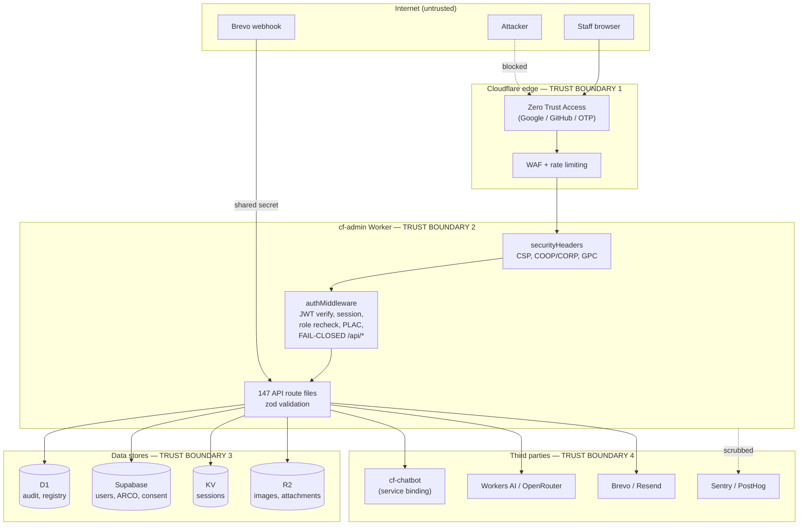

---

title: "Threat Model (STRIDE)"
status: active
audience: [technical, operator, ai, owner]
last_verified: 2026-10-16
verified_against: [code, config]
owner: harshil
related_docs: [SECURITY.md, RoPA.md, ../runbooks/incident-response.md, compliance/ASVS-L2.md, ../architecture/plac-and-audit.md, ../architecture/PERMISSIONS-SYSTEM.md]
related_code: [src/lib/auth/authz-signal.ts, src/pages/api/emails/webhook.ts, src/lib/audit.ts, src/lib/schemas/ai.ts]
tags: [threat-model, stride, security, owasp, asvs, dfd]
---

# Threat Model (STRIDE)

> **TL;DR (non-technical):** A structured list of how someone could attack this
> platform, and what stops them. Written so that the next person to change the
> auth or API layer can see which defences are load-bearing before they move
> something.

## Context / Scope

Closes gap **G8** from
`../records/reviews/2026-07-22-compliance-certification-audit-all-frameworks-and-roadmap.md` (private).
Serves OWASP ASVS V1.1, OWASP Top 10 A04 (Insecure Design), SOC 2 CC3.2 and
ISO 27001 A.5.8.

**In scope:** `cf-admin` — Worker, middleware, API routes, D1/Supabase/KV/R2
access, control-plane connectors.
**Out of scope:** `cf-astro` and `cf-chatbot` internals (trust boundaries with
them are modelled); vendor infrastructure security (inherited, see
[`compliance/ISO-27017-27018.md`](compliance/ISO-27017-27018.md)).

## 1. Data-flow diagram

**Trust boundaries:**

1. **Internet → CF edge.** Identity is established here, not in the app. The
   Worker sees an unauthenticated request only on the explicit allowlist in
   `src/lib/auth/routes.ts` — `/api/health`, `/api/emails/unsubscribe`,
   `/api/auth/logout`, `/api/auth/dev-login` (404 in a production build), the
   two public storage prefixes modelled below, and the Brevo webhook. The
   `/api/auth/*` *prefix* was narrowed to those two named routes on 2026-09-04.
2. **Edge → Worker.** The CF Access JWT is *verified* in-app
   (`verifyZeroTrustJwt`) — headers alone are not trusted.
3. **Worker → data.** All access is service-role/binding; the Supabase `anon`
   role has zero table grants and zero RLS policies. Function ACLs are
   **not** complete: EXECUTE is revoked on four of the six public functions, and
   `increment_conversation_metrics` and `purge_expired_privacy_data` remain
   callable by `anon` and `authenticated` (live check 2026-09-20). Neither is
   `SECURITY DEFINER`, so a caller executes with their own privileges and the
   body fails on table access — this boundary holds today because of Layer 1,
   not because of Layer 3. A REVOKE migration is outstanding; see
   [`SECURITY.md`](SECURITY.md) §10.3.
4. **Worker → third parties.** Outbound only, no user-controlled URLs.

**Public exception — Staff Managed Storage share/request routes.** Two route
families are the one deliberate carve-out in trust boundary 1: they serve
external parties (vendors, vets) who have no portal account, so they cannot
sit behind CF Access.

- `/api/storage/share/[token]` — vendor download links. `GET` is always
  side-effect-free (renders a consent/passcode gateway form only); the actual
  file transfer happens on `POST`, so query-string data is never echoed or
  acted on.
- `/api/storage/request/[token]/*` — inbound File Request Links, letting an
  external party upload a file the staff member asked for. Same GET/POST
  split: `GET` never reads the passcode from the query string, `POST` reads it
  from form data and compares it with `timingSafeEqualStrings()`.

Token model: both are HMAC-signed, self-verifying, time-boxed tokens
(`mintShareToken`/`verifyShareToken`, `src/lib/storage/share-token.ts`) —
possession of the token is the credential, there is no session. An optional
passcode adds a second factor, hashed at rest with a salted HKDF subkey
(`hashPasscodeKeyed` / `verifyPasscode`, with a legacy-format fallback) and
compared timing-safely. Every access attempt — success or failure — is telemetry
logged to `storage_share_access_logs` (hashed IP, user agent, CF country,
attempt status), independent of whether the request succeeds.

A 2026-08 security pass found and closed a **reflected-XSS-to-session-
takeover chain**: the no-passcode path on `request/[token]/index.ts` embedded
the raw, unvalidated `?passcode=` query value inside an inline `<script>` via
unescaped `JSON.stringify()`, letting a crafted link execute same-origin
script in a staff browser that later followed it. Also closed in the same
pass: a passcode-bypass gap where the upload `presign`/`confirm` endpoints
never re-checked the passcode the landing-page gateway had already enforced,
and two non-timing-safe passcode comparisons (`!==` instead of
`timingSafeEqualStrings`). All three are reflected in the STRIDE rows below as
mitigated, not merely mitigatable.

## 2. STRIDE analysis

### S — Spoofing

| Threat | Mitigation | Residual |
|---|---|---|
| Forged CF Access header | JWT signature verified against the team's JWKS with audience pinning — headers alone never trusted | Low |
| Session hijack | `__Host-` prefix, `Secure`, `HttpOnly`, `SameSite=Strict` (SEC-02); 24h hard expiry | Low |
| Stolen session after role revocation | Since 2026-09-16 a permission or role change writes an `authz-changed:{userId}` mark; the session re-reads role and page map on its **next request** (`src/lib/auth/authz-signal.ts`). Deactivation, deletion, manual force-kick and the Sessions-page block still run the 3-layer force-kick. The 30-minute re-check remains the backstop | **Low–Medium** — next request (KV consistency ≈60 s) for a change made in the portal; up to 30 minutes for a role edited directly in Supabase, and up to 60 minutes if Supabase is unreachable at re-check time |
| Stolen session used for a dangerous action | Since 2026-10-16 role changes, suspending or deleting a person, signing people out, Owner-level grants, Page Registry changes that reach more than one person, deleting records and Email API credentials need a sign-in from the last 10 minutes ([`../architecture/PERMISSIONS-SYSTEM.md`](../architecture/PERMISSIONS-SYSTEM.md) §10.5) | **Medium** — whoever holds the browser can sign in again there; the check proves the person only once Cloudflare Access asks for its own second step at every sign-in (item #13, an owner step) |
| Webhook impersonation | Pre-shared secret compared in constant time, fail-closed when unset, plus a 120/min per-IP limit (`src/pages/api/emails/webhook.ts`, `test/webhook-secret.test.ts`). **Not** an HMAC: there is no payload signature and no replay protection, so a captured request can be replayed and any leak of the secret is a full forgery. Tightening where the secret may be presented is tracked in `../MAINTENANCE.md` | **Medium** |

### T — Tampering

| Threat | Mitigation | Residual |
|---|---|---|
| SQL injection | D1 prepared statements + bound params; Supabase client parameterises. SEC-03 blocks *new* raw `env.DB.prepare` in handlers — 18 pre-existing handler files are grandfathered by name in `scripts/rules_check.py` | Low |
| Mass assignment | zod `.strict()` allowlists. **Was High** — `inquiries/edit` accepted `updates: any` straight into a Supabase `.update()`; fixed 2026-07-25 | Low |
| XSS | Nonce-based CSP; `sanitizeHtml` via HTMLRewriter; SEC-08 guards `dangerouslySetInnerHTML` | **Medium** — `script-src` still carries `'unsafe-inline'` pending the Report-Only canary |
| Reflected XSS via public storage link (`?passcode=`) | **Closed 2026-08.** No-passcode `GET` no longer reads or echoes query-string data; the upload gateway's passcode value now flows through an escaped `data-passcode` HTML attribute, never a `JSON.stringify()`'d inline `<script>` | Low |
| Storage upload/passcode bypass | **Closed 2026-08.** `presign`/`confirm` on File Request Links now independently re-verify any configured passcode server-side, and comparisons use `timingSafeEqualStrings()` instead of `!==` | Low |
| CSRF | Origin/Referer validation on every mutation, fail-closed (`test/csrf.test.ts`) | Low |
| Audit-log tampering | Insert-only application path: no route edits an entry, and since 2026-10-16 none deletes one younger than 180 days (`DELETE /api/audit/logs` and `/api/audit/prune` removed, the targeted delete refuses the activity log, Data Retention holds a 180-day floor). Each day is sealed the next morning: a fingerprint chained to the day before, kept in the log, as an R2 copy and in an email, and checked again each morning and under *Check seals* ([`../architecture/plac-and-audit.md`](../architecture/plac-and-audit.md) §3.2 and §3.6). Cloudflare API access can still change the table; the seals make that visible | **Medium** — today's entries are unsealed until 14:00 UTC the next day, and until the owner locks `audit-log/` in R2 (MAINTENANCE AL-1) someone with R2 write access can rewrite the copies as well as the seals; the emails already sent then remain. The table was bulk-cleared on 2026-09-18, before any of this |

### R — Repudiation

| Threat | Mitigation | Residual |
|---|---|---|
| Denying an action | Every mutation audited with actor, role, path, CF-Ray, hashed IP, and each day sealed the next morning | **Low to Medium** — an entry of a sealed day cannot be removed without the morning check showing it; see Audit-log tampering |
| Audit silencing abuse | **Removed.** `is_audit_silenced` was taken out of the code on 2026-07-26 and the Supabase column dropped on 2026-07-27 (`supabase/migrations/20260727000000_drop_audit_silence.sql`). There is no way to mute the audit trail for an account | Closed |
| Log gaps | `waitUntil` writes; a V1-schema fallback covers a column mismatch, but there is **no retry** — a failed write is reported to Sentry and the event is lost (`src/lib/audit.ts`) | **Medium** |

### I — Information disclosure

| Threat | Mitigation | Residual |
|---|---|---|
| PII in error tracking | `sendDefaultPii: false` + scrubber (`test/sentry-scrub.test.ts`) | Low |
| Raw IPs at rest | Hashed (HMAC-SHA-256 with `IP_HASH_SECRET`) in the audit log, the storage access logs, the suppression list and the email ledger. **Raw** in `admin_login_logs` (by design, for forensics), in the `consent_attempts` / `booking_attempts` dead-letter tables, and in KV session records. The session-less routes' rate-limit keys hold the raw IP only inside Cloudflare's Rate Limiting binding, for its 60-second period, and in no store of ours (since 2026-10-04; until then they were Upstash keys, which until 2026-10-02 limiter analytics also kept with no expiry — [incident record](../operations/incidents/2026-10-02-redis-keys-without-expiry.md)). Full table in [`RoPA.md`](RoPA.md) §2.1 | **Medium** — retention on the raw stores is manual, so the exposure window is whatever an operator last purged |
| Secrets in source | CI secret-scan (blocking); `.dev.vars` gitignored | Low |
| Cross-tenant leakage | **N/A** — single tenant. Becomes the primary risk if multi-tenancy is ever added |
| Search-engine indexing | `robots.txt` + `X-Robots-Tag`. The header lived only in `public/_headers` (static assets) until 2026-09-02, when `src/lib/security/csp.ts` started setting it on SSR responses too | Low |
| Identity documents on ARCO tickets | **Not held here.** Supabase `legal_requests` stores only `identity_doc_mime` and `identity_doc_size`; the document itself is an object in cf-astro's R2 bucket, fetched through a cf-astro endpoint behind an admin secret header. Supabase RLS therefore does not protect the asset — the controls that matter are the cf-astro endpoint's header check and R2 bucket privacy, neither of which is modelled in this repo | **Medium** — the most sensitive asset in the system, and its trust boundary sits outside this model |

### D — Denial of service

| Threat | Mitigation | Residual |
|---|---|---|
| Brute force / flooding | Cloudflare WAF + per-route rate limits on sensitive routes: Cloudflare's Rate Limiting binding for one-minute limits and D1 counters for hour/day limits (Upstash until 2026-10-04; [`SECURITY.md`](SECURITY.md) §6b) | Low |
| Unbounded bulk operations | Array caps in zod (ids ≤500, bookings ≤200, tags ≤30) | Low |
| Free-tier exhaustion | Quotas and usage dashboards | **Medium** — a determined attacker could burn D1/Workers quota |
| AI cost abuse | Model IDs validated against the `AI_MODELS` catalogue, or — for OpenRouter — a deliberately bounded `openrouter/<vendor>/<model>` pattern rather than a closed enum (`src/lib/schemas/ai.ts`); per-user quota; 3/min and 20/day rate limits | Low |

### E — Elevation of privilege

| Threat | Mitigation | Residual |
|---|---|---|
| **Unauthorised API access** | **Fail-closed `/api/*` authorization.** The code shipped 2026-07-25 in `shadow` mode, which recorded what it would have blocked; `API_DENY_MODE` was flipped to `enforce` on **2026-08-12**. Before that every route relied on self-guarding | Low |
| Unmapped route bypass | `resolveApiAuthz` returns null → deny; enforced by SEC-07 and a route-inventory test | Low |
| Prefix confusion | Segment-boundary anchored matching — `/api/usersomething` no longer inherits `/api/users` access | Low |
| Role escalation via payload | Client-supplied roles are informational; the provisioning gates read the target's role from the database, never the body (`src/lib/access-center/page-gates.ts` and `handlers.ts`, gates A–D in [`../architecture/PERMISSIONS-SYSTEM.md`](../architecture/PERMISSIONS-SYSTEM.md) §10). SEC-04 is narrower than it looks — it only forbids one hardcoded role-array literal | Low |
| Dashboard prerender bypass | ESLint hard-errors on `prerender = true` under `src/pages/dashboard/**` | Low |
| Storage PLAC deny bypassed by hardcoded role array | **Closed 2026-08.** `requests/[id].ts` previously OR'd `placDenyResponse(...)` with a hardcoded `['dev','owner',...].includes(user.role)` clause, silently overriding an explicit per-user PLAC deny for those roles. The clause was removed — `placDenyResponse` alone now gates | Low |

## 3. Highest-priority residual risks

Ranked by exploitability × impact:

1. **The audit log's newest day, and its copies until they are locked.** Since
   2026-10-16 each day is sealed the next morning and the portal cannot delete
   recent entries ([`../architecture/plac-and-audit.md`](../architecture/plac-and-audit.md)
   §3.6). What is left: the current day is unsealed until 14:00 UTC the next day,
   and the R2 copies are not locked yet (`../MAINTENANCE.md` AL-1, an owner step),
   so someone with Cloudflare access could rewrite both the seals and the copies;
   the morning emails already sent would still show the change. The bulk clear of
   2026-09-18 happened before any of this and cannot be explained from the log.
2. **Restores are not proven yet.** Backups run: `backup_runs` records 19
   succeeded backups between 2026-09-26 and 2026-10-14 (D1 connector,
   2026-10-16). The restore tests on the server ran end to end on 2026-10-08 and
   both ended FAIL on a false finding, fixed the same day; no passing test is
   recorded since (`../records/reports/2026-10-08-restore-tests.md` (private),
   `../MAINTENANCE.md` RT-1 and RT-6).
3. **`'unsafe-inline'` in `script-src`** — materially weakens XSS defence. The
   Report-Only canary is live; the flip is blocked on operator verification of
   Cloudflare Rocket Loader (`../MAINTENANCE.md` C-3). The `style-src` half is a
   larger job than previously written down — 885 inline `style={{ }}` props
   across 110 files, not "about 20".
4. **Brevo webhook has no payload signature or replay protection** — a shared
   secret is the whole control on a session-less, publicly reachable route.
5. **Single-operator concentration** — no separation of duties; the same person
   holds every role in the incident runbook, and is also the only person who can
   remove audit entries past 180 days or a bucket lock.
6. **Role-revocation timing** — portal changes now land on the user's next
   request, but an edit made directly in Supabase still waits up to 30 minutes,
   and a Supabase outage at re-check time extends that to 60.

## 4. Assumptions

If any of these stops being true, re-run this model:

- Single tenant. Multi-tenancy would make cross-tenant isolation the dominant
  concern and invalidate several "N/A" entries above.
- All operators are trusted employees; the model defends against external
  attackers and compromised accounts, not a determined malicious insider with
  Owner role.
- Cloudflare and Supabase platform security is inherited, not verified.
- No payment-card data and no human health data (see the compliance audit
  §6.1–6.2 for the triggers that would change this). The
  `accessibility_accommodation` field on `consent_records` is the one item that
  could disturb this assumption; it is flagged for assessment in
  [`RoPA.md`](RoPA.md) activity D.

## 5. Verification log

| Date | Checked | Not checked |
|---|---|---|
| 2026-10-16 | "Audit-log tampering", "Denying an action" and §3 items 1, 2 and 5, for the daily seal (#21): `src/lib/audit-seal/`, `src/workers/scheduled-audit-seal.ts`, `src/pages/api/audit/logs.ts`, `delete-targeted.ts`, `src/pages/api/retention/purge.ts`, a search of `src/` for any other delete from `admin_audit_log` (none) and `test/audit-seal.test.ts`; item 2's figures from `backup_runs` through the D1 connector, and `../MAINTENANCE.md` RT-1, RT-3 and RT-6 | The other rows; cf-backup's own records of restore tests after 2026-10-08 (not read); the first live seal run |
| 2026-10-16 | The new "Stolen session used for a dangerous action" row and the recent sign-in sentence in "Audit-log tampering", against `src/lib/auth/fresh-sign-in.ts`, the routes that call it (pinned by `test/fresh-sign-in.test.ts`) and `src/lib/auth/stages/bootstrap.ts` (`signedInAtFromAssertion`) | Every other STRIDE row |
| 2026-10-07 | The "Raw IPs at rest" and "Brute force / flooding" rows, for the move of cf-admin's rate limits off Upstash on 2026-10-04: `src/lib/ratelimit.ts`, `src/lib/dal/RateLimitRepository.ts`, `wrangler.toml` `[[ratelimits]]`, `RoPA.md` §2.1 | Every other STRIDE row; how long Cloudflare keeps a limiter counter after its period |
| 2026-09-20 | Every STRIDE row re-derived from code at HEAD. Corrected: the audit-log "append-only" claim (the table was bulk-cleared 2026-09-18; `prune` keeps no snapshot), the webhook "HMAC" claim (`src/pages/api/emails/webhook.ts` — shared secret, constant-time), raw IP storage (per-store table now in `RoPA.md` §2.1), ARCO identity documents (R2 via cf-astro, not Supabase RLS), the revocation window (`authz-changed` mark, 2026-09-16), audit silencing (removed 2026-07-26/27), the public allowlist, the route count (147), `hashPasscodeKeyed`, the SEC-03 grandfather list, the `waitUntil` retry claim, the `X-Robots-Tag` date, the AI model pattern, and the 2026-08-12 enforcement date. §3 re-ranked | Cloudflare edge WAF and rate-limit rule configuration (dashboard-side, not in this repo); the "no user-controlled URLs" outbound claim; live Supabase policy state; the cf-astro side of the ARCO document trust boundary |
