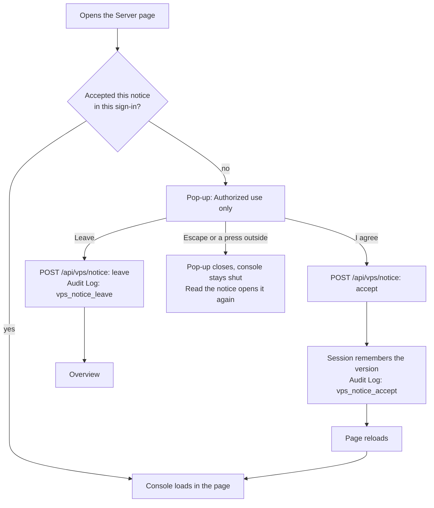

# Server access notice — design

> **In one minute:** the first time a person opens the Server page after signing in, a pop-up
> says that the server is privately owned and paid for by the platform's vendor, that only
> people he authorized may use it, that activity there is monitored and recorded, and that
> unauthorized use may lead to legal action. The person chooses **I agree** or **Leave**. The
> console stays shut until they agree, and either answer is saved in the Audit Log with their
> name, their session, the time, their approximate location and their device.

## 1. What the owner asked for (2026-10-11)

A notice of acknowledgement every time someone signs in to the admin portal and opens the
Server (VPS) area. It should say, in professional words, that the server is owned and paid for
by the vendor and developer, that any use needs his authorization, that unauthorized use,
access or changes are logged and may lead to legal or other action, and that anyone who is not
sure, or not authorized, should leave the page or ask an administrator or the vendor for help.
Every acknowledgement goes in the Audit Log with the user, the session, the location and the
device.

## 2. What the research says

| Source | What it asks of such a notice | How the notice follows it |
|---|---|---|
| NIST SP 800-53 control AC-8, "System use notification" | Show the notice **before** access. Say that the system is private (there: a government one), that use may be monitored, recorded and audited, that unauthorized use is prohibited and may bring criminal and civil penalties, and that using the system means consent to monitoring. Keep it on screen until the person acknowledges it and takes an explicit action to go on | The console does not load until the person chooses **I agree**; the four statements are the notice's three points and its last line |
| The US Department of Defense's standard notice and consent banner | Adds that people should have **no expectation of privacy**, and that records may be used and disclosed for authorized purposes | "You should have no expectation of privacy on this system" and "Records may be shared with the authorities" |
| Clickwrap practice (vendor and law-firm guidance on enforceable online agreements) | An **affirmative act** that clearly means yes (a button that says what it does, never a pre-ticked box or "by continuing to use"), conspicuous terms, and a record of **who** accepted, **when**, and **which version** of the text; a changed text is accepted again | An "I agree" button named in the consent line; the Audit Log row holds the person, the time, the session, the version and a fingerprint of the exact words; a new version is shown again to everyone |
| Mexico's Federal Criminal Code, article 211 bis 1 | Punishes knowing, copying, changing or destroying information in a computer system protected by a security mechanism, **without authorization** | The notice and the sign-in in front of it make the authorization boundary explicit and recorded. The notice names no law, because who uses the server and from where can change; "under applicable law" covers that |

The sources are secondary summaries of the controls and laws, read on 2026-10-11. The wording
follows common practice; it is not legal advice, and a lawyer in the relevant country should
review it before anyone relies on it in a dispute.

## 3. The words, and why each one is there

The text lives in one place, `src/lib/vps-notice.ts`, and the pop-up renders it from there.

| Part | What it says | Why |
|---|---|---|
| Title | **Authorized use only** | The standard heading for such notices; the whole message in three words |
| Opening | The server is privately owned, managed and paid for by the vendor (named, as the platform's developer and vendor); it serves the hotel's operations; only people he authorized may use it, and only for the work they were authorized to do | Who owns it and who decides, as the owner asked. "Only for the work they were authorized to do" covers going beyond a grant, not only having none |
| Point 1 | **Activity is monitored and recorded.** It may be logged, reviewed and audited; no expectation of privacy | AC-8 and the DoD banner. "May" is accurate: changes and terminals are recorded, reads are not |
| Point 2 | **Unauthorized use is prohibited.** Access, use or change without authorization, or beyond it, may lead to removal of access and to civil or criminal action under applicable law; records may be shared with the authorities | The consequences the owner asked for, in the usual legal form |
| Point 3 | **Your answer is recorded.** Name, session, time, approximate location and device | Telling people what is recorded about them is both fair and what privacy law expects; it also makes the record harder to dispute |
| Help | If you are not authorized, or not sure, choose Leave and ask an administrator of this portal or the vendor, with his email address as a link | The owner's "leave the page or request assistance" |
| Consent | By choosing "I agree" you confirm you are authorized and accept these conditions, including the monitoring and recording of your activity | The explicit consent AC-8 and clickwrap practice ask for, tied to the button's own label |
| Buttons | **Leave** and **I agree** | Plain verbs. Leave has the focus when the pop-up opens, so a stray Enter never agrees |

## 4. How it works

- **Once per sign-in.** An acceptance is kept in the session (`vpsNoticeVersion`), so it lasts
  until the session ends: signing out, the 24-hour limit, or a new sign-in. Everyone sees it,
  the owner and vendor support included.
- **The server decides, not the pop-up.** The Server page renders the console's frame only for
  a session that accepted the current version, and the gateway refuses to open the console
  without it too: a frame gets a short "accept the notice first" page and a tab opened straight
  at the console is sent to the Server page. The console's own calls are not held, because they
  come from a console that is already open.
- **A new text, a new acceptance.** Changing any word means a new `version`. An answer sent for
  an older version is refused, and everyone is asked again on their next visit.
- **A moment's lag is covered.** The session copy the portal keeps in memory can be up to five
  seconds old; when it says "not yet", the page and the gateway read the stored session itself
  before deciding.

## 5. What the Audit Log keeps

One row per answer: action `vps_notice_accept` or `vps_notice_leave`, module `vps`, target type
`vps_notice`, target id the version. Besides the person, role, time, request path and Ray ID
every row has:

| Field | What it holds |
|---|---|
| `session_id` column | The session's handle: the same one the Sessions page shows, never the session cookie |
| `ip_hash` column | The keyed hash of the sign-in address, as on every row |
| `notice` | The version and a SHA-256 fingerprint of the exact words |
| `page` | The Server page address they were opening |
| `person` | Their display name and how they signed in |
| `session` | When the session started and when they signed in |
| `location` | City, region, country, time zone, network provider and its number, and Cloudflare's data centre, all from Cloudflare's reading of the connection |
| `address` | A keyed hash of the address used for this answer, and whether it is the sign-in address |
| `device` | Phone or computer, browser, system, the browser's own platform and mobile hints, and the full user agent |
| `browserReported` | What the browser says about itself: its time zone, language and screen size. A value that fails its check is left out; it never blocks the answer |

The raw address is never stored in the Audit Log ([RoPA](../security/RoPA.md) §2.1); the sign-in
record of the same session holds it.

## 6. Limits and open points

- **A read-only role cannot accept.** The portal refuses every change from a read-only role
  before a route runs, and an answer is a change. Such a person sees the notice and cannot open
  the console. Today the Server page is for admins and above, so this needs a grant to a
  read-only person to matter.
- **Someone skilled can still call the console's API by hand** without accepting, since only
  pages are held. Every change made that way is still in the Audit Log, and going round the
  notice on purpose is itself evidence.
- **Browsers older than 2023** do not say whether a request opens a page, so the gateway does
  not hold them; the Server page still shows them the notice first.
- **English only**, like the rest of the portal. A Spanish version is a new version of the text,
  if the owner wants one.

## 7. Verification log

| Date | Checked by | Method | Result |
|---|---|---|---|
| 2026-10-11 | claude | Written with the code. `test/vps-notice.test.ts` (the route, the record, the acceptance check, which requests are held, the text), `test/vps-gateway.test.ts` (frames and tabs held until acceptance, console calls not held), `test/vps-page.test.ts` (one frame, in the accepted branch; the pop-up's choices) | Matches the code. Not yet seen on a phone (owner step); the research in §2 is from secondary sources |
