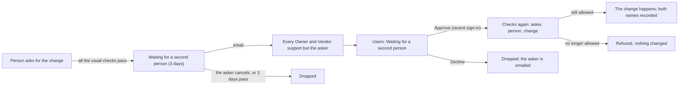

# Two-person rule — design

> **TL;DR (non-technical):** a handful of changes that cannot be taken back, or that hand out the
> top of the portal, now need a second person. The first person asks; an Owner or Vendor
> support who is not them approves it on the Users page within 3 days, and only then does it
> happen. Suspending someone still works at once, so nobody waits to cut off access.

Permissions item #36, approved by the owner on 2026-10-15 22:16 with the rest of the list
("I approve all your suggestions"). The item, as approved: a two-person rule for making someone
Owner, deleting a person, removing the last Owner (open defect D14, which had no guard at all),
and changing log retention; with one Owner, the second person is Vendor support.

## 1. What needs a second person

| The change | Asked from | Why it is on the list |
|---|---|---|
| Making someone **Owner or Vendor support** | Users → a person → Change role | Hands out the top of the portal. Vendor support is included because it holds everything an Owner does and more; leaving it out would leave the rule a side door |
| **Deleting a person** | Users → a person → Remove | Cannot be undone: the account, personal settings and console permissions go |
| **Removing the last active Owner**: changing their role or suspending them | Users → the Owner → Change role or Suspend | Would leave the hotel with no Owner (D14, the 2026-09-16 lock-out) |
| **Changing how long a server log is kept** | Server → Log storage | Shortening it destroys records the moment the change runs |

Everything else stays one-person, on purpose:

- **Suspending** anyone but the last Owner is immediate, so access can always be cut off at once.
  The message for a removal says so.
- **Inviting** someone straight in as Owner or Vendor support is refused while someone else
  could approve: invite them with another role, then change it, which asks for the second
  person. With nobody else, as when Vendor support makes a new portal's first Owner, the
  invitation goes ahead and its activity-log row says it had no second person.
- A request that changes something else as well (a name together with a role) is refused when
  part of it is on the list: a waiting change would leave the rest behind. Make it on its own.
- A server log's retention needs the second person whether it gets longer or shorter. The portal
  cannot tell which way a change goes without asking the server, and such changes are rare.

## 2. Who approves

Any **active Owner or Vendor support who is not the person who asked**. The person being
removed may approve it themselves if they are an Owner: that is their consent. Approving needs a
sign-in from the last 10 minutes (the rule of permissions item #14); so does asking, as each of
these changes already did.

With one Owner and one Vendor support, as today, each is the other's second person. When there
is nobody else who could approve, there is no second person to wait for: the change goes ahead
at once, as before, and its activity-log row says it had none. That is what keeps a new portal
working, where Vendor support makes the first Owner. It gives little away: while there is an
active Owner, every way down to a single Owner-or-Vendor-support account (removing the last
Owner, deleting someone) is itself on this list.

## 3. How it runs

1. **Asking.** The route makes every check it made before (clearance, yourself, fresh sign-in).
   Where the change is on the list, it then stores it as waiting and answers `202` instead of
   making it: the message says why it waits, until when, and that an Owner or Vendor support who
   did not ask decides it. The server console shows the same answer as a notice on Log storage.
2. **Waiting.** One `admin_portal_settings` row, `approvals:pending`, holds at most 20 waiting
   changes, each for 3 days. Asking again for the same change returns the one already waiting.
   The row is written by compare-and-swap on its exact previous value, so two people deciding at
   once cannot both act.
3. **Approving.** The approver's tap takes the change out of the row first, then checks again as
   of now: the asker's account is still active and its current role may still make the change,
   and the person it is about is unchanged (their role is still the one it was when asked). Then
   it runs the same code the route runs, as the approver, and the activity-log row names both.
   For a server log, the portal sends the change to the server as the approver, who must hold
   the server's own `retention.manage`. When a check fails, nothing changes, the change stops
   waiting, and the asker is emailed why.
4. **Declining** drops it and emails the asker, with the decider's note if there is one. The
   asker may **cancel** their own while it waits.

Every step writes one activity-log row, `second_person`, with `op` = `ask`, `approve`,
`decline`, `cancel` or `not_done`, besides the change's own row. The Owner and Vendor support
see every waiting change on the Users page; anyone else with the Users page sees only their own.

## 4. Decisions

- **Storage:** no new table (RULE #0.9). Waiting changes are few and short-lived; the activity log
  is their history.
- **Execution as the approver, checks as the asker.** The approver may not be able to make the
  change alone (an Owner cannot make another Owner), so the clearance is the asker's, checked
  again at approval; the action is the approver's, so the request's details and the activity row
  are theirs.
- **3 days** covers a weekend; after that the asker asks again.
- **Not the console's own rule.** The server console is reached only through the portal, so the
  portal holds the change; the server checks the approver as for any change.

## 5. What is not covered

- Anything that can write the settings table or Supabase directly bypasses the rule, as it can
  bypass every check in the portal (MAINTENANCE AC-3, AC-4 (private)).
- Data Retention's purge stays as it is: Owner or Vendor support, a recent sign-in and an exact
  count. It removes data past its window; it does not change a window.
