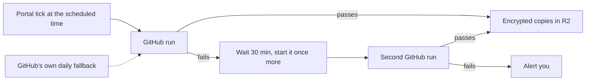
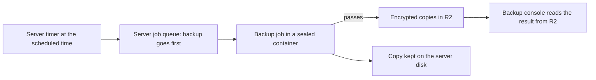
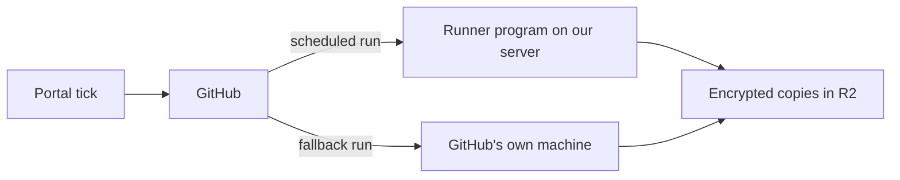
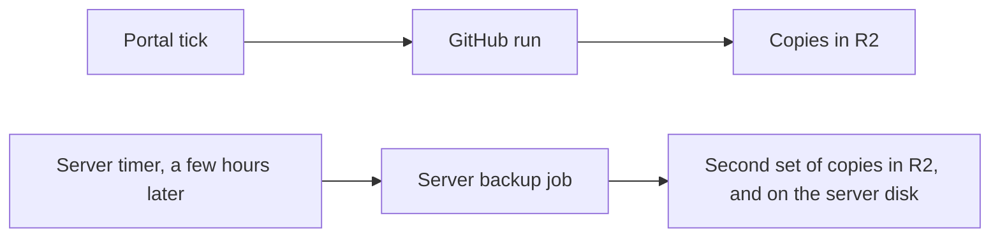

# Should backups run on our own server instead of GitHub? A comparison

> **The short answer (for everyone)**
>
> - **My opinion:** do not move the whole backup onto the server. Keep GitHub doing the
>   backups, make it retry a failed backup by itself 30 minutes later, and keep using the server
>   for what it is best at: proving that the copies can be restored. If GitHub ever lets us down
>   again in a way our code cannot fix, add the server as a **second, independent** backup,
>   never as the only one.
> - **Why:** most of what broke in the last month would break on the server too. The one
>   problem caused by GitHub itself (a download site refusing us) was fixed today. Moving would
>   swap a machine that GitHub maintains for one that only you can update, by hand, from your
>   phone, and three server updates are already waiting on you.
> - **What it would take to change my mind:** a GitHub-only failure coming back twice in the
>   next eight weeks, or the databases growing too big for GitHub's free machines (§9).

| | |
|---|---|
| **Date** | 2026-10-25 |
| **Asked for by** | Harshil: "cant we have whole thing in cf-vps running this backup process inside it? … see if its more beneficial … currently in this setup we fix this pretty much every week cuz something gets broken! And in long run we cant afford this" |
| **Written by** | Claude, in the "Stop backup runs from failing" thread |
| **Status** | Decided: the owner chose option A on 2026-10-25. Its automatic second try is built in `cf-backup/src/tick/retry.ts`, with a change record of the same date in cf-backup; the eight weeks of watching (§10) start then |
| **Where the backup engine lives** | the `cf-backup` repository: `.github/workflows/secondary-pipeline.yml` |
| **Where the server's jobs live** | the `cf-vps` repository: the job runner (`agent/src/jobs`, `contract/jobs.ts`, `host/66-jobs`) |

## 1. What was asked

Run the whole backup process on the cf-vps server (the Oracle Cloud machine: Harshil gives
4 processor cores, 24 GB of memory and 150 GB of disk) instead of on GitHub's machines. On the
schedule, the backup would go to the front of the server's job queue with as much of the
server as it needs; other work keeps running, and new work waits until the backup is done. The
question is whether that is more reliable and cheaper to keep running over the long term.

## 2. What actually broke: the evidence

Before choosing where backups run, it matters **why** they failed. Every failed backup run of
the engine since it started (2026-09-26 to 2026-10-25), read from the `backup_runs` table in
the shared D1 database and from GitHub's own run records:

| Date (UTC) | Started by | What failed | Caused by | Would the server have avoided it? |
|---|---|---|---|---|
| 2026-09-28 | the schedule | Pre-flight, 10 s in, at the database image download | Amazon's image site refused GitHub's shared machine | **Yes**: the server keeps the image on its disk |
| 2026-09-29 | the schedule | the same | the same | **Yes** |
| 2026-10-01 | GitHub's fallback | One D1 database's export | A Cloudflare API hiccup, not retried | **No**: the server calls the same Cloudflare API |
| 2026-10-05 | GitHub's fallback | Nothing archived after 15 minutes | Unknown: GitHub no longer has the run | Cannot tell |
| 2026-10-07 (twice), 10-08 | Run now | The old Supabase project's login | First runs of a new feature (other projects); fixed the same days | **No**: the same code would run on the server |
| 2026-10-25 | the schedule | Pre-flight, at the image download: "Data limit exceeded" | Amazon's anonymous download allowance, counted per address; GitHub's machines share addresses | **Yes**, but fixed today another way (below) |

In the same 30 days, 22 backup runs succeeded, 8 failed and 1 was cancelled (22 more were
fallback runs that correctly stood down). The scheduled runs that failed on 28 and 29 September
were each rescued later the same day by GitHub's fallback run; today's is still waiting for it.
On 1 and 5 October the fallback was itself the run that failed.

**Today's fix** (cf-backup, 2026-10-25): the engine now downloads the image from GitHub's own
image library first, then Amazon's, then Docker's, all pinned to the same fingerprint, and
tries all three again twice. If none answers, the D1 databases are still backed up. Each D1
export is now tried three times and stopped after 3 minutes if it hangs.

**The other "weekly fixes"** were not failed backups:

| What | When | Would the server change it? |
|---|---|---|
| A new security warning in a dependency stopped `npm run verify`, so nothing could deploy | cf-backup 2026-10-02, 10-07, 10-24; cf-vps 2026-10-23, 10-24 | **No.** It happens to any code wherever it runs. It hit the server's own code in the same week |
| The cf-admin tick that starts backups needed fixes | 2026-10-04, 10-07 | **No.** Something still has to start and watch the backup |
| A Cloudflare storage hiccup (R2 "InternalError") | 116 alerts from the server's own heartbeat between 2026-09-30 and 10-21 | **No.** The server hits it too, and its fix is waiting on you |

**What this tells us:** of the five causes, one came from using GitHub's shared machines, and
it is fixed. Two would have happened anywhere, and one is unknown. Moving the backup would not
have prevented most of the breakage. It would have changed **who** has to fix it, and how
quickly that can happen (§5).

## 3. The two places, side by side

| | GitHub's machine (today) | Our server |
|---|---|---|
| Kind | A fresh, empty machine for each run, thrown away afterwards | One long-lived machine that also runs our other services |
| Chip | Intel/AMD (x86) | ARM (Ampere). Everything the backup needs exists for ARM: the Supabase PostgreSQL image is published for it (checked: its image index has an arm64 entry, about 343 MB compressed), and so are age, Node and wrangler |
| Size for this job | 2 cores, 7 to 8 GB memory, 14 GB disk (GitHub's figures for private repositories) | 4 cores, 24 GB, 150 GB (Harshil's figures; the cf-vps docs still say 2 cores and 12 GB, a doc to correct) |
| What the backup actually uses | About 2 minutes, under 1 GB of memory, and about 1 MB of data (the largest copy so far is 1.1 MB) | The same |
| Who keeps it working | GitHub | You. The server's code reaches it only by your hands (§5) |
| Cost | About 100 of the 2,000 free GitHub minutes a month go to backups (from `backup_runs`: 84 billed minutes in 30 days, plus about 1 minute for each fallback that stands down) | Nothing extra on Oracle's plan |
| How we see a run | GitHub shows every step live, and the console's Live page reads it from GitHub | We would build it: the server's Jobs page shows jobs, but the backup console cannot reach the server without a person's browser in between today |

**Size is not the problem.** The whole backup is about a megabyte and two minutes. GitHub's
smallest machine is far more than enough, and so is the server. Giving the backup "full
resources" would change nothing, because it never runs short. The busy gate does matter on
the server, though: a backup could have to wait behind other work (§6).

## 4. The options

### A. Stay on GitHub and make it self-healing (recommended)

Today's fix plus one small addition in cf-backup: when a scheduled backup fails, the backup
service starts it again once, 30 minutes later, by itself, and alerts you only if the second
try also fails. The GitHub fallback stays as a third chance. Nothing changes on the server.

### B. Move everything onto the server (the proposal)

A new heavy job on the server, built like the restore test, with a new "priority" place in
the queue. The keys move from GitHub to the server's encrypted credential store. GitHub is no
longer involved.

### C. GitHub stays in charge, but runs the job on our server ("self-hosted runner")

GitHub's runner program is installed on the server, and the same workflow runs there. The
fallback could still use GitHub's own machine, so one of the two would be a different
computer.

### D. Both: GitHub stays the engine, and the server makes a second copy

Two separate engines on two separate providers. A day is only lost if **both** fail.

## 5. The deciding factor: who fixes it, and how fast

This is the difference that matters most for "in the long run we can't afford this".

| | GitHub (A) | Server (B, C, D) |
|---|---|---|
| A fix to the backup | Claude pushes to `main`; the next run uses it. Minutes, and none of your time | Claude builds a package; you upload it in the console, check its fingerprint and run the install commands one at a time with your yes. Your time, on your phone |
| How it has gone so far | Today's fix was live within minutes | Three server updates are waiting on you: the bundle of 2026-10-16 (9 days), and the heartbeat and integrity-check fixes of 2026-10-23 |
| When the machine itself breaks | GitHub replaces it; every run gets a fresh one | Disk full, a stuck container, an operating-system update, an Oracle problem: you, from the console or Oracle's web page |
| When the machine is gone | Nothing to rebuild | The rebuild runbook (`cf-vps` `documentation/runbooks/rebuild.md`) takes hours, and backups stop until it is done |

The machine that runs the backup should be the part of the system that needs you the least.
Today that is GitHub's.

## 6. Option B in depth (the proposal)

### How it would work

1. **A backup job on the server's job runner**, like the restore test: `class = "heavy"`,
   network on, about 2 GB of memory, a 30-minute limit. The runner already has the
   foundations: a container per run with no extra rights, encrypted secrets per job, live
   progress, results and alerts (`cf-vps` `documentation/features/JOBS.md`).
2. **One image built for ARM** with PostgreSQL 17 (Supabase's image), Node, wrangler and age.
   It is downloaded once and kept on disk, so the download problem goes away for good.
3. **Your priority idea:** today the queue puts light jobs first, then the oldest. A new
   `priority` class would put the backup first in line and let it start while the processor is
   busy, while still refusing to start if memory is short. New work waits until it finishes,
   which takes about a minute. Nothing running would be stopped.
4. **The keys:** the Cloudflare token (D1 export and R2 upload) and the Supabase read-only
   address move into the server's encrypted credential store (`job-<name>.<NAME>`). The server
   gets only the **public** half of the backup key, as GitHub does now, so it still cannot
   read the backups it makes.
5. **Results:** the job writes the encrypted copies, the manifest and the checksums to R2, as
   today. The backup console finds them in R2 on its next tick. That works because the backup
   console already reads R2.
6. **Run now** from the backup console would need a new path: backup console, then the portal,
   then the server console, then the job. Today a restore test makes that trip only through a
   person's browser.
7. **Watchdogs stay:** the daily dead man's check and the staleness alert still warn you if no
   backup lands.

### Pros

- **No download problem again:** the image lives on the server's disk.
- **Exact timing:** a server timer fires on the minute. GitHub's own schedule can start hours
  late, although the portal's start at 09:20 is already on time.
- **A copy on a second provider:** the server's disk (Oracle) could keep the last few
  encrypted copies, beside R2 (Cloudflare) and GitHub's 14-day copy.
- **Room to grow:** 150 GB of disk and no per-minute meter, if the databases ever become large.
- **No GitHub minutes:** about 100 a month saved (5% of the free allowance).
- **Faster runs:** no machine to set up, so maybe 30 to 40 seconds instead of 2 minutes. Nobody
  notices the difference.

### Cons and risks

- **Every engine change needs your hands** (§5). Today a fix lands in minutes. On the server
  it waits until you can do the install steps.
- **One machine, maintained by one person.** If the server is down, full, being upgraded or
  rebuilt, there is no backup that day. You chose no boot-volume backups for the server, so a
  lost server is rebuilt from scratch.
- **Oracle risk.** If the account is still on Oracle's Always Free plan, Oracle may take back a
  machine that stays idle (the cf-vps console tracks that risk for this reason), and free
  capacity can be hard to get back ("Out of host capacity" in the rebuild runbook).
- **The keys move to a busier place.** GitHub's machine exists for two minutes and then is
  deleted. The server is always on and runs other services. Possibly a game server too, if
  the Minecraft proposal goes ahead. The server's protection is good: a sealed container,
  encrypted secrets, a full audit trail. Still, the backup keys would be in the place most
  exposed to the internet. RULE #0.8 (cf-backup's four-key limit) and doc 12 would need your
  yes for the new place.
- **The backup and its proof would be on the same machine.** Restore tests already run on the
  server. Today a backup made on GitHub is checked on the server, so two different machines
  agree. With B, a fault on the server could spoil a backup and its restore test together.
- **Your priority rule can still make it wait.** The memory check stays. Behind a big restore
  test or a busy game server, the backup could be held back or marked missed.
- **A big build:** the job, the ARM image, the priority class, the keys, the console's Run now
  path, the Live page, documentation and tests across cf-backup, cf-vps and cf-admin. Several
  days of work, then about an hour of your server steps. RoPA would also need updating: backup
  data would be processed in Oracle's region instead of on GitHub's machines.
- **It replaces a design you approved:** GitHub Actions as the runner, and the GitHub artifact
  as the second provider (plan of record, `README.md` decisions and OD-12).

## 7. Option C in depth (self-hosted runner)

**Pros:** the workflow, its guards, the console, the Live page and push-to-deploy all stay as
they are. The image stays on the server's disk. A small trick, choosing the machine by trigger
(`runs-on: ${{ github.event_name == 'schedule' && 'ubuntu-24.04' || 'self-hosted' }}`), would
send the daily fallback to GitHub's own machine, so the two runs use different computers.

**Cons:**

- **The runner program sits outside the server's protections.** It is long-lived, updates
  itself from GitHub, and is given the backup keys for every run. To run containers it needs
  Docker or Podman access, which on Linux is close to full control of the machine. It would
  bypass the job runner's sandbox and busy gate, which exist for good reasons.
- **A new key on the server:** the runner's own GitHub registration.
- **The server still has to be up.** If it is down, the run waits in GitHub's queue for up to
  24 hours and then fails, unless the fallback trick sends that run to GitHub's machine.
- **Small differences:** the workflow uses Docker commands, and the server uses Podman on ARM.
- **GitHub is still in the middle.** If GitHub is down, C is down too. So it adds the server's
  risks without removing GitHub's.

## 8. Option D in depth (both)

**Pros:** the only option that removes a single point of failure. Both engines have to fail on
the same day before a backup is lost, and they share no machine, chip, network or provider
except the databases themselves and R2. The server copy would use the server's own disk as a
third place.

**Cons:** two engines to keep working, which the remediation program decided against once
already (two pipelines were merged into one, RD-15). It has most of B's build cost and B's "your
hands for every change" problem, but for the second engine only. If the server's engine falls
behind on updates, the main backup is unaffected.

## 9. Scorecard

| Question | A. GitHub, self-healing | B. Server only | C. Self-hosted runner | D. Both |
|---|---|---|---|---|
| Chance a scheduled day ends with no backup | Low: three tries on fresh machines | Medium: one machine, one try unless we add retries | Low to medium | **Lowest**: two independent engines |
| Breakages it removes | Download refusals (fixed today), transient failures (retry) | Download refusals | Download refusals | Any one engine's failure |
| Breakages it adds | None | Server down, disk, upgrades, Oracle, queue waits | Runner program, Podman/ARM differences, server down | B's, for the second engine only |
| Your time to fix something | None | **High**: every change | Medium: runner upkeep | Medium: second engine only |
| Where the keys live | GitHub, for 2 minutes per run | The always-on server | Both | Both |
| Backup and its proof on different machines | Yes | **No** | Mostly | Yes for the GitHub copy |
| Build effort | Small: about a day, cf-backup only | Large: several days, three repos, your server steps | Medium | Large |
| Running cost | About 100 GitHub minutes a month, 5% of free | $0 | $0 to about 50 minutes | About 100 minutes, $0 on the server |
| Fits the plan you approved | Yes | Needs your decisions: keys, RoPA, plan of record | Needs your yes on the new key | Needs your decisions: keys, RoPA |

**Your priority-queue idea** is sound as a server design and worth keeping for heavy server
jobs in general. It answers a problem the backup does not have: the backup never runs out of
resources. It fails when an outside service refuses, or when new code meets real data.

## 10. Recommendation and plan

1. **Now (option A):** keep today's fix and add the automatic second try 30 minutes after a
   failed scheduled backup, with an alert only if that also fails. It is a small change in
   cf-backup, with no server steps and no new keys.
2. **Watch for eight weeks** (about 16 scheduled backups on the Sunday and Wednesday schedule).
   Move to option D if any of these happens:
   - a failure caused by GitHub itself (not our code, not Cloudflare or Supabase) happens
     twice;
   - a backup takes over 20 minutes, or the data nears GitHub's 14 GB disk;
   - GitHub changes its free plan so that backups no longer fit.
3. **If D is chosen,** first clear the three waiting server updates and agree how server code
   gets updated (accept the manual steps, or design a safe automatic update), so the second
   engine does not fall behind on day one. Use your priority class for it.
4. **Not B on its own:** it would put the backup, its proof and its fixes all on the one machine
   that depends on you the most.

**Not checked:** the server's live load and free memory today (a cloud session cannot reach
the server); which Oracle plan the account is on; GitHub's current runner sizes beyond its
published figures; option C on the real server. **Checked:** every failed run listed in §2,
from `backup_runs` and GitHub; the image's ARM entry, from its registry; the job runner's
limits and controls, from the cf-vps code and documentation; the waiting server updates, from
the cf-vps handoff.

## Sources

- `backup_runs` in the shared D1 database, read through the Cloudflare connector on 2026-10-25.
- GitHub's records of the `secondary-pipeline` workflow runs (job logs and step timings).
- The cf-backup change record of 2026-10-25, "Backups no longer fail when one download site
  refuses" (`cf-backup` `docs/records/`, private).
- The server's job runner: `cf-vps` `documentation/features/JOBS.md` and `contract/jobs.ts`.
- The server's waiting updates: `cf-vps` `documentation/program/HANDOFF.md` (private).
- GitHub's published sizes for standard runners on private repositories (2 cores, 7 to 8 GB,
  14 GB disk), and its rule that a job queued for a self-hosted runner fails after 24 hours.
- Amazon ECR Public's anonymous allowance: 500 GB of downloads a month, counted per address
  (launch announcement); the 2026-10-25 run's log shows the refusal.
