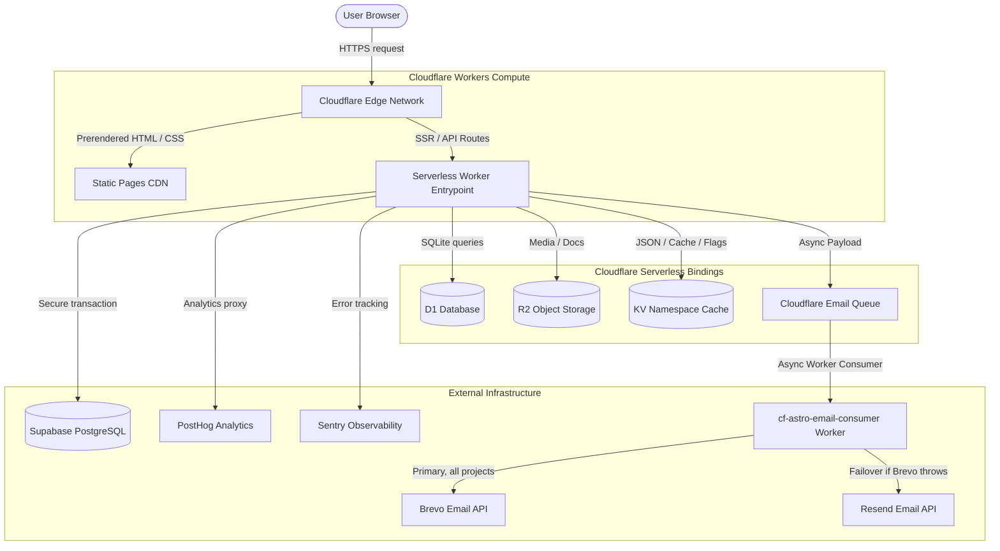


# System Architecture & Technical Operations Manual

This document provides a comprehensive, production-grade technical reference for the **cf-astro** application (Hotel para Mascotas Madagascar). It covers high-level business context, system architecture, database design, API routing, edge feature flags, asynchronous email pipelines, deployment configurations, and runtime resource limits.

> **Last checked against the code:** 2026-10-17 (§2–§8 and §10). The usage figures in §9 were
> not re-measured that day.

---

## 1. Business Context & Migration Rationale

**Hotel para Mascotas Madagascar** is a luxury pet hotel and boarding business located in Aguascalientes, Mexico. The application (`madagascarhotelags.com`) serves both as a public marketing presence and a fully bilingual (ES/EN) customer booking platform.

Originally constructed with Next.js on Vercel, the application was systematically migrated to **Astro 7** deployed on **Cloudflare Workers** (`wrangler deploy` — migrated off Cloudflare Pages in July 2026, see `Documentation/SEO-OPERATIONS.md` §3) to achieve three fundamental business goals:

- **Zero-Cost Edge Infrastructure**: Fully utilizes Cloudflare's free tiers for static CDNs, serverless Workers, D1 SQL databases, R2 media storage, and KV namespaces.
- **Flawless SXO (Search Experience Optimization)**: Achieves instantaneous loads and a 100/100 Core Web Vitals score by defaulting to zero client-side JavaScript for marketing pages, utilizing Astro's component framework to prerender optimized HTML at build time.
- **Ultra-Fast Global Execution**: Serving all static content from Cloudflare's CDN and dynamic API endpoints from low-latency edge Workers located physically close to users in Mexico.

---

## 2. High-Level Architecture & Technical Stack

The entire application runs distributed at the network edge on the Cloudflare Edge network:



### Technical Stack Mapping

- **Framework**: Astro 7 configured with the official `@astrojs/cloudflare` adapter.
- **Rendering Strategy**: Static-first Hybrid model (`output: 'static'`). Pages are precompiled to pure HTML unless explicitly marked with `export const prerender = false` (which triggers edge SSR).
- **Styling**: Tailwind CSS v4 utilizing the high-performance `@tailwindcss/vite` compiler plugin for lightning-fast builds.
- **Hydration Core**: Preact 10+ islands (`@astrojs/preact` configured with Vite `compat: true` for React ecosystem interoperability).
- **Validation Engine**: Zod ^3.25.0 for strict, typed, runtime parsing of client inputs and config variables.

---

## 3. Configuration Profiles & Edge Bindings

The application maps runtime environments, variables, and resources via three primary configuration artifacts:

### 3.1 `astro.config.ts`

Establishes the core compilation rules, [SUPABASE_PROJECT_REF] routing, and build plugins:

- **`trailingSlash: 'always'`**: Enforces trailing slashes on all routes to prevent duplicate indexation and split canonical authority in search engines.
- **`i18n`**: Configured with `defaultLocale: 'es'` (Spanish) and `locales: ['es', 'en']` (English) with `prefixDefaultLocale: true` (ensuring URLs always start with explicit locale slugs, e.g., `/es/` or `/en/`).
- **`passthroughImageService()`**: Disables Astro's CPU-heavy local image optimization. Optimization is handled dynamically at the edge by Cloudflare Images/R2 custom domains.
- **`__BUILD_ID__` & `__LAST_UPDATED__`**: Injected at compile time to scope ISR cache layers and provide precise sitemap modified metadata.

### 3.2 `wrangler.toml`

Defines the Cloudflare Workers environment, compatibility flags (`compatibility_flags = ["nodejs_compat"]`), and system bindings:

- **`main = "./src/worker.ts"` (since 2026-10-14)**: the Worker entry. It hands every request to the Astro adapter's handler (`@astrojs/cloudflare/entrypoints/server`) except one whose path has broken percent-encoding (`/%c0`), which gets a `400 Bad Request: Malformed URI` there (`src/lib/malformed-path.ts`, §9.1). Before, Astro logged each such scanner request as `[ERROR] Error: Invalid URL encoding` in Workers Logs before any middleware ran. Keep anything that must run before Astro in this file, and keep the guard using `decodeURI`'s result: the bundler drops a bare `decodeURI(x);` as free of side effects.

- **`DB` (D1 Database)**: Binds the local SQLite engine for fast content delivery and dead-letter queue audits.
- **`ISR_CACHE` (KV Namespace)**: Caches HTML page structures and CMS content blocks. _(Note: standard static assets like images and fonts bypass KV entirely and are cached natively by Cloudflare's CDN using `public, max-age=31536000, immutable`)._ Its key families (2026-10-04):

  | Prefix                             | Written by                                          | Expiry | Notes                                                                                                                                                                                                                                                                                                                                                                                                                                                             |
  | ---------------------------------- | --------------------------------------------------- | ------ | ----------------------------------------------------------------------------------------------------------------------------------------------------------------------------------------------------------------------------------------------------------------------------------------------------------------------------------------------------------------------------------------------------------------------------------------------------------------- |
  | `isr:<path>#<build>`               | `src/middleware.ts` (`isr-cache-key.ts`)            | 24 h   | Only a 200 HTML page is stored. `?page=<n>` is part of the key on `/es/blog` and `/en/blog` only; everywhere else query params are ignored. Since 2026-10-10: dotted paths (sitemaps, feeds, `.txt`) skip it; a miss streams to the visitor while a copy is stored; the entry's metadata holds an ETag, so a hit answers `If-None-Match` with a 304 (`isr-response.ts`). A publish deletes the current build's key by name and lists only the paginated `?` keys. |
  | `cms:<key>`                        | `/api/revalidate` (cf-admin publish)                | 24 h   | Allowlisted and sanitized (`SECURITY.md` §8). Was 1 h until 2026-10-04.                                                                                                                                                                                                                                                                                                                                                                                           |
  | `feed:<path>#<build>`              | `src/lib/feed-cache.ts`                             | 6 h    | The three sitemaps and two RSS feeds. A degraded (fallback) render is never stored. Cleared by every path revalidation.                                                                                                                                                                                                                                                                                                                                           |
  | `rl:<endpoint>:<ip>`, `burst:<ip>` | `src/lib/rate-limit.ts`                             | 60 s   | Fallback counters only, used when a rate-limit binding is missing or throws.                                                                                                                                                                                                                                                                                                                                                                                      |
  | `ping`, `analytics:weekly_digest`  | read only (`/api/health`, `/api/analytics/summary`) | n/a    | cf-astro never writes these.                                                                                                                                                                                                                                                                                                                                                                                                                                      |

- **`RL_PER_MIN_<n>` (Workers Rate Limiting bindings, since 2026-10-04)**: ten bindings, one per step of the ladder 3, 5, 10, 20, 30, 60, 100, 200, 500, 1000 requests a minute. A rate limit uses the smallest binding at or above it; the KV counters above are the fallback, and the request is allowed when both fail (`SECURITY.md` §4, AGENTS.md invariant #3). They replaced Upstash Redis and need no secret.
- **`[observability]`**: Workers Logs persisted at a 20% head-sampling rate and traces persisted at 5%, since 2026-10-04 (both were 100%). A sampled-out request keeps no console line in Cloudflare; errors a route captures still reach Sentry in full and `log.warn`/`log.error` still reach BetterStack. The server-side Sentry tracer samples 10% of page and API requests and none for probe paths (`/.env`, `/wp-…`), bots (by user agent) or 404s (`src/lib/server-trace-sampling.ts`).
- **`SESSION` (KV Namespace)**: Astro's session store, and the booking idempotency keys (`booking-idem:<key>`, 24 h): a retried submission gets the first answer back instead of a second booking.
- **`EMAIL_QUEUE` (Queue)**: Handles async email payloads to protect the user from booking timeouts.
- **`ANALYTICS` (Analytics Engine)**: zero-cost edge counters (conversions, failures) in the `madagascar_analytics` dataset.
- **`IMAGES` / `ARCO_DOCS` (R2)**: CMS images (shared with cf-admin) and ARCO identity documents (private).

---

## 4. Edge API Routes & Data Pipelines

### 4.1 System API Reference

| Endpoint                 | Method       | Security                                                                               | Purpose                                                                                  |
| ------------------------ | ------------ | -------------------------------------------------------------------------------------- | ---------------------------------------------------------------------------------------- |
| `/api/booking`           | `POST`       | D1 audit first, then Origin, rate limit, Zod                                           | Booking: D1 outbox, then the Supabase transaction, then the email queue (§4.2).          |
| `/api/booking/replay`    | `POST`       | Bearer (`verifyBearerAuth`): `HEALTH_CHECK_SECRET`, or cf-admin's secret from anywhere | Drains the booking outbox from D1 into Supabase. Poked by cf-admin's 5-minute job.       |
| `/api/contact`           | `POST`       | Origin, rate limit, Zod                                                                | Contact form: Supabase `contact_messages` + consent row, email queued.                   |
| `/api/consent`           | `POST`       | D1 audit first, then Origin, rate limit, Zod                                           | Consent banner clicks ([`CONSENT-RECORD-SYSTEM.md`](CONSENT-RECORD-SYSTEM.md)).          |
| `/api/consent/replay`    | `POST`       | Bearer; cf-admin's secret only through its binding (`SECURITY.md` §7)                  | Drains the consent outbox from D1 into Supabase.                                         |
| `/api/arco/submit`       | `POST`       | Origin, Turnstile, rate limit, 6-layer file validation                                 | ARCO rights request with identity document (R2 `arco-documents`).                        |
| `/api/arco/get-document` | `GET`        | `X-Admin-Secret` (`ARCO_ADMIN_SECRET`), rate limit, access recorded first              | Serves one identity document by ticket ([`ARCO-DSR-RUNBOOK.md`](ARCO-DSR-RUNBOOK.md)).   |
| `/api/health`            | `GET`        | Bearer; cf-admin's secret only through its binding                                     | Health check, the consent probe and the hourly heartbeat (`?probe=`).                    |
| `/api/health-analytics`  | `GET`        | Bearer `HEALTH_CHECK_SECRET` (or cf-admin's, binding only)                             | Writes and checks a test Analytics Engine point.                                         |
| `/api/revalidate`        | `POST`       | Bearer, cf-admin's service binding only                                                | Purges the page cache and writes allowlisted CMS blocks to KV.                           |
| `/api/cms-status`        | `GET`        | Bearer, cf-admin's service binding only                                                | Read-back: lets cf-admin verify a publish is live.                                       |
| `/api/analytics/summary` | `GET`        | Rate limit, then bearer, cf-admin's service binding only                               | Weekly analytics digest for cf-admin.                                                    |
| `/api/analytics/track`   | `POST`       | Origin, rate limit, Zod                                                                | First-party funnel events into Analytics Engine.                                         |
| `/api/runtime-config`    | `GET`        | Public, no secrets in the answer                                                       | PostHog and Sentry rates for browser scripts (§5).                                       |
| `/api/mcp`               | `POST`       | Public, read-only, rate limit                                                          | MCP JSON-RPC: services, locations, booking URL, FAQ.                                     |
| `/api/ingest/[...path]`  | `GET`/`POST` | Path allowlist, header stripping                                                       | PostHog reverse proxy, so ad blockers do not drop consented analytics.                   |
| `/api/webhooks/brevo`    | `POST`       | Shared secret (`BREVO_WEBHOOK_SECRET`)                                                 | Brevo delivery events (§6.3).                                                            |
| `/api/media/[...path]`   | `GET`        | Public                                                                                 | Streams an R2 image; a local-development fallback (production images come from the CDN). |

Every route is on demand (`prerender = false`). `SECURITY.md` §4 lists the rate limits and §7
the secrets.

### 4.2 The Atomic Booking Transaction

The booking submission flow is designed so that a customer's booking is never lost, even when
Supabase is down (`src/pages/api/booking.ts`, `src/lib/booking-service.ts`):

```
[BookingWizard (Preact island)]
               │
               ▼  POST JSON
   [/api/booking (Worker)]
               │
               ├─► 0. Size bound + per-IP burst guard
               ├─► 1. D1 `booking_attempts` row (audit-first, PII redacted in the raw body)
               ├─► 2. Origin check → rate limit → JSON parse → Zod
               ├─► 3. Idempotency key in SESSION KV (a retry gets the first answer)
               ├─► 4. D1 replay outbox: the whole transaction + email payload, before Postgres
               ├─► 5. Supabase transaction: bookings, consent_records, booking_pets,
               │        booking_quality_metadata, email_audit_logs
               │        success → outbox entry retired · failure → kept, critical alert,
               │        drained later by /api/booking/replay
               ├─► 6. Two messages to EMAIL_QUEUE (customer confirmation, staff notification)
               │
               ▼  200 + { success, bookingRef, consentId, emailsQueued, whatsappUrl }
        [Confirmation UI]
```

The answer is the same whether the Postgres write succeeded or was deferred to the outbox.

### 4.3 3-Tier CMS Content Fallback Strategy

Marketing page texts, service pricing tables, and blog posts are loaded via a robust 3-tier fallback matrix inside Astro component frontmatter to guarantee that the site renders even if the database is completely offline:

1. **`ISR_CACHE` KV (`cms:<key>`)**: The primary high-speed layer. Injected directly by the CMS revalidation webhook, with a 24-hour expiry since 2026-10-04 (1 hour before). `getPricing`, `getTestimonials` and `getAboutStats` are also memoised **per request** (`src/lib/request-memo.ts`, wired by the middleware), so a page that shows the same block in three components reads KV, and on a miss D1, once.
2. **D1 SQL Database (`cms_content`)**: The local edge database. Queried via `getJsonBlock(db, group, key)` if KV returns null.
3. **Static Locale files (`es.json` / `en.json`)**: Code-level fallbacks. Hardcoded dictionary texts that ensure standard structures render instantly if all databases are unreachable.

---

## 5. Edge Feature Routing & Configuration

> **Corrected 2026-09-10 — this section described a system that does not exist.**
> It previously specified a three-step pipeline: `admin_feature_flags` read from
> D1, cached in KV under `features:global` with a 60-second TTL, and hydrated
> into `Astro.locals.features`. None of it is in `src/`. There is no
> `admin_feature_flags` read, no `features:global` key, and no `locals.features`
> anywhere in this repo — verified by grep on 2026-09-10. The D1 table exists
> (2 rows) but this repo has never read it.
>
> **It was also a latent cost bug.** A 60-second KV TTL means a KV _write_ every
> 60 seconds to refresh the entry — 1,440 writes/day against a Cloudflare free
> tier limit of **1,000 KV writes/day**. Had it been built as written, it would
> have exhausted the daily KV write budget on its own. If edge feature flags are
> ever wanted here, the TTL has to be minutes, not seconds, and the design needs
> to be costed against that 1,000/day ceiling first.

What actually exists at the edge today:

1. **Service configuration**, read from D1 `service_config` (active rows for `cf-astro`
   and `global`) by `src/lib/service-config.ts`, cached in isolate memory for 10 seconds and in
   the Cloudflare Cache API for 300 seconds; cf-admin's config purge clears the cached copy.
   Every read falls back to coded defaults, so a missing row never breaks a page.
2. **ISR HTML caching**, in `src/middleware.ts`, keyed by `__BUILD_ID__` with a
   24-hour TTL — one KV write per unique path per deploy.
3. **CMS content blocks**, injected into `ISR_CACHE` under `cms:<key>` by
   `src/pages/api/revalidate.ts` with a 24-hour TTL (1 hour until 2026-10-04).
4. **Sitemaps and RSS feeds**, cached in `ISR_CACHE` under `feed:<path>#<build>`
   for 6 hours (`src/lib/feed-cache.ts`, since 2026-10-04). They select only the
   columns they print, not whole post bodies.
5. **The browser's runtime config** (`/api/runtime-config/`, PostHog and Sentry
   settings): one shared request per page, kept in `sessionStorage`
   (`mada_runtime_config`) for 10 minutes and only when the answer was good
   (`src/scripts/runtime-config-client.ts`, since 2026-10-04).

---

## 6. Email Infrastructure & Async Queue Pipeline

To prevent slow third-party API networks from causing booking timeouts, the email infrastructure is fully decoupled:

### 6.1 Queue Producer (`cf-astro`)

The booking API route constructs two email payloads (one for customer confirmation, one for admin alerts) and pushes them to `env.EMAIL_QUEUE`. The booking route returns `200 OK` instantly, bypassing synchronous wait states.

### 6.2 Queue Consumer (`cf-astro-email-consumer`)

An isolated, lightweight worker sidecar consumes the queue on behalf of **both** cf-astro and cf-admin (one shared worker, one shared queue — `madagascar-emails`):

- **Absolute Code Isolation**: The consumer worker is completely decoupled from `cf-astro`. It must never import Drizzle ORM schemas or Astro layouts to prevent cyclic compilation failures.
- **Email Assembly**: HTML is built in the consumer's own TypeScript templates; the consumer has zero runtime dependencies (cf-email-consumer `package.json`).
- **Hybrid-SMTP Provider, not project-routed**: The consumer calls **Brevo's API first for every send**, regardless of `projectSource` (cf-astro or cf-admin). **Resend is wired in only as an automatic same-request failover** if the Brevo call throws — there is no per-project routing split; `RESEND_API_KEY` lives in this worker's own secrets.

### 6.3 Delivery Webhooks & Observability

- **Webhook Endpoint**: `POST /api/webhooks/brevo` (cf-astro) captures delivery, bounces, and complaints from the primary provider. This lives in cf-astro itself, not the consumer worker — `cf-astro-email-consumer` is queue-only (no `fetch()` handler), so it cannot receive inbound HTTP webhooks at all.
- **Security**: Brevo does not sign webhook payloads by default, so this is **not** signature/HMAC verification — it's a constant-time shared-secret comparison (`timingSafeEq`, `src/lib/security.ts`) against `BREVO_WEBHOOK_SECRET` (a cf-astro secret), checked from the `Authorization` header, the `x-brevo-secret` header, or a `?secret=`/`?token=` query param. Never log the raw query string unredacted.
- **Audit Log**: Verified webhook events are pushed into the `email_audit_logs` Supabase table inside a JSONB `delivery_events` array for auditing.
- **Email API messages** (2026-10-10): an event whose tags carry `api_msg_<message id>` belongs to the email API, whose messages live in the email service's own D1 database. The webhook forwards it to `EMAIL_QUEUE` as purpose `api_delivery`, and `cf-astro-email-consumer` records the verdict, feeds the do-not-mail list and calls the client's webhook. A failed queue send answers `500` so Brevo retries.

---

## 7. Operations, Provisioning & Local Development

### 7.1 Local Development Commands

```bash
# 1. Install precise dependencies
npm install

# 2. Run local Astro dev server with HMR
npm run dev

# 3. Clean Vite caches and start dev server
npm run dev:clean

# 4. Preview build locally with full Cloudflare proxy bindings (D1, KV, R2)
npm run cf:dev

# 5. Compile production build
npm run build

# 6. Apply database migrations to local D1 instance
npm run db:migrate

# 7. Apply database migrations to production D1 instance
npm run db:migrate:remote
```

### 7.2 Manual Provisioning Guide

If deploying the infrastructure from scratch on a new Cloudflare account, execute these steps in order:

```bash
# 1. Create the D1 Database
npx wrangler d1 create madagascar-db

# 2. Apply initial schemas to production D1
npx wrangler d1 migrations apply madagascar-db --remote

# 3. Create the KV cache namespaces
npx wrangler kv namespace create ISR_CACHE
npx wrangler kv namespace create SESSION

# 3b. R2 buckets and the email queue
npx wrangler r2 bucket create arco-documents
npx wrangler r2 bucket create madagascar-images
npx wrangler queues create madagascar-emails

# 4. Bind Secrets to the Worker
npx wrangler secret put DATABASE_URL        # Supabase postgres:// URL
# Note: BREVO_API_KEY (primary) and RESEND_API_KEY (failover) are secrets on
# the shared cf-astro-email-consumer worker, not on cf-astro itself.
npx wrangler secret put BREVO_WEBHOOK_SECRET # Verifies inbound Brevo delivery-status
                                              # webhook (/api/webhooks/brevo) — this
                                              # ONE Brevo secret lives on cf-astro
                                              # itself, unlike BREVO_API_KEY above.
                                              # Must match the token/header value
                                              # configured in the Brevo dashboard's
                                              # webhook settings exactly.
npx wrangler secret put REVALIDATION_SECRET  # Webhook bearer key
# The full secret list is SECURITY.md §13. SENTRY_AUTH_TOKEN is a build-time
# variable in Workers Builds, not a Worker secret.
```

The rate-limit bindings and the Analytics Engine dataset need no provisioning step: they are
created from `wrangler.toml` on deploy.

---

## 8. Domain Routing & DNS Setup

Cross-domain redirection (forcing `www.madagascarhotelags.com` and
`pet.madagascarhotelags.com` to the apex `madagascarhotelags.com`) **cannot**
be handled via the static `public/_redirects` file — Workers `_redirects`
only supports relative URLs (see the comment block at the top of that file).
Two layers exist:

1. **Primary, code-level (`src/middleware.ts`, step 1):** on every
   on-demand request, a `LEGACY_HOSTS` check (`www.*`, `pet.*`) plus an
   `isHttp` check issue a single-hop **308** straight to
   `https://madagascarhotelags.com` (cached for an hour), normalizing the root
   path to `/es/` and adding the trailing slash in the same response. A call
   through cf-admin's service binding (host `internal`) is never redirected. This is the code's own defense — it does not
   depend on any Cloudflare dashboard configuration.
2. **Secondary, dashboard-level (defense-in-depth):** zone-level **Redirect
   Rules** (Domain Zone → **Rules** → **Redirect Rules**) for the same three
   hosts (`www.*`, `pet.*`, `cf-astro.pages.dev`) → apex, 301, preserving the
   query string. See `Documentation/SEO-OPERATIONS.md` §1.6.

> **Known issue, live as of 2026-08-10 — not yet resolved despite the code
> above being correct:** production traffic on `www.*` and `pet.*` is
> observed 301-redirecting to _itself_ (an infinite loop), which the current
> `middleware.ts` logic cannot produce if it is actually executing for those
> requests. This points to a Cloudflare **account-configuration** issue —
> most likely `www`/`pet` are still bound as Custom Domains on a stale,
> no-longer-deployed Cloudflare Pages project from before the July 2026
> migration to a plain Worker, rather than on the current `cf-astro` Worker
> alongside the apex domain. Not re-checked since 2026-08-10 (on 2026-10-17
> the documentation session could not reach the site through its network
> proxy); the check is in [`TODO-BACKLOG.md`](TODO-BACKLOG.md). Remove this
> note once `curl -sI https://www.madagascarhotelags.com/` answers one
> redirect to the apex.

---

## 9. Operations, Free Tier Limits & Resource Budgets

The system operates strictly inside Cloudflare's free tier quotas, ensuring monthly operational cost is exactly **$0 USD**. The **Source** column says where each figure comes from; "estimate" means worked out from the code, not read from a dashboard.

| Resource                               | Current Usage                                                                                                                                                                                                                                | Free Tier Limit                                                                              | Source                                                                                         |
| -------------------------------------- | -------------------------------------------------------------------------------------------------------------------------------------------------------------------------------------------------------------------------------------------- | -------------------------------------------------------------------------------------------- | ---------------------------------------------------------------------------------------------- |
| **Workers Builds**                     | ~30 / month                                                                                                                                                                                                                                  | 3,000 build minutes / month, 1 concurrent (Free — `workers/ci-cd/builds/limits-and-pricing`) | earlier estimate                                                                               |
| **Worker Requests**                    | ~1,200 / day                                                                                                                                                                                                                                 | 100,000 / day                                                                                | earlier estimate, never measured: the Cloudflare connector has no per-Worker analytics         |
| **D1 Rows Read**                       | ~70,000 / day, **account-wide** (all Workers and databases)                                                                                                                                                                                  | 5,000,000 / day                                                                              | measured 2026-10-04 from cf-admin's D1 usage probe (Cloudflare D1 analytics)                   |
| **D1 Rows Written**                    | ~650 / day, account-wide                                                                                                                                                                                                                     | 100,000 / day                                                                                | measured 2026-10-04, same probe                                                                |
| **KV writes (`ISR_CACHE`)**            | about one per page per deploy, ~20 / day for feeds, one per CMS block per publish                                                                                                                                                            | 1,000 / day (shared by every writer of the namespace)                                        | estimate. Rate-limit counters write KV only when a binding fails                               |
| **KV reads (`ISR_CACHE`)**             | one per on-demand page render, plus `cms:` blocks on a page-cache miss                                                                                                                                                                       | 100,000 / day                                                                                | estimate                                                                                       |
| **KV Storage Capacity**                | ~2 MB                                                                                                                                                                                                                                        | 1 GB                                                                                         | earlier estimate                                                                               |
| **Workers Logs events**                | 20% of invocations since 2026-10-04 (was 100%)                                                                                                                                                                                               | 200,000 / day                                                                                | `wrangler.toml` `[observability]`; event counts not measurable here                            |
| **Rate Limiting binding**              | one call per contact post or limited API call; two per booking or consent post (burst guard + limit)                                                                                                                                         | included in Workers; Free-plan allowance not re-verified on 2026-10-04                       | the code: `src/lib/rate-limit.ts`, `booking.ts`, `consent.ts`                                  |
| **Sentry spans**                       | 10% of human page and API requests; none for probes, bots or 404s since 2026-10-04                                                                                                                                                           | 10M / month (Free)                                                                           | `src/lib/server-trace-sampling.ts`                                                             |
| **GitHub Actions (consent heartbeat)** | none scheduled since 2026-10-10: the workflow runs only by hand, because Cloudflare's bot protection challenged every scheduled run from 2026-10-08 and each still billed a minute. The server job and cf-admin's watchdog run the heartbeat | 2,000 minutes / month, shared by every private repository                                    | the workflow; GitHub ran it 604 times by 2026-10-10, lately every 4–7 hours rather than hourly |
| **R2 Storage Capacity**                | ~450 MB                                                                                                                                                                                                                                      | 10 GB                                                                                        | earlier estimate                                                                               |

### 9.1 What one request costs (2026-10-04)

- **A prerendered page, an image or a font** is served from static assets and never wakes the Worker.
- **An on-demand page** is one Worker invocation and one KV read on a cache hit. On a miss it renders, reads each `cms:` block once (the per-request memo, §4.3) and, if the page is a 200, writes one KV entry for 24 hours.
- **An unknown blog tag, an invalid `?page=` or a page past the last one** is rewritten to `/404/` (with the slash, or the middleware would answer a 308) and answers a 404 that is not cached, so a random value costs no KV write. While D1 is failing, a page past 1 is a 503, also not cached. `?page=` only counts on `/es/blog/` and `/en/blog/`.
- **A path with broken percent-encoding** (`/%c0`, `/%`) is answered `400` by the Worker entry before Astro starts (since 2026-10-14), cached at the edge for an hour, with no redirect, render or error log.
- **A sitemap or RSS feed** is served from `feed:` KV for 6 hours; a miss queries D1 for the listed columns only.
- **The browser's `/api/runtime-config/` call** happens at most once per page and, after a good answer, not again for 10 minutes in that tab.
- **A form post** costs one rate-limit binding call for contact, two for a booking or a consent post (the burst guard on `RL_PER_MIN_30`, then the endpoint's limit), with no outbound HTTPS call and no KV write. The plan put form posts at about 50 a day on Upstash.

The change record for this work is [`records/2026-10-04-resource-usage.md`](./records/2026-10-04-resource-usage.md).

---

## 10. AI & Human Extension Guide (Invariants)

To ensure this codebase remains perfectly editable, maintainable, and robust for both human teams and future AI coding models, strictly follow these structural guidelines:

> [!WARNING]
> **System Architectural Invariants**
>
> 1. **Do Not Introduce Local Image Processors**: Never replace `passthroughImageService()` with `@astrojs/image` or standard Sharp compilation. Sharp cannot run in a Worker, and a bundled image pipeline pushes the Worker towards its script-size limit.
> 2. **Never Import Database Schemas in Email Consumer**: The `cf-astro-email-consumer` worker must remain 100% decoupled from `cf-astro/src/lib/db` and Drizzle schemas. Any imports between them will break build cycles and cause module resolution crashes during bundle packaging.
> 3. **Preserve `trailingSlash: 'always'`**: All page-level generation logic, routing hooks, and canonical calculations rely on trailing slashes. Changing this parameter will immediately throw 404/301 loops in production.


