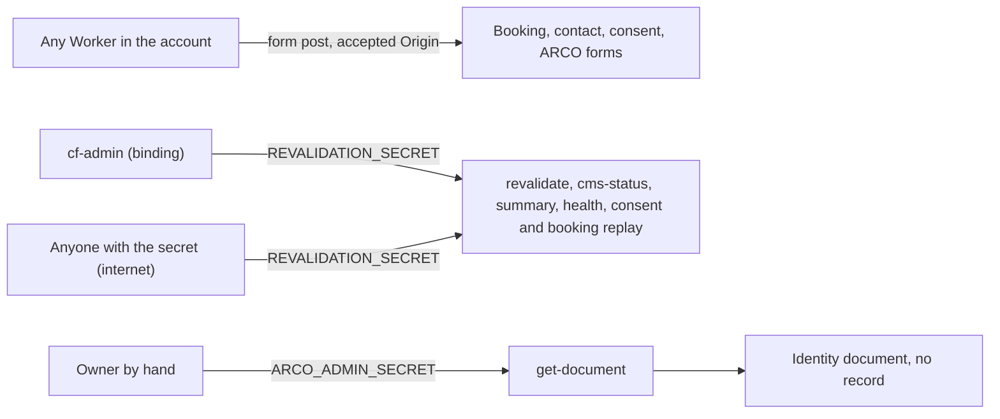
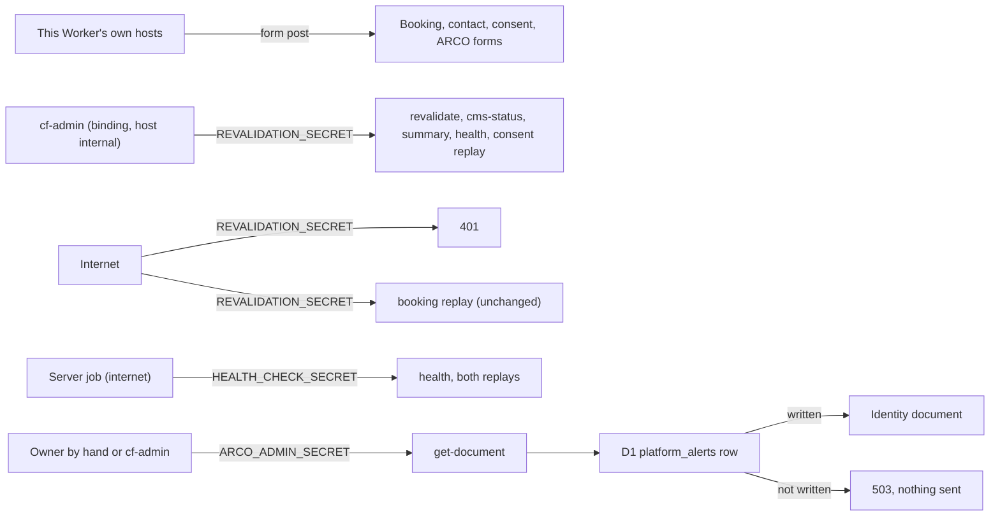


---
title: 'Website permissions: forms from our own hosts only, the portal secret only through the portal, and a record of every identity document served'
status: historical
audience: [owner, non-technical, technical, ai, operator]
last_verified: 2026-10-15
verified_against: [code, infra]
owner: harshil
related_code:
  [
    src/lib/security.ts,
    src/lib/arco-access-record.ts,
    src/middleware.ts,
    src/pages/api/arco/get-document.ts,
    src/pages/api/revalidate.ts,
    src/pages/api/cms-status.ts,
    src/pages/api/analytics/summary.ts,
    src/pages/api/health.ts,
    src/pages/api/health-analytics.ts,
    src/pages/api/consent/replay.ts,
  ]
related_docs:
  [../../SECURITY.md, ../ARCO-DSR-RUNBOOK.md, ../WHERE-THE-DATA-LIVES.md, ../TODO-BACKLOG.md]
tags: [record, security, permissions, arco]
---

# Website permissions: forms from our own hosts only, the portal secret only through the portal, and a record of every identity document served

> **In one minute (for everyone)**
>
> - **What changed:** the website's forms accept posts only from the website itself; the
>   admin portal's secret now works only when the portal itself calls; and every identity
>   document handed out from an ARCO request is written down first.
> - **Why:** the permissions review of 2026-10-15 (item #40, approved by the owner) found
>   three places where the website trusted more than it needed to.
> - **What you will notice:** nothing on the website. ARCO identity documents now leave a
>   line on the admin portal's Alerts page each time one is fetched.
> - **What it costs or saves:** nothing; no new secret, setting, table or service.

|                       |                                                                                                                                                                          |
| --------------------- | ------------------------------------------------------------------------------------------------------------------------------------------------------------------------ |
| **Date**              | 2026-10-15                                                                                                                                                               |
| **Asked for by**      | Harshil (owner), approving the 41 permissions suggestions, item #40 "Website items"                                                                                      |
| **Done by**           | Claude Code agent, session in the commit trailer                                                                                                                         |
| **Commits**           | the commit that adds this record                                                                                                                                         |
| **Risk**              | low to medium: the portal's content publishing and health checks now depend on calling through the service binding, which they already do; the booking path is untouched |
| **Can it be undone?** | yes, by reverting the commit (§8)                                                                                                                                        |

## 1. What happened, for non-technical staff

The website has forms (bookings, contact, consent, privacy requests). To stop other sites
tricking a visitor's browser into posting them, the website checks where a post comes from.
It trusted every address under our Cloudflare account, which also hosts the chatbots and an
advertising page. It now trusts only its own addresses.

The admin portal talks to the website with a secret password, to publish content, check
health and push stuck records through. Anyone who learned that password could do the same
from anywhere on the internet. The portal reaches the website over a private internal link,
so the website now honours that password only on the private link. The server's own
health-check password, used from the internet, is unchanged. The bookings drain was left
exactly as it was on purpose: bookings matter most, and a past outage came from changing
that very check.

When someone asks to see or delete their data (an ARCO request) they upload an identity
document. Staff fetch it to confirm who is asking. Nothing recorded who fetched which one.
Now each fetch writes a line first, visible on the portal's Alerts page; if that line cannot
be written, the document is not sent.

Nobody has to do anything differently. The owner has a short list of optional follow-ups
(§7).

## 2. Impact on each service

| Service                                              | Before                                                      | After                                                                                              | Does anyone need to act?                           |
| ---------------------------------------------------- | ----------------------------------------------------------- | -------------------------------------------------------------------------------------------------- | -------------------------------------------------- |
| Public website (cf-astro)                            | forms accepted posts from any Worker in the account         | only from the site, its own `workers.dev` host and its own version URLs                            | no                                                 |
| Admin portal (cf-admin)                              | its secret opened six website endpoints from anywhere       | the same calls work through its binding; from the internet the secret opens only the booking drain | optional: trailing slashes and the ARCO route (§7) |
| Server dashboard (cf-vps)                            | hourly heartbeat with the health-check secret               | unchanged                                                                                          | no                                                 |
| Outside services (Supabase, Sentry, PostHog, GitHub) | the writer role's grants were wider than the documents said | unchanged; the documents now match the live grants, and the narrowing SQL is in the backlog        | owner decision (§7)                                |

Backups, email delivery and the knowledge graph are not touched.

## 3. How it worked before

Any page served by another Worker in the account (chatbots, advertising) passed the origin
check. The portal's secret worked the same from the private link and from the internet. An
identity document went out with only a log line on failed attempts, and none on success.

## 4. How it works now

Forms accept only the website's own hosts. The portal's secret is honoured only when the
request host is `internal`, which only a service-binding call can carry. Every identity
document served is recorded first, and a portal call may name the signed-in person.

## 5. Technical detail (for engineers)

- **Files changed:**
  - `src/lib/security.ts`: `ALLOWED_HOSTNAME_SUFFIXES` (`.mascotasmadagascar.workers.dev`)
    replaced by `OWN_VERSION_HOST`, one label ending `-cf-astro` on the account subdomain,
    HTTPS, default port; `isAllowedHostname` (ARCO Turnstile) uses it too. New
    `SERVICE_BINDING_HOST`, `isServiceBindingRequest`, `bindingOnlySecret`.
  - `src/pages/api/revalidate.ts`, `cms-status.ts`, `analytics/summary.ts`: refuse any call
    not through the binding with the same 401 a wrong secret gets.
  - `src/pages/api/health.ts`, `health-analytics.ts`, `consent/replay.ts`: the second
    `verifyBearerAuth` candidate is `bindingOnlySecret(request, REVALIDATION_SECRET)`.
  - `src/pages/api/booking/replay.ts`: a comment only.
  - `src/middleware.ts`: the legacy-host and `http:` redirect skips host `internal`. Without
    it, a binding call to `http://internal/...` (cf-admin's connectivity diagnostic) is
    redirected to the public host and arrives as an internet call.
  - `src/lib/arco-access-record.ts` (new) and `src/pages/api/arco/get-document.ts`: after the
    R2 read and before the response, `[SUPABASE_PROJECT_REF]` writes one `platform_alerts`
    row through `fireAlert` (severity `info`, console and D1 only); without the D1 row the
    body is cancelled and the answer is 503.
- **Decisions:**
  - _Version URLs kept._ They serve cf-astro's own code; dropping them would break a preview
    for no gain. Turning previews off is an owner decision (§7).
  - _The binding is recognised by host._ cf-admin writes `https://internal/...` on every
    binding call; the internet reaches the Worker only on hostnames Cloudflare routes to it,
    and `internal` is not a public name. No new secret is needed.
  - _Booking replay unchanged_ (life-safety-adjacent; the 2026-09-02 incident).
  - _The record lives in cf-astro, in `platform_alerts`._ It is the one place that sees every
    fetch, including fetches by hand; the table exists and cf-admin's Alerts page reads it.
    Writing cf-admin's `admin_audit_log` from here was rejected: its user columns are
    required and #21 plans a hash chain over it. cf-admin should still log its own row when
    it adds a portal route.
  - _The actor header is trusted only on a binding call._ From the internet whoever holds
    the secret could write any name.
- **Data and schema:** no migration, no table, no setting. New rows in the existing D1
  `platform_alerts` (source `arco_get_document`, event `identity_document_served`,
  fingerprint `arco-document:<ticket>`).
- **Security and privacy:** a staff member's user id, email and role are stored in that row
  when the portal names them (WHERE-THE-DATA-LIVES.md). No requester name, no IP.
  `db/postgres-cf-astro-writer-grants.sql` re-mirrored from the live grants.
- **CPU:** one host comparison per request on the changed routes, one regex test per form
  post, and one D1 insert per identity document served.

## 6. How it was verified

| Check                    | Command or method                                                                                          | Result                                                                                                                                                |
| ------------------------ | ---------------------------------------------------------------------------------------------------------- | ----------------------------------------------------------------------------------------------------------------------------------------------------- |
| Full gate                | `npm run verify`                                                                                           | exit 0 (summary in the commit message)                                                                                                                |
| New tests                | `test/security.test.ts`, `test/binding-only-secrets.test.ts`, `test/arco-access-record.test.ts`            | pass; the health test fails against the previous `health.ts`                                                                                          |
| Workers in the account   | Cloudflare connector, `workers_list`                                                                       | 12 Workers; none named `<something>-cf-astro`                                                                                                         |
| Who calls what           | read-only search of cf-admin, cf-vps, cf-backup, cf-email-consumer and this repo                           | cf-admin calls every binding-only endpoint through `ASTRO_SERVICE`; nothing calls `get-document`, `analytics/summary` or `health-analytics` from code |
| Writer role grants       | Supabase connector, read-only queries on `pg_roles`, `information_schema.role_table_grants`, `pg_policies` | as in `db/postgres-cf-astro-writer-grants.sql`                                                                                                        |
| Superuser secret in code | search of every file                                                                                       | no code reads `DATABASE_URL_ADMIN`                                                                                                                    |

Not checked: whether `DATABASE_URL_ADMIN` is set (the connector lists Workers without their
secrets, and the sandbox cannot reach the Cloudflare API), and the live sites themselves
(the sandbox's proxy blocks them). How a binding `fetch` follows Astro's trailing-slash
redirect was not observed in production (§7).

## 7. What is left

All in [TODO-BACKLOG.md](../TODO-BACKLOG.md) §0c:

- booking replay through the binding only (owner's yes);
- cf-admin writing the trailing slash on `/api/revalidate`, `/api/cms-status` and its
  diagnostic `http://internal/api/health`;
- an ARCO route in the portal that names the person (needs `ARCO_ADMIN_SECRET` on cf-admin);
- narrowing `cf_astro_writer`'s read of `legal_requests` (SQL in the backlog);
- deleting the unused `DATABASE_URL_ADMIN` and three other unread secrets in the dashboard;
- turning preview URLs off.

## 8. Rolling back

Revert the commit and push to `main`. Nothing in a database or a dashboard changed, so the
revert is the whole rollback. The `platform_alerts` rows already written stay, and are
harmless.

## Phone test steps

1. Open `https://madagascarhotelags.com/es/`, scroll to the contact form at the bottom and
   send a short test message: it should go through as before.
2. In the admin portal, edit any small piece of page text and publish it; open the page and
   check the new text is live.
3. In the admin portal, open the server's Jobs page, pick `astro_heartbeat` and press **Run
   now**: it should come back green.
4. If you fetch an ARCO document by hand, open the portal's Alerts page afterwards: a line
   "Identity document for ARCO-… sent to the holder of ARCO_ADMIN_SECRET" should be there.


