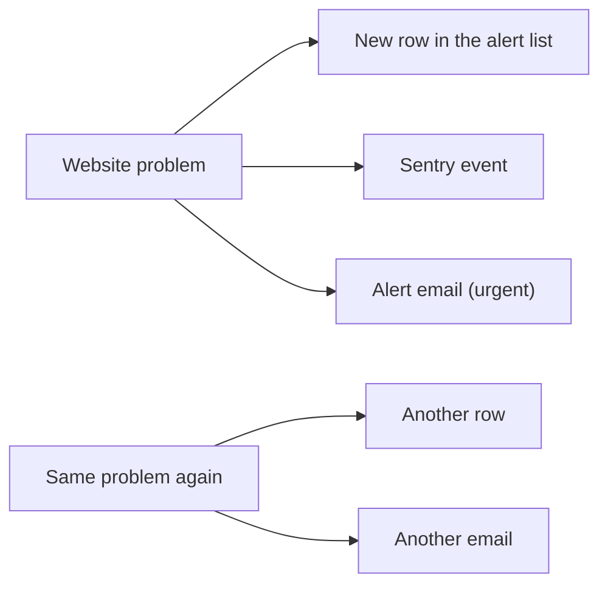
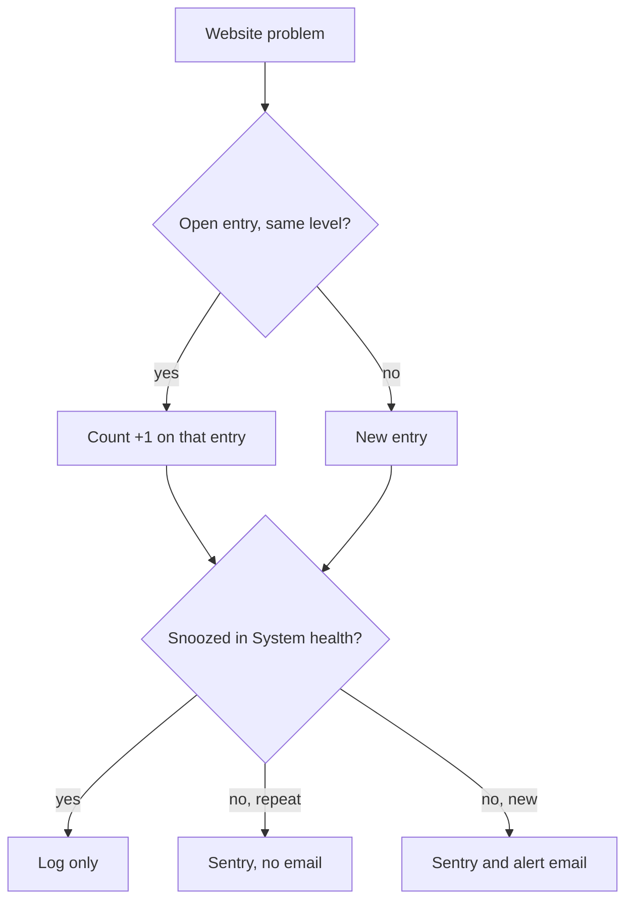
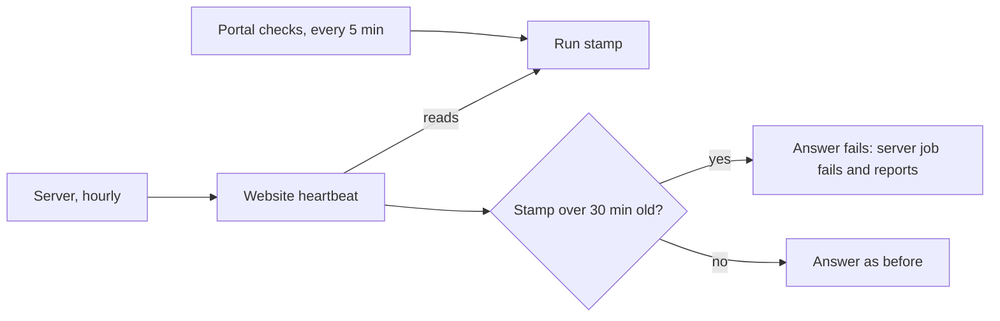


---
title: 'Website alerts: one email per problem, snoozes honoured, the portal watched'
status: historical
audience: [owner, non-technical, technical, ai, operator]
last_verified: 2026-10-17
verified_against: [code, infra]
owner: harshil
related_code:
  [
    src/lib/alert-gate.ts,
    src/lib/heartbeat.ts,
    src/pages/api/health.ts,
    test/alert-gate-repeats.test.ts,
    test/heartbeat.test.ts,
  ]
related_docs: [../OPERATIONS.md, ../CONSENT-RECORD-SYSTEM.md]
tags: [record, alerts, heartbeat, monitoring]
---

# Website alerts: one email per problem, snoozes honoured, the portal watched

> **In one minute (for everyone)**
>
> - **What changed:** a problem the website reports again while it is still open is
>   counted on the same entry instead of a new entry and a new email; a problem someone
>   snoozed in the admin portal stays quiet until the snooze ends; and the website's
>   hourly heartbeat now notices when the admin portal's own checks have stopped.
> - **Why:** part 2 of the System health plan the owner approved on 2026-10-17 ("Build
>   all"), items 27, 32 and 35. One Brevo webhook problem had left 19 entries.
> - **What you will notice:** one alert email per problem instead of one per repeat;
>   System health shows how many times a website problem came.
> - **What it costs or saves:** fewer emails and fewer database rows; one small database
>   read more per alert and per hourly heartbeat.

|                       |                                                                                                                           |
| --------------------- | ------------------------------------------------------------------------------------------------------------------------- |
| **Date**              | 2026-10-17                                                                                                                |
| **Asked for by**      | the owner: System health plan of 2026-10-17, parts 2 and 3 approved "Build all"                                           |
| **Done by**           | Claude (AI agent), the "Permissions system" thread                                                                        |
| **Commits**           | cf-astro: this commit. cf-admin `950b899`: the six columns (its migration `0074`) and the checks' run stamp, pushed first |
| **Risk**              | low: when anything is missing or fails, every alert channel fires as before                                               |
| **Can it be undone?** | yes, by reverting this commit (§8)                                                                                        |

## 1. What happened, for non-technical staff

When something goes wrong on the website, for example a message from the email
provider that fails its security check, the website raises an alert. The alert is
written to a list the admin portal shows on its System health page, and an urgent one
also emails the hotel's alert inbox.

Until today, every time the same problem happened again, the website added another
entry to that list and sent another email. One email-provider problem left 19
entries. Now the first time opens an entry and sends the email; each time after that
adds one to the entry's count, with no new email, until someone closes it on System
health. The next time after a close starts a new entry and emails again.

The admin portal can now also snooze a problem for 1, 4 or 24 hours, with a reason.
While a website problem is snoozed, the website still counts it but sends no email.

Finally, the website's hourly heartbeat, which the hotel's server runs, now checks
that the admin portal's own checks are still running. If they have not run for 30
minutes, the heartbeat fails, and the server reports a failed job. Without this,
nothing would say so if the portal's scheduler stopped.

Nobody needs to do anything differently.

## 2. Impact on each service

| Service                   | Before                                           | After                                                                                        | Does anyone need to act? |
| ------------------------- | ------------------------------------------------ | -------------------------------------------------------------------------------------------- | ------------------------ |
| Public website (cf-astro) | Every alert a new row; every urgent one an email | A repeat counted on the open row, no second email; a snoozed problem only logged and counted | No                       |
| Admin portal (cf-admin)   | System health counted rows; could not snooze     | Shows each problem's count from its repeats; snoozes it; stamps each run of its checks       | No                       |
| Server dashboard (cf-vps) | The heartbeat job checked bookings and consents  | The same job also fails when the portal's checks stopped                                     | No                       |
| Outside services (Sentry) | An event per alert                               | An event per alert, none while snoozed                                                       | No                       |

Backups, email delivery and the knowledge graph are untouched.

## 3. How it worked before

Each alert went to every channel at the same moment. The same problem again was
treated as new: another row and another email. Nothing watched the admin portal's
scheduler from outside the portal.

## 4. How it works now

The row is written first, and what it finds decides the rest: a repeat adds to the
open entry and sends no email, a snoozed problem goes no further than the log and its
entry, and a new problem goes everywhere as before.

The heartbeat reads the portal's run stamp. Only its answer to the server fails; its
own record keeps the booking and consent verdict, so the portal does not later blame
the website for its own outage.

## 5. Technical detail (for engineers)

- **Files changed:**
  - `src/lib/alert-gate.ts`: `fireD1` writes first; `addRepeat` updates the newest
    open row with the same source, event and severity (`repeats = COALESCE(repeats, 1) + 1`,
    `last_seen_at`); `snoozedUntil` reads the latest `snoozed_until` still ahead among
    the problem's rows; a repeat skips email, a snoozed problem skips Sentry and email.
    `COMPLIANCE_SOURCES` (`arco_get_document`) always inserts.
  - `src/lib/heartbeat.ts`: `readPortalWatch` reads `json_extract(setting_value, '$.tick')`
    from the `health-state` row; `withPortalWatch` adds `portal` to the answer and fails
    it past `PORTAL_STALE_MINUTES` (30).
  - `src/pages/api/health.ts`: the heartbeat branch reads both in parallel and records
    the heartbeat's own verdict.
- **Decisions:** repeats are matched at the same level, so a critical problem is never
  hidden inside an open warning row. The first message is kept. Sentry still gets
  repeats, since it groups them by fingerprint and its counts stay true. The watcher
  fails the answer, not the record, so cf-admin's heartbeat check stays about bookings
  and consents. Rejected: filing a portal problem from the website (a second alert
  path for the same outage; the server's job already reports failures).
- **Data and schema:** no migration in this repository. The six nullable
  `platform_alerts` columns are cf-admin's migration `0074`, applied live before this
  push. The `health-state` row's `tick` is written by cf-admin's checks job.
- **Security and privacy:** no new personal data. The snooze reason and the name of
  who is on a problem are written by cf-admin, not here.

## 6. How it was verified

| Check      | Command or method                                                      | Result                                              |
| ---------- | ---------------------------------------------------------------------- | --------------------------------------------------- |
| Full gate  | `npm run verify`                                                       | exit 0 (the summary is in the commit message)       |
| Unit tests | `test/alert-gate-repeats.test.ts`, `test/heartbeat.test.ts` on SQLite  | repeats, levels, closes, compliance, snoozes, watch |
| Live table | Cloudflare D1 connector: `platform_alerts` DDL after cf-admin's `0074` | the six columns present                             |

Not checked: a live repeat, snooze and stale stamp in production; they follow the
push.

## 7. What is left

The admin portal's System health page owns snoozes, closes and the home page strip
(cf-admin's own records).

## 8. Rolling back

Revert this commit and push. The six columns stay (they are additive and harmless);
the website then files a row and an email for every alert again, and the heartbeat
stops reading the portal's stamp.

## Phone test steps

1. Open the admin portal, System health, Problems.
2. A website problem that came several times shows "Came N times" on one ticket.
3. Open it, snooze it for 1 hour with a reason: the ticket moves to the Snoozed lane.
4. Open the server's Jobs page: the latest `astro_heartbeat` run is green.


