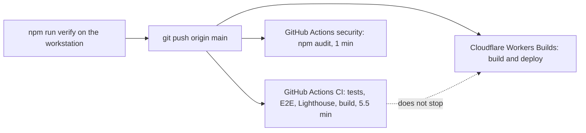
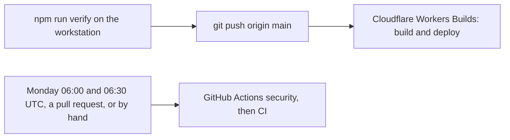


---
title: 'CI and security no longer run on every push'
status: historical
audience: [owner, non-technical, technical, ai, operator]
last_verified: 2026-10-18
verified_against: [code, infra]
owner: harshil
related_code: [.github/workflows/ci.yml, .github/workflows/security.yml]
related_docs: [../../RULES.md, ../../main.md, ../SYSTEM-ARCHITECTURE.md]
tags: [record, ci, github-actions, cost]
---

# CI and security no longer run on every push

> **In one minute (for everyone)**
>
> - **What changed:** GitHub's `CI` and `security` checks stop running after every push to `main`. They run once a week, on pull requests and when someone starts them by hand.
> - **Why:** the owner asked on 2026-10-18 not to waste GitHub Actions minutes. Each push was spending about 5.5 billed minutes on `CI` and 1 on `security`, and the deploy never waited for either.
> - **What you will notice:** nothing on the website. On GitHub, pushes to `main` no longer show the two checks.
> - **What it costs or saves:** about 6.5 Actions minutes per push; 14 `CI` runs took about 80 minutes between 10 and 17 October.

|                       |                                                                                                  |
| --------------------- | ------------------------------------------------------------------------------------------------ |
| **Date**              | 2026-10-18                                                                                       |
| **Asked for by**      | Harshil: "Select best options, just dont waste github action minutes" (17:11)                    |
| **Done by**           | Claude, in the "Docs pass across five repos" thread                                              |
| **Commits**           | cf-astro: this record's commit; cf-admin: the same change to its `quality` workflow the same day |
| **Risk**              | low: the deploy never waited for these checks, and `npm run verify` still runs before every push |
| **Can it be undone?** | yes, by restoring the `push` trigger (§8)                                                        |

## 1. What happened, for non-technical staff

Every change to the website is checked on the computer of the person or agent who pushes it, with `npm run verify`, before the push. Until now GitHub ran a second, longer set of checks after each push: it built the site, ran the tests, opened the pages in a browser and measured their speed. Cloudflare deploys the new code as soon as the push lands and never waited for that second set, so it was a safety net, not a gate.

GitHub charges the safety net against a monthly allowance of free minutes shared by all the hotel's repositories. Each run took about five and a half minutes, and a second small check, the dependency audit, took another minute.

From now on both run once a week, early on Monday, on pull requests, and whenever someone asks. Nothing changes for staff or visitors: the website deploys exactly as before, and the required check before every push stays in place.

## 2. Impact on each service

| Service                   | Before                                                  | After                                                 | Does anyone need to act? |
| ------------------------- | ------------------------------------------------------- | ----------------------------------------------------- | ------------------------ |
| Public website (cf-astro) | `CI` about 5.5 minutes and `security` 1 minute per push | both weekly, on pull requests and by hand             | No                       |
| Admin portal (cf-admin)   | `quality` 6 to 9 minutes per code push                  | weekly, on pull requests and by hand (its own record) | No                       |
| Outside services (GitHub) | about 6.5 billed minutes per cf-astro push              | the docs mirror's 1 minute per docs push, plus weekly | No                       |

Backups, email delivery, the server dashboard and the knowledge graph are not touched.

## 3. How it worked before



The push started three things at once. Cloudflare built and deployed; GitHub repeated and extended the checks. A red GitHub run changed nothing about the deploy.

## 4. How it works now



The push starts only the deploy. The weekly runs, a pull request or a manual start run the full set.

## 5. Technical detail (for engineers)

- **Files changed:** `.github/workflows/ci.yml` (the `push` trigger removed, a weekly `schedule` added at 06:30 UTC Monday, header comment), `.github/workflows/security.yml` (the `push` trigger removed; its weekly schedule and `pull_request` kept), `main.md` §2, `RULES.md` §3, `SYSTEM-ARCHITECTURE.md` §9 (a usage row), this record and the index.
- **Decisions:** `CI` runs checks that `npm run verify` does not (`db:check`, `types:check`, Playwright E2E, Lighthouse, the internal link check, knip). They now run weekly instead of after each push; the trade is a problem in one of them surfacing within a week instead of within minutes. The owner chose minutes over that latency. A lighter per-push run was rejected because GitHub bills each job as a whole minute.
- **Data and schema:** none.
- **Security and privacy:** `npm audit` runs weekly and on pull requests; a new high advisory is caught within a week instead of at the next push.

## 6. How it was verified

| Check       | Command or method                                                 | Result                                                                                        |
| ----------- | ----------------------------------------------------------------- | --------------------------------------------------------------------------------------------- |
| Full gate   | `npm run verify`                                                  | see the commit message                                                                        |
| Run lengths | GitHub Actions API, the last 40 runs of cf-astro, read 2026-10-18 | 14 `CI` runs of 3.8 to 5.7 minutes and 13 `security` runs of about 1 minute, 10 to 17 October |
| Trigger     | the workflow files at the pushed commit have no `push` block      | the push carrying this change starts neither workflow                                         |

Not checked: the next Monday schedule has not fired yet.

## 7. What is left

- The same pattern remains in cf-backup (`ci` about 3 minutes per push), cf-email-consumer (`ci` 1 minute) and cf-graph (`ci` about 2 minutes). Offered to the owner the same day.
- The docs mirror still runs on every push that touches a published document (about 1 minute). Not changed.

## 8. Rolling back

Add the trigger back to both workflow files:

```yaml
on:
  push:
    branches: [main]
```

and push. Nothing else depends on it.

## Phone test steps

1. Open the repository on GitHub, then Actions. The latest push to `main` shows no `CI` or `security` run.
2. Open Actions, `CI`, "Run workflow": a manual run starts and runs the full set.


