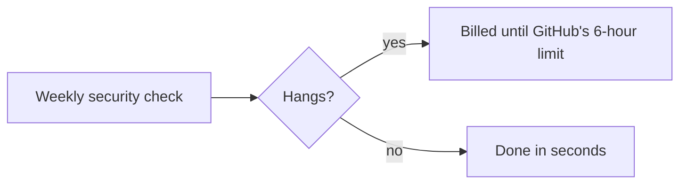
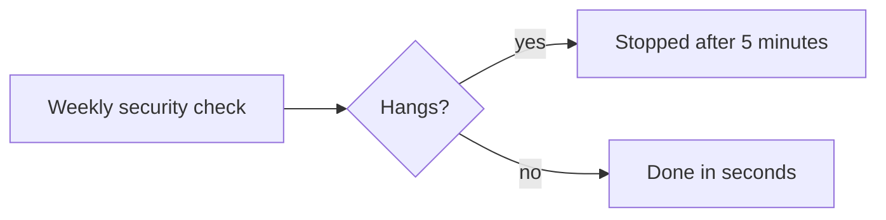


---
title: 'Every workflow job gets a time limit'
status: historical
audience: [owner, non-technical, technical, ai, operator]
last_verified: 2026-10-25
verified_against: [code, infra]
owner: harshil
related_code: [.github/workflows/security.yml, test/workflow-minutes.test.ts]
related_docs: [2026-10-18-ci-on-schedule.md]
tags: [record, ci, github-actions, cost]
---

# Every workflow job gets a time limit

> **In one minute (for everyone)**
>
> - **What changed:** the `security` workflow's one job now stops after 5 minutes. A new test
>   requires a time limit on every job and keeps the checks off push.
> - **Why:** the owner asked on 2026-10-25 to stop wasted GitHub Actions minutes (2,000 a month,
>   shared by every private repository). A job without a limit that hangs can bill up to six
>   hours. It was the only job in this repository without one.
> - **What you will notice:** nothing.
> - **What it costs or saves:** nothing on a normal run; up to six hours on a hung one.

|                       |                                                                                                                                                                                                                  |
| --------------------- | ---------------------------------------------------------------------------------------------------------------------------------------------------------------------------------------------------------------- |
| **Date**              | 2026-10-25                                                                                                                                                                                                       |
| **Asked for by**      | Harshil: stop "over used and stale used github actions minutes", "re runs, cicd checks, code check etc on same thing"                                                                                            |
| **Done by**           | Claude (cloud session, "Stop backup runs from failing" thread)                                                                                                                                                   |
| **Commits**           | cf-astro: this record's commit; the same day cf-backup and cf-email-consumer stopped their push checks, and cf-admin got the page on where the minutes go (`documentation/operations/github-actions-minutes.md`) |
| **Risk**              | low: an audit takes seconds                                                                                                                                                                                      |
| **Can it be undone?** | yes, by removing the line                                                                                                                                                                                        |

## 1. What happened, for non-technical staff

GitHub runs some automatic checks for this website, each from a monthly allowance of free
minutes. If a check got stuck, GitHub would keep billing it for up to six hours unless the check
says when to give up. Every check here already said so except the weekly security check. Now it
gives up after 5 minutes, and a test makes sure every future check says when to give up too.

## 2. Impact on each service

| Service           | Before                               | After                 | Does anyone need to act? |
| ----------------- | ------------------------------------ | --------------------- | ------------------------ |
| Website (GitHub)  | `security` could run up to six hours | stops after 5 minutes | No                       |
| Website (Workers) | not touched                          | not touched           | No                       |

## 3. How it worked before

## 4. How it works now

The difference: a stuck check costs at most 5 minutes instead of up to 360.

## 5. Technical detail (for engineers)

- `.github/workflows/security.yml`: `timeout-minutes: 5` on `npm-audit`.
- `test/workflow-minutes.test.ts`: every job of every workflow declares `timeout-minutes`, and
  only `sync-docs.yml` has a `push` trigger (the checks stay weekly, on pull requests and by
  hand, as decided on 2026-10-18).

## 6. How it was verified

| Check     | Command or method                                     | Result                        |
| --------- | ----------------------------------------------------- | ----------------------------- |
| Full gate | `npm run verify`                                      | exit 0 (this record's commit) |
| The test  | `test/workflow-minutes.test.ts` with the timeout gone | fails                         |

## 7. What is left

Nothing here.

## 8. Rolling back

Remove the line and the test, and push to `main`.

## Phone test steps

Nothing to test on the phone: the website does not change.


