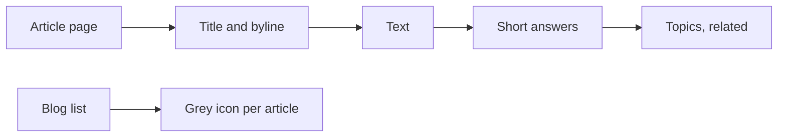
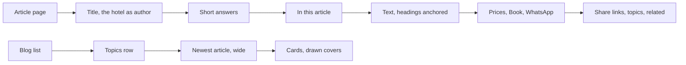


---
title: 'The blog pages remade: answers first, a list of sections, a booking box and covers drawn from the title'
status: historical
audience: [owner, non-technical, technical, ai, operator]
last_verified: 2026-10-30
verified_against: [code, infra]
owner: harshil
related_code:
  [
    src/lib/blog-article.ts,
    src/lib/blog-sources.ts,
    src/lib/blog-schema.ts,
    src/components/sections/BlogPostContent.astro,
    src/components/sections/BlogPageContent.astro,
    src/components/blog/ArticleOutline.astro,
    src/components/blog/BookingBox.astro,
    src/components/blog/ShareLinks.astro,
    src/components/blog/TopicsRow.astro,
    src/components/blog/WordCover.astro,
    src/components/blog/RelatedPosts.astro,
    src/pages/es/blog/[slug].astro,
    src/pages/en/blog/[slug].astro,
    test/blog-article.test.ts,
  ]
related_docs: [../FRONTEND-AND-SEO.md, ../README.md]
tags: [record, blog, seo, frontend]
---

# The blog pages remade: answers first, a list of sections, a booking box and covers drawn from the title

> **In one minute (for everyone)**
>
> - **What changed:** an article now opens with its short answers and a list of its sections,
>   and ends with the hotel's prices, Book and WhatsApp buttons and share links. The blog's list
>   leads with the newest article, has a row of topics, and gives every article without a photo a
>   cover made from its own title.
> - **Why:** the fourth stage of Harshil's 2026-10-30 ask to make the blog "really amazing, well
>   and useful" in both repositories. The articles had no way to book from them, no outline, and
>   23 grey placeholder pictures.
> - **What you will notice:** coloured covers with the article's title instead of the grey photo
>   icon, the topics row above the list, and the booking box at the end of every article.
> - **What it costs or saves:** nothing. No new table, setting, library or service. The list
>   pages read every article's topics once (one small database read, kept in the page cache).

|                       |                                                                                                                                                                                                                               |
| --------------------- | ----------------------------------------------------------------------------------------------------------------------------------------------------------------------------------------------------------------------------- |
| **Date**              | 2026-10-30                                                                                                                                                                                                                    |
| **Asked for by**      | Harshil, 2026-10-30: "blog system is not to the extent I wanted it to be. so please carefully review it over both repo, think deep, take as long as needed, research extensively and make it really amazing, well and useful" |
| **Done by**           | Claude Code, in the cf-admin "Improve cf-admin visuals and features" thread (stage 4 of cf-admin's `documentation/specs/2026-10-30-content-studio.md`)                                                                        |
| **Commits**           | cf-astro: this record's commit                                                                                                                                                                                                |
| **Risk**              | low: the blog's pages change how they look; how an article is found, served or taken down is unchanged                                                                                                                        |
| **Can it be undone?** | yes, by reverting the commit (§8)                                                                                                                                                                                             |

## 1. What happened, for non-technical staff

The blog has 15 articles on the website, 8 in English and 7 in Spanish, and 8 more waiting for
their date. None has a photo yet, so the list showed 15 grey picture icons.

Now each article without a photo gets a cover made from its own words: its topic and its title
on a soft colour that is always the same for that article. When a photo is added in the admin
portal, it replaces the drawn cover.

An article page now starts with its short answers, when it has them, then **In this article**,
a list of its sections that jumps to each one and folds away on a phone. At the end there is a
box with the hotel's prices (the same ones the rest of the website shows, changed from the
portal's Prices page), **Book now** and **Ask on WhatsApp**, then plain links to share the
article by WhatsApp, Facebook, X or email.

The blog's list leads with the newest article as a wide card, and a row of topics that scrolls
sideways ("All", then each topic with how many articles it has). A topic's page is headed by its
topic.

Articles signed "Hotel Madagascar" (15 of the 23: the 7 live Spanish articles and the 8 waiting)
were described to Google as written by a person of that name. They now say, to readers and to Google, that the hotel wrote them, with its
logo and "since 1994".

## 2. Impact on each service

| Service                   | Before                                                                      | After                                                                              | Does anyone need to act? |
| ------------------------- | --------------------------------------------------------------------------- | ---------------------------------------------------------------------------------- | ------------------------ |
| Public website (cf-astro) | Grey placeholder covers, answers after the text, no outline, no way to book | Drawn covers, answers first, In this article, booking box, share links, topics row | no; phone test below     |
| Admin portal (cf-admin)   | Its Blog page marks every article "No cover photo"                          | unchanged; a cover added there replaces the drawn one                              | no                       |
| Search engines            | 7 live articles' author marked as a Person named "Hotel Madagascar"         | the hotel's Organization                                                           | no                       |

Backups, email, the server and the knowledge graph are not touched.

## 3. How it worked before

The article went straight from its title to its text; the short answers came after the text,
where few readers reach. Nothing on the page led to a booking. The list showed every article
the same way, with a grey icon when there was no photo.

## 4. How it works now

The reader gets the answer first and can jump to the part they need; the end of every article
offers to book with real prices. The difference from §3: every article is a way into a booking,
and no article looks empty.

## 5. Technical detail (for engineers)

- **Files changed:**
  - `src/lib/blog-article.ts` (new): `headingId`, `textOf`, `outlineArticle` (anchors every `h2`
    and `h3` of the sanitized body, keeps a plain anchor it already has, makes repeated ones
    unique), `[SUPABASE_PROJECT_REF]` (the bundled Markdown's own headings from `render()`),
    `readingMinutes` (counted from the words, not the markup: the list counted HTML tags as
    words), `shareLinks`, `wordCover` and `blogTopics`.
  - `src/lib/blog-sources.ts`: `getBlogTopics`, one `columns: 'feed'` read of every published article's
    tags (no bodies); `null` when the read fails, so a page counts the posts it shows.
  - `src/lib/blog-schema.ts`: `'Hotel Madagascar'` added to the business names, and
    `isBusinessByline` exported for the page's byline.
  - `src/components/blog/`: `ArticleOutline`, `BookingBox` (`getPricing` and
    `src/data/servicePages.ts`, no price written by hand), `ShareLinks`, `TopicsRow`, `WordCover`
    (new); `RelatedPosts` draws a cover when there is no photo; `AioDirectAnswers` comment.
  - `src/components/sections/BlogPostContent.astro`: answers, outline, text, booking box, share
    links, topics; the hotel's logo and name when the byline is the hotel; anchored headings keep
    clear of the fixed header (`scroll-mt-28`).
  - `src/components/sections/BlogPageContent.astro`: the topics row, the newest article as a wide
    card on the index's first page, drawn covers, the cover's own description as its alt text,
    the reading time fixed, a topic page headed by its topic; the author line under each card is
    gone (every article is the hotel's).
  - The six blog routes: the article pages pass the sections, answers and address; the list and
    topic pages pass the topics.
- **Decisions:** share links are plain links, so no other site's code loads and nothing tracks a
  reader; the drawn cover is HTML and CSS, not a generated image, so it costs nothing and adds no
  file; the open-graph image stays the site's own until an article has a photo.
- **Data and schema:** none.
- **Security and privacy:** the anchors are letters, digits and hyphens only, added after
  `sanitizeHtml`; no personal data moves.

## 6. How it was verified

| Check         | Command or method                                         | Result                                                                                                              |
| ------------- | --------------------------------------------------------- | ------------------------------------------------------------------------------------------------------------------- |
| Article tests | `npx vitest run test/blog-article.test.ts`                | 25 passed                                                                                                           |
| Full gate     | `npm run verify`                                          | exit 0: 0 type errors, ratchet matching, 48 test files and 513 tests, a11y_check 0 findings, Prettier clean         |
| Live articles | Cloudflare D1 connector, counts and lengths only          | 23 articles (15 live, 8 scheduled), every one with second-level headings, one with short answers, none with a cover |
| Bylines       | the same connector, comparing the byline to known strings | 8 "Madagascar Pet Hotel", 15 "Hotel Madagascar"                                                                     |

Not checked: the rendered pages in a browser (the owner's phone test covers them).

## 7. What is left

- Covers: the 23 articles need photos, added in the admin portal's Blog page.
- The bundled Markdown copies of the first fourteen articles are refreshed from D1 once the
  fact-check suggestions are decided (cf-admin `MAINTENANCE.md` CS-5).

## 8. Rolling back

Revert the commit and push. The old pages return; nothing is stored differently.

## Phone test steps

1. Open madagascarhotelags.com/es/blog/. The newest article is a wide card, the topics row
   scrolls sideways, and each card has a coloured cover with its title.
2. Tap a topic: the page is headed by it and the topic is marked in the row.
3. Open an article: under the title, "En este artículo" lists its sections; tap one to jump.
4. Scroll to the end: the prices box with Reservar and WhatsApp, then the share links.


