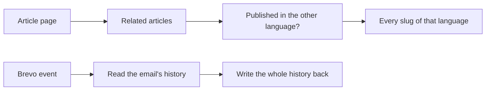
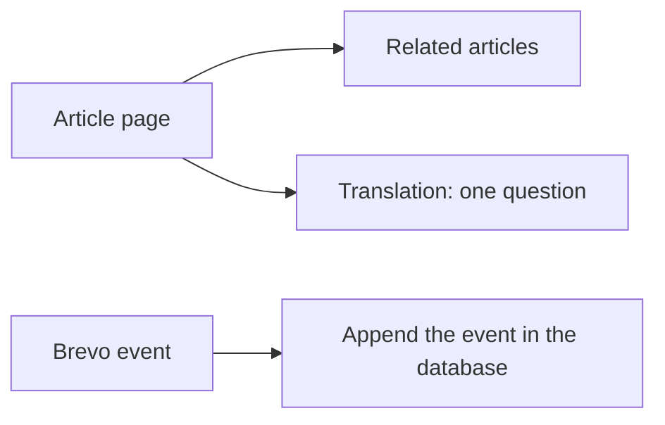


---
title: 'Fewer waits on the database: blog pages, the booking form and the email delivery webhook'
status: historical
audience: [owner, non-technical, technical, ai, operator]
last_verified: 2026-11-13
verified_against: [code, infra]
owner: harshil
related_code:
  [
    src/lib/blog.ts,
    src/lib/delivery-events.ts,
    src/pages/api/booking.ts,
    src/pages/api/webhooks/brevo.ts,
    src/pages/es/blog/index.astro,
    src/pages/en/blog/index.astro,
    'src/pages/es/blog/[slug].astro',
    'src/pages/en/blog/[slug].astro',
    test/query-round-trips.test.ts,
  ]
related_docs: [../SYSTEM-ARCHITECTURE.md, ../FRONTEND-AND-SEO.md, ../TODO-BACKLOG.md]
tags: [record, performance, database, blog, booking, email]
---

# Fewer waits on the database: blog pages, the booking form and the email delivery webhook

> **In one minute (for everyone)**
>
> - **What changed:** pages and forms that asked the database several questions one after the
>   other now ask them at the same time, two questions became one, and the email delivery
>   lookup got an index.
> - **Why:** the owner asked for a speed pass on all three systems: fix N+1 queries, index what
>   is searched, cache what rarely changes, and update the screen before the server answers.
> - **What you will notice:** blog pages that are not already cached open a little sooner, and a
>   booking's answer comes back a little sooner. Nothing looks different.
> - **What it costs or saves:** nothing. One fewer database query per blog article view that
>   misses the cache, and one fewer per Brevo delivery event.

|                       |                                                                                                           |
| --------------------- | --------------------------------------------------------------------------------------------------------- |
| **Date**              | 2026-11-13                                                                                                |
| **Asked for by**      | the owner: "Find and fix every N+1 query, add indexes, cache the data that rarely changes, optimistic UI" |
| **Done by**           | Claude Code, the cf-astro speed thread                                                                    |
| **Commits**           | this commit                                                                                               |
| **Risk**              | low: the same rows are read and written; only the order of waiting changed                                |
| **Can it be undone?** | yes, by reverting the commit and dropping one index (§8)                                                  |

## 1. What happened, for non-technical staff

When the website builds a page or takes a booking, it asks the database questions. Each question
is a short trip over the network. Until today some pages asked a question, waited for the
answer, then asked the next one even when the second question did not need the first answer.

A blog article, for example, asked "which articles are related?", waited, then asked "is there
a version in the other language?", waited, and sometimes asked a third question. It now asks
the first two at the same time, and the language question is one question instead of two. The
blog list asks for its articles, their count and its topics row at the same time.

When someone books, the website already fills in the booking's audit row and checks whether
this exact booking was already sent (a double tap). Those two steps now happen together.

When Brevo tells us an email was delivered or bounced, the website used to read the email's
history, add the event, and write the whole history back. It now adds the event in one step,
which is quicker and means two events arriving at once can no longer overwrite each other. The
lookup Brevo uses when an email carries no tracking label now has an index in the database.

Nobody has to do anything differently. Most pages were already served from the page cache for 24
hours, so visitors mostly see the gain the first time a page is built after a publish.

## 2. Impact on each service

| Service                         | Before                                                                  | After                                                        | Does anyone need to act? |
| ------------------------------- | ----------------------------------------------------------------------- | ------------------------------------------------------------ | ------------------------ |
| Public website (cf-astro)       | Blog pages and the booking API waited for independent questions in turn | The independent questions are asked together                 | No                       |
| Admin portal (cf-admin)         | Its own Brevo webhook looked up `resend_id` with no index               | The same lookup can use the new index                        | No                       |
| Outside services (Supabase, D1) | No index on `email_audit_logs.resend_id`                                | Partial index `idx_email_audit_logs_resend_id`; D1 unchanged | No                       |

Backups, email delivery, the server dashboard and the knowledge graph are not touched.

## 3. How it worked before

The article page waited for each of the three questions in turn, and the last one read every
article slug of the other language to check a single one. The webhook read the history, added
the event in the Worker and wrote everything back: two trips, and two events at once could each
erase the other's.

## 4. How it works now

The article page asks its two questions together and waits once; the translation question
answers both "published?" and "known at all?" from the indexes. The webhook appends the event in
one statement that also says whether the email exists.

## 5. Technical detail (for engineers)

- **`src/lib/blog.ts`:** `getBlogPosts` starts the paginated index's `COUNT` before awaiting the
  page query (a rejected count still reads as `degraded`). `[SUPABASE_PROJECT_REF]` replaces
  `getPublishedSlugs`, whose only callers were the post pages; it is one `SELECT` of three
  `EXISTS` subqueries on `idx_posts_slug_locale` and `idx_blog_redirects_old_slug_locale` (query
  plan read on the live D1).
- **`src/pages/{es,en}/blog/[slug].astro`:** related posts and the translation check run in one
  `Promise.all`; the post page no longer calls `getD1KnownSlugs`.
- **`src/pages/{es,en}/blog/index.astro`:** `getBlogTopics` starts beside `getBlogPosts`. Topic
  pages were left alone so an unknown topic's 404 still costs one query.
- **`src/pages/api/booking.ts`:** `backfillBookingAttemptDetails` (never throws) and the
  `SESSION` idempotency read run together; the audit-first D1 write still comes first
  (AGENTS.md invariant 2), and a KV failure still proceeds as a normal booking.
- **`src/pages/api/webhooks/brevo.ts`, `src/lib/delivery-events.ts`:** one connection per request
  (the message-id fallback used to open its own), and one `UPDATE … SET delivery_events =
(array or []) || $event::jsonb … RETURNING id`; no row returned is the old "Tracking ID not
  found". `cf_astro_writer` already holds `SELECT` and `UPDATE` on those columns (checked in
  `information_schema.column_privileges`).
- **Data and schema:** Supabase migration `email_audit_logs_resend_id_index` (ledger version
  `20261113203449`), applied through the Supabase connector before this push:
  `CREATE INDEX IF NOT EXISTS idx_email_audit_logs_resend_id ON public.email_audit_logs (resend_id)
WHERE resend_id IS NOT NULL`. It is not modelled in `src/lib/db/schema.ts`, like every other
  index on these tables (`DB-HARDENING-APPLIED-VIA-SUPABASE-MCP.md`), so no Drizzle migration
  goes with it and `npm run db:check` is unaffected. No D1 migration: every D1 query on these
  paths already uses an index.
- **Not changed, on purpose:** the booking transaction's five inserts (measured, no gain; see
  `TODO-BACKLOG.md` §0f), the outbox drain's one-row-at-a-time replay (each row needs its own
  failure accounting, and it sees a handful of rows a day), and the caches (§7).

## 6. How it was verified

| Check                   | Command or method                                                                                   | Result                                                                                                  |
| ----------------------- | --------------------------------------------------------------------------------------------------- | ------------------------------------------------------------------------------------------------------- |
| New tests               | `test/query-round-trips.test.ts`                                                                    | 8 pass; the booking test times out against the old `booking.ts`                                         |
| Append on real Postgres | a local Postgres 16 with the table's columns, through Drizzle, with and without prepared statements | null and non-array histories start a list; 20 events sent at once all landed; missing id returns no row |
| Index                   | Supabase connector: `pg_indexes`, `schema_migrations`, `EXPLAIN` with sequential scans off          | present, recorded, used by `resend_id = …`                                                              |
| Translation query       | Cloudflare D1 connector: `EXPLAIN QUERY PLAN` and a run on four live posts                          | three index searches; correct answers                                                                   |
| Full gate               | `npm run verify`                                                                                    | see the commit message                                                                                  |

Not checked: timings in production (the Cloudflare connector has no Workers analytics) and the
blog pages rendered in a browser (the owner checks on a phone).

## 7. What is left

- **Cache:** nothing added. Pages are kept 24 hours in `ISR_CACHE`, the service config has three
  layers, the CMS blocks are read from KV first and memoised per request, `/api/runtime-config`
  is edge-cached for 60 s and the feeds have their own cache. No rarely-changing read was found
  outside those layers.
- **Optimistic screens:** the cookie banner already is one. The booking, contact and ARCO forms
  keep waiting for the server on purpose (`TODO-BACKLOG.md` §0f).
- The booking transaction and the contact form's two inserts: `TODO-BACKLOG.md` §0f.

## 8. Rolling back

Revert this commit and push. The index can stay (it only helps); to remove it, run
`DROP INDEX IF EXISTS public.idx_email_audit_logs_resend_id` as a Supabase migration.

## Phone test steps

1. Open `madagascarhotelags.com/es/blog/` and an article: the page, its related articles and the
   English link (when the article has one) show as before.
2. Do the same on `/en/blog/`.
3. Make a test booking only if you planned one anyway: the confirmation appears as before.


