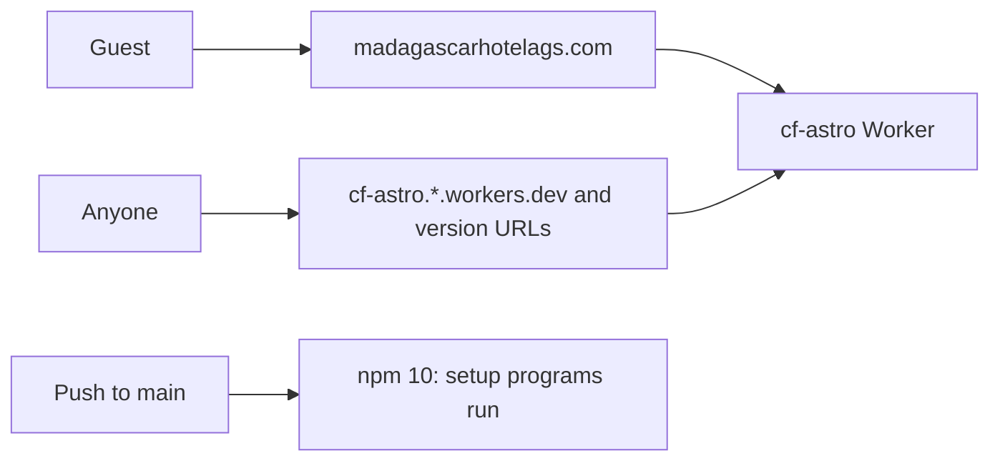
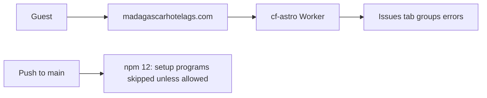


---
title: 'One address for the website, builds that run no package code, and Workers Issues'
status: historical
audience: [owner, non-technical, technical, ai, operator]
last_verified: 2026-11-19
verified_against: [code, infra]
owner: harshil
related_code: [wrangler.toml, package.json, .npmrc]
related_docs: [../../SECURITY.md, ../OPERATIONS.md, ../TODO-BACKLOG.md]
tags: [record, security, supply-chain, deploy, observability]
---

# One address for the website, builds that run no package code, and Workers Issues

> **In one minute (for everyone)**
>
> - **What changed:** the website now answers only on `madagascarhotelags.com` (and the two
>   names that redirect to it); Cloudflare's spare test addresses for it are off. The automatic
>   build installs packages with npm 12, which runs no package's setup program unless we allow
>   it, and only takes versions public for a week. Cloudflare's Workers Issues groups the
>   site's errors on its own page.
> - **Why:** Harshil asked on 2026-11-19 for protection against attacks and leaks, and chose
>   batch 1 of the security plan. A spare address skips the rules set on the real one, and a
>   package's setup program is how hijacked packages steal a build's keys.
> - **What you will notice:** nothing for guests: bookings, contact and every page work as
>   before. The old `workers.dev` address stops answering.
> - **What it costs or saves:** nothing.

|                       |                                                                                                                                                                       |
| --------------------- | --------------------------------------------------------------------------------------------------------------------------------------------------------------------- |
| **Date**              | 2026-11-19                                                                                                                                                            |
| **Asked for by**      | Harshil: "INSTANTLY flag, block, report and if active attack or data breach, data leak we need to know all!", then "Start batch 1 now" on the security plan           |
| **Done by**           | Claude Code, in the "Detect and block security threats instantly" thread                                                                                              |
| **Commits**           | cf-astro: the commit that adds this record. The same build change in cf-admin, cf-backup, cf-vps, cf-email-consumer and cf-graph                                      |
| **Risk**              | low: no code in the booking path changed; the custom domain is managed in the dashboard and a deploy without `routes` leaves it alone; a failed build changes nothing |
| **Can it be undone?** | yes (§8)                                                                                                                                                              |

## 1. What happened, for non-technical staff

Cloudflare gives every Worker a free test address on `workers.dev`, and one more for each
version. The website's real address is `madagascarhotelags.com`. The test addresses served the
same site but outside the rules the hotel's zone applies to its own names, so they were a side
door. Nothing used them: the site is only deployed from `main`. They are now off.

The build now uses npm 12. The old npm let every package run its own setup program while it
was being installed, on the machine that holds the build's keys; npm 12 runs none unless this
repository says yes by name. Three packages here carry one, and none needs it.

Cloudflare's Workers Issues is also on: crashes and errors are grouped on the Worker's Issues
tab, next to the Sentry reports and System health alerts that already exist.

## 2. Impact on each service

| Service                   | Before                                                     | After                                                          | Does anyone need to act? |
| ------------------------- | ---------------------------------------------------------- | -------------------------------------------------------------- | ------------------------ |
| Public website (cf-astro) | answered on its domain and on `workers.dev`; npm 10 builds | its domain only; npm 12 builds, install scripts off; Issues on | no                       |
| Booking, contact, ARCO    | unchanged code                                             | unchanged code                                                 | no                       |

The other services get the same build change in their own repositories on the same day.

## 3. How it worked before

Two kinds of address reached the same Worker; only the domain sat inside the zone's rules.
Each build ran every package's setup program.

## 4. How it works now

One address, an install that runs no package code, and errors grouped by Cloudflare. The
difference from §3: no side door, and no third-party code during the build's install.

## 5. Technical detail (for engineers)

- **Files changed:** `wrangler.toml` (`workers_dev = false`, `preview_urls = false`, still no
  `routes`; `[observability.issues]`); `package.json` (`packageManager: npm@12.2.2`;
  `allowScripts` denies `esbuild`, `workerd` and `@sentry/cli`, whose binaries come from
  platform packages); `.npmrc` (new, `min-release-age=7`); SECURITY.md §2 and §14,
  OPERATIONS §7, TODO-BACKLOG.
- **Decisions:** the CSRF allowlist's `workers.dev` entry and `OWN_VERSION_HOST` were left in
  `src/lib/security.ts` so that no code in the booking path changes in this push; they now
  accept only hosts that answer nothing, and their removal is a backlog item. The custom domain
  stays dashboard-managed, as Cloudflare's configuration page describes (no `route` or
  `routes`, `workers_dev = false`). No AGENTS.md invariant is touched: no CAPTCHA on booking,
  rate limiting still fails open.
- **Data and schema:** none.
- **Security and privacy:** no personal data moves.

## 6. How it was verified

| Check                  | Command or method                                                          | Result                                                                  |
| ---------------------- | -------------------------------------------------------------------------- | ----------------------------------------------------------------------- |
| Blocked scripts        | `npm ci` under npm 12.2.2, Node 22.23                                      | `esbuild` (three versions), `workerd` (two), `@sentry/cli`; all skipped |
| Full gate              | `npm run verify`                                                           | see the commit message                                                  |
| Config                 | `npm run types:check` and `npx wrangler deploy --dry-run`                  | accepted                                                                |
| Who uses `workers.dev` | a search of all six repositories, and Sentry's uptime monitors (connector) | only the CSRF allowlist; the one uptime monitor checks the apex         |

Not checked: the Workers Builds log and the dashboard's Domains page, which a cloud session
cannot read. After the push, the Worker's modified time is read through the Cloudflare
connector.

## 7. What is left

- Remove the two `workers.dev` origin rules and their tests (TODO-BACKLOG).
- Harshil's dashboard steps from the plan (cf-admin's change record of the same day).

## 8. Rolling back

Revert the commit and push: the `workers.dev` address and version URLs come back on that
deploy, npm 10 runs again, and Issues switches off.

## Phone test steps

1. Open `https://madagascarhotelags.com/` on the phone: the home page loads.
2. Start a booking and go as far as the summary step: the form works as before.
3. Cloudflare dashboard → Workers & Pages → `cf-astro` → **Issues**: the tab opens.


