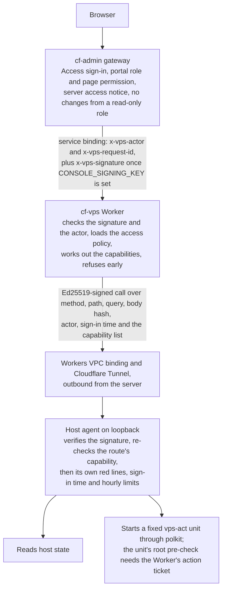

# cf-vps Architecture Overview

> **TL;DR (non-technical):** cf-vps lets approved people look after one rented server from
> inside the admin portal. The portal checks who you are, a private service decides what you
> may do, and a small program on the server does the work. Nothing on the server is open to
> the internet, every request is signed, and every sensitive step leaves a record.

## Components

| Part | Where it runs | What it does |
|---|---|---|
| cf-admin gateway | The admin portal's Worker | Signs the person in and checks their page permission; refuses any change from a read-only role and holds every change until the server access notice is accepted; then forwards `/dashboard/vps/app/` to cf-vps through a service binding with an actor header, and records each change in the portal's activity log |
| cf-vps Worker | Cloudflare, private (`workers_dev` and preview URLs off, no route) | Serves the console and its API, resolves the person's capabilities, signs each agent call |
| Console UI | Static assets in the Worker (`src/ui`, Preact) | One page per area; shows only what the person may open |
| Workers VPC binding + tunnel | Cloudflare and the server | Carries the Worker's calls to the agent over an outbound-only Cloudflare Tunnel; no inbound port is open |
| Host agent | The server, Node, runs as an unprivileged user | Reads host state, enforces capabilities again, starts controlled actions |
| Host modules | `host/NN-name/` | Everything installed on the server, as code, applied over SSH |
| Audit plane | The server | auditd, Laurel, tlog, sudo I/O and process accounting into Vector, then local storage, R2 and Sentry |
| App platform | The server | Rootful Podman apps behind one nginx ingress, PostgreSQL on a socket |
| Job runner | The server, root, started by systemd | Runs a job's container to completion, but only once the server is not busy; one queue for every job ([JOBS](../features/JOBS.md)) |

## Request path

Each hop checks again rather than trusting the one before it. cf-admin knows who the person
is; the Worker decides what they may do and refuses early, with the capability it needed or
an old sign-in; the agent believes only what the Worker signed, so it re-checks the
capability and keeps a few rules of its own (the root terminal and a reboot only for Owner
and Vendor support, the sign-in time, per-person hourly limits). A change on the server runs
as root only through a fixed unit, and that unit refuses to start without a ticket the
Worker signed for exactly it.

The Worker handles everything under `/dashboard/vps/app/` (`BASE_PATH`); the API lives under
`/dashboard/vps/app/api/`. Paths with `//`, backslashes or encoded slashes or dots are refused
before routing. Routes in `AGENT_ROUTE_CAPS` are the only ones that can reach the agent, so
the Worker cannot be used as a general proxy onto the host. The browser terminal's live connection takes
the same path as one long request: a WebSocket upgrade, signed like any other call, whose
socket the Worker hands back untouched once the agent accepts it
([How the terminal connects](../features/CONSOLE.md#how-the-terminal-connects)).

## Trust boundaries

| Boundary | What is trusted across it | How it is protected |
|---|---|---|
| Browser to cf-admin | Nothing; the person logs in | Cloudflare Access, cf-admin roles and page permissions |
| cf-admin to Worker | The actor header | The Worker has no public route; only the service binding reaches it. cf-admin drops any header a browser sent. A missing or invalid header gives `bad_actor`; a header of another version gives 409 `actor_version_mismatch`. Once the owner sets `CONSOLE_SIGNING_KEY` on cf-admin and this Worker, the actor, target and request-id headers count only with cf-admin's `x-vps-signature` over them, the method and the path with its query (HMAC-SHA256, 60 seconds either side; the body is not covered); otherwise `bad_signature` (`src/gateway/signature.ts`) |
| Worker to agent | The signed capability list, and the signed actor's role and sign-in time | Ed25519 signature over method, path, query, timestamp, single-use nonce, body hash, actor and capabilities. 60-second skew. The agent holds public keys only. For the root terminal, a reboot and every change that needs a fresh sign-in, the agent also checks the signed role and sign-in time itself, and counts uses against hourly limits ([PERMISSIONS](../security/PERMISSIONS.md#the-agents-own-red-lines)) |
| Agent to root | Nothing beyond named units | polkit lets the agent start only the fixed `vps-act-*` units. Each unit first runs a root pre-check that needs a fresh, unused action ticket the Worker signed for that exact unit (`contract/action-ticket.ts`), so the agent alone cannot start one; then the root script validates its target again |
| Terminal | A 30-second ticket | The Worker mints it, the root-side signer verifies it, and issues a 60-second SSH certificate for one account |

Fail-closed rules: no signing key in the Worker answers 503; no public key on the agent answers
401 on every signed route; an invalid stored access policy errors rather than falling back to
open; an unknown route is 404; the agent answers only loopback `Host` names.

## Data stores

| Store | Holds | Notes |
|---|---|---|
| cf-admin's D1 database (binding `DB`) | One settings row, `vps:access`: role defaults and per-person grants | cf-vps owns no tables. Compare-and-swap on a revision; read cached 30 s per isolate, and fresh for an Access page save, a change, or a read a floor guards ([PERMISSIONS](../security/PERMISSIONS.md#stored-policy-and-per-person-grants)) |
| Worker secret `VPS_SIGNING_KEY` | The Ed25519 private key | Deploys are refused without it (`secrets.required`) |
| Worker secret `CONSOLE_SIGNING_KEY` | The key cf-admin signs the identity headers with, the same value on cf-admin | Optional and not in `secrets.required`; without it the Worker checks no signature. A different key from `VPS_SIGNING_KEY` |
| Host config in `/etc/vps` | Retention table, service allow-list, Worker public keys, job manifests and the busy-gate settings | Written by host modules; a job's limits changed from the console sit beside its manifest as an override, which the modules never touch |
| Audit disk | `/srv/audit`: the forensic record | A fixed-size image, so a full audit disk cannot fill the system disk |
| System journal | Service logs and terminal recordings | Age-limited by retention |
| R2 audit bucket | Off-server copy of security classes; encrypted database dumps under `backups/postgres/` | Security classes locked for 90 days, see [AUDIT-PIPELINE](../security/AUDIT-PIPELINE.md); dumps locked 30 days, expired at 35 |
| Sentry | Alerts for real problems only | Not a record |
| Agent releases | `/opt/vps/agent/releases/<version>`, `current` link | Rollback switches the link |
| Agent state | `/var/lib/vps/metrics`: one sample a minute, one file per day; and `limits.json`, each person's admin terminal opens and reboot requests in the last hour | The unit's `StateDirectory`; the samples kept 30 days, at most 12 MiB; survives deploys and reboots. See [Metrics history](../features/CONSOLE.md#metrics-history) and [Hourly limits](../security/PERMISSIONS.md#hourly-limits) |
| Job runs | `/var/lib/vps/jobs`: the queue, each run's record, output and report, a day's index of finished runs, and a person's pause | Written by root, readable by the agent (2750 `root:vps-agent`); kept 30 days |
| App data | `/srv/apps`, `/srv/share`, PostgreSQL dumps kept 7 days, each also sent off the server encrypted (R2 `backups/postgres/`) | Apps run with a read-only root and no capabilities. The server holds only the public half of the backup key |

## Agent hardening

The agent runs as its own user with no capabilities, `ProtectSystem=strict`, `ProtectHome`, a
256 MB memory cap, and writes only to the app and share folders and its own state folders (the
metrics history and the hourly limits, and the input a person stages for a restore test). It reads logs and the audit
record through supplementary groups, not root. Reads of files, logs and the audit record are
written to the journal with the person's email.

## Related

- [PERMISSIONS](../security/PERMISSIONS.md): who may do what.
- [ACTIONS](../features/ACTIONS.md): the controlled changes.
- [API-ROUTES](../reference/API-ROUTES.md): the route table.
- [DEPLOY](../operations/DEPLOY.md) and [HOST-MODULES](../operations/HOST-MODULES.md).
- Plan of record: `documentation/specs/2026-09-29-cf-vps-design.md` (private).
