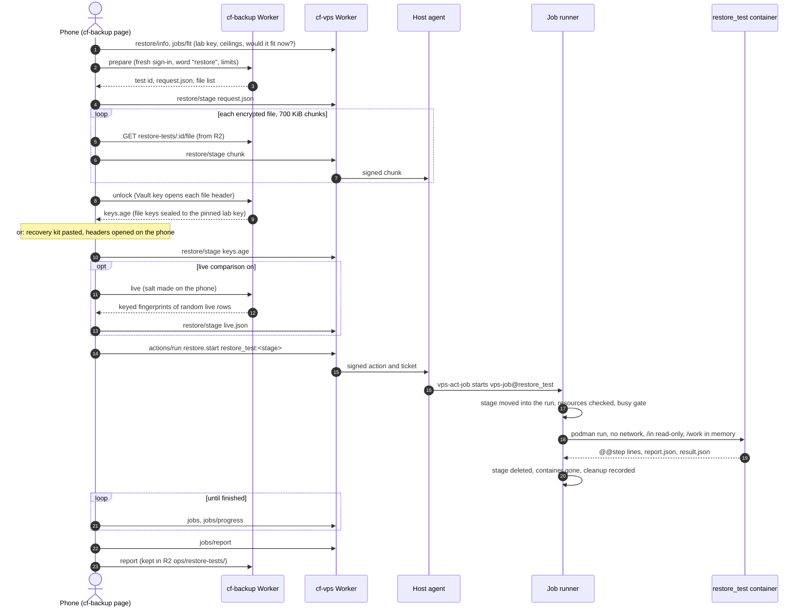

# Restore Tests

> **TL;DR (non-technical):** A restore test proves that a backup can actually be used. From
> the backup console you pick one backup copy; it is sent to our server, unlocked inside a
> sealed container that has no internet, rebuilt into working databases and checked about forty
> ways: is every file intact, does it unlock, is every table and row there, is the data healthy,
> does it match what was saved and what is live today, and how long did it take. You get a
> score and a plain verdict. Then the container and every unlocked byte are destroyed; only the
> report, which holds no customer data, is kept. Nobody pastes a key: the backup service unlocks
> the copy with the key it already keeps.

## What it proves, and what it cannot

A passing Full test proves that **this copy** opens with the key on record, rebuilds into
PostgreSQL and SQLite on a machine that is not production, holds every table and row its
manifest lists, is internally healthy, equals what the backup saw when it was taken, and still
matches a fresh random sample of live production. It measures how long that took.

It does not prove anything about other copies, and it never restores into production or into a
real Supabase project or D1 database. Every report lists what a restore test never checks
(`NOT_COVERED` in `lab-lib.mjs`): Supabase Storage files, Vault secrets, database role
passwords, Supabase's other auth tables, Workers KV, other R2 contents, Worker secrets and
settings, DNS and Access, and Supabase's own settings outside the schemas checked. Those are
never counted as passed. The full restore rehearsal in cf-backup's `docs/RESTORE.md` still
applies; this makes its data part routine and timed.

The owner approved the design on 2026-10-08, with three additions (settings controlled by
permissions, resources chosen per test with a fit check, and no key to paste), and agreed that
a copy may be on the server, sealed and in memory, for the length of a test (rulings
`documentation/records/2026-10-08-restore-test-rulings.md`, private).

## Who may run one

Each console checks its own permissions; starting a test needs both sides. These are the
code's defaults; the owner can change a role's list or one person's.

| Where | Permission | Allows | Held by default |
|---|---|---|---|
| cf-backup | `restoretests.view` | See tests, reports and Restore tests → Settings (read only); file a finished test's report | Owner, Vendor support, Admin |
| cf-backup | `restoretests.run` (floor) | Prepare and start a test: unlock with the Vault key, take the live sample | Owner, Vendor support |
| cf-backup | `restoretests.configure` (floor) | Change Restore tests → Settings and pin the server's lab key | Owner, Vendor support |
| cf-vps | `restore.test` (floor) | Stage a copy (`restore/stage`), start (`restore.start`) and cancel (`restore.cancel`) the test | Owner, Vendor support |
| cf-vps | `host.view` | The Restore tests page, live progress, reports, the fit check | Owner, Vendor support, Admin |
| cf-vps | `logs.view` | A run's output | Owner, Vendor support, Admin |
| cf-vps | `jobs.run` | Stop a test that waits or runs from the Jobs page (`job.stop`); it ends cancelled, with the same cleanup | Owner, Vendor support |
| cf-vps | `jobs.manage` | Block `restore_test`, or change its base limits from the Jobs page (never past the ceilings below) | Owner, Vendor support |

- **Floors.** `restoretests.run`, `restoretests.configure` and `restore.test` stay with the Owner
  and Vendor support: they cannot be granted to anyone else, asked for for a while or handed on,
  though one person can be denied them. `jobs.run` and `jobs.manage` are not floors
  ([JOBS](JOBS.md#who-may-see-run-and-change-jobs)).
- **A recent sign-in and a typed word.** On cf-vps, staging and starting need a cf-admin sign-in
  from the last 10 minutes, checked by the Worker and again by the agent; starting also needs the
  typed word `restore`. On cf-backup, preparing, unlocking, changing Restore tests → Settings and
  pinning the lab key need the same recent sign-in, and preparing also needs the word `restore`.
  Cancelling needs neither.
- **A power taken away stops at once.** For staging, starting and cancelling, and for cf-backup's
  run and settings steps, each service reads the stored access policy fresh rather than a
  30-second copy, so the next step after a permission is removed is refused.
- **In front of both consoles**, cf-admin's gateway checks the person's page access. The staged
  files go through cf-vps's door, so the person also needs access to the Server page, may not be
  a read-only account (Viewer), and must have accepted the server access notice in this sign-in:
  otherwise staging is refused with `notice_required`.
- **Limits.** cf-backup allows a set number of tests a day for the whole platform (Restore tests
  → Settings), and the server runs one `restore_test` at a time: a start while one waits or runs
  is refused and its staged files are not used.

The capability rules are in [PERMISSIONS](../security/PERMISSIONS.md); cf-backup's are in its
plan of record (15, and 13 for access).

## The whole flow

The two Workers are not linked. Both consoles sit on cf-admin's origin, so the person's own
phone carries the copy from one to the other, and each service checks its own permissions.

1. **Before Start** the cf-backup page reads `restore/info` (whether the job is installed, its
   ceilings and the lab key's public half) and `jobs/fit` for the resources chosen, and lists
   every reason Start is disabled.
2. **Prepare** (cf-backup) checks the copy, the permission, the daily limit and the resources
   against its Settings, records the test and sends one notice email.
3. **Stage** (cf-vps): the page uploads `request.json`, then each encrypted file as cf-backup
   streams it from R2, then `keys.age`, then `live.json`, into one stage named by a random
   16-hex id.
4. **Unlock** (cf-backup): with the Vault key, inside cf-backup's Worker, it opens only the small
   header of each chosen file, takes out that file's key and seals the file keys to the lab key
   pinned in its Settings. With **my recovery kit** the page does the same on the phone with the
   pasted key, and a passing kit test is also recorded as cf-backup's Restore proof.
5. **Start**: `restore.start` with target `restore_test:<stage>` runs `vps-act-job`, which
   refuses a job that takes input without a stage, a stage that does not exist or has no
   `request.json`, a blocked job, and a second test while one waits or runs.
6. **Run**: the job runner waits on the busy gate ([JOBS](JOBS.md)), then runs the container.
7. **Watch and file**: the page polls `jobs` and `jobs/progress`, reads `jobs/report` when the run
   ends, and files the report in cf-backup. If the phone was closed, whoever next opens
   cf-backup's Restore tests within two days files it.

## The staged files

A stage lives in `/var/lib/vps/jobs-stage/restore_test/<stage>/` (the agent's own state folder,
mode 0700, files 0600). Names match `STAGE_FILE` (no path, no leading dot). Chunks arrive in
order by byte offset into a hidden `.part-<name>` that the last chunk renames into place. A
stage holds at most 512 MiB (`STAGE_MAX_BYTES`), and a chunk is refused when it would leave
less than 2 GiB free where stages are kept. A stage nobody started is deleted two hours after
its last change (`STAGE_TTL_MS`), checked whenever a new upload begins.

| File | From | Shape |
|---|---|---|
| `request.json` | cf-backup prepare | `{ v: 1, test, copy: { runKey, folder, startedAt, missing, dataBytes, recentDataBytes }, options: { depth, stores, sample, keySource }, resources: { memoryMb, cpus, workspaceMb, timeoutS, maxWaitS } }`. Required: the start is refused without it |
| `manifest.json`, `SHA256SUMS` | the copy's own files in R2 | the Secondary Pipeline's manifest (schema `cf-backup/secondary-manifest@1`, per-table counts and, from phase 4, content fingerprints) and its checksum list |
| `<file>.sql.gz.age` | the copy's files in R2, unchanged | `postgres-schema`, `postgres-data`, `postgres-auth`, `supabase-<ref>-schema/-data`, `supabase-<ref>-auth` and `d1-<name>`, as the stores chosen need |
| `keys.age` | cf-backup unlock, or the phone (kit) | age-encrypted to the lab key: `{ v: 1, files: { <file>: <16-byte file key, base64> }, keyFingerprint, source: "vault" or "kit" }` |
| `live.json` | cf-backup live (optional) | `{ v: 1, takenAt, salt, stores: { <store>: { tables: { <table>: { key, cols, rows: [{ k, h, u, t }] } }, settings: [{ kind, name, md5 }], migrations: [...] } } }`; `k` and `h` are HMAC-SHA256 of the row's key and of the whole row under the phone's salt; `u` is when the row last changed **as far as cf-backup can prove it** (null when nothing proves it), `t` the newest time stored on the row that has passed (see group G) |

When the run starts, the runner moves the stage into the run's own `in/` folder, outside every
folder the agent can write, so nothing can change it once the test has begun.

## Resources: three checks, then hard limits

Each test asks for memory, processor, work space (a memory-only folder), a time limit and a wait
limit.

1. **cf-backup's Restore tests → Settings** holds the defaults, the most a person may ask for,
   whether people may change resources at all, and which key sources are allowed. Prepare
   refuses a choice outside them (cf-backup `src/restore-tests/settings.ts`).
2. **The server's ceilings** are in the job's manifest, root-owned, changed only through
   `host/66-jobs`. No setting and no request can pass them:

   | Resource | Default | Ceiling | Floor |
   |---|---|---|---|
   | Memory (`memory`, `memory_max`) | 2G | 2560M (leaves the runner 512M of the jobs group's 3G) | 1024 MiB |
   | Processor (`cpus`, `cpus_max`) | 1 core | 1.2 cores (the jobs group's 60% of two cores) | 0.25 |
   | Work space (`workspace`, `workspace_max`) | 1G | 2G, and never more than the memory less 512 MiB | 256 MiB |
   | Time limit (`timeout`, `timeout_max`) | 30m | 1h | 1 minute |
   | Wait limit (`max_wait`, `max_wait_max`) | 2h | 4h | 1 minute |

   `resolveRunResources` (`contract/jobs.ts`) applies them. The runner calls it on
   `request.json` before the run waits; a choice outside them fails the run before anything is
   unlocked.
3. **The busy gate and `jobs/fit`.** `jobs/fit` answers before Start with the same function and
   the gate's own rule, counting **this test's** memory: the problems with the choice, whether it
   would start now or wait (and why), whether its memory could ever fit under the gate's memory
   ceiling on a quiet server, the free space for staging, and what is running. The page also
   refuses a copy larger than the free staging space. The gate then decides for real when the
   run starts ([JOBS](JOBS.md)).

Podman then enforces the choice: `--memory` and `--memory-swap` equal (the container never
swaps, so nothing it unlocks reaches the disk), `--cpus`, and a size-capped `--tmpfs` at
`/work` inside the memory cap. The container is a `heavy` job, so it runs alone among heavy
jobs.

The work space a copy needs is estimated inside the container once the files are unlocked (the
unlocked size three times over, plus 512 MiB for PostgreSQL and the checker:
`estimateWorkMb`). The report shows it beside the measured peak, so the defaults can be
corrected over time; there is no estimate before Start yet. A peak under the estimate passes (the
safe side: the first real test peaked at 161 MiB against 527 MiB estimated); a peak above it is a
warning, since the room check before Start would then let in a test the server cannot hold
(`memoryEstimateCheck`).

## The container

| Item | Value |
|---|---|
| Job | `restore_test`, class `heavy`, `input = true`: started only from its page with a stage, never by Run now or a timer |
| Image | `localhost/vps-job-restore-test:<tag>`, built on the server by `66-jobs image` from `host/66-jobs/files/opt/vps/jobs/restore_test/Containerfile`: the official PostgreSQL 17 image, Node, and the `age-encryption` library pinned by its lock file. Runs as `postgres`, never root |
| Network | none |
| Disk | read-only root; the stage at `/in`, read-only; everything unlocked or rebuilt in `/work`, in memory; `/out` for the report |
| Secret | the lab key, as the credential `job-restore_test.LAB_KEY`; the checker reads it once and removes it from its environment, so no program it starts has it |
| PostgreSQL | a throwaway cluster in `/work`: Unix socket only, no TCP listener, no fsync |

## What is checked: groups A to J

The checker is `lab.mjs`, with its rules in `lab-lib.mjs`, PostgreSQL in `lab-pg.mjs` and SQLite
in `lab-sqlite.mjs`. A store is one database in the copy: `postgres` and `postgres-auth` (the
live Supabase project), `supabase-<ref>` and `supabase-<ref>-auth` (another Supabase project),
and `d1-<name>` (a D1 database). Any **gate** that fails makes the verdict FAIL whatever the
score, and later groups that depend on it do not run.

| Group | Checks | Gate | Its fraction of the area's points |
|---|---|---|---|
| **A Copy intact** | `request.json` readable; `SHA256SUMS` present; the manifest's schema known and its checksum right; every file of every chosen store listed, staged and matching its SHA-256; no file the checksum list names missing from R2 (cf-backup's prepare already refuses such a copy); copy age (a warning past 26 h). A store the lab does not know is a warning and is not tested | yes | 1 when nothing failed |
| **B Unlocks** | `keys.age` opens with the lab key; every file decrypts with its own file key and unzips into `/work`; the key fingerprint matches the manifest's (a warning if not); the copy is not under half the median size of recent copies (a warning, 0.7) | yes | 1, or 0.7 for a small copy |
| **C Rebuilds** | PostgreSQL, one database per Supabase project: the roles the dump names plus `anon`, `authenticated` and `service_role`; a bootstrap (the `extensions` schema with `pgcrypto` and `uuid-ossp`, stand-ins for `auth.jwt`, `auth.uid`, `auth.role` and `auth.email`, and the lab's own functions in schema `lab`); the schema, then the data with `session_replication_role = replica`, in one transaction; the auth export into `auth.users` and `auth.identities`. SQLite: each D1 export into memory with foreign keys off. The unlocked files are then deleted | yes | not scored |
| **D Complete** | every table's row count equals the manifest's; a table the manifest does not list is a warning; for auth stores, the users and identities counts and that every identity belongs to a user | yes | tables matching / tables |
| **E Healthy** | PostgreSQL: every B-tree index valid and checked with `amcheck`, every table's pages checked (`verify_heapam`), foreign keys hold (they loaded with triggers off), sequences past their highest id, then `ANALYZE` (timed). SQLite: integrity and full-text checks | index, page and integrity errors | 1 less 0.1 per warning, at least 0.5 |
| **F Same as when saved** | each table's content fingerprint, taken by the backup pipeline when it saved the copy, equals the rebuilt table's. A copy without fingerprints is a warning, judged on D at half marks | yes, when fingerprints exist | identical / compared |
| **G Matches live** | each sampled live row is `same`, `changed` (proven changed after the copy: expected), `new` (added after: expected), `differs` (different, though **proven** unchanged since: bad), `missing` (added before the copy, not in it), or `unknown` (different or absent, and nothing shows when it last changed); rows in tables whose columns changed are counted apart. A store cf-backup cannot read live is skipped. How "unchanged" is proven is below the table | only `differs` | rows less `differs` and `missing`, less half of `unknown` and column-changed |
| **H Settings match** | catalog fingerprints (columns, constraints, indexes, row-security switches, policies, functions, triggers, grants in `public` and `supabase_migrations`) and the migration ledger (`supabase_migrations.schema_migrations`, or `d1_migrations`) against live | no (warnings) | 1; 0.8 when every difference is explained by migrations applied since the copy; otherwise 1 less 1/20 per difference |
| **I Works** | PostgreSQL: one row of every `public` table with a primary key updated to itself and rolled back (its triggers and constraints run); as `anon`, tables with row security and no read policy for `anon` show nothing; the first 50 rows by primary key read 20 times (timed). SQLite: rolled-back writes and timed reads | yes | passed / checked |
| **J Speed** | lab time against 15 minutes; decrypt speed; copy age against 26 hours (the data a restore would lose); the measured peak against the work-space estimate (a warning only above it) | no | 0.5 for the lab time, 0.5 for a fresh copy |

A **Quick** test runs A to D only, gives no score, and its verdict is "Quick test passed" or
FAIL.

**How G knows a row is unchanged since the copy.** A time on a row is not proof: a writer can
change a row without stamping `updated_at`, and no table in the live project keeps it with a
trigger. The first real tests (2026-10-08) failed on exactly that: five `admin_authorized_users`
rows whose sign-in time had moved after the copy while `updated_at` stayed older, which G called
"DIFFERENT though unchanged" when the copy was right. cf-backup now sends `u` as follows
(`src/restore-tests/live.ts` `changeTime`), and the checker trusts only that:

- **PostgreSQL, a copy that records its export boundary** (the manifest's `xidBefore`, taken
  before `pg_dump` from 2026-10-08): each row's own transaction number (`xmin`, made whole with
  the current epoch) against the boundary. Below it, the row was written before the export began,
  so the copy must hold it exactly; at or above it, it changed since.
- **Without a boundary** (an older copy, or D1): a time on the row at or after the copy began
  proves a change; every timestamp column counts, and in D1 every column typed or named as a time
  (`…_at`, `…_at_ms`, `…_date`), none in the future. A different row whose times are all older
  proves nothing and is `unknown`.
- **A row the copy does not hold** is judged by `t`, when it was added: after the copy began it is
  `new`, before it `missing`.

### Score and verdict

`score()` in `lab-lib.mjs`. Each area's points are its fraction times its weight; an area that
did not run scores nothing, so a narrower test can never look as good as a full one.

| Area | AB (the lower of A and B) | D | F | E | H | I | G | J |
|---|---|---|---|---|---|---|---|---|
| Points | 10 | 15 | 20 | 15 | 15 | 10 | 10 | 5 |

| Score | Verdict |
|---|---|
| any gate failed | **FAIL** |
| 95 to 100 | Ready to restore |
| 85 to 94 | Ready, with notes |
| 70 to 84 | Usable, fix soon |
| under 70 | Not trustworthy |

With the live comparison off, G and H score nothing, so a Full test reaches at most 75; a copy
that also has no fingerprints reaches at most 65. The job runner counts the run as succeeded
when no gate failed; the verdict is the report's.

The report (`RestoreReport` in `contract/restore.ts`) carries the copy, the options and
resources, every group and check, the score and points, the failed gates, timings, the
work-space estimate and peak memory, the data-loss window (the test's start less the copy's),
the lab time, the not-covered list and notes. It never holds a value from the data: names,
counts, hashes, seconds and fixed sentences only. PostgreSQL errors are reduced to their
SQLSTATE code (`safeError`), because a message can quote a row.

## What is kept, and what is deleted

| Kept | Where | For |
|---|---|---|
| The report | cf-backup R2 `ops/restore-tests/<year>/<test id>.json`, written once; and the run's `report.json` on the server (at most 256 KiB) | cf-backup's history; on the server, 30 days |
| The run record | `record.json`: state, timings, resources, stage id, whether it was cleaned up, how many output lines were withheld | 30 days |
| Live progress | `progress.json`: the latest state of each `@@step` (at most 60 steps) | 30 days |
| Output | `output.log`, at most 5 MiB. For a job with input, a line shaped like an email address or an international phone number is not kept: a marker replaces it and the record counts it | 30 days |
| Who did what | cf-admin's activity log (`vps_restore_test` for staging, starting and cancelling; `backup_restore_test` for cf-backup's prepare, file download, unlock, live sample and filing; its settings and the lab key pin are logged as a settings change) and the agent's journal ([AUDIT-PIPELINE](../security/AUDIT-PIPELINE.md)) | as for every action |

On the server, "30 days" means the day's folder is deleted when the job next finishes a run
after that ([JOBS](JOBS.md#how-a-run-works)).

| Deleted | When |
|---|---|
| The unlocked files | inside the container, as soon as the databases are rebuilt |
| The container and `/work` | when it exits for any reason (`--rm`; `/work` is memory) |
| The staged copy (`in/`) | when the run ends, whatever happened: success, failure, timeout, cancel or a refusal |
| A stage never started | two hours after its last change |

After every run with input, the runner checks that `in/` is gone and that `podman container
exists` no longer finds the container, and records `cleanedUp`. If either is still there the run
fails with `CLEANUP FAILED`, which raises the `job_failed` alert, even after a cancel. A failed
or missed run alerts like any job; cf-backup also emails its alert recipients when a filed
report's verdict is anything but Ready to restore, Ready with notes or Quick test passed.

## The lab key

The key pair the copy's file keys are sealed to. Only the container can open `keys.age`, and
the server never holds the backup key itself, so it can open the files of the one copy staged,
during that run, and nothing else.

- **Made** on the server by `node scripts/setup/lab-key.mjs` (`new`, `replace` or `check`), run
  from the owner's computer over SSH. It needs `66-jobs install` and `image` first, because the
  pair is made inside the job's own image with no network (`labkey.mjs`).
- **Private half:** the encrypted systemd credential `job-restore_test.LAB_KEY` in
  `/etc/credstore.encrypted`, written through a root-only file in `/run` that is deleted at once.
  It never crosses SSH, never reaches the owner's computer and is never printed.
- **Public half:** `/etc/vps/jobs/restore_test.labkey.pub` (root, readable by the agent). It is
  shown on the cf-vps Restore tests page and by `66-jobs status`, and `restore/info` returns it
  only when it has the shape of an age public key.
- **Pinned** once in cf-backup's Restore tests → Settings (`restoretests.configure`, with a
  recent sign-in). cf-backup seals file keys only to the pinned key, and its page refuses to
  start while the server's key differs, so a changed page cannot redirect the file keys.
- **Replaced** with `lab-key.mjs replace`; cf-backup must pin the new public half before the
  next test. `check` proves the stored private half still matches the public half.

## In the console

The cf-vps **Restore tests** page (`host.view`, `src/ui/screens/RestoreTests.tsx`, at
`/dashboard/vps/restore`) shows whether the container is installed and the lab key made, the
server's ceilings, the test waiting or running with what it was given, a progress bar, its live
steps and a **Cancel test** button (`restore.cancel`), and every past test with its verdict and
whether it was cleaned up. Peak memory is in the report, not shown live. Opening one shows its report and, with `logs.view`, its output. Tests are
started only from cf-backup's Restore tests; the Jobs page links there instead of offering Run
now for this job. On a server whose agent predates jobs, the page says so instead of failing.

**Cancel** runs `vps-act-jobstop@restore_test`, which leaves the cancel mark and stops the job's
unit whether it waits or runs, and only for a job that takes input. The runner then ends the run
as `cancelled` (recorded, never alerted), deletes the stage and checks the cleanup, as after any
run. Stop on the Jobs page (`jobs.run`) does the same.

## Testing PostgreSQL by hand

**First run for real on 2026-10-08** (two tests: Full, Vault, the copy of 2026-10-07, all five
stores; their ids are in `documentation/program/HANDOFF.md`, private). Proven:
the cluster in `lab-pg.mjs`, the bootstrap and the `lab.*` functions, loading a real Supabase
dump (C), every count (D), the health checks (E), the settings comparison (H) and the works
checks (I); and the live sample's PostgreSQL row text agrees with the lab's (137 of 144 rows the
same). Both ended FAIL 90 on G's false finding, now fixed (group G above). **Not yet proven:**
group F on PostgreSQL, since that copy predates content fingerprints, and the export boundary;
the first backup made after 2026-10-08 carries both.

Run these again whenever the image, the PostgreSQL version or either fingerprint recipe changes:

1. **Quick first.** In cf-backup → Restore tests, pick the newest copy that holds the `postgres`
   store (and `postgres-auth`), depth **Quick**, key **Vault**, default resources. Watch the
   cf-vps Restore tests page. A pass proves A to D: the copy unlocks, the dump loads in the lab's
   PostgreSQL and every count matches. A FAIL at C names a SQLSTATE code; that is a lab bug
   (a missing role, extension or function in the bootstrap), not a bad backup, until shown
   otherwise.
2. **Full, live comparison off.** Same copy, depth **Full**, live comparison **Off**. This
   isolates F from G. Read in the report:
   - **E:** errors are real damage or a bootstrap gap; warnings (foreign keys, sequences) are
     worth noting.
   - **F:** `pass` means the two recipes agree. If **every** table differs while D passed, the
     recipes disagree, not the data: compare `PG_SESSION` and `pgTableFingerprintSql` in
     `lab-lib.mjs` with cf-backup's `scripts/secondary-pipeline/fingerprint.ts`, and the
     PostgreSQL versions on each side. A copy taken before fingerprints were added shows the
     half-marks warning instead.
   - **I:** a write that fails names a SQLSTATE; a row-security line that says `anon` can read a
     table is a real finding about the schema.
3. **Full, live comparison Small.** Read **G** and **H**. Mostly `same` and `changed` rows is
   right. Many `differs` and no `same` means the live side's row text and the lab's disagree (the
   live sample runs through Supabase's read-only query route); fix the recipe before trusting G.
   A few `differs` on a copy with an export boundary is a real finding, or a boundary bug: read
   which store before trusting either. **H** is never a gate: expect differences from what the
   lab's bootstrap adds or lacks, and check that the names make sense.
4. **Record the result**, with the test id, in `documentation/program/HANDOFF.md` (private).

## Updating the lab

The checker and its image live in `host/66-jobs/files/opt/vps/jobs/restore_test/`. A change there
reaches the server only when the image is rebuilt; until then the server keeps running the image
it has. Each change bumps the tag in `host/66-jobs/files/etc/vps/jobs/restore_test.toml`
(`localhost/vps-job-restore-test:<n>`), so a half-done update fails a test plainly ("no such
image") instead of running old code under a new name. From a checkout of `main` on the owner's
computer (`bash` is needed, so not Windows PowerShell), `push.sh` copies the modules to the
server over SSH, and each `apply.sh` step then runs on the server as root:

1. `bash host/push.sh` copies the host modules to the server.
2. `sudo bash /tmp/vps-host/66-jobs/apply.sh install` writes the new files and manifest.
3. `sudo bash /tmp/vps-host/66-jobs/apply.sh image` builds the new image (a few minutes; it says
   `restore_test: built localhost/vps-job-restore-test:<n>`).
4. `sudo bash /tmp/vps-host/66-jobs/apply.sh status` shows the job and that the lab key is still
   installed (the key is not touched by an update).

No agent deploy and no new lab key are needed for a change to the checker alone. Start no test
between steps 2 and 3. The next test then shows the new behaviour; the console needs nothing.

Without a computer (a phone only), the same update can be made from the console's Terminal as
`vps-admin`, the admin terminal: it needs the floor capability `terminal.admin` (Owner and
Vendor support), a sign-in from the last 10 minutes, opens at most 6 times an hour per person,
and raises an alert each time it opens. Save the commit's `host/66-jobs/files` diff to a file,
check it with `sudo patch --dry-run -p4 -d /`, apply it the same way, restore the manifest's owner and mode
(`root:vps-agent`, `0640`), compare each file's SHA-256 with the commit's, then build the one
image as `apply.sh image` does
(`systemd-run --wait --pipe --collect -p Slice=vps-tools.slice podman build -t <image> /opt/vps/jobs/restore_test </dev/null`).
This is how `:2` went live on 2026-10-08; it touches only the files in the diff.

## Key code paths

- the stage -> `agent/src/jobs/stage.ts` (`stageChunk`, `sweepStages`, `stageFreeBytes`)
- input, resources, progress, report, cleanup -> `agent/src/jobs/run.ts` (`runJob`, `containerArgs`, `PERSONAL_SHAPE`)
- `restore/info`, `jobs/fit`, `jobs/progress`, `jobs/report` -> `agent/src/jobs/view.ts`
- the shapes -> `contract/jobs.ts` (`STAGE_ID`, `resolveRunResources`, `parseProgressLine`, `JobFit`, `RestoreInfo`), `contract/restore.ts` (`RestoreReport`)
- the actions -> `contract/actions.ts` (`restore.start`, `restore.cancel`), `vps-act-job`, `vps-act-jobstop`
- the checker and its image -> `host/66-jobs/files/opt/vps/jobs/restore_test/`
- the ceilings -> `host/66-jobs/files/etc/vps/jobs/restore_test.toml`
- the lab key -> `scripts/setup/lab-key.mjs`, `labkey.mjs`
- the page -> `src/ui/screens/RestoreTests.tsx`, `src/ui/restore.ts`
- cf-backup's side -> cf-backup `src/api/restore-tests.ts`, `src/restore-tests/`, `src/ui/restore-tests.ts`

## Verification log

| Date | Checked | Not checked |
|---|---|---|
| 2026-10-16 | The whole document against the code, read-only. In cf-vps: the capabilities, role defaults, floors, fresh sign-in and fresh policy reads (`contract/capabilities.ts`); `restore.start`, `restore.cancel` and the `job.*` actions (`contract/actions.ts`); `vps-act-job` and `vps-act-jobstop` (`host/65-actions/`); the stage's limits and sweep (`agent/src/jobs/stage.ts`); the runner's input, cancel and cleanup handling (`agent/src/jobs/run.ts`); the `restore_test` manifest, image, checker, groups, score and verdicts (`host/66-jobs/`); the report's shape (`contract/restore.ts`); the Restore tests page (`src/ui/screens/RestoreTests.tsx`); the admin terminal's rules. In cf-backup: the `restoretests.*` capabilities, defaults and floors (`src/access/catalog.ts`), fresh policy reads (`src/http/router.ts`), and prepare, unlock, live, filing, settings and the lab key pin (`src/api/restore-tests.ts`, `src/ui/screens/RestoreTestsScreen.tsx`). In cf-admin: the server console gateway (page access, Viewer refusal, access notice) and the activity-log verbs. Corrected: a cancelled test ends `cancelled`, not failed; the live panel shows no peak memory; the holders; where the settings are (Restore tests → Settings); added the Jobs page's Stop and Block, the floors, the recent sign-in on both sides and the gateway's rules; private documents are named, not linked, and the test ids moved to the handoff, for the public docs mirror. | The live server: that image `:2` and the lab key are installed, and any test's results. The figures from the first real tests (FAIL 90, 137 of 144 rows the same, a peak of 161 MiB against 527 MiB estimated) are kept as recorded on 2026-10-08, not re-measured. Whether group F and the export boundary have since been proven on a newer copy (the handoff still lists it as open). That the live sample uses Supabase's read-only query route. Live Cloudflare, Supabase and GitHub state. No test was run. |
