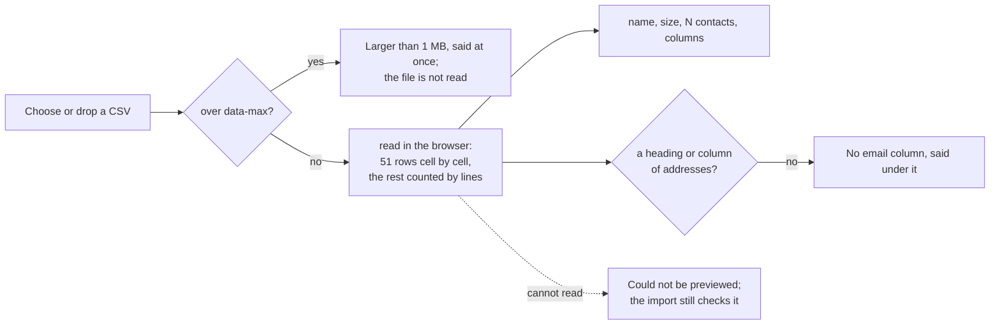

# Lists made plain and no blank fields

> **In plain words.** The owner found a list's Add people page confusing on a phone: a tall
> header, long instructions, circled chips everywhere and a bare "Choose file" box. He asked for a
> template and its variables picked so no email goes out blank, and for people added from the ones
> already emailed. Oltrem Mail rebuilt the Lists pages around three ways to add contacts as cards,
> offers the people you emailed to tick, and a campaign now refuses to start while anyone would
> get a blank variable. The kit's part is the file preview and taking the new Mail in. The full
> account is
> [Oltrem Mail's record](../../vendor/mail/published/archive/records/2026-11-14-lists-add-contacts-and-personalization.md).

## What the kit changed with it

| Area | Before | Now |
|---|---|---|
| The frame script | A chosen file showed as the browser's own "Choose file, No file chosen" | `data-file-peek` fills the block it names with the file's name and size, its rows and its headings before it is sent, and one warning: no column of addresses, over `data-max` bytes (then not read), or unreadable |
| `vendor/mail` | Oltrem Mail 46d713d | Oltrem Mail 7d8f1ff |
| The client template's tests | The old Lists words | The new ones: Permission to email them, the list has N contacts, the last import line |

The stylesheet is 166 KiB, under its 172 KiB cap.

## How it works now

Nothing is sent by the preview: the form posts the file as before, and the import's own checks
decide. A second file chosen while the first is read takes over; the first one's answer is dropped.

## How it was checked

- `packages/screens/test/frame.test.ts`: 120 contacts with a quoted comma, the headings, the
  warning for no address column, a file over the limit not read, an unreadable file said.
- `templates/client/test/screens.test.ts`: the Lists journey with the new words, against the
  vendored Mail.
- Oltrem Mail's verify, 11 gates, for 7d8f1ff; both review agents run on the change.
- The kit's `pnpm verify` once for the batch. Phone tests P220 to P224 in
  [the email phone tests](../../docs/phone-tests-email.md).
