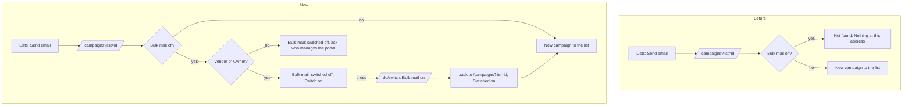
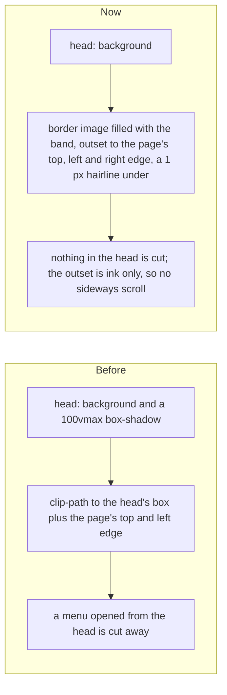

# A switched-off part says so with Switch on, and menus in a page head open again

> **In plain words.** The owner added people to a list on a phone and pressed **Send email**. The
> portal answered "Nothing at this address". Nothing was broken in the list: Bulk mail (the part
> that holds Campaigns) had been switched off on the Modules page the day before, and the pages
> of a switched-off part answered the same Not found as a mistyped address. Now such a page says
> which part it belongs to and that it is switched off. The Vendor and Owners get **Switch on**,
> one press that switches the part on and comes back to the same address with its query, so Send email ends on
> the new campaign for that list. The same day the list's three dot menu opened to nothing. The
> coloured band behind every page head was cut to the head's shape with a `clip-path`, and that
> cut away any menu opened from the head. The band is now drawn so it cuts nothing.

## What the owner saw, and what changed

| He saw | Cause | Now |
|---|---|---|
| Send email on a list: "Nothing at this address" | Bulk mail was off; every page of an off part answered Not found | "This page is part of Bulk mail, switched off in Settings, Modules", with **Switch on Bulk mail** for the Vendor and Owners; anyone else is told who can |
| The list's ⋮ More did nothing on a phone | the head's band used `clip-path` to stop at the head's edges; the menu opens as a sheet at the foot of the screen, outside the head, so it was cut away. A head with tabs under it was drawn another way, which is why the menu worked while Bulk mail was on | the band is the head's border image (`border-image-outset`), which paints outside the head and cuts nothing inside it |

## How it works now

### Opening a page of a switched-off part

- The screens' gate still refuses the page while the part is off (404), but a page opened in the
  browser (`GET`) is the `PartOff` card in the frame, under the part's name as the Modules page
  shows it. A form posted to such a page is still the plain Not found.
- **Switch on** posts to `/do/switch` with the part's id in `ids` and `on`, through
  `PUT /api/settings/parts`. The Modules page's permission, recent sign-in and audit row apply.
  It is offered only where `maySwitch` already offers switches (the Vendor and Owners), and only
  for a part the Modules page lists and that is not core, so the button never does nothing. A
  part it needs that is off too (Bulk mail needs Email) is switched on in the same press, and
  the card says so.
- `back` is the address opened, without its `done` word. It is accepted when it is a path on
  this portal with its query in printable ASCII, without spaces, quotes, angle brackets, `#` or
  `\`, and never `//` or `/\` (another site). An encoded id or an address in a filter comes back
  as it was; anything else returns Home.
- The answer says `switched-on` when every id posted was switched on, and `switched` otherwise.
  A module's own page (Campaigns is Oltrem Mail's) now shows the kit's own word for these two, as
  the kit's pages already did.
- The extras' switches at the top of a part's first page are not drawn while the part is off.

### The band behind a page head

## What was left as it was

- Oltrem Mail's list page still shows Send email while Bulk mail is off. It leads to the page
  above, which says why and switches it on in one press. Hiding the button would need a read of
  the parts on every list page.
- The phone's menu sheet has no shade behind it, as before. A tap outside closes it.

## How it was checked

- `packages/screens/test/switches.test.ts`: an off part's page names the part, offers Switch on
  with the address and its query for an Owner and none for a member, a form posted to it is a
  404; a core part's page has no extras row and no button; a part that needs another part that
  is off takes it along; Switch on returns to the address with its query and
  `done=switched-on`, an encoded id and an address in a filter kept; a `back` of another site,
  markup, quotes or `#` returns Home.
- Both review agents (TypeScript and silent failures) were run on the change. Fixed from their
  findings: `back` addresses with an encoded id or an `@` went Home, Switch on for a part needing
  another off part was refused in confusing words, and a core or unlisted part showed a button
  that did nothing.
- `templates/client/test/screens.test.ts`, the whole flow in the client portal: the Owner makes a
  list and adds a contact, the list's page links Send email to `/campaigns?list=…`, the Owner
  switches Bulk mail off, Send email shows "This page is part of Bulk mail" with Switch on, the
  press returns to the same address, and the page is "New campaign to Spring guests" with
  "Switched on". `templates/client/test/parts.test.ts`: an off part's page now names the part.
- `packages/core-ui/test/theme.test.ts`: the head's band is its border image, and no head rule
  carries a `clip-path`.
- In a browser at 388 px and 1280 px, dark, on the local portal with Bulk mail off: the list's ⋮
  opened as a sheet that took the press (before, the sheet was there but cut away), Edit name
  and description opened its dialog, the page did not scroll sideways, and Send email showed the
  off page. The live portal's own records were read (read only) for the cause: its Modules list
  had Bulk mail off since 13 November.
