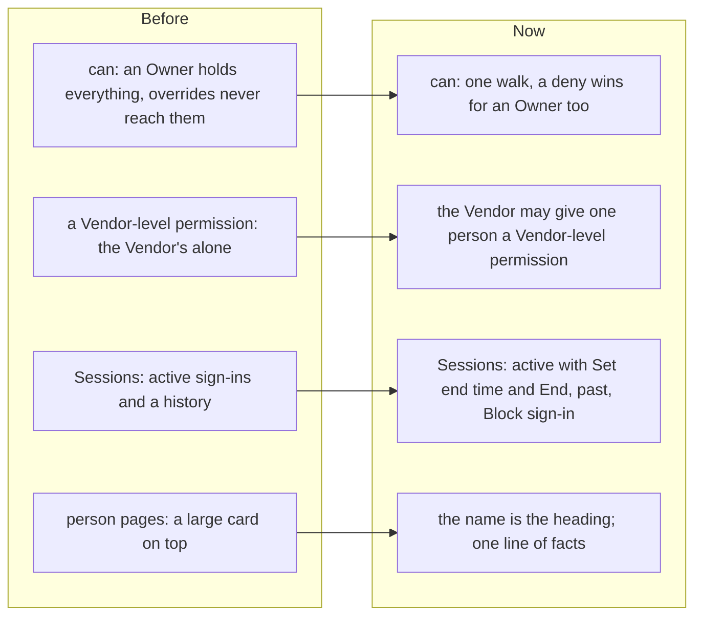

# Users list, sessions, blocking and Owner overrides

> **In plain words.** The owner sent two phone screenshots of a client's Users pages and asked
> for four things. First, a tidier Users list with a smaller Invite button. Second, overrides that
> can take a permission from one Owner, or give someone a Vendor-level permission. Third, a
> Sessions page that shows active and past sessions, can change or end an active one, and can
> block someone for a while or for good. Fourth, no big info card on a person's pages, and
> professional wording throughout. All of that is now in place. The permission check still reads
> nothing from the database on a request.

## Why

The owner's words: "have a specific owner with less permission or add vendor level permissions
if needed", "we should be able to see past session, active sessions, change existing or active
session, kill active session, block user temporary or permanently", "There shouldn't be big user
info box on top", "Even pixel level boxes, section, filter size is important", and "Review
wording of everything". Until now, overrides skipped Owners entirely, and nothing below the
Vendor could carry a Vendor-level permission. A person could only be switched off; there was no
block that ends on its own date.

## What changed

| Part | Now |
|---|---|
| The check (`can`) | An Owner with no deny of their own is answered at once, as before. Otherwise one walk from the scope to the root: a deny on any node wins, for an Owner too. A Vendor-level permission is held only through an allow the Vendor gave. An Owner holds everything else, and anyone else needs an allow. No network. |
| The compile | An Owner is narrowed only by their own denies, never by a role's deny that reaches them through a group. An allow override counts for a permission with no floor. It also counts for a Vendor-level one, but only when the Vendor wrote it: the compile joins `granted_by` and checks this again, whoever wrote the row. |
| Who may change overrides | An Owner's: the Vendor, or another Owner. An Owner's People and access permissions: the Vendor alone, so two Owners can never strip each other of the means to undo it. Anyone else's: only someone ranked above every role they hold. An Owner-level permission can only be taken from an Owner, never given. A Vendor-level one is given and ended by the Vendor alone. Nobody changes their own overrides. |
| Blocking | Migration 0065 adds `iam_principals.blocked_until` and `signed_out_at`. Block sign-in until a date, or permanently (which deactivates the account). Either way, every session ends at once: the time is kept, the tenant's policy version moves, and the stored sessions are removed. An Owner can never be blocked, and nobody can block themselves. While blocked: `KIT-E-2017`. Afterwards, sign-ins made before the block stay ended (`KIT-E-2006`), so a browser it signed out must sign in again; one made during the block works. A stored session that outlives its removal (a KV failure, a request under way) is refused at the next recheck, within five minutes. |
| Sessions page | Sign-in state, with Block sign-in (1 hour to 30 days, or Permanently, plus an optional reason) or Unblock/Reactivate. Active sessions, each with Set end time (1 hour to 30 days, or Never) and End session. Sign out everywhere. Past sessions: ended sessions and earlier sign-ins, one row per browser, newest first. |
| Users list | A small Invite button beside the heading (new `chip` button size). Each row has two lines: the name (and email), then the roles and last sign-in. A pill appears only for Blocked or Deactivated. A Blocked chip appears only when someone is blocked. |
| Person pages | The name is the page heading and the email sits under it. Below that, one line: state, roles, last sign-in, member since. Then the tabs: Overview, Permissions, Overrides, Sessions, Activity. The large card is gone. |
| Rows | A row's actions wrap under its text on a phone instead of squeezing it (`.ui-row` in `theme.css`), across every page that uses rows. |
| Wording | Every Users and access message reviewed for plain, standard terms: "Revoke" an invitation, "Add a role", "Remove role", "Deactivate", "Allowed for them" or "Denied for them", "End override", and no middle dots. |

No new environment variable, binding or table: one column on an existing table. The only extra
reads happen when someone changes an override or a block, never on a page view. The page query
pins in `templates/client/test/__snapshots__` are unchanged.

## Lockout

- An Owner can be narrowed only by the Vendor or another Owner, never by themselves, and their
  People and access permissions only by the Vendor.
- A deny is only given by someone who holds that permission.
- The last Owner can never be deactivated or blocked.
- The Vendor itself is never checked against overrides.
- An Owner's session compiled before this change keeps its old map until it recompiles, which
  happens at the next policy change and at most a day later.

## How it was verified

- IAM tests (94): the Owner's own deny, a group's deny not reaching an Owner, an Owner's People
  and access deny counting only from the Vendor, `narrowed` set and cleared, a Vendor-given allow
  on the Vendor floor, the governance refusals, blocks (a sign-in during one let in after it), the
  same-second cut-off, a session that outlived a block refused at the recheck, and session ends. Users tests (10): block, unblock, refusals, session end time. Screens tests (130):
  the list, the head, active and past sessions, the dialogs, and the editor in its Owner and
  Vendor modes. Template page tests (46): the full journey, including set end time, block,
  Blocked filter, unblock and the activity lines, with page query pins unchanged.
- Screenshots at 390 px, before and after, on the local portal.
- Both review agents (TypeScript, silent failures) ran on the change before the push. Fixed from
  their findings: one Owner could deny another Owner's People and access permissions; an Owner's
  checks walked the tree on every request; the Users module's audit failures went unreported in
  the client; a block whose session removal failed left the session working; a sign-in made
  during a timed block stayed refused after it; the ended sign-in message named only the
  sessions list. Left as it was before this change: ending or timing one session rewrites the
  stored record, so a request writing it at the same moment can undo that one change; Sign out
  everywhere and Block do not depend on it.
- `pnpm verify` green before the push.
- Not verified: on a real phone (P213 to P219 in [Phone tests: Users](../../docs/phone-tests-users.md)).
