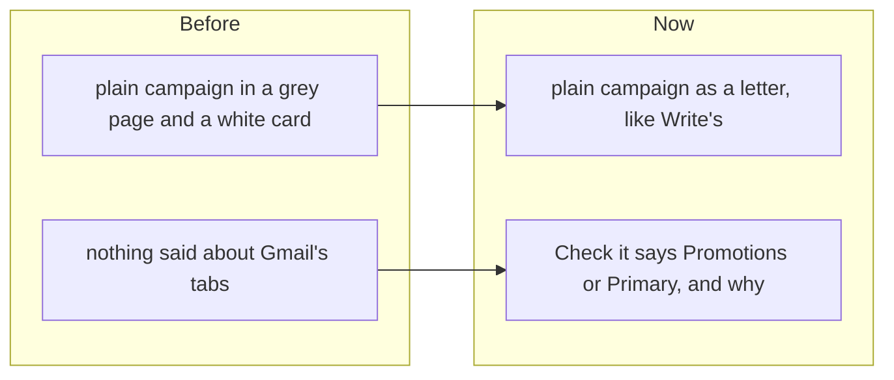

# Campaigns go as plain letters, and say which Gmail tab they will reach

> **In plain words.** The owner's first campaign reached its four people, in Gmail's Promotions
> tab, and he wrote: "It should land in Primary otherwise no one would even look at buying our
> product". No portal, provider or setting can choose the tab: Gmail decides for each person. What
> a portal can do is add no sign of an advertisement itself, and say which signs an email still
> carries before it goes. A campaign's plain message used to go out in a grey page with a white
> card; it now goes as **a plain letter**, the way a person's own mail app sends one. And the
> campaign's **Check it** step now says which tab it will most likely reach, and why.

## What was taken in

| Package | What a person sees |
|---|---|
| `@oltrem/campaigns` | A plain campaign arrives as a letter: no coloured page, no card, the footer and Unsubscribe a small grey line under the words. Over the preview: **Gmail will most likely put this under Promotions**, naming each sign (an offer in the subject, shouting, many links, a design, a From name that says newsletter), what to change, and Compose for a few people; or **It reads like a letter: the best chance of Gmail's Primary tab** |
| `@oltrem/email` | Write counts shouting (rows of exclamation marks, lines in capital letters) among the signs of a promotion it asks about once |

What was checked in the owner's campaign, what no portal can control (the tab itself, an offer
being a promotion, the unsubscribe link every campaign must keep) and what helps most are in
Oltrem Mail's record, published with the release:
[2026-11-15-campaigns-as-letters.md](../../vendor/mail/published/archive/records/2026-11-15-campaigns-as-letters.md),
and its setup page's section 6.

## How it was checked

Oltrem Mail's `pnpm verify` passed before its push; the kit's `pnpm verify` ran once with the
release in. The letter and the card were drawn side by side at a phone's width and compared.
Phone tests P246 and P247 are owed ([the Email list](../../docs/phone-tests-email.md)).

Not verified: which tab Gmail picks for the next campaign. Only a new send to real Gmail
addresses shows it.
