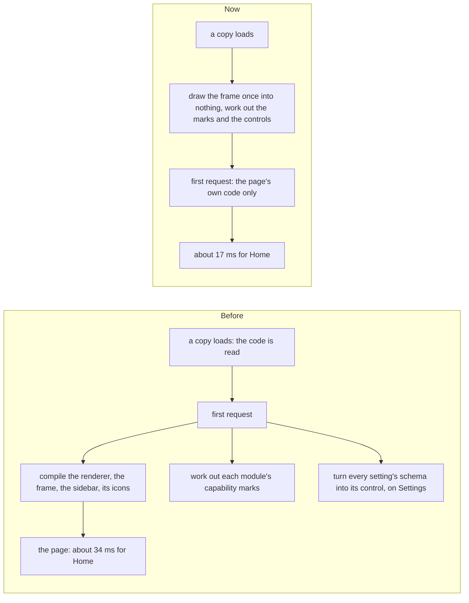

# The CPU of a fresh copy's first page

> **In plain words.** System status showed the Worker's CPU time per request at the 95th
> percentile as 27 ms on 14 Nov and 43 ms early on 15 Nov, against the free plan's 10 ms. The
> pages themselves cost 4 to 8 ms once warm, and the minute's cron tick about 1 ms. What costs
> more is the first page a fresh copy of the Worker serves: Cloudflare starts a new copy when
> none is running near the visitor, and that copy compiles each piece of code the first time it
> runs. On a portal few people use, most page visits are such a first one, so they set the 95th
> percentile. The work that reads nothing is now done while the copy loads, which the plan does
> not count against a request: Home's first request went from about 34 ms to about 17 on this
> computer, and the Settings page's from 22 to 31 ms to about 17. The measuring tool, `pnpm cpu`, also
> counted time spent waiting as CPU, which made the cron tick look like 65 ms; it no longer does,
> and it now shows each page's first request beside its warm ones.

## What the live portal showed

The portal's account holds one Worker, the portal itself (the Cloudflare connector's Worker
list), so the budget's account-wide figure is the portal's. 340 requests by 02:43 UTC: about one
a minute is the cron tick, the rest pages and the calls they make. The 95th percentile is the
costliest 1 in 20, which is the first pages of fresh copies.

## What changed

- **The frame drawn once while the copy loads** (`warmFrame` in `@oltrem/screens`): the whole
  sidebar, the account menu and the bell, rendered to a string that is thrown away. It reads
  nothing and shows nothing; a fault in it is printed for Workers Logs and the Worker starts as
  before.
- **The capability marks** (`@oltrem/iam`): the fingerprint of each module's declared
  capabilities, compared with the registry on a copy's first request, is worked out while the copy
  loads, through a new optional `prepare(modules)` on the startup hook that `createApp` runs. A
  list it was not given is worked out on the call, as before.
- **The settings' controls** (`@oltrem/core-config`): each setting's control (a switch, a choice,
  a number with its limits) comes from its schema; they are read while the copy loads for every
  setting defined by then, instead of on the first Settings page.
- **`pnpm cpu`** counted each sample's time up to the next one. The runtime samples running code
  every 50 to 100 µs and takes no sample while the copy waits; a sample before a wait was counted
  with the whole wait (a tick of under 2 ms read 65 ms). A sample now counts at most 500 µs
  (`GAP_US`). Each page's first request is profiled too, in a new "first" column.

## On this computer

`pnpm cpu / /settings`, three rounds a page, the Worker minified as it is deployed, run four times
with the code before and after taking turns, so a busy moment of this computer lands on both.
"First" is the page's first request in a fresh copy.

| Page | First, before | First, now | Fastest warm, before | Fastest warm, now |
|---|---|---|---|---|
| Home | 33.4, 34.7 ms | 18.3, 16.6 ms | 8.1, 6.7 ms | 5.9, 6.0 ms |
| Settings | 31.2, 21.7 ms | 17.2, 16.4 ms | 7.7, 7.7 ms | 8.8, 8.7 ms |

A full `pnpm cpu` of every page, before and after, agreed for these two (Home 30.9 to 20.9 ms,
Settings 25.4 to 14.6 ms) and showed no other page moving by more than its 2 to 3 ms of noise
between runs; the cron tick was 1.1 ms before and 0.2 ms after, both small.

## What it does not change

A fresh copy's first page still compiles the page's own code and its calls to the portal's API,
about 17 ms for Home on this computer. The live 95th percentile will fall but is likely to
stay over 10 ms while few people use the portal; the warm pages and the tick are well under it.
For a standard Worker Cloudflare counts only the time a request's code runs, not the copy's start
(its Dynamic Workers pricing page sets the two apart), which is why the work moved there; the
start, about 125 ms of its 1 s limit before, has room for it.

## How it was verified

Tests: `pnpm cpu`'s sums (a 64 ms gap ended by an idle sample counts 500 µs; the first column);
the startup hook's `prepare` run once while the app is made, and one that throws leaving the app
to start (`packages/core-http`); the marks of a list not prepared worked out on the call
(`modules/iam`); a setting defined after the settings module was made still showing its control
(`packages/core-config`); the frame drawn with the whole sidebar saying nothing, and a fault in
it printed, never thrown (`packages/screens`). Profiles read by hand with the runtime's inspector
for Home, Settings, Email, Providers and the tick. `pnpm verify` before the push. Nothing on the
phone changes; System status shows the new figure from the day after the deploy.
