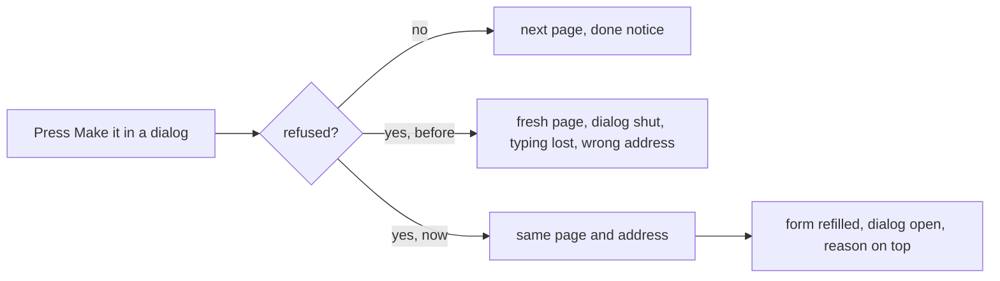
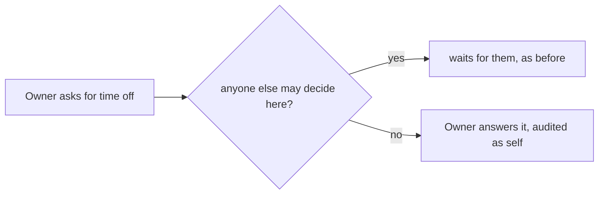

# Every journey walked and fixed

> **In plain words.** The owner asked for the portal's flows to be checked and fixed. Five
> audits walked every journey a person takes, area by area (people and access, the work
> modules, team and sales, the system pages, and Oltrem Mail), in a real browser and in the
> code. They found the same few faults again and again, and each was fixed once where it is
> shared and module by module where it is not. A form that is refused now keeps what was typed
> and stays where it was. A company run by one Owner (or the Vendor alone) can answer its own
> requests, because nobody else can. A page says an email is queued, or waits for an email
> service, instead of claiming it was emailed. And a refusal names what to do, with a link to
> do it.

## 1. A refused form keeps what was typed

| Before | Now |
|---|---|
| A form sent from a dialog and refused came back as a fresh page: the dialog closed, everything typed was gone, and the address was the form's own, so a reload showed an error | The page stays at its address, the form is filled again with what was sent (never a password or a file), and its dialog opens again with the reason at the top |
| The refusal's title was "Invalid input" | "Check what you entered", and the reason names the field |

The browser script (`frame.js`) does this once for every form: a refused answer carries
`data-refused` on its notice (`Toasts refused` in core-ui), and the script refills the form whose
address matches the one sent. Without the script the page works as before.

## 2. One person can run the company

A portal often has one Owner, or only the Vendor, for a long time. Before, time off, expenses,
hours, approvals and campaigns over the approval limit all asked for "someone else", who did not
exist, so the request could never be answered. Now an Owner or the Vendor may answer their own
when no other active person can decide at that place; the audit row says `self: true`, nobody
is emailed about their own answer, and wherever another decider exists the separation stays.
A member whose place has nobody to decide is told so, with a link to invite someone.

## 3. Queued is not emailed

Invitations, quotes, invoices, shifts, time off, files shared with a customer and campaign
tests said "emailed" the moment a message was put in the outbox. They now say it is queued, and
where the portal has no working email service, that the email waits for one, with a link to
Email settings. Quotes and invoices also have "Email it again".

## 4. What else each area got

| Area | Fixed |
|---|---|
| People and access | invite refuses an existing account or a pending invitation; Send again, Copy link, Revoke with a question; Accept lands on Home with "You joined"; a used link explains itself; two sibling places cannot share a name; Make Owner asks first |
| Work | Bookings keep the day on a refusal and book beyond a week; Tasks can be given to oneself; Automations made in one dialog, switched on, events in words; Files: Copy for links, Undo for the trash, a share refused for someone who is no customer; Analytics in words |
| Team and sales | a quote or invoice goes only to a customer; an accepted quote offers Make the invoice and is not billed twice; shifts publish only where drafts wait; address fields suggest the company's people; refusals link what they clash with; the customer page shows their quotes and invoices; Decline asks first on the customer's account page |
| System pages | error alerts have Mark resolved and fold their detail; Deployments say Computer or Fleet; a job that is off says so; backups on a new portal raise no false alert; unticking Customers switches Quotes and Invoices off with it |
| Oltrem Mail | its own record, in Oltrem Mail's documents |

## 5. Speed

Measured, not changed: the first-request CPU pass earlier the same day had already halved a
fresh copy's first page (about 34 ms to 17 ms). Drawing the sidebar twice costs about 0.2 ms
on a warm request, so it was left as it is. Shifts and Time clock read one more query each (the
company's people for the address suggestions), pinned in the template's query test.

## How it was checked

- The five audits, each walking its area as the Vendor and as the Owner on the local portal,
  every finding checked in the code before it was fixed.
- The frame test (a refused form keeps its address, is refilled and opens its dialog; a page
  that is not a refusal is left as drawn), and the same in a real browser: Tasks, a task given
  to an address nobody has, the dialog reopened with the title, address and notes kept, and a
  reload showing Tasks.
- Each module's own tests, with new page tests for bookings, tasks, approvals, automations,
  files, analytics, quotes, invoices, customers and privacy, and the self-answer tests (refused
  where someone else decides, allowed where nobody does).
- The template's journey tests (49), updated for the queued words, the self answers and the new
  redirects; the full `pnpm verify` before the push (summary in the commit).

Not verified: any of this on a phone (P251 to P294 in
[their own list](../../docs/phone-tests-flows.md)); a send through a real email service.

Left, each for a later change: a stored link from an invoice to its quote (needs a migration;
until then a quote is matched on its address and title); erasing a person's rows for a privacy
request (a change to every module's contract); retiring a role or group that was ever given
(needs a migration); a page for one delivered message; the audit log's "To what" in words;
automation schedules on the company's clock; an Owner's own request answerable alone is reached
from "Asked by you" but not yet counted in Approvals' waiting list; Alerts' buttons shown to a
person who may only read them; and `iam.expiring` and `iam.reviews` start on, which the owner may
want off for a one-person company.

Two reviewers (access and code) read the change before the push. From them: a refused form now
refills the form of the row that was sent (its hidden fields must match), and only a refusal keeps
the page's address; the check for someone else who may decide looks at no more than ten people,
and with more takes it that someone does, so it can neither miss a decider nor run long.
