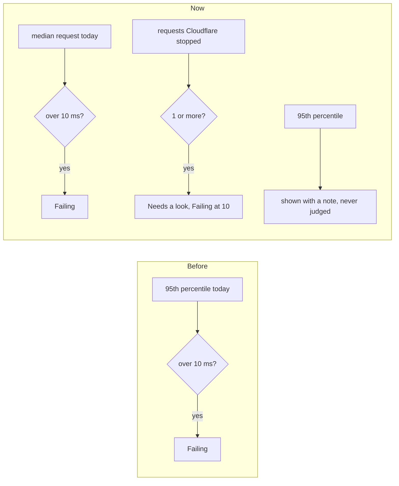
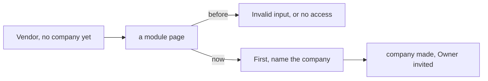

# A team of twelve reviewers, a CPU check that judges what Cloudflare judges, and module pages before the company exists

> **In plain words.** The owner asked for the kit's two review agents to become a team of many
> specialists, and for the portal's flows to be checked and fixed. Three things came of it. Ten
> new reviewers join the two taken in on 14 November, each knowing one subject and this kit's own rules
> for it, with a skill that says which to run for a change. System status stops calling the live
> portal's CPU failing because of its first requests after a quiet spell, which Cloudflare allows;
> it now judges the typical request and counts the requests Cloudflare actually stopped. And before
> the company is named, the fourteen module pages that showed "Invalid input: the company is made
> first", and the six that told the Vendor a permission was missing, now show the company form, as
> Home and Users already did.

## 1. The review team

| Before | Now |
|---|---|
| `typescript-reviewer` and `silent-failure-hunter` ([the record](2026-11-14-review-agents-from-ecc.md)) | those two, plus `security-reviewer`, `access-reviewer`, `data-reviewer`, `free-plan-reviewer`, `flow-reviewer`, `phone-ui-reviewer`, `accessibility-reviewer`, `plain-words-reviewer`, `test-reviewer`, `docs-reviewer` |
| no rule for which to run | `.claude/skills/review-team/SKILL.md`: who looks at what, the team for each kind of change, one brief for all, every finding checked in the code before it is acted on |

Each reviewer reads and reports only: none edits, commits or pushes, and none replaces
`pnpm verify`. Oltrem Mail has a thirteenth, `mail-reviewer`, for the four mail laws, in its own
repository.

## 2. CPU time on System status

The live portal's 95th percentile was 43 to 49 ms a day against a 10 ms budget, so System status
read Failing. Measured locally, a warm page costs 4 to 12 ms; the slow ones are the first requests
a fresh copy of the Worker answers after a quiet spell, which a portal with a few hundred requests
a day meets often. Cloudflare's limits page says each isolate has "some built-in flexibility" for
a Worker that runs over the limit now and then, and stops only one that does so consistently; a
stopped request shows in its analytics as `exceededResources`.

The same one GraphQL call asks for both, so no extra request is made. The rows and their limits
are in [core-health's README](../../packages/core-health/README.md).

## 3. Module pages before the company exists

A new portal's Vendor could open Tasks, Invoices, Campaigns, Compose and ten more pages before
naming the company, and each showed "Invalid input: the company is made first, correct the fields
listed under errors": a dead end that blamed the person. Analytics, Automations, Privacy,
Developer, Templates and Lists said the Vendor lacked a permission that nobody can hold until the
company exists. Every module page, and the kit's Records and Forms, now shows the company form at
that point; the rule is kept in [the screens README](../../packages/screens/README.md). The
portal's own pages (System status, Settings, Look, Notifications, the delivery log, Integrations)
still open as themselves.

## How it was checked

- The core-health budget tests: the median judged, one stopped request warns and nine fail, the
  95th percentile never named as the reason, `exceededResources`, `exceededCpu` and
  `exceededMemory` counted and nothing else. The screens test: an informing row shows its figure
  alone, in the table and in the copied report.
- Every page the sidebar links, opened as the Vendor before the company existed: 47 pages, the
  twenty above refused, after the change none does. A new screens test keeps eleven of
  them and three of the portal's own pages.
- After the company and its Owner, every page three links deep from Home, as the Owner and as the
  Vendor (174 pages each), searched for error words: none found.
- The full `pnpm verify` before the push (summary in the commit).

Not verified: the five full flow audits by `flow-reviewer` stopped on the account's usage limit and
were not run again; the live portal's System status after the deploy (phone tests P248 and P250).
