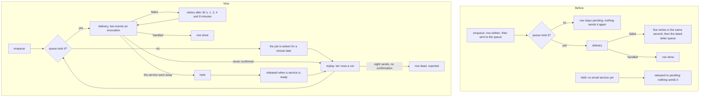

# What did not land is sent again, and has an end

> **In plain words.** The portal writes every event (an email to send, mostly) into a table
> called the outbox before it hands it to Cloudflare's queue, so that anything the queue loses
> can be sent again. A review of the whole codebase found that the part that sends again was
> written and tested but never called: nothing in a running portal ever ran it. A message the
> queue refused, or one held until an email service was connected, stayed where it was for ever.
> That is now wired to a job, with three things beside it so that sending again can never mean
> sending twice or sending for ever: failed deliveries wait between tries, the queue hands the
> Worker two events at a time instead of 25, and every message has a last try after which it
> says in words what happened.

## What was wrong

| What | Where | What it did |
|---|---|---|
| Nothing called `replay` | `packages/core-outbox`; no caller in the kit or in Oltrem Mail | a message released after an email service was connected stayed `pending`; one the queue refused was never tried again; one no delivery confirmed was never sent again |
| The sent mark overwrote `done` | `outbox.ts`, after the queue took the event | a consumer quicker than that write lost its `done`, and the row read as never confirmed |
| A failed event was retried at once | `packages/core-http/src/worker.ts`, `message.retry()` | the queue's five retries were spent within the same second, while the provider or the database was still down |
| 25 events an invocation | `templates/client/wrangler.jsonc`, `max_batch_size` | one email costs up to 20 database queries and the free plan allows 50 an invocation, so a batch failed from its fourth message on |

## How it worked, and how it works now

Before, the only way back for a message was the queue's own retries, and they were over in a
second. Now the outbox is the way back: a job replays it, each row waits one step longer on the
ladder each time (an hour, an hour, an hour, two hours, then twelve), and after eight sends that
no consumer confirmed the row is `dead` and the job reports it.

## What changed, by part

- **`@oltrem/core-outbox`.** `replay` sends a `sent` row again no sooner than its own next time,
  so a delayed event is not sent before its wait ends and each send again comes later than the
  last. The sent mark never overwrites `done`. New: `hold(key)`, for a consumer that cannot take
  an event until something changes (the row is held again and `release(type)` brings it back),
  and `maxSends` (8), after which an unconfirmed row is `dead`. Its README says who calls
  `replay`.
- **`@oltrem/core-http`.** A failed event goes back to the queue with a wait: `retryDelay`, half
  a minute doubling with each delivery, an hour at most.
- **The client template.** `max_batch_size` 2 and `max_batch_timeout` 1 second. A test in the
  tool's suite pins both, since every portal is built from this file.
- **Oltrem Mail** (its own record has the detail). The `email.release` job replays the outbox,
  ten rows a run. A delivery writes the route it is about to call on the message first, so one
  cut short after the provider's yes is asked again only there. A message is asked on the route
  that may have sent it six times in all, and one every service refused for now thirty times;
  then it fails in words. A database write that fails after the provider's yes is never read as
  the provider failing. A campaign call answered 500, 502 or 504 is treated as "may have been
  sent", as queued mail already was.

## What a client sees

Nothing new on a page. An email that used to stay "queued" or "waiting" for ever now leaves, or
ends as "not sent" with the reason. On the one live portal read on 2026-11-17 every outbox row
was `done`, so switching the replay on sends no old mail there.

## How it was checked

- The outbox's own tests, inside the Workers runtime on a real local database: 20, with new ones
  for the delayed row, the ladder of an unconfirmed row, the `done` the sent mark leaves alone,
  `hold` and its release, and the end after eight sends.
- The queue handler's test of the waits (30, 60, 480 and 3,600 seconds).
- The template's consumer settings pinned by a test.
- Oltrem Mail's tests of each case, each seen failing against the code before the change.
- The full `pnpm verify` of both repositories; the summary line is in each commit.

Not checked: a real provider outage, or the queue refusing a send on a live portal. Both are
simulated in the tests.

## Left for the owner

One choice. After an answer that is not clear (a timeout), the portal asks the same email
service again, up to six times. A service that knows the message's key (Resend) answers with the
email it already took. The others would send a second copy if the first did leave. The stricter
rule is to stop after the first unclear answer on those services and say "may have been sent";
a person then presses Send again. It is asked in the thread of this review.
