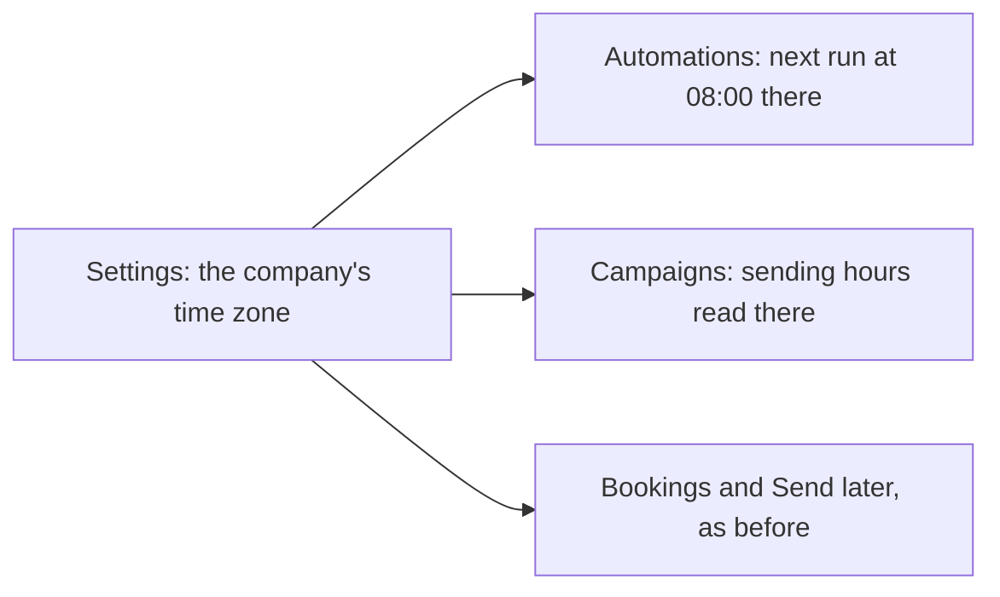

# Four items left on 15 November, finished

> **In plain words.** [The flows record of 15 November](2026-11-15-flows-fixed.md) left a list of
> things for later. The owner asked on 20 November for the open work to be finished. Four of those
> items needed no decision from him, and they are done here, in one push. The others still need a
> migration, a change to every module, or his choice, and stay on that list.

## What changed

| Before | Now |
|---|---|
| An Owner alone could answer their own request, but Approvals' For you and Home's Needs you did not show it | It is in For you, counted, and in Needs you, wherever they may answer it alone |
| Alerts showed I am on it and Mark resolved to someone who may only read them, and then refused the press | The list says whether the caller holds `alerts.manage` (`manage`); only then are the buttons shown, and a reader sees who took each alert, or Nobody yet |
| Automation schedules ran on UTC; campaign sending hours on the alerts' quiet-hours zone | Both run on the company's clock, the time zone bookings and Send later use (`bookings.time_zone`); the form and the page name it |
| `npm run deploy` wrote `autoUpdate` back to true when the Vendor had set it false by hand | A deploy keeps a false set by hand; one it wrote itself for the client's own modules still ends with them |

A schedule made before keeps its hour and minute, read on the company's clock from its next run
(the run already planned keeps its time once). A portal whose company time zone was never set
reads both on UTC: its schedules do not move, and its sending hours move only if the alerts' zone
had been set apart from it. A zone the clock does not know is read as UTC and reported, so one bad
value cannot stop every schedule. A hand-set false goes back to the updates when it is set to
true in the row again ([the fleet](../../docs/reference/fleet.md)).

## Still left

From the 15 November list: a stored link from an invoice to its quote and a retire flag for roles
and groups (each a migration); erasing a person's rows for a privacy request (every module's
contract); a page for one delivered message; the audit log's "To what" in words (each module would
name its own rows, and someone who may read the log could then read a record's name they may not
open, which is the owner's call); and whether `iam.expiring` and `iam.reviews` start on for a
one-person company (asked).

## How it was checked

- Approvals tests (10): For you and Needs you list one's own request where one may answer it
  alone; the test fails without the change.
- Alerts tests (17): `manage` false for a reader, true for whoever may act; the screens' Alerts
  table tests (4): no buttons and Nobody yet for a reader.
- Automations tests (19): schedules in Mexico City, India and across London's change to summer
  time; one made through the route on the company's clock, the list naming it; a zone the clock
  does not know read as UTC; the form's time field naming the zone.
- The cli fleet tests (29): the deploy's record run on SQLite keeps a hand-set false and ends a
  false written for the client's own modules.
- Two reviewers (access, TypeScript) read the change; from them, the unknown zone read as UTC,
  each hourly slot taken from its own wall hour, and the record's SQL nested so its JSON functions
  read only the choices row.
- The full `pnpm verify` before the push (summary in the commit).

Not verified: any of this on a phone (P295 to P298 in [their list](../../docs/phone-tests-flows.md)), or
D1's own JSON functions against Cloudflare (the same SQL ran on SQLite).
