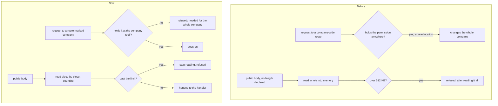

# Security and access: what the review found and fixed

> **In plain words.** The second part of the full review looked at who may do what and at what
> the portal accepts from outside. Five things were tightened. A person given a permission at
> one location only could reach a few pages that change the whole company (its settings, its
> email services, its activity log, its backups); those are now for the company alone. A sign-in
> that was ended could come back for a few minutes on another server; it now stays ended. The
> public addresses (an email provider's reports, a website's form, the customers' sign-in) read
> a body only up to its limit, even when the sender does not say how long it is. Calls the
> portal makes to outside services give up after a set time. And a few small holes: a broken
> link that showed an error, an invitation accepted twice at once, a webhook's secret written
> into the activity log, a search where `_` matched any letter. Nothing a person uses day to day
> looks different.

## What was wrong, and what it is now

| Severity | What | Where | Before | Now |
|---|---|---|---|---|
| High | Company-wide routes checked "holds it anywhere" | `core-http` authorizer; 20 routes in core-audit, core-config, providers, backup, customers | someone given the permission at one location could change the company's settings, email services, backups or sign-in services, or read the whole activity log | a route marked `company: true` asks for the permission at the company itself (`can` at the root); its refusal says "for the whole company" |
| High | An ended sign-in could come back | `modules/iam/src/sessions.ts` | the session's KV record could expire before the door's own day ended, and a server that had not seen the end rebuilt it | the record is kept until the door's day is over (sign-in time plus one day), so the end is read everywhere |
| Medium | A body with no declared length was read whole | public hooks (`core-http`), the records' CSV import, the customers' door | the length a sender declared was checked; one sent in pieces, with none declared, was read into memory before its size was known | `readCapped` stops at the first byte past the limit; a test sends four megabytes in pieces and sees no more than the limit read |
| Medium | Outside calls with no time limit | the customers' sign-in services (details, token), the providers' probe | a service that hung held the page or the check | ten seconds for a sign-in service, twenty for a probe, as a send already had |
| Low | A webhook's address in the activity log | `modules/developer/src/webhooks.ts` | the whole address, path and query, which often carry the receiver's secret | the host only; the webhook's own row still keeps the address |
| Low | A webhook refusal read whole | the same file | a receiver answering an error with a long body had all of it read in the five-minute job | only its start is read (the 200 characters kept) |
| Low | An invitation accepted twice at once | `modules/iam/src/handover.ts` | a double tap or two tabs ended in an internal error, or a second grant for an existing account | the invitation is taken first, only while it waits; the second is refused in words, and a grant that fails leaves it waiting again |
| Low | A broken link on the customers' door | `modules/customers/src/door.ts` | a path that is not valid percent-encoding (`%`) was an internal error | it leads back to the account page or the sign-in |
| Low | `_` and `%` in a people search | `modules/iam/src/reads.ts`, `modules/users/src/people.ts` | matched any letter, or anything | taken as typed (`containing`, `ESCAPE`) |

## How it worked, and how it works now

A route that belongs to the whole company now says so in its definition, and the pipeline passes
that to the authorizer, which checks the permission at the company rather than anywhere. A route
open to any identity cannot be marked (the module is refused at load). The reference pages show
these routes as "at the company".

## What a client sees

Nothing new for the Owner or anyone given access at the company. A person whose role was given
at one location only, and who holds Settings, Integrations, the activity log or Backups through
it, is now refused on those pages with "needed for the whole company". Where the sidebar lists
such a page for them, it now opens to that refusal; hiding it is left as a follow-up.

## How it was checked

- Each fix has a test that runs inside the Workers runtime on a real local database, and each
  was seen failing against the code before the change: the 20 company routes pinned by name in
  the client template's test (25 once the kit took Mail's copy, with email's five); the authorizer's company check; an ended sign-in staying ended; a
  body sent in pieces stopped at the cap (all 64 pieces read before, at most ten now); an oversized import, an
  oversized door form; broken door links; time limits on every sign-in service call and the
  probe; the webhook audit host and the refusal read once; two acceptances at once; `_` and `%`
  in both people searches.
- The full `pnpm verify` of the kit; its summary line is in the commit.

Not checked: a real slow sign-in service or provider (the time limit is checked to be set, not
waited out), and a person with a location-only role on a live portal.

## Left for the owner (proposals, not done)

- **Grant only what you hold, by permission.** Today a person who may give access gives any role
  whose position is below their own, even one holding permissions they lack themselves; this is
  the rule the IAM README writes down. The stricter rule is that a role is given only by someone
  who holds each of its permissions at that place. It would refuse some grants a manager can make
  today, so it waits for a yes. Recommended: yes.
- **The sidebar for a location-only role.** Hide the company pages from someone who holds their
  permission only at a location, so the page they would open to a refusal is not offered.
  Recommended: yes, with the next look pass.

## Phone tests

| # | Open | You should see |
|---|---|---|
| P299 | As someone whose role was given at one location only, open Settings or Integrations | Refused, saying it is needed for the whole company; as the Owner, the same page works |
| P300 | An invitation link, opened in two tabs: press Accept in both | One account and one role; the other tab says the invitation was used or withdrawn |
| P301 | Developer, make a webhook whose address has a path; then Activity log | The log names only the host of the address |
