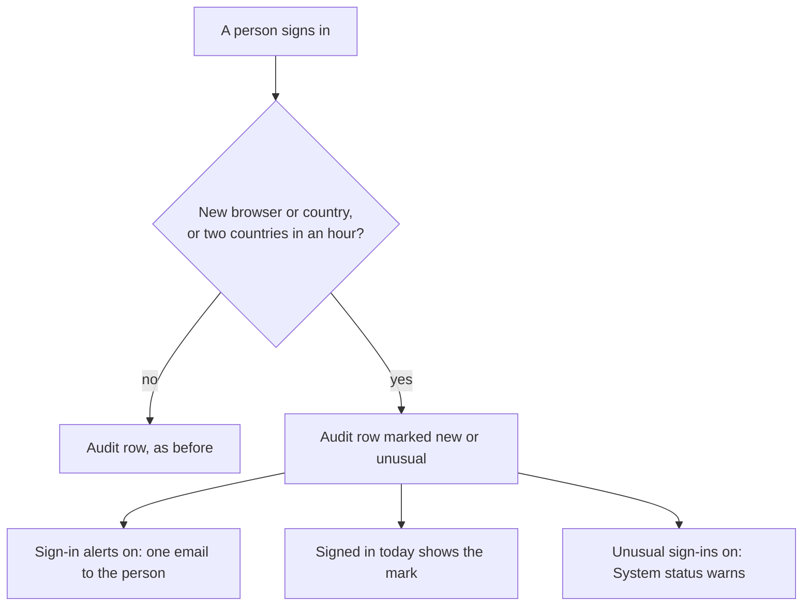
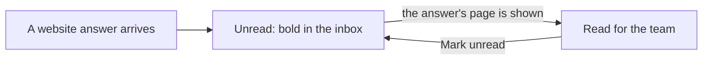

# Safer and calmer

> **In plain words.** The owner approved the first batch of the feature plan on 21 November
> ("begin next part"): things that make a portal safer and calmer, with no new key, binding,
> setting store or outside service. Nine features are built. Four of them are extras that send
> mail, warn, or read more on every Home, so they start off on every portal, new or old, and an
> Owner switches each on from Modules: Sign-in alerts, Unusual sign-ins, the What changed card and
> Service status. The rest add to pages people already open, and change nothing until used: the
> answers already in a form's inbox count as read, a file setting left at its default takes what
> it took before, and a link made without a passcode works as before.

## What changed

| Feature | Before | Now |
|---|---|---|
| Sign-in alerts (extra, off) | A sign-in was recorded and nothing was said | A sign-in from a browser or country the account had not used lately, or from two countries within an hour, emails the person with the browser, the country, the time and "sign out everywhere"; once a browser |
| Unusual sign-ins (extra, off) | Nothing watched the sign-ins | System status warns on two countries within an hour, or on 10 or more sign-ins refused in a week for addresses with no account; a refused sign-in is now recorded, once an hour an address |
| Signed in now | Each person's sessions, one person at a time | Users, Signed in today: who signed in within the last day, by person, from where, with the refused addresses; Sign everyone else out for an Owner or the Vendor; My access lists your own sign-ins with Sign out everywhere |
| File kinds and room | A file was judged by its name | Its first bytes are read too: a program dressed as a picture or a document is always refused; Allowed types may narrow to documents, or documents and pictures; Room per person may cap what each uploads (both off by default) |
| Better share links | A link that ends, and a download count | A link may ask for a passcode (ten wrong ones lock it) and may be emailed as it is made; each link shows when it was last downloaded |
| The deeper jobs page | Each job's last run | Each job's last 24 hours as a strip of hours, why the jobs wait while a budget is spent, and Check for work on the jobs that can say what waits for them, without running anything |
| What changed (extra, off) | Home showed nothing of others' changes | For whoever may read the audit log: what others did since they last pressed Mark as seen, by kind, each a link into the audit log |
| Read and unread | A form's answers had a status only | A new answer is unread for the team until someone opens it: bold in the inbox, an Unread view and count, Mark unread |
| Service status (extra, off) | System status checked the portal alone | It also reads Cloudflare's status page and those of the email services set to send, and needs a look only on a major outage one of them reports |

## Decisions

- **Marks that move on their own were avoided.** The frame fetches a page under the pointer
  before the tap. So What changed moves only when Mark as seen is pressed, and an answer is marked
  read by the frame script once its page is shown (`data-seen`), never when it is only fetched.
- **No write per request.** The sign-in comparison runs once, when a browser first signs in, and
  its result rides on the audit row the portal already wrote; the jobs' last day is kept in the
  run write the scheduler already makes; Sign everyone else out moves one version instead of
  touching each session.
- **Calm by default.** Service status never fails, so it never opens an alert: a minor problem
  somewhere in a large network is reported most days. Unusual sign-ins counts a few refused
  addresses in its words and warns from ten.
- **Old portals keep what they see.** Migration `0067` adds the four extras to a saved Modules
  list as off; `0071` counts every answer already in as read (one write for each answer, once) and
  indexes the unread ones; `0068`, `0069` and `0070` only add columns and an index.
- **What the extras switch.** Off, an extra stops its email, its warning or its card. The sign-in
  comparison and the refused rows are kept either way, since Signed in today reads them; the
  What changed and seen-mark routes answer either way, each under its own permission.
- **The reads stay small.** The unread count and view read an index of the unread alone; Room per
  person sums from an index that holds the sizes; the Signed in today tab asks its route with
  `probe=1`, which checks the permission and reads nothing.

## Left out, and why

- Cloudflare's bot score for unusual sign-ins: it needs Bot Management, which the free plan does
  not have.
- "Inactive for an hour" on Signed in today: it would need a write on every request.
- Room and allowed types per role, and exceptions for one person: they need a table, which is
  batch 2's to propose.
- An unread count in the sidebar: one more read on every page.
- Emailing an existing link again: only a link's hash is kept, so a link is emailed when made.
- SendGrid's status page (it is Twilio's as a whole), and Postmark's and Mailtrap's (they did not
  answer in the common shape).

## What a page costs now

The template pins each sidebar page's database queries. Three moved, each for a reason, all within
their share: Home 30 to 32 (What changed's two reads, while it is on, as it is in the pinned
test), `/access` 3 to 4 (the read of your own sign-ins), and `/developer` 2 to 3 (the read of why
the jobs wait). The Signed in today tab is decided by its route with `probe=1`, which checks the
permission and reads nothing, so `/people` stays at 6.

## How it was checked

- Each module's tests inside the Workers runtime: the sign-in comparison and alerts
  (`modules/iam/test/sign-in-alerts.test.ts`), Signed in today, Sign everyone else out and the
  seen mark (`modules/users/test/signed-in.test.ts`), the file kinds by their bytes, the room,
  passcodes and the emailed link (`modules/files`), the day line and the stand-down
  (`packages/core-jobs`), the jobs page's strip, notice and check route (`modules/developer`),
  What changed counting others and the Vendor but not the asker, refusals, the system or sign-ins
  (`packages/core-audit`), read and unread with migration `0071` (`modules/forms`), Service status
  with a stand-in for the pages (`packages/core-health/test/status-pages.test.ts`), the providers'
  status addresses (`modules/providers`), migration `0067` on a saved list
  (`packages/core-config/test/quiet-extras.test.ts`).
- The template's tests: the forms flow through the real pages (Unread, bold, the read mark, Mark
  unread), Service status reading nothing while off and Cloudflare with the services that send
  once on (`templates/client/test/service-status.test.ts`), the parts list, and the query pins.
- The five status pages and Cloudflare's read on the day in the common shape; SendGrid's,
  Postmark's and Mailtrap's not.
- Three reviewers read the change: data, access and security. They caught an unread count and
  a room sum that read more rows than needed (now one index each), a passcode compared in
  ordinary time and a locked link left unrecorded, the Signed in today route answering at any
  place, a read mark the frame could send to any address, What changed leaving out the Vendor,
  refused sign-ins that a burst from many addresses could write without end (now 20 an hour),
  and a status page that could redirect or answer without end (now no redirect, 16 KB). Left,
  and named: an emailed link waits in the outbox in plain words until it is sent, as every
  outgoing email does, and there is no cap on how many links one person emails (each is
  recorded with its address).
- The full `pnpm verify` before the push (summary in the commit).

Not verified: any of it on a phone (P310 to P320 in [their list](../../docs/phone-tests-flows.md)); a
real sign-in alert from a deployed portal; a real status page read from a Worker on Cloudflare
(the tests' Worker has no network).
