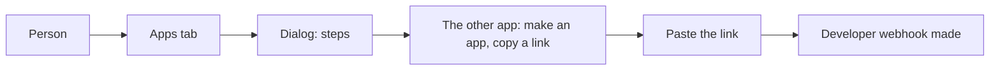
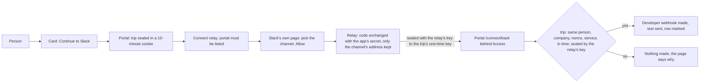
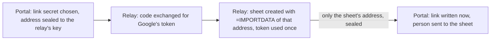

# The Apps page and one-click connect

> **In plain words.** On 22 November the owner asked for a complete makeover of the Apps page, then
> for one-click connect "like modern systems": press the button, the app's own page asks to allow
> it, and the portal takes care of the rest, with no keys to copy. He picked the full catalogue,
> then Slack, Discord and Google Sheets for one-click in this push, then a smart **Any other app**
> card that works out the app by itself. The page now shows what is connected first, with its
> health and Send test, Pause and Delete beside it, then every app as one card in a grid, filtered
> by a sideways row. Slack and Discord connect in one press and send a test at once; Google Sheets
> creates the sheet in the person's own Drive. No portal holds any app's secret: the Vendor runs
> one small **connect relay** for every portal, which stores nothing.

## What changed

| Before | Now |
|---|---|
| Four tabs (Chat alerts, Calendar, Spreadsheets, Make, Zapier, n8n), each with its own list below | **One catalogue**: Connected on top (every alert, calendar and spreadsheet link, with its logo, health and actions), then the cards in one grid with a sideways row of filters (All, Chat, Calendar, Spreadsheets, Automation, Data once data services are listed). The old `?show=` addresses still open their filter |
| A card a person could not use was hidden behind one notice | Every card stays, greyed with **Ask an Owner** or **Switched off** |
| A card showed no state | Each card says on its right: Connect, Add, Create, or how it is doing (Working, Waiting, Trying again, Failing, Paused, Not checked lately) |
| Every chat alert: make an app in Slack or Discord, copy a link, paste it | **Continue to Slack** and **Continue to Discord**: the person picks the channel on the app's own page, and the portal makes the alert and sends a test. The pasted link stays, under "Or paste a webhook link instead" |
| A spreadsheet: copy a formula, open a new sheet, paste it in A1 | **Create the sheet in Google**: the person picks their Google account, and a new sheet with the list in it opens. The formula stays as the other way |
| A card for each named app only | **Any other app**: paste any webhook link; Slack, Teams, Discord, Google Chat, Zapier, Make, n8n and Pipedream are recognised from the address, anything else gets the signed standard webhook; a retired Teams connector, a Slack Workflow link and n8n's test address are refused with what to paste instead |
| One calendar link a person; a new one ended the old | A link **for each calendar app** (Google Calendar, Apple Calendar, Outlook, another app): adding Outlook no longer ends Google's |
| A chat alert's window: steps, link, events as chips | Open <app> button, the steps, the link with how it starts, the events as a readable list of tickboxes, an optional name, "Connect and send a test" |
| "Working" whenever something had been sent | "Trying again" when the app did not take the last one (no answer or not a 2xx) |
| A long trademark paragraph | One line: the names and logos belong to their owners and only show which app a card connects to |

New parts:

- `packages/relay`: the connect relay, one Worker in the Vendor's account with eight secrets
  (`RELAY_PORTALS`, its own `RELAY_SEAL_KEY` and each app's id and secret, rows in the token
  registry), no binding, no storage, request addresses not logged. Providers are data in
  `src/providers.ts`.
- `packages/core-crypto`: `oneTimeKey`, `sealTo`, `openSealed`, a seal for one trip that names
  its sender.
- `modules/connect`: `oneclick.ts` (start and finish, two routes), `detect.ts` (Any other app), the
  setting `connect.relay` (the Vendor's, under System; empty means no one-click), the page
  `/connect/back`.
- The client template wires `kek` and `relay` into the connect module. No new binding, variable,
  table or migration in a portal.

## How it worked before

The person did the work in the other app: made an app or a webhook there, copied its address and
pasted it in the portal.

## How it works now

The person presses one button and answers one question on the app's own page. The relay exchanges
the code with the app's secret, keeps only what the portal needs and seals it with its own key so
that only the portal that started the trip, in the same browser, opens it, and only an answer the
relay itself sealed. The connect module's README, "One-click
sign-in", lists each check and why it is there.

## Impact on each part

| Part | Impact |
|---|---|
| A client's portal | The Apps page changes for everyone; one-click appears only once the Vendor sets `connect.relay`. Uses the existing `KEK`. `/connect` makes 8 database queries, up from 2, since it now reads the alerts and the links together (its pin in the screens test was raised for that reason; 9 in the first push, which also read the provider list) |
| The Vendor | Runs one more Worker (the relay) and makes three apps once (Slack, Discord, Google), steps in `packages/relay/README.md` |
| Developer module | Unchanged: alerts are still its webhooks, made through its API as the person, and it checks each chat's address again |
| Oltrem Mail | Unchanged |

## What was decided

- Teams, Google Chat, Excel, Zapier and Make stay on the pasted link: Teams and Google Chat
  need Microsoft's and Google's app checks and a refresh token kept for each alert; Zapier and Make
  offer one-click only to apps in their stores (the owner's pick, "Smart Custom card now, Teams
  later").
- Data services (Supabase, Neon, Upstash and others) are the database thread's: they show in this
  catalogue under Data, only where the data part is mounted (it answers `/api/data/services`),
  with "Any other database" beside them, and open that thread's pages; the relay is the one place for their sign-in
  entries too.
- Google's `drive.file` with online access: Google's lowest level, no verification, no refresh
  token; the token is used once, inside the relay, and never reaches a portal (second push).

## What the reviews changed

The kit's seven reviewers (security, flows, phone look, accessibility, words, types, tests) read
the change before the push. What they caught and what was done:

- **Security.** The relay now seals with its own key (`RELAY_SEAL_KEY`) and the portal opens only
  what that key sealed: a trip's state travels in addresses others can see, and anyone who read
  it could otherwise have answered it with a channel of their own. The relay's logs no longer keep
  request addresses, and one-click start and finish have audit actions of their own instead of
  `make`. A Google token reached the portal, and with it the files the Vendor's one Google app
  had made in that person's Drive from any portal: the owner picked "the relay makes the sheet",
  done in the second push below. Accepted: a chat trip can be finished twice within its ten
  minutes by the same person, which gains them nothing (a sheet's second finish is refused, its
  link's secret being already taken).
- **Flows.** A failed test is a notice that stays, not a toast that fades; a link pasted on Any
  other app lands on the filter that lists it; an app's own page pasted instead of its webhook
  link is refused with where the right link is; deleting something already gone counts as done; a
  failure to read the alerts is said as it is, not as a missing permission; the spreadsheet cards
  say what to make first when there is nothing to share; the calendar window says what the
  calendar holds; the relay's refusal page names no setting; Discord no longer sends the webhook's
  own name as the channel's.
- **Phone look.** The filter row sits above Connected, and Connected shows only the rows of the
  filter picked; the "Tell me when" list is folded behind one line (the usual events are ticked);
  each card's state sits on its title line; the fold has a turning arrow; the new row's wash runs
  only when the reader allows motion.
- **Accessibility.** Each row's buttons say which row they act on to a screen reader; a folded part
  the person had changed opens again after a refusal; Enter in a pasted link takes the link; the
  link is marked required only where it is.
- **Words.** Delete everywhere for the same act; buttons named as they are on the page; the
  one-step and failure notices say what to do next; "Failing" for a webhook whose messages fail;
  the relay setting reads "Sign-in service for Slack, Discord and Google".
- **Tests.** The page half of one-click (the buttons, the cookie, the way back) now has its own
  test; the relay's 405, a state dated too far ahead, an unreachable token endpoint and the PKCE
  pairing are tested; tests that changed shared state put it back even when they fail.

## The second push: the relay makes the sheet

Later the same day, the owner's pick on the review's Google finding ("Relay makes the sheet"):

- The portal no longer calls Google at all. It sends the spreadsheet link's address and title in
  the state, sealed to the relay's own key; the relay writes only an address of that portal's own
  spreadsheet links into the new sheet, and sends back only the sheet's `docs.google.com` address.
- The link is written in the portal only once that address comes back, with the secret chosen at
  the start: a trip that is cancelled, expires or fails leaves no link behind (before, a link was
  made and ended again).
- The Data filter and its cards show only where the data part is mounted and the person may read
  it, drawn from that part's `/api/data/services`, with "Any other database" opening
  `/data/connect/custom` (the database thread's ask). The page reads that list instead of the
  provider list, so `/connect` makes one query fewer.
- Reviewed by the security and tests reviewers. Their catches, done: the same way back replayed
  within the ten minutes is refused instead of failing with an error (its secret is taken); the
  Data cards have a test of their own, shown and hidden; the longest state a portal sends is
  tested against the relay's cap. Left, and named for the owner: someone who reads a person's
  trip state within its ten minutes can sign in with their own Google account and, if the person
  then opens the way back the stranger hands them, the stranger's sheet reads that person's list
  (carried over from the first push, where the stranger's token did the same). The fix is a
  confirm step on the way back naming the Google account the sheet was made in. Also left: a link
  deleted within those ten minutes comes back if the same person replays its way back by hand.

## How it was verified

- `modules/connect`: 23 tests in the Workers runtime, among them one-click start and finish, a
  trip refused for another person, nonce, service or after ten minutes, a seal for another trip,
  an address of another service or a seal not made by the relay's key, the relay's key
  unreadable, who may start, a sheet's address sealed so only the relay opens it and its link
  written only once the sheet comes back, none when the relay failed or named another address
  (second push); the Any other app guesses and refusals, an app's own page among them;
  a calendar link for each app.
- `packages/relay`: 11 tests, among them an unknown portal refused without a redirect or a
  setting's name, only GET, Slack's access token dropped, the answer sealed with the relay's key,
  the public key at `/key`, Google's PKCE verifier paired with its challenge, each failure said
  so, and (second push) the sheet made by the relay with only its address sealed back, refused
  without the portal's own link sealed to the relay, for another portal's address, a formula with
  more than the link, and when Google refuses, answers elsewhere or cannot be reached.
- `packages/core-crypto`: the one-time seal, sealed and opened, refused for another trip or key,
  and refused when another sender sealed it or posed as the relay.
- The client template's screens test: every page, the calendar and spreadsheet links, a filter
  listing only its rows, the chat and Any other app refusals, one-click's way back without its
  trip clearing the cookie, and with the relay set the whole page half of one-click; no Data
  filter or card where the data part is not mounted, and `/connect` pinned at 8 queries.
- On the local portal at phone and computer widths, light and dark: the catalogue, a dialog, Any
  other app recognising a Zapier link, a calendar link made for Google Calendar, and, with a relay
  address set, Continue to Slack sending the browser to the relay with an HttpOnly cookie on
  `/connect` and the way back saying the trip had expired.
- Not verified: a real sign-in with Slack, Discord and Google, which needs the Vendor's three apps
  and the relay deployed (P377-P379).
