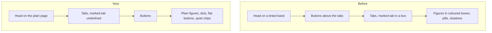

# Calm and modern

> **In plain words.** The owner said the portal's buttons, boxes and colours felt like the 90s,
> and on Modules that the buttons were "big blob type, not modern" and off the grid. On
> 22 November he picked **Calm and modern** from three looks. Now the page is plain, with no
> coloured wash behind it or tint behind the title. The filled button is flat, and the other
> buttons are a thin line. Chips are small rounded squares instead of pills. A state is a dot and
> a word. Figures are plain numbers. Cards are one level with no shadow.
> He had also found that some pages put their buttons above the tabs, so the tabs still moved:
> every page of a set now draws them under the tabs.

## What changed

| Before | Now |
|---|---|
| The page had two soft washes of the brand's colours; the head sat on a band tinted in its section's colour | One plain page colour; the head sits on it with a hairline under the tabs |
| The filled button had a light from the top, a highlight and a shadow; the bordered one a shadow; 14 px semibold | Flat colour; a hairline and no shadow; 14 px medium |
| Chips were pills (fully round), 14 px | Rounded squares with 8 px corners, 13 px; 32 px tall under a mouse, 36 under a finger |
| A state was a bordered pill tinted in its colour, with an icon | A dot in the state's colour and the word |
| Figures were boxes with a border and a colour wash, each in a different colour | Plain numbers and words in a row; a number takes a colour only when it is a state |
| The marked tab had a tinted box behind it as well as its underline | Its words and its underline |
| A section's title had a coloured bar before it; the head's icon tile had a two-tone gradient | No bar; a flat 32 px tile |
| A phone card in a table and the save bar at the foot had shadows | A hairline only |
| The set's own page (Email settings' Integrations, among others) put its buttons in the head, above the tabs | Under the tabs, the first line of the content, so the head and the tabs never move |

**The rules.** The design system's skill gains "Calm and modern": a plain page, flat controls on
the grid, one filled button per screen where a page can manage it, status as a dot and a word,
cards one level. The theme tests hold the stylesheet to them.

**Impact on each part.** The stylesheet is smaller (165 KiB of the 172 KiB cap). A client's brand
colour, radius and a background picked on the Look page still apply; only the defaults changed.
No route, table, setting or binding changes. Oltrem Mail's pages take the look from the kit.

## How it was checked

- core-ui (102): a status pill is a dot and a word with no border; figures have no border,
  background or padding; the canvas is plain, the fill flat, the band the page's colour, no bar
  before a title, no box behind the marked tab, chips with 8 px corners, no shadow on the save bar.
- screens (168): a set's own page draws its actions after the tabs, not in the head; one chip look.
- Looked at in a headless phone browser on the local portal, dark and light: Modules, Audit log,
  Email settings' Integrations, System status, Users.
- The full `pnpm verify` before the push (summary in the commit).

## Later the same night: the head on the page

The owner's next screenshot (Forms, dark, his Aurora look) showed the head still on a strip of its
own colour, and Create form, taller than the title, running past the strip's edge; the Aurora
background showed as patches. Now:

| Before | Now |
|---|---|
| The head sat on a band of the page's colour with a line under it, drawn over any picked background | No band and no line: the head sits on the page, and the tabs' own line marks the head off where there are tabs |
| The head's button was 40 px under a finger, at the top of its line | 36 px (32 under a mouse), centred on the title's line; the same for a tab's commands |
| Aurora and Sunrise drew the brand's colours at up to 20% | About half that: a faint glow |

Checked: core-ui theme tests (no band, the command centred), screens (171), and the full verify
before the push. Looked at in a headless phone browser, dark with Aurora and light.

Not verified: any of this on a phone (P337 to P340, and P359 to P360, in [their list](../../docs/phone-tests-flows.md)).
