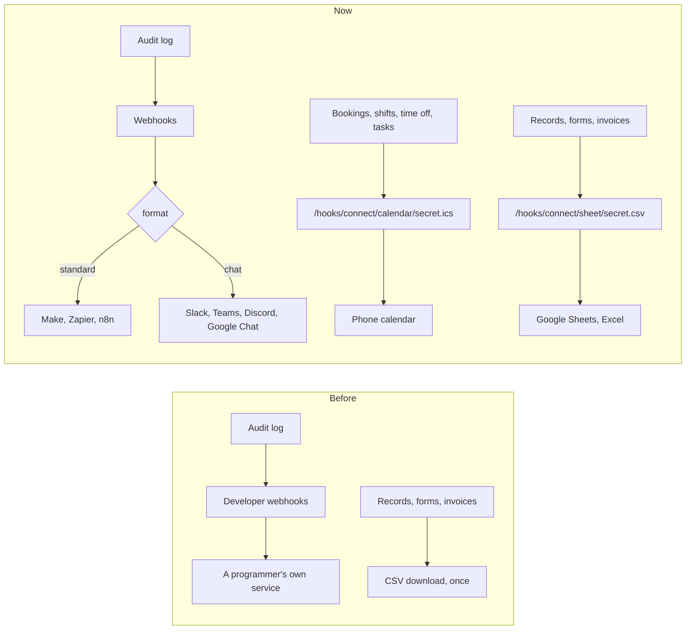

# Connect apps

> **In plain words.** On 22 November the owner said the portal still did not feel valuable enough,
> nor easy to connect to other things, and picked a Connect page first. It is built for someone
> with no technical background: one page, four tabs, a card for each service with its own logo,
> numbered steps for the other app, one field and one button. A team gets a line in its Slack,
> Teams, Discord or Google Chat channel when a form is answered or a quote accepted; each person
> gets their bookings, shifts, days off and due tasks in the calendar on their phone; a list, a
> form's answers or the invoices stay up to date in Google Sheets or Excel; and Make, Zapier or n8n
> start a flow on each event. The owner asked for "ALL or as many logos as possible": eight
> services show their own logo, Microsoft's three a plain icon (Microsoft had its logos taken out
> of the free icon set). One-click sign-in for Slack and Discord is the next batch, his pick.

## What changed

| Before | Now |
|---|---|
| Webhooks on the Developer page only, in the signed Standard Webhooks envelope a programmer reads | The same webhooks can be a chat alert: `format` `slack`, `teams`, `discord` or `google-chat` posts one plain line in that service's own body, only to that service's own address, unsigned and mentioning nobody (migration `0072`) |
| No way to see portal work in a phone's calendar | A personal calendar link (`.ics`), read by Google Calendar, Apple Calendar and Outlook with one tap from the page, holding the person's own bookings, shifts, approved time off and due tasks |
| A list, a form's answers or the invoices only as a one-time CSV download | A live spreadsheet link (`.csv`) for `=IMPORTDATA` in Google Sheets or From Web in Excel, which updates by itself; it takes a new permission, `connect.share` |
| Make, Zapier and n8n had to be set up by reading the Developer page | A card for each with the steps, and a test sent the moment it is connected |
| | One table, `connect_links` (migration `0073`), and bit plane `31` |

**How it works.** Chat alerts and automations are the Developer module's webhooks, fed by the
audit log as before; the page makes them through the Developer API as the signed-in person, so
`developer.manage` decides who may. A chat webhook keeps the envelope in its delivery log and
turns it into the service's body just before the request, so a retry reads the same. Calendar and
spreadsheet links are this module's: a secret in the address (192 random bits; only its SHA-256 is
kept), read by the other app with no sign-in at `/hooks/connect/…`, outside the door like a shared
file's link. Each read is done as the link's person with the access they hold at that moment, by
each module's own store (`calendar()` in bookings, shifts, time off and tasks; `csv()` in invoices;
`exportCsv` in records and forms), so a role taken away shows less.

**What keeps a link safe.** A spreadsheet link takes `connect.share`, which joins the Owner roles
and which an Owner can keep from other roles, as `files.share` for one file; taken away, the
person's spreadsheet links open nothing. A link made before an Owner signed its person out,
blocked them or switched them off opens nothing ever again (`signed_out_at`), and neither does a
link no app read for 90 days; such a link is deleted the next time it is tried. A person keeps 20
spreadsheet links at most and one calendar link. Making and deleting a link are audited; the link
keeps when an app last read it, to the hour.

**Impact on each part.** A new module, `@oltrem/connect`, mounted by the client template after
Developer, with its page under Work as "Connect apps" ("Integrations" is already the email
services' page). Developer: one column and the chat formats. Bookings, shifts, time off, tasks:
a `calendar()` each; invoices: `csv()`, reading only the places the person may view. core-module:
the `CalendarEntry` type. No binding, secret, variable or outside service is added; nothing runs on
a schedule. A calendar read runs about 15 to 25 queries (the link, the person's access, four
sources), inside the free plan's 50; a guessed address costs one.

## How it was checked

- connect (12 tests): the manifest with its capability on plane 31 and its personal data; what a
  person may link; a calendar link's address once, its hash only, the calendar file (escaping,
  all-day days, folding at 75 octets), a failing source reported and left out, the last read
  written hourly; a new calendar link replacing the old; refused when guessed, of the other kind,
  during a block, after an Owner's sign-out (and deleted), after being switched off and on again,
  after 90 days unread, or deleted; a spreadsheet link refused without `connect.share`, read as
  its person, closed when its list is gone, its module off or the permission taken away; 20 at
  most; the privacy search; the audit rows.
- developer (the chat alert test, in 15): chat alerts on the service's own address only, one plain line in each service's
  body, unsigned, mentioning nobody, a Markdown link kept apart.
- bookings, shifts, timeoff, tasks and invoices: each `calendar()` or `csv()` only the person's own
  or visible items, and none once their role is taken away.
- The template's screens test: every tab opens; the Owner makes a calendar and a spreadsheet link,
  reads both with no sign-in, deletes one and sees it closed, and the chat refusals.
- Four reviewers (security, data, phone look, plain words) read the batch before the check; what
  they found was fixed in it: the share permission, the sign-out and idle ends, the count inside
  the insert, the invoices filtered in SQL, the personal data, the words and the cards that did
  nothing. Left: an Owner's list of everyone's links, and an audit row for each read of a
  spreadsheet link (signing a person out ends all their links today).
- The full `pnpm verify` (summary in the commit).

Not checked: the four tabs on a phone (P325 to P331), a real Slack, Teams, Discord or Google Chat
channel, or a calendar or spreadsheet app reading a deployed portal's link.
