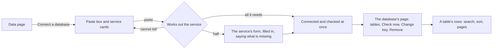

# Connected data: the Data pages

> **In plain words.** A company can now connect its own database (Supabase, Neon, Turso,
> Airtable or Upstash Redis) and read its tables in the portal, on a phone or a computer. Nothing
> in the database changes and nothing read from it is kept. Connecting starts from one box: paste
> whatever the service gave you, and the portal works out which service it is and connects at
> once. You can also start from a card for each service, with its steps. Phases 2 and 3 of the
> owner's database review ("Connected data", 22 November); the dialects that read each service
> came first, in the same day's batch 2a.

## What changed

| Before | Now |
|---|---|
| The dialects could read a database, but nothing in the portal used them | **Data** in the sidebar (Work): every connected database with its service, its address, and how its last check went and how long ago |
| No way to connect one | **Connect a database**: one box for a connection string, an address, a key, or up to 8 lines of an `.env` file; under it a card for each service with its steps (only `https://` links are drawn) |
| | A database's page: its facts, its tables, Check now, Change key, Remove (one confirm: the database itself is not touched) |
| | A table's rows: search, sort (the header on a computer, a row of chips above the rows on a phone), Next page and First page; a card for each row on a phone, with its first value as the title; saved views keep the table, its search and its sort |
| The Parts page showed nothing for this part | **Data** with its words, in the Work group |

Before this batch the flow stopped at the dialects: code that could read a database, with no
route or page to reach it. Now each step above is a page, and each call it makes goes through the
module's routes as the signed-in person.

## Who may do what

Two permissions on bit plane 32, both held at the company itself, so a grant at one place gives
neither:

- `data.read` lets a person see the connections, read their tables and rows, and press Check now.
  It sits in the **Manage** level (class `admin`), and no ready-made everyday role hands it out. The
  reason: a connection reads with its own key, so it sees every row that key can read, whatever
  place the person works at. An Owner gives it to the people who should read the company's own
  databases.
- `data.manage` lets a person connect, change a key and remove a connection. It asks for a fresh
  sign-in, like an email service's key.

## What the review team caught, and what was done

These reviewers ran: types, tests, security, access, data, free plan, the user journey, phone,
accessibility and plain words. What they caught, fixed in this batch:

- **Access.** The read routes are now held at the company too. Before this, a grant at one place
  read every connection.
- **Keys.** A key is never written back into a page. After a refusal, the other fields keep their
  values and the notice asks for the key again.
- **The paste box.** It never takes another secret for the key: a line with a name counts only if
  its name says it is a token. Of two tokens it takes the one named read-only (Vercel KV gives
  both). It also reads the forms the services use themselves: Neon's `psql '…'` line, Neon's
  settings given one by one, a Supabase dashboard address and a Supabase pooler string.
- **Plain words.**
  - A refused key now says "The service refused the key", with what may be wrong and what to press.
    The service's own words follow in a smaller line.
  - A connection, or a new key, that is saved but not answered says so. Before, it opened with no
    word.
  - The older failed check is hidden while the tables load: tables that load now say more than an
    older check.
- **Journeys.**
  - Someone without `data.manage` (the Apps page links every card here) sees a service's steps and
    "Ask an Owner", not a form that refuses on Connect.
  - Back is at the top of a table's rows.
  - First page and Clear the search stay on the page even when a page is refused.
  - Change key asks for the key when it is the service's only field (Neon, Airtable). Before, it
    offered "leave it empty to keep it", which could only fail.
- **Phone and screen readers.**
  - The sort chips come before the rows.
  - The table scrolls inside a named region you can reach with the keyboard.
  - Sort links say how the table is sorted.
  - A long value wraps instead of pushing the page wider.
- **Free plan.**
  - Check now pressed twice within 30 seconds calls the service once.
  - The connect page makes one call, not two.
  - The Data list costs 3 queries, pinned by the template's query test.
  - The Apps page costs 9 queries, up from 8: it now asks the data part for its services, and
    shows the Data chip and its cards because the part is mounted.

## Left, to come back to

- A table's page makes two calls (the connection and the rows), and a table list can reach 500
  rows. Past 500 tables, a table cannot be reached from the list: the notice says the list is cut,
  but there is no "open by name" yet.
- Reads are not audited, and there is no limit per person. Changes are audited by the providers
  registry.
- A connection made straight from a paste is named after its service, and nothing can rename it
  yet.
- A refused Change key loses the key that was typed, and the paste box loses its text when the
  browser's script is off. Both follow from never writing a key back into a page.
- The connections check on a timer, Home cards, the usage count, and sign-in through the connect
  relay for Supabase and Airtable come next.

## Phone tests

P386 to P393 in [the flows' phone tests](../../docs/phone-tests-flows.md).

## How it was checked

- **The data module's tests:** 87, all inside the Workers runtime with every service answered by a
  script.
  - `module.test.ts`: the routes through the pipeline beside IAM and providers.
  - `pages.test.ts`: every page and its failure paths.
  - `detect.test.ts`: the paste box.
- **The template's tests:**
  - The module list.
  - The routes held at the company, now including the six read routes.
  - The query count of `/data`.
- **The tool's tests:** the part catalogue, still equal to core-config's, and its groups, with Data
  in Work.
- **The full verify chain:** the summary is in the commit.

Not checked: a real database on a phone. That is P386 to P393, the owner's.
