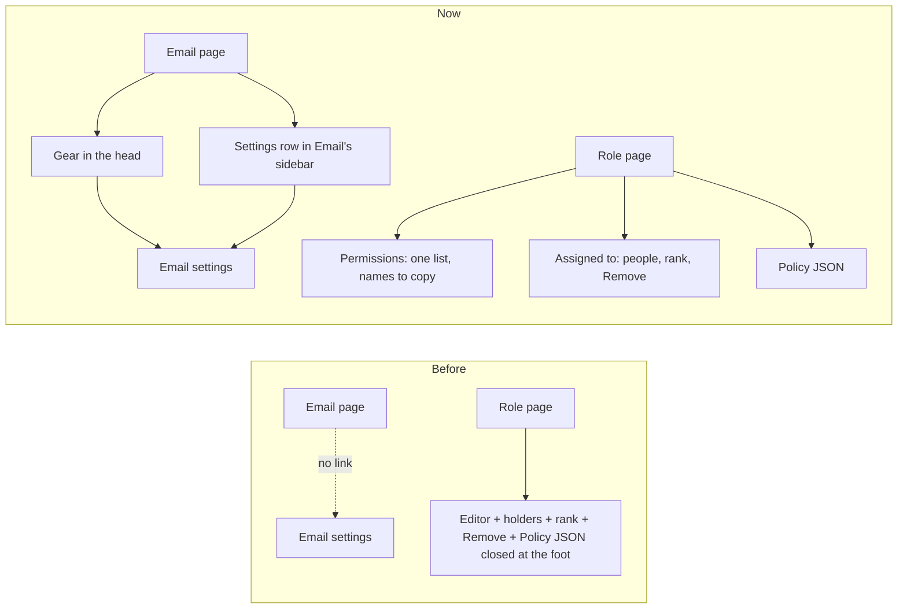

# Email settings in reach, Compose like Gmail, and the role editor remade

> **In plain words.** Four things the owner pointed at on 22 November, on the live portal. Email's
> Settings tab had no way in, because Email draws its own sidebar instead of a row of tabs: it now
> has a gear at the top right of every Email page and a Settings row at the foot of Email's
> sidebar. Compose was busy; it now reads like Gmail's: one Send button with Schedule send beside
> it, a few icons, and one More menu. The Inherit, Allow and Deny control on a user's permissions
> was cut off and faded; it is now one even control that fits a phone. And the permission names
> the owner asked for (`access.groups.manage`, `email.domains.manage`, `settings.features.manage`,
> like AWS) were only inside Policy JSON: every permission row now shows its name with a Copy
> button, and Policy JSON is a tab of its own on a role and on a user. A role's page was remade
> around three tabs, so the editor no longer shares a page with everything else.

## What changed

| Before | Now |
|---|---|
| Email hides the row of tabs (it has its own sidebar), and no folder linked to its Settings tab, so Email settings could only be reached by typing the address | A gear at the head's right, beside the bell, on every page of a set that draws its own sidebar (on a phone, in the top bar beside Search); a Settings row, always shown, at the foot of Email's sidebar (the phone's menu reuses it) |
| Compose: a pen in a coloured head, a side panel, a row of buttons that wrapped, Schedule as its own block, formatting above the message | A plain head; the bar holds Send with a Schedule send arrow beside it, Attach, Template, Preview, the ready check (a quiet green check mark when all is well) and More (Save draft, Save as template); formatting sits under the message |
| Inherit, Allow and Deny: a chip row whose fading edge and negative margin cut Deny off and faded Inherit | One segmented control: a track, the picked option raised, Allow green, Deny red, never clipped; the words take the row's width and the control wraps under them on a phone |
| Permission names only inside Policy JSON | Each permission row, on a role and on a user's permissions, shows its `area.thing.verb` name in code type with a Copy button beside it |
| Policy JSON at the foot of the page, closed, under a link | A tab: a role reads Permissions, Assigned to, Policy JSON; a user's access reads Permissions, Policy JSON |
| A role's page was one long page: the editor, who holds it, its rank and Remove, with modules as cards of different heights in two columns | Three tabs. Permissions is one bordered list, each module a row of the same layout; a level the module lacks shows a dash in its place rather than a hole. Assigned to carries the people, the rank and Remove |

**Why the gear shows only on Email.** Every other set keeps its row of tabs, whose last tab is
Settings. The frame finds the set's Settings tab (an address under `/settings/section/`) and passes
it to the head and to the set's own sidebar; the stylesheet shows the gear only on a page that hid
its tabs, so no page gets two ways to the same tab side by side.

**Why the role page is lighter.** The role page read the people, groups and grants on every visit.
Now the Permissions tab reads only the role and the permission list; the Assigned to tab reads the
people, groups and grants and not the permission list. Each module row also tells the browser to
skip drawing it until it scrolls near (`content-visibility`), which is what made a long role slow
to scroll on a phone. This was checked on this computer, not measured on the live portal.

**Impact on each part.** Screens: the frame and the head (the gear), the role page (three tabs),
the user's access page (two tabs), the permission rows. Core UI: Email's sidebar (the Settings
row), Compose's head, the stylesheet. IAM: `GET /people/:id/access` adds each item's `name`
beside its id. Mail (oltrem-mail, packed into `vendor/mail/`): the Compose bar. No table, setting,
permission or migration changed; the role page's move actions now return to Assigned to.

**How it was checked.** The portal's screen tests open each tab and look for the names and Copy,
Remove only on Assigned to, the gear and the sidebar row, and the new Compose bar. The core UI
tests check the Settings row, the head without a pen, the one-list rule and the level gap. Each
page was looked at on this computer at 390 and 1440 pixels, light and dark, with nothing wider than
the screen. Compose was not looked at, because the local portal has no sender set up; its markup
is covered by the tests.

**What the review caught and was fixed before the push.** Five review agents read the change.
Fixed: the gear did not show on a phone, where the page's head is hidden, so the phone bar now
draws it; the level control and the Copy button were under the size a finger needs; an empty line
sat in every permission row with no tags; the role page read the other roles on its Policy JSON
tab, which needs none; Remove showed to someone who may not change roles; the Permissions tab of a
user forgot the location picked; the copied word no longer replaces the Copy icon (it turns green);
Policy JSON opens with one plain line on what it is; the tab Who holds it is now Assigned to, and a
missing level reads "Manage not available".

**Left for later.** The page-by-page audit the owner asked for comes next, starting with the access
pages and their head: on a phone a user's Permissions starts below the top fifth (the tabs, the
person's line and the two rows of chips stack up), a role nobody has shows two lines instead of an
empty state with its button, and a role's page is titled Role rather than by its name.
