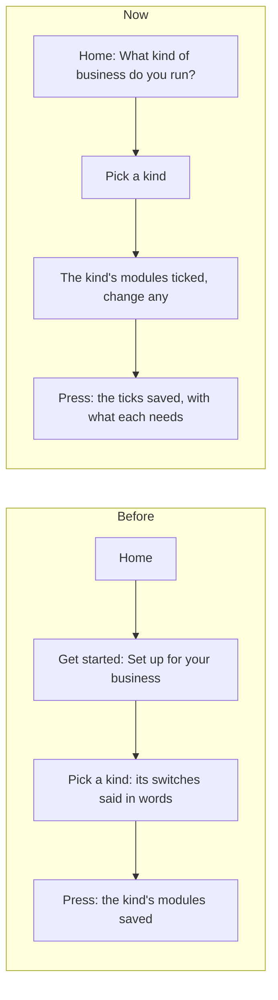

# First run and Home

> **In plain words.** This is the fourth batch of the design the owner picked on 22 November, "a
> design anyone can follow". A new portal now asks its first Owner one question at the top of
> Home: what kind of business do you run? Each kind opens Set up for your business, which asks
> "Which of these do you use?" with the features that kind uses already selected, to change before
> anything is saved. Inviting someone can copy another user's access in one tap. Every line of
> Needs you and Get started opens the exact page and tab that does it, and a test opens each one.

## What changed

| Before | Now |
|---|---|
| Set up for your business said in words which modules a kind switches on and off, and saved exactly that | "Which of these do you use?": every module that can be switched off as a chip, the kind's ones ticked (what is on now for Something else); the ticks are saved, a ticked module keeping on what it needs; Something else's button reads "Save what I use" |
| Home showed Set up for your business only as a line of Get started | While that step is open, Home starts with "What kind of business do you run?" and the kinds as chips, for whoever may switch modules |
| Inviting meant picking the role and location by hand | "Same access as": each active user whose role you may give, as chips; one picked chooses their highest such role and its location, and names any other role they hold to give after they accept |
| Switch on backups opened Backups, whose page said "switch it on above", though the switch had moved to System's Settings tab | It opens System, Settings, where the switch is; the Backups page links there |
| Invite a second person opened the Users list; Name who gets alerts opened the top of System, Settings | `/people/invite`; System, Settings, at the Alerts card |

**How the ticks are saved.** The form sends `asked` and one field per ticked module. The modules
left off are every module not ticked, unless a ticked one needs it, with the extras (ids with a
dot) and anything the page does not list kept as they are saved. A form without `asked`, as
before, saves the kind's own list. The same one save through `PUT /api/settings/parts`, so its
permission, its audit row and its refusals are unchanged.

**How Same access as works.** It reads the users list beside what the Invite page already read.
A user is offered when they are active, are not the Vendor, and hold a role the inviter may give
directly. One invitation carries one role, so the highest such role is picked and the others are
named. A role used only once switched on, or one with an end, is not copied: an invitation gives
a plain role.

**Impact on each part.** Screens: Home (`FirstRun`, one more read while the step is open),
Set up for your business, the Invite page, the Backups page's wording. Backup, users and alerts:
the Get started links. No table, setting, permission, route of the API or migration changed.

**Left for later, and why.** "Every empty list gets its sentence and button" moves to the
page-by-page audit: most lists already have their button on the head's line, so each needs a look
in place rather than one rule. Access requests already show in Needs you with a link to
Access requests (`modules/iam/src/todo.ts`, tested in `governance.test.ts`), so nothing changed
there. The question shows on Home rather than as a page before it, so nobody is ever held at a
door they cannot leave; Hide on Get started still hides the step.

**What the review caught and was fixed before the push.** Four review agents read the batch.
Fixed: a refused press of Set up for your business came back with the kind's picks instead of the
person's, and the kind saved showed its own picks rather than what is on, so pressing again would
have undone a change; nothing picked is refused; the starter list says it is made only while Lists
stays picked; Same access as only offers access the inviter may give at that location, never a
service account or the inviter, names the same role at another location, and names only roles the
inviter may give; its chips are buttons of the form, so the addresses typed stay, and a refused
form keeps the addresses, the user copied and the role and location sent; someone who may not
switch modules is told on the Backups page and in Get started that an Owner switches the nightly
backup on (and names the alert recipients); the words "tick" and "System's Settings" gave way to
"pick" and "System, Settings".

**Also left for later, from the review.** The step counts as done once the modules were ever
saved, so switching one extra on first (say, Nightly backup) closes the question; changing that
would ask portals already in use the question again, so it waits for the owner's word. A module a
picked one needs stays on with a line saying so, but not by name. Same access as reads the first
200 users. Invite a second person still opens the Invite page for someone who may not give any
role, which then says so.

## How it was checked

- screens: `start.test.ts` (the modules picked for a kind and for Something else, the picks saved
  with what a picked one needs, the extras kept, a refused press keeping the picks, the kind saved
  showing what is on, Home's question with each kind and none);
  `same-access.test.ts` (who is offered, the highest role and its location, the roles named, an
  inactive user, the Vendor, a service account, a Deny, a group's role, a switched-on-only and an
  ended role left out, the same role at two locations, and only where the inviter may give it).
- The client template's screens test: the new portal's Home with the question; every link of the
  question, Needs you and Get started opened, each a 200 and its `#` found on the page; Same access
  as offered and pressed with an address typed, the role checked and the address kept, and kept
  again after a refusal; Home's queries in the first-run state within 40; Set up for your business ticks, and a press with
  Bookings not picked switching off only Bookings, and nothing picked refused.
- backup, users and alerts: the Get started links.
- The full `pnpm verify` before the push (summary in the commit).

Not verified: any of this on a phone (P410 to P415 in [the list](../../docs/phone-tests-flows.md)).
