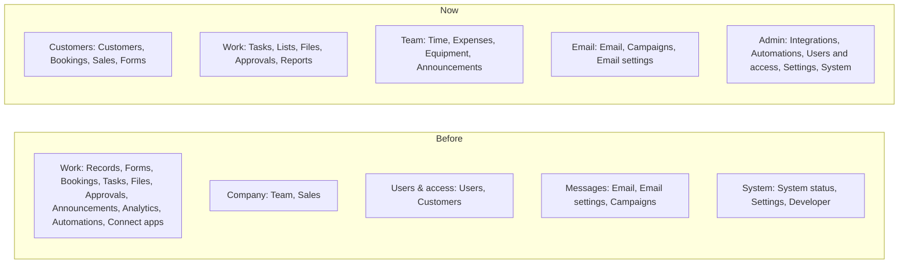

# Five groups and plain names

> **In plain words.** On 22 November the owner asked for a design anyone can follow, and picked
> five sidebar groups and a short list of new names. The sidebar now reads Customers, Work, Team,
> Email and Admin, with Admin last. Records is now Lists, Modules is Features, Bulk mail is
> Campaigns, Analytics is Reports, System status is Status, Connect apps is Apps, and the email
> keys page is Email services. Every address stays the same, so a saved link or a bookmark still
> opens the same page. Oltrem Mail uses the same groups and names.

## What changed

| Before | Now |
|---|---|
| Five groups that mixed kinds of things: Work, Company, Users & access, Messages, System | Customers (who you serve), Work (what gets done), Team (your people's time and things), Email, Admin (how the portal runs), Admin last |
| Customers and Privacy sat under Users & access, Quotes and Invoices under Company | Customers, Bookings, Sales and Forms under Customers |
| One Team set held Shifts, Time clock, Time off, Expenses and Equipment | Time (Time off, Time clock, Shifts) is one row; Expenses, Equipment and Announcements their own rows, under Team |
| Integrations (the email keys) was a tab of Email settings; Connect apps sat in Work; Developer in System | Integrations is one row in Admin with three tabs: Apps, Email services, Developer |
| Settings held Modules, Settings and the Audit log; System status, Alerts, Backups and Deployments were a set of their own | Settings holds Settings, Features and Set up for your business; System holds Status, Alerts, Backups, Deployments and the Audit log |
| Records, Modules, Bulk mail, Analytics, System status, Connect apps, Privacy, Users | Lists, Features, Campaigns, Reports, Status, Apps, Privacy requests, Users and access; email's Lists are Mailing lists |

**Why these.** Each group answers one question: who you serve, what gets done, your own people,
your mail, and how the portal itself runs. The parts only an Owner looks after sit together at
the foot, so a person who does the daily work reads the top of the sidebar only. Each name is the
word most portals use for the same thing.

**The rules.** The design system's skill gains "Names and groups". A screens test holds every
section to the five groups, Admin last, and refuses a row, tab or module name the glossary
replaced.

**Impact on each part.** The screens' sidebar list (`NAV`), each module's page entry, the names
table, the Features page's sections and the deploy's question of modules (core-config's and the
command-line tool's lists, held equal) take the new names and groups. Home's card titles follow
(Email services, Status). The settings page's section Users & access reads Users and access. No
address, permission, setting key, table or binding changed. Oltrem Mail's pages take the groups
and names in the same push.

## How it was checked

- screens (171): the new five-groups test; the sidebar order and colours; Users and access as
  one entry with its tabs; Email services a tab of Integrations in Admin.
- cli: the parts question in the sidebar's groups and order; every part's group equal to the
  screens' and the modules' own entries, Oltrem Mail's included.
- core-config, the modules' tests, the client template's screens tests, and Oltrem Mail's
  verify.
- The full `pnpm verify` before the push (summary in the commit).

Not verified: any of this on a phone (P354 to P358 in [their list](../../docs/phone-tests-flows.md)).
