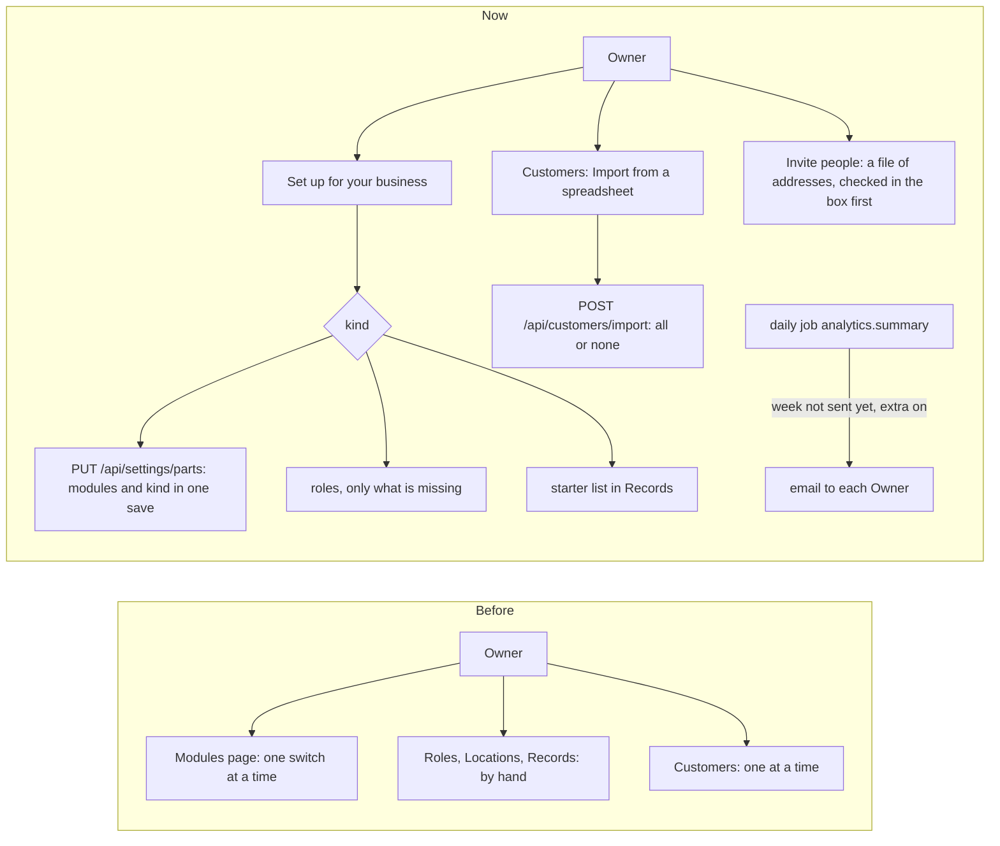

# Starting setup and imports

> **In plain words.** On 22 November the owner picked "Starting setup and imports" as the next
> batch, so that a new client gets value on the first day instead of an empty portal. An Owner now
> opens **Set up for your business**, taps what the business is (Services by appointment, Shop,
> Office, Field team or Something else) and presses one button: the modules that kind does not
> use are switched off, two ready roles are made, and a starter list (Services, Products, Projects
> or Sites) is waiting in Records. The customers they already have come in from a spreadsheet in
> one step, and the team from a file of addresses, checked before anyone is invited. Once the portal is
> in use, the **Monday summary** emails each Owner what was done last week against the week
> before; it is off until someone switches it on, as every new email is.

## What changed

| Before | Now |
|---|---|
| A new portal started with every module on; the Owner switched them one by one on the Modules page and made roles, locations and lists by hand | **Set up for your business** (`/start`), a tab beside Modules and the first step of Get started: a kind picked from a sideways row, what it will do shown in words, and one press that switches the modules, makes the roles Full admin and Standard user (Full admin ranked above) and the kind's starter list, then points to the next steps (invite the team, add the locations, bring in the customers). Pressing again makes nothing twice and deletes nothing; Something else leaves the modules as they are |
| Customers added one at a time | **Import from a spreadsheet** on Customers: a CSV file with Email and Name columns (Note if wanted, in any order), up to 1,000 rows and 128 KB; all or none, so a bad row is named and nothing is added; an address already a customer is skipped; nobody is emailed |
| Invitations typed or pasted | Invite people also takes a CSV or text file: its addresses fill the box with the ones typed, to be checked, and nobody is invited until the form is sent again |
| Analytics only on its page | The **Monday summary**: an extra of Analytics, off on every portal until switched on (migration `0074`), emails each Owner from Monday last week's named work (answers to the website forms, customers added and imported, quotes, invoices, bookings, tasks, records, time off, expenses, approvals), the changes people made and the people who used it, each against the week before; a missed Monday is made up the day after |
| | One setting, `settings.business` (the kind picked), saved only with the modules; no table, binding, secret or variable |

**How it works.** The kinds are data in core-config (`BUSINESS_KINDS`), each with the optional
modules it does not use and its starter list; `kindOff` turns a kind into the modules list through
the same rule as the Modules page, so it can never switch a core module or Records off, and the
extras already chosen are kept. The page calls the APIs as the signed-in person, in order: the
modules and the kind in one save (audited as `settings.parts` with the kind), then each role and
the list only when none of that name is there, reading the modules as just saved so a Records part
switched on by the press takes its list at once. A step that fails is named on the page and the
others stay done. Locations are not made by the press: measured, each one cost about ten database
queries (its audit row and every session checked again after it), and ten of them took one press
to 113, past the free plan's 50; one press now stays under 30, and the next steps link the
Locations page. The customers import reads the file inside the module's own route, checks
every row first and writes them in one statement, so a file is added whole or not at all; the
audit row keeps the counts, never the addresses. The Monday summary counts the successful rows
for the last full week, Monday to Sunday (UTC), the portal's own work left out of the changes, and
goes to each active Owner at the company (five at most) through the portal's notifications and
email, one message each, keyed by the week and the Owner. The week is noted as sent only when
every Owner's went, so a failed or late Monday is made up by the next day's run with no message
twice.

**Impact on each part.** core-config: the kinds, the setting, `business` on the parts routes, the
Get started step and migration `0074`. screens: the new page in the Settings set and the sidebar's
search, and the file on Invite people. customers: one route, one dialog. analytics: the `send`
option, the job, the extra and one `oltrem_meta` key, the week last sent. The client template: the `analytics.message` email template and
`send`. The command-line tool: the extra in its copy of the catalogue. A portal that already
saved its modules has the new Get started step ticked already, so nobody is invited to switch off
modules in use; nothing changes until someone presses the button.

## How it was checked

- core-config: the kinds against the catalogue (each kind's modules switchable, Records never
  off, Something else changing nothing), a kind saved with the modules and audited, the Get
  started step done once picked or once the modules were saved, a kind that is not one refused by
  the route, the Settings page's edit refused, and migration `0074` on a saved list (the extra
  added once, nothing else changed, a portal with no saved list given no row).
- screens: what each kind switches with the extras kept, the plan's words, the roles left to
  whoever manages them when they cannot be read; the addresses read from an invitation file (an
  apostrophe kept, `mailto:` dropped, a UTF-16 sheet read) and put back in the box.
- customers: the import with headers in any order and quoted fields, repeats and existing
  customers skipped, a bad row, a missing column, an empty file, more than 1,000 rows or more than
  128 KB adding nobody,
  refused without the permission, nobody emailed, the audit rows with counts only; the dialog.
- analytics: nothing before Monday 01:00 or on a quiet week, the last full week against the week
  before with the portal's own work left out, the Owners (through a group; not switched off,
  blocked, ended, not started, at a place only or a service account), nothing twice the same week,
  a failed send failing the job and made up the next day with the same keys.
- The template's screens test: with Records off first, the Owner picks Shop and one press, within
  30 database queries, switches the modules and makes Full admin above Standard user and the
  Products list; a second press answers the same and makes nothing twice; Something else and a
  kind that is not there; the file's addresses shown in the box before the invitation, a blank
  file and one over 128 KB refused; Get started's new step on a new portal.
- Seven reviewers (security, access, data, flow, plain words, silent failures, tests) read the
  batch before the full check. Fixed in it: one press over the 50 queries (measured at 113 with ten
  locations), Full admin ranked below Standard user, the list refused when Records was off before
  the press, the step shown to portals already in use, an invitation file sent unseen and an
  apostrophe cutting an address, the summary's missed Mondays, its Owners through a group, its
  count of the portal's own work and its cap, and the words they found. Left, named for later:
  the shared page form is read whole before a module's own size check (as the records import
  already is); a row number in an import can be off after a blank row or a cell over two lines;
  the kind and the modules are two saves; someone holding the modules permission only at a
  location sees the page and is refused on the press.
- The full `pnpm verify` (summary in the commit).

Not checked: the pages on a phone (P341 to P347), a real Monday summary email reaching an inbox,
or a client's real customer spreadsheet.
