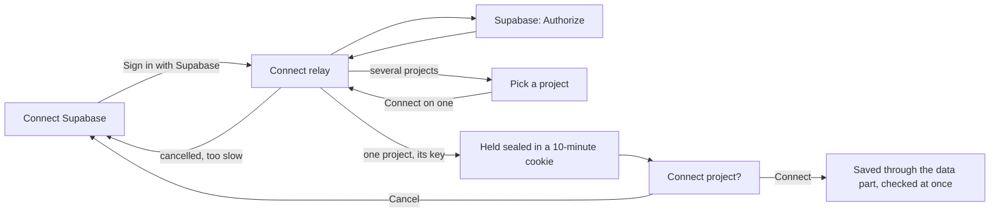

# Sign in with Supabase

> **In plain words.** A company can now connect its Supabase database without copying a key.
> On the Supabase card, press "Sign in with Supabase", allow the portal on Supabase's own page,
> pick the project if there are several, and press Connect on the page that names it. The
> Vendor's connect relay reads the project's secret key once, on its own Worker, and hands it to
> that portal only; nothing is saved until the person presses Connect. Batch 2c of the owner's
> database review ("Connected data", 22 November), after his ask to "add those OAuth system to as
> many as we possible can".

## What changed

| Before | Now |
|---|---|
| Supabase connected only by pasting its address and secret key | **Sign in with Supabase** above the steps on Connect Supabase, once the Vendor has set the connect relay |
| The relay knew Slack, Discord and Google | The relay knows Supabase too: its OAuth app (Projects Read, Secrets Read), PKCE, the client's id and secret sent as HTTP Basic |
| | Several projects: a page with one button each |
| | One project: "Connect <project>?" with its address, and nothing saved before Connect |
| The relay setting was "Sign-in service for Slack, Discord and Google" | "Sign-in service for Slack, Discord, Google and Supabase" (same key, `connect.relay`) |

Before, a person copied the project's address and secret key from Supabase's dashboard into the
form. Now the relay reads them with Supabase's token, used once and never sent on, and the portal
asks the person to confirm the project before it saves anything.

## Why a confirm step

The way back from the relay is an address in the person's browser. Someone could start a trip
with their own Supabase account and send the way back to another person: saving straight from it
would connect the first person's database into the second person's portal, where its rows could
be taken for the portal's own. So the answer is only held, sealed under the KEK for the person
who started the trip, and the page names the project and its address before Connect (the Apps
thread's security review). The held answer is opened again on Connect and checked as this
person's, this company's, under 10 minutes from the trip's start, and still theirs to connect
(`data.manage` at the company). Only the save asks for the key; the confirm page's view of the held
answer has none. Cancel lets the held project go at once.

## Who may do what

- Starting needs `data.manage` held at the company itself, the same as the data part's own
  `POST /connections`, which still decides on Connect (with its fresh sign-in).
- The relay keeps the Supabase app's id and secret as two Worker secrets,
  `SUPABASE_CLIENT_ID` and `SUPABASE_CLIENT_SECRET` (rows in the token registry, planned until the
  Vendor sets them). A portal holds no Supabase secret and never sees Supabase's token.

## Impact on each part

| Part | What changed |
|---|---|
| `@oltrem/relay` | A Supabase entry; Basic client auth; no `scope` sent when an entry lists none; after the code, it lists the projects and reads the picked or only project's secret key (`?reveal=true`), at most 20 projects listed |
| `@oltrem/connect` | `GET /oneclick` (ready), Supabase in `POST /oneclick` (with `project`), `finish` answering `confirm` or `pick`, `POST /oneclick/held`; the way back's confirm and pick pages and `POST /connect/back` |
| `@oltrem/data` | "Sign in with Supabase" and the trip messages on Connect Supabase |

## Owner steps

1. In Supabase, Organization settings, OAuth Apps: add an app with the redirect address
   `https://<relay>/back/supabase`, permissions Projects Read and Secrets Read, nothing else.
2. Set its Client ID and secret on the relay as `SUPABASE_CLIENT_ID` and
   `SUPABASE_CLIENT_SECRET` (`packages/relay/README.md`, step 5), then deploy the relay.

Until then the button shows (the relay is set) but Supabase's page refuses the unknown app; the key
form below keeps working.

## Left, to come back to

- Airtable's sign-in: its access token lasts 60 minutes and its refresh token rotates, so it needs
  the refresh token kept sealed with the connection and a refresh before each read. Its own batch.
- A Supabase key read by the relay is a full secret key, as the form already asks for; Supabase
  has no read-only secret key to give.
- The project picker lists at most 20 projects.
- A held project can be confirmed twice within its 10 minutes (a replayed Connect), which makes a
  second connection to the same project. Nothing is exposed by it; refusing a second connection
  to the same address belongs to the data part.
- The project picker and the "no secret key yet" page leave the trip's cookie to run out by
  itself; replaying that way back only shows the same page.
- The portal's app stays authorized in the person's Supabase account after the key is read (the
  relay throws the token away). They can remove it in Supabase, under their account's
  authorized apps; the key the portal holds keeps working until it is deleted in Supabase.
- The person who signed in can read the key through the held answer's save call with their own
  cookie, as they could in Supabase's dashboard; nobody else can.

## Phone tests

P394 to P398 in [Phone tests owed: Connected data](../../docs/phone-tests-data.md).

## How it was checked

- **The relay's tests** (16, five of them Supabase's): no scope sent and a PKCE challenge, the
  code exchanged with HTTP Basic; the only project's address, name and secret key, the token never
  sent back; several projects answered as a list with no key read; the project the portal sealed
  read when the account has it, refused when not; a project with no secret key answered without
  one, a refusal or no project as failed.
- **The connect module's tests** (24): one-click ready; Supabase refused without `data.manage`
  or with it only at a place; a picked project sealed to the relay's key; a list checked again;
  the key held, never in the answer, opened only for its person, untouched and in time; an address
  or key the relay should not send refused; a project with no key cannot be confirmed.
- **The data pages' tests** (31): the button only for a manager, only when ready, only for
  Supabase; each trip reason in fixed words.
- **The template's screens test**: the whole journey on the real portal: cancelled, the picker,
  the held cookie, the confirm page without the key, a stranger refused, Connect saving through
  the data part and opening the connection.
- **The full verify chain:** the summary is in the commit.

Not checked: a real Supabase account. That is P394 to P398, the owner's, after the owner steps.
