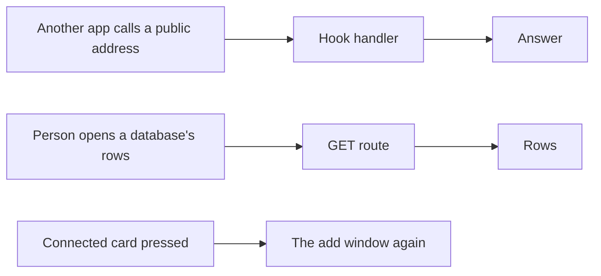
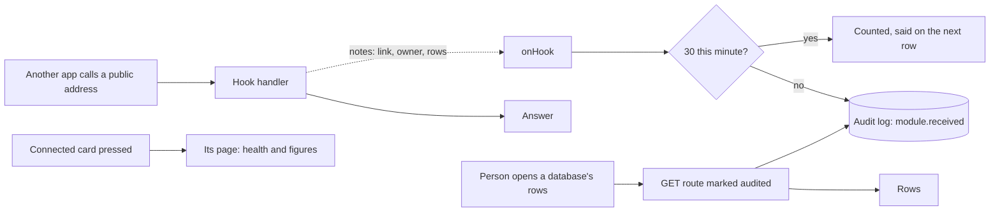

# The Apps page: logos, what is running, and a log of everything outside

> **In plain words.** The owner asked four things of the Apps page (23 November): logos that look
> broken or glare on a white square in dark mode; a service already connected (Airtable) that
> still offered "add a new one" instead of showing how the running one is doing; a log of
> everything the portal connects to, receives or collects, webhooks included, for data-loss
> prevention and compliance; and a more modern look. Now the logos sit on a dark tile in dark
> mode, a connected card shows its health and figures and opens what is running, every public
> address and every read of a connected database writes an audit row, and every card lifts under
> the pointer.

## What changed

| Part | Before | Now |
|---|---|---|
| Logo tiles | white in both themes | white in light, clear in dark; a brand colour too dark to see there is drawn in the text colour (`inkOf`, a style on the mark); on the Apps, Data and email provider tiles |
| Zapier's logo | the badge with its name, too small to read | its orange asterisk |
| A connected card | opened the "add" window again | its health, its last delivery, use or check, and a link to its webhook page, link row or database page (Connected when several); "Add another" under it |
| Connected | alerts and links | one line of how many work and how many need a look, the connected databases among the rows |
| Public hooks | no audit row | `<module>.received` for every call: the route pattern, never the address; status, time, bytes, caller; what the handler noted (`ctx.note`); 30 rows a minute per route at most, the rest counted |
| Reads of a connected database | no audit row | tables, rows and a row audited through `onChange` (`audited: true` on the GET), without what was read |
| Cards | lift on hover only for link cards | every card lifts, the ones that open a window too, but not under reduced motion; the whole card shows keyboard focus |

The stylesheet stays small: the dark tile is one changed value and the dark marks carry their own
style on the mark.

## Impact on each part

- **core-module:** `HookContext.note`, `HookCall`, and `audited` on a route (GET only, checked by the contract).
- **core-http:** `onHook` in `createApp`; an audited GET goes through `onChange`.
- **core-audit:** `createHookAudit` and `hookEntry`.
- **connect:** calendar and sheet reads note the link, its owner and the count; the page changes above.
- **data:** `GET /services` carries each service's connections (one more query); three reads audited.
- **core-ui and screens:** the tile in dark, `inkOf`, the hover on every card.
- **The client template:** passes `createHookAudit` as `onHook`.

## How it worked before

Public calls and reads of outside data left no trace in the audit log, and a connected card led
back to adding a new connection.

## How it works now

Every call to a public address is told to `onHook` after it answered or threw, and becomes a row
after the response. A flood is capped per route, so it cannot spend the day's database writes.
A read of a connected database is told like a change.

## How it was verified

- Tests: `packages/core-http/test/app.test.ts` (every hook call told, the secret never in it; an
  audited read told and a plain one not; the contract refuses `audited` on a POST),
  `packages/core-audit/test/hooks.test.ts` (the row and the cap), `modules/connect/test/connect.test.ts`
  (a sheet read notes its link, owner and rows), `packages/core-ui/test/ink.test.ts`.
- The local portal at 390 and 1280 px, light and dark: the tiles, the asterisk, a connected Zapier
  card and a connected Airtable card with Add another, the Connected line.
- `pnpm verify`, quoted in the commit.
- Not checked: the live portal; the phone tests P468 to P474 are owed.
