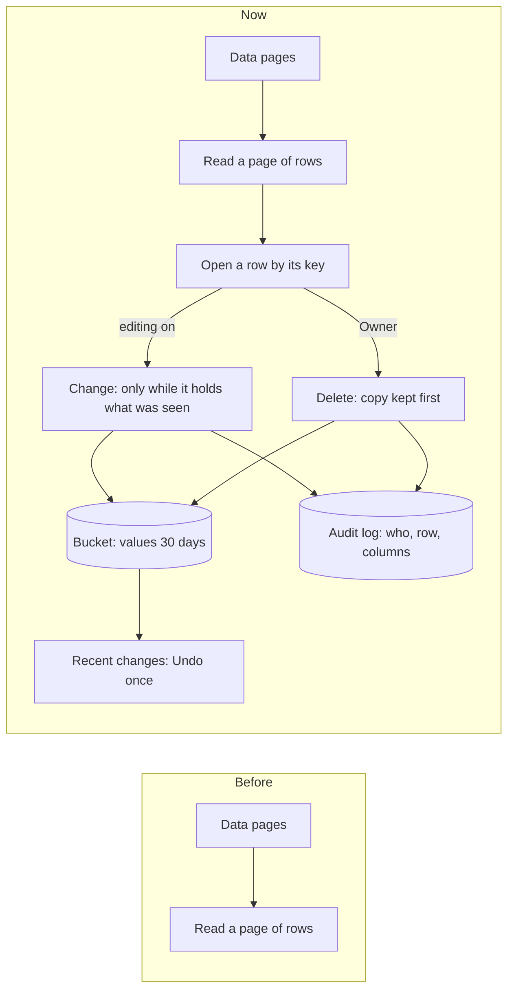

# Editing a connected database

> **In plain words.** Phase 3 of the owner's database plan, batch 7 ("Begin next part", 23
> November). A connected Supabase, Neon or Turso database can now be changed from the portal, but
> only once a manager presses **Turn on editing** for it: every database starts read only. A row
> opens on its own page; a change saves only if nobody changed the row since it was opened; only
> an Owner can delete a row. Every change is in the audit log, and for 30 days it can be undone
> from the database's page, a deleted row put back included.

## What changed

| Part | Before | Now |
|---|---|---|
| A database | Read only, always | Read only until a manager presses Turn on editing (`data.manage`, fresh sign-in); kept as the connection's `edits` option through a new key for the same host, dropped (with the kept changes) for another host; no switch for Airtable or Upstash |
| Permissions | `data.read`, `data.manage` | Also `data.edit` (change a row, undo a change) and `data.delete` (delete a row: Owner floor, fresh sign-in) |
| A table's rows | A list | With a primary key, each row's first value opens the row's own page |
| A row | Not reachable alone | Its page: every value whole; with editing on, a box for each value that can be changed, No value where it may be empty, Save changes; Delete row for an Owner |
| A change | None | Only the columns whose value differs are written, by one statement that matches the key and each column's old value and returns the new; a row changed meanwhile saves nothing (`KIT-E-4105`) |
| A delete | None | The row's values kept first, then deleted; the copy kept too when the database gave no clear answer; rows a cascade removes are not put back, and the confirm says so |
| Undo | None | Recent changes on the database's page, each opening its before and after with Undo, once, for 30 days |
| Where the values are | Nowhere: nothing read was kept | Each change's values in the portal's bucket for 30 days, then deleted (on the database's page or by the hourly check), and left out of the backup's copy of the files; the audit log names the table, the columns changed and a number key, never the values, a text key or the database's words |
| A refused write | Not tried | Said for what it is: a key that may only read (`KIT-E-4107`), a value the database will not take (`KIT-E-4108`), with the database's own words; the form keeps what was typed |

Before, the portal only ever sent reads: Neon's batches were read only, Supabase's calls were
GET, Turso's token was read only. Now a write goes out only from the three routes that change a
row, only for a database whose editing is on, and only for a person with the permission; every
read still goes as before.

## Why it is built this way

- **Off at first, per database.** The plan's card ("Let the portal change rows in connected
  databases, and how?") recommended editing per database, off at first, with a key that may
  write asked for when it is turned on. Batch 7 was built on that recommendation while the card
  waits; nothing writes until a manager turns it on.
- **Only while the row holds what was seen.** A person who opened a row a minute ago must not
  write over a change someone made since. The statement itself checks the old values, so no read
  before the write can go stale.
- **Values kept outside the audit log.** The audit log is kept for good and cannot be erased by a
  privacy request, and a client's rows are often about people. It names what changed; the values
  sit in the bucket for the 30 days Undo needs, then go.
- **An approval before a change** is optional in the owner's plan and never required (he is a
  single Vendor); it is left for later.

## Impact on each part

| Part | Impact |
|---|---|
| `@oltrem/data` | Four permissions; eight new routes; four new errors (`KIT-E-4105` to `KIT-E-4108`); the row and change pages; the editors of the three SQL dialects; the change store in the bucket; `createData` takes `bucket` in its bindings |
| `@oltrem/providers` | `registry.setOption` and `OPTIONS` (`edits`); `setCredential` keeps options for the same host only; Turso's token field is named Token, its hint saying when to add `--read-only` |
| The client template | Hands the bucket (`FILES`) and its error report to `createData` |
| `@oltrem/backup` | Its copy of the files leaves out `data/changes/` (`NOT_COPIED`), so a kept change never outlives its 30 days under the bucket lock |
| A client's database | Written only where editing is on, by a key that may write |
| Cloudflare's free plan | A row page is two calls to the service (Supabase: its description and the row); a change three or four; Supabase's description read once per request; one bucket write per change, two lists per database page (recent changes, and the clean-up after the answer); a form's boxes hold at most 32,000 characters, so reading its hidden copy back stays near 1 ms |

## How it was verified

- `test/edits.test.ts`: the whole journey through the pipeline on a Turso database played by a
  fake libSQL server that runs each statement on the test's own D1, so the SQL really runs on
  SQLite (keys from `table_xinfo`, `IS` matches, `RETURNING`, a view with no key).
- `test/editors.test.ts`: Neon's and Supabase's editors against scripted answers.
- `test/pages.test.ts`: the row page with editing on and off, the form sent as typed, the
  database's page with Turn on editing and Recent changes, a change's page with Undo; a refused
  save keeping what was typed.
- `test/module.test.ts`: the form's 32,000-character budget; `modules/backup/test/backup.test.ts`:
  a kept change is not copied.
- The data, providers, backup and template tests, then `pnpm verify`; the commit message quotes it.

## What the review team caught

Ten reviewers read the change before it was pushed; what held was fixed in it, each with a test.

- **A save that sent nothing.** The row form numbered its boxes with the locked key column
  counted, so the save, which reads boxes until one is missing, stopped at once: every save said
  "Nothing was changed". Boxes are now numbered without the locked ones.
- **A delete that could lose the row.** A delete whose answer timed out dropped the copy though
  the row might be gone; now only a clear refusal drops it. A failed clean-up of old copies no
  longer fails a delete or reads as a copy not kept, and a failed second copy no longer turns a
  done delete into an error.
- **The audit log.** A refusal's own words (`Key (email)=(…) already exists`) reached the log, kept
  for good, and so did text keys; both are left out now. The backup copied the kept changes into
  a locked copy kept 35 to 90 days; it leaves them out now.
- **A key moved to another database** kept editing on and the old database's copies; both go now.
- **A refused save lost what was typed**, and a typed value was dropped when No value stayed
  ticked; both kept now. Turso stored text in a number column; it sends a number or refuses.
- **Words.** "Allow editing" and "Turn off editing" became Turn on and Turn off editing; text that
  said only an Owner can turn editing on now says a manager can; undo, refusals and the locked
  columns say what to do next; Airtable and Upstash no longer offer a switch that can do nothing.
- **Left for later**, named here so it is not lost: checking that a key may write when editing is
  turned on (the first save says so plainly instead); listing more than the 10 newest changes;
  an undo of a delete on Supabase into a column Postgres always numbers itself (refused with the
  database's words); PostgREST's `max-affected` guard, which needs a real Supabase to try; the
  fresh sign-in refusal naming a permission's id (a kit-wide wording).

Not checked: a real Supabase, Neon or Turso database, a deployed portal, a phone (P435-P442).
