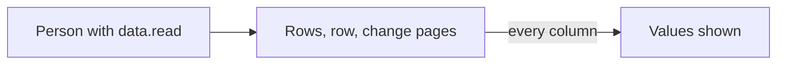
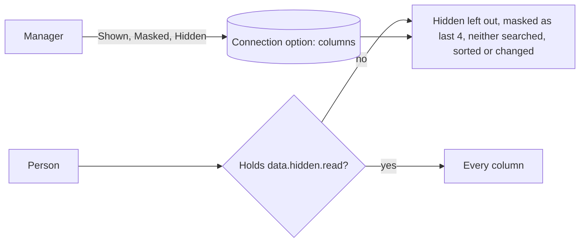

# Hidden and masked columns on a connected database

> **In plain words.** Phase 3 of the owner's database plan, batch 9, the last of phase 3. A
> manager can hide a column (such as notes) or mask it (such as a phone number, shown as
> `••••4567`) for each table of a connected database. People without the new permission
> `data.hidden.read` never see those values, and cannot search, sort or change by them.

## What changed and why

The plan of 2026-11-22: "Hide or mask columns. For example, personal data such as phone numbers,
per connection, for people without the right permission." The rules and what they do are in
[the data README](../../modules/data/docs/timed-check-and-home.md#hidden-and-masked-columns). They are kept as one
option on the connection (the providers registry's `columns`), so no table, setting or call was
added.

## Impact on each service

| Part | Impact |
|---|---|
| `@oltrem/data` | `data.hidden.read`; `POST /connections/:id/columns`; the rows, row and change routes leave out or mask; `plan` never searches or sorts a closed column; the rows page's form |
| `@oltrem/providers` | A second option, `columns`, with its own check |
| The client's databases | One read of the table when rules are saved; nothing else |

## Before and after

Before, everyone who could read a database saw every column. After, a manager decides per table,
and only people given `data.hidden.read` see those columns as they are.

## How it was verified

The data tests on a fake Turso over D1: a key column and an unknown column refused, a reader
refused the route; a reader's rows without the hidden column, the masked one masked, search and
sort leaving them out; an Owner seeing all; a row's page without either value and a change that
names a masked column refused; a change's page masked; the rules cleared. The page tests: the
count and the marked header, the manager's form, its save and its refusals. Then `pnpm verify`.
Not checked against a live database: phone tests P460-P462.

## Phone tests

| # | Steps | Expected |
|---|---|---|
| P460 | As an Owner, open a table of a connected database, open Hide or mask columns, mask one column and hide another, Save columns | Saved; the key column is not offered |
| P461 | Sign in as someone with Data read but not hidden columns, open that table | The hidden column is gone with a line saying so; the masked one shows only its last 4 characters |
| P462 | As that person, search for a value of the masked column | No row is found by it |
