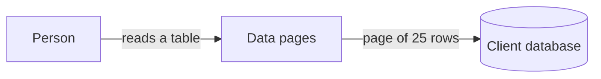
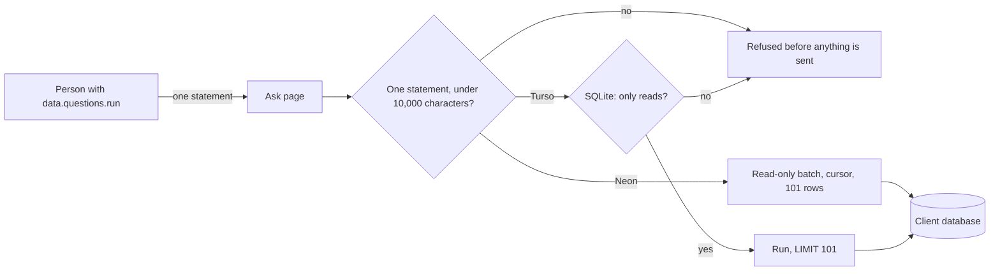

# Questions in SQL on a connected database

> **In plain words.** Phase 3 of the owner's database plan, batch 8. Someone given the new
> permission `data.questions.run` can type a question in SQL on a Neon or Turso database's Ask page and see
> up to 100 rows of the answer. The database itself refuses anything that would change it, even
> when the portal holds a key that may write.

## What changed and why

The plan of 2026-11-22 lists "Ask a question in SQL, read-only by default" with the edits. Reading
a table one page at a time cannot join or count; a question can. How each database is kept to
reading is in [the data README](../../modules/data/docs/a-supabase-project-beyond-its-tables.md#questions-in-sql).

While testing the Ask page, the kit's text box (`Textarea` in core-ui) was found to write its
value as a `value` attribute, which a browser ignores on a text box: every edit form with a text
box (a task's notes, an invoice's note, a customer's note, a row's long value) showed the box
empty, and saving it unchanged would have emptied the field. The primitive now writes the value
as the box's text, which fixes every form at once.

## Impact on each service

| Part | Impact |
|---|---|
| `@oltrem/data` | `data.questions.run`, `POST /connections/:id/ask`, the Ask page and its link; `ask` on the Neon and Turso dialects |
| `@oltrem/core-ui` | `Textarea` fills its text from `value` |
| Neon, Turso | One more read call per question (two for Turso: describe, then run); nothing written |

## Before and after

Before, the pages read one table at a time. After, a question goes to the database once it is
one statement, and the database's own read-only rules decide; the audit log notes that it was
asked and how many rows came back.

## How it was verified

The data tests: a fake Turso over D1 answers `describe` and runs the question on SQLite (the
wrapping, 150 rows cut to 100, a `PRAGMA`, an `UPDATE` and a setting `PRAGMA` refused with nothing
run, a syntax error shown, the audit row without the question's words, `ben` refused without
`data.questions.run`); the Neon request shape (read-only header, the three statements) and the refusals
before any call; the Ask page's form, answer, refusal and notices. The core-ui test pins the text
box's text. Then `pnpm verify`. Not checked against a live Neon or Turso database (no test
database here): phone tests P443-P446.

## Phone tests

| # | Steps | Expected |
|---|---|---|
| P443 | As an Owner, open a Neon or Turso database's page | Ask a question in SQL; Ask runs `SELECT * FROM <a table>` and shows its rows |
| P444 | Ask `DELETE FROM <a table>` | Refused in plain words; the table is unchanged |
| P445 | Ask a question that gives more than 100 rows | 100 rows, and a line that says there are more |
| P446 | Open a task (or an invoice) with notes and press Edit | The notes are in the box, not an empty box |
