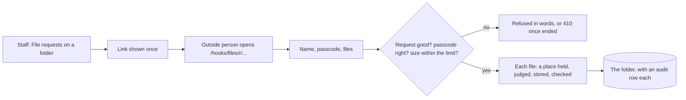

# Files: File requests, batch 6

> **In plain words.** The owner chose to build file requests with strict limits (23 November). A
> person who may share a folder can now make a link that customers or partners open to send files
> straight into that folder, without an account. The link ends on a set day or after a set number
> of files, can ask for a passcode, and every file goes through the same checks as a staff upload.

## What changed

| Part | Before | Now |
|---|---|---|
| Getting files from outside | by email, then a staff upload | a file request link on the folder |
| Limits | | 1 to 30 days; 20 files unless told, 100 at most; 10 per sending; the largest upload per sending; the location's room |
| Checks | | each file judged and checked as an upload is; one that can run is held for review |
| Who sent it | | the name they give, shown as "name (file request)", and an audit row per file |
| Core | public hooks read at most 512 KB, as text | a hook may declare `body: 'bytes'` and read its own body under its own limit |
| Data | | migration `0083`: `files_shares.request` |

Before, a public hook read at most 512 KB as text, enough for provider reports and forms but not a
file. Now the one hook that takes files reads the form itself, only after its declared length is
within the portal's largest upload; every other hook is unchanged.

## How it was checked

The core's new hook kind (`packages/core-http/test/app.test.ts`); the module through the pipeline
beside IAM on real D1 and the test bucket (a request made on a folder only and by someone who may
share there, its token never opening as a link, its page and headers, a passcode asked and a wrong
one refused, a name needed, two files received with one held and the name escaped, a disguised
program refused, the files past its count refused and the request then gone, one ended by hand);
the folder page's section and form; then `pnpm verify` (its summary in the commit). Not run from a
real phone's browser, on a deployed portal or with large files: P492-P495 in
[their own list](../../docs/phone-tests-files.md).
